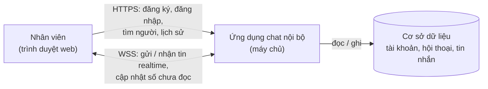

# 02 - Software Requirements Specification (SRS)

| Mục | Nội dung |
|---|---|
| Dự án | Ứng dụng chat nội bộ (MVP) – Nhóm: *[chưa xác định]* |
| Tệp | `02-srs.md` |
| Phiên bản | 1.0 – Draft |
| Ngày | 2026-11-13 |
| Người soạn | Nhóm BA / Architect (bản nháp có trợ lý AI hỗ trợ soạn thảo) |
| Trạng thái | Draft – chờ Product Owner rà soát mục 9 |
| Nguồn yêu cầu | (1) PDF "Xây dựng ứng dụng chat nội bộ (MVP)", ngày 13~14/11/2026 – **nguồn duy nhất của yêu cầu nghiệp vụ**; (2) `01-brd.md` v1.1 trên repository (trạng thái trong tài liệu: Draft) |

**Quy ước ký hiệu**

| Ký hiệu | Ý nghĩa |
|---|---|
| `[PDF]` | Do đề bài quy định. Không được tự thay đổi. |
| `[QĐ-xx]` | Quyết định của Product Owner, ghi trong BRD mục 10.1. |
| `[GĐ-xx]` | Giả định đã ghi trong BRD mục 10.2. |
| `[GS-xx]` | Giả định mới của SRS vì PDF và BRD chưa chốt. Xem mục 9.1. |
| `[ĐX]` | Đề xuất của nhóm (cách đo, cách hiển thị…), không phải yêu cầu đề bài. |
| `[OQ-xx]` | Câu hỏi mở. OQ-01…OQ-11 kế thừa từ BRD; OQ-12 trở đi phát sinh ở SRS. Xem mục 9.2. |
| `AT-01…AT-06` | 6 bước nghiệm thu MVP theo PDF §5, đánh số theo đúng thứ tự trong PDF. |

> Tài liệu này **không chứa kết quả chạy thử hay số đo nào**. Các ngưỡng thời gian lấy từ PDF và phải được kiểm chứng bằng phép đo thực tế, ghi tại `12-test-reports.md`.

---

## 1. Giới thiệu

### 1.1 Mục đích
Biến các nhu cầu nghiệp vụ trong BRD (BR-01…BR-19) thành yêu cầu phần mềm rõ ràng, kiểm chứng được và truy vết được đến mã yêu cầu của đề bài, làm căn cứ cho thiết kế (`06`–`09`), giao diện (`10`) và kiểm thử (`11`–`12`).

### 1.2 Phạm vi
- **Trong phạm vi (MVP):** đúng 15 mã bắt buộc của PDF §3 – TK-01…TK-06, CH-01, CH-02, CH-03, CH-06, NH-01…NH-04, TB-01 – cùng yêu cầu phi chức năng tối thiểu của PDF §4.
- **Ngoài phạm vi:** toàn bộ mã ở PDF §6 (dự án không đăng ký – QĐ-01); ứng dụng điện thoại; tải ảnh đại diện; lưu trữ file. Xem mục 7.

### 1.3 Thuật ngữ

| Thuật ngữ | Giải thích dễ hiểu |
|---|---|
| Tài khoản | Danh tính của một nhân viên trong ứng dụng, gồm tên đăng nhập, mật khẩu và tên hiển thị. |
| Tên đăng nhập | Tên dùng để đăng nhập, không trùng với ai trong hệ thống. |
| Tên hiển thị | Tên người khác nhìn thấy (ví dụ "Nguyễn Văn An"); được phép trùng nhau. |
| Phiên đăng nhập | Khoảng thời gian một người được coi là đã đăng nhập trên một trình duyệt. Phiên có hạn dùng và bị hủy khi đăng xuất. |
| Hội thoại 1-1 | Cuộc trò chuyện riêng giữa đúng hai tài khoản. |
| Nhóm | Hội thoại có từ 3 thành viên trở lên, có tên và một trưởng nhóm. |
| Trưởng nhóm | Người tạo nhóm hoặc người được chuyển quyền; là vai trò **trong nhóm chat**, không phải chức danh trong tổ chức. |
| Thành viên | Tài khoản đang ở trong một hội thoại. Chỉ thành viên mới đọc và gửi tin được. |
| Tin văn bản | Tin do người dùng gõ và gửi. |
| Tin hệ thống | Dòng thông báo do ứng dụng tự tạo khi có sự kiện nhóm (thêm, xóa, rời, đổi tên…), không thuộc về người gửi nào. |
| Realtime | Tin hiện ở máy người nhận ngay khi gửi, không cần tải lại trang. |
| WebSocket | Kênh kết nối luôn mở giữa trình duyệt và máy chủ để đẩy tin realtime `[PDF §2]`. |
| HTTPS / WSS | Hai loại kết nối có mã hóa, người ngoài không đọc trộm được trên đường truyền. |
| Băm mật khẩu | Biến mật khẩu thành chuỗi không đảo ngược được trước khi lưu; dùng thuật toán bcrypt hoặc argon2 `[PDF]`. |
| Số chưa đọc (badge) | Con số trên hội thoại cho biết có bao nhiêu tin mới mình chưa xem. |
| Trang lịch sử | Một lần tải 50 tin `[PDF CH-03]`. |
| Chuẩn hóa NFC | Cách quy chữ tiếng Việt có dấu về một dạng mã duy nhất, để "ồ" gõ từ hai bộ gõ khác nhau vẫn được coi là cùng một chữ. |

## 2. Mô tả tổng quan

### 2.1 Bối cảnh sản phẩm

Ứng dụng gồm phần chạy trên trình duyệt và phần máy chủ dùng chung cho API và realtime; dữ liệu lưu trong cơ sở dữ liệu `[PDF §2]`. Không có hệ thống bên ngoài nào khác trong MVP.

### 2.2 Nhóm người dùng

| Actor | Mô tả | Quyền trong MVP |
|---|---|---|
| Khách | Người chưa đăng nhập | Đăng ký, đăng nhập |
| Người dùng | Nhân viên đã đăng nhập | Đổi mật khẩu, sửa hồ sơ, tìm người, chat 1-1, tạo nhóm, xem hội thoại **mình đang là thành viên** |
| Thành viên nhóm | Người dùng đang ở trong một nhóm | Đọc và gửi tin trong nhóm đó, tự rời nhóm |
| Trưởng nhóm | Thành viên giữ quyền trưởng nhóm | Như thành viên, cộng thêm: thêm/xóa thành viên, đổi tên nhóm, chuyển quyền trưởng nhóm (QĐ-03) |
| Người triển khai | Người cài đặt hệ thống | Cấu hình hệ thống; không có giao diện quản trị |

Không có vai trò **quản trị hệ thống** vì gói mở rộng A (QT-01, QT-02) không được đăng ký (QĐ-01).

### 2.3 Môi trường vận hành `[PDF §1, §2]`
- Trình duyệt **bản mới** của Chrome, Edge, Firefox, Safari. Thế nào là "bản mới" xem GS-15.
- Giao diện co giãn theo màn hình (responsive); không có ứng dụng điện thoại.
- Demo chính thức trên môi trường **trực tuyến** có HTTPS/WSS (QĐ-02).

### 2.4 Ràng buộc thiết kế
| Ràng buộc | Nguồn |
|---|---|
| Realtime qua WebSocket | `[PDF §2]` |
| Kết nối HTTPS/WSS | `[PDF §4]` |
| Mật khẩu băm bằng bcrypt hoặc argon2, không lưu nguyên văn | `[PDF TK-02, §4]` |
| Phiên dùng token (JWT hoặc session) có thời hạn; đăng xuất hủy token | `[PDF TK-03]` |
| Tin nhắn lưu ở cơ sở dữ liệu, không chỉ trong bộ nhớ | `[PDF §4]` |
| Giao diện tiếng Việt | `[PDF §4]` |
| Công nghệ tự chọn nhưng phải giải thích trong ghi chú thiết kế; SRS không chọn công nghệ | `[PDF §7]` |

## 3. Yêu cầu chức năng – bảng tổng hợp

Đúng 15 mã bắt buộc, mỗi mã một dòng. Cột "Nội dung theo đề" ghi theo PDF §3. Các mã CH-04, CH-05 **không** có trong bảng này (xem mục 7).

| # | Mã | Tên | Nội dung theo đề `[PDF §3]` | Ưu tiên | BR nguồn |
|---|---|---|---|---|---|
| 1 | TK-01 | Đăng ký tài khoản | Đăng ký bằng tên đăng nhập + mật khẩu + tên hiển thị. Tên đăng nhập là duy nhất trong hệ thống; báo lỗi khi trùng. | Must | BR-01 |
| 2 | TK-02 | Quy tắc mật khẩu | Tối thiểu 8 ký tự, có chữ và số. Mật khẩu lưu dạng băm (bcrypt/argon2), tuyệt đối không lưu plaintext. | Must | BR-01, BR-16 |
| 3 | TK-03 | Đăng nhập / đăng xuất | Đăng nhập bằng tên đăng nhập + mật khẩu; phiên dùng token (JWT hoặc session) có thời hạn; đăng xuất hủy token. | Must | BR-02 |
| 4 | TK-04 | Đổi mật khẩu | Người dùng đã đăng nhập đổi mật khẩu bằng cách nhập mật khẩu cũ + mật khẩu mới. | Must | BR-03 |
| 5 | TK-05 | Hồ sơ cá nhân | Xem/sửa tên hiển thị. Avatar dùng ảnh mặc định hoặc chữ cái đầu (chưa cần upload ảnh). | Must | BR-04 |
| 6 | TK-06 | Tìm người dùng | Tìm tài khoản khác theo tên đăng nhập hoặc tên hiển thị để bắt đầu chat. | Must | BR-05 |
| 7 | CH-01 | Tạo hội thoại 1-1 | Chọn một người dùng → mở hội thoại. Nếu đã có hội thoại cũ thì mở lại, không tạo trùng. | Must | BR-06 |
| 8 | CH-02 | Gửi / nhận tin văn bản | Realtime qua WebSocket; hỗ trợ tiếng Việt có dấu và xuống dòng; độ dài tối đa 5.000 ký tự/tin. | Must | BR-07 |
| 9 | CH-03 | Lịch sử tin nhắn | Lưu toàn bộ lịch sử ở server; cuộn ngược để tải thêm theo trang (50 tin/lần). | Must | BR-08 |
| 10 | CH-06 | Danh sách hội thoại | Liệt kê hội thoại theo tin mới nhất; hiển thị trích tin cuối, thời gian và số tin chưa đọc. | Must | BR-09 |
| 11 | NH-01 | Tạo nhóm | Đặt tên nhóm + chọn từ 2 thành viên trở lên. Người tạo mặc định là trưởng nhóm. | Must | BR-10 |
| 12 | NH-02 | Nhắn tin nhóm | Tương tự chat 1-1; hiển thị tên + avatar người gửi cạnh mỗi tin. | Must | BR-07, BR-11 |
| 13 | NH-03 | Quản lý thành viên | Trưởng nhóm: thêm/xóa thành viên, đổi tên nhóm. Thành viên: tự rời nhóm. | Must | BR-12, BR-15 |
| 14 | NH-04 | Tin hệ thống trong nhóm | Sự kiện thêm / xóa / rời nhóm, đổi tên nhóm hiển thị thành dòng tin hệ thống trong hội thoại. | Must | BR-13 |
| 15 | TB-01 | Badge số tin chưa đọc | Hiển thị số tin chưa đọc trên từng hội thoại và tổng số trên tab/icon ứng dụng. | Must | BR-14 |

## 4. Đặc tả từng yêu cầu chức năng

Mỗi mã gồm: đầu vào/đầu ra, quy tắc, trạng thái lỗi và tiêu chí chấp nhận đo được (dạng Cho trước / Khi / Thì). Câu chữ thông báo lỗi chính xác trên giao diện sẽ chốt tại `03-frs.md`. Bảng lỗi dưới đây mô tả **điều kiện lỗi và hành vi bắt buộc**.

Quy tắc chung cho mọi chức năng cần đăng nhập:
- **QT-CHUNG-1:** Yêu cầu không có phiên hợp lệ (chưa đăng nhập, hết hạn, đã đăng xuất) bị từ chối và không trả dữ liệu nào `[PDF TK-03, §4]`.
- **QT-CHUNG-2:** Mọi thao tác đọc hoặc gửi trong một hội thoại, qua cả API và WebSocket, đều kiểm tra người yêu cầu có đang là thành viên hội thoại đó không `[PDF §4]`, `[QĐ-04]`. Xem NFR-04.

---

### 4.1 TK-01 – Đăng ký tài khoản

| Thuộc tính | Nội dung |
|---|---|
| Actor | Khách |
| Đầu vào | Tên đăng nhập; mật khẩu; tên hiển thị `[PDF]` |
| Đầu ra | Tài khoản mới được tạo. Người dùng được chuyển tới màn hình đăng nhập `[GS-03]` |

**Quy tắc**
- R1. Tên đăng nhập là duy nhất trong hệ thống `[PDF]`. Hai tên chỉ khác nhau chữ hoa/thường (ví dụ `An.Nguyen` và `an.nguyen`) được coi là trùng `[GS-01]`.
- R2. Định dạng tên đăng nhập: 3–30 ký tự, chỉ gồm chữ cái không dấu a–z, chữ số 0–9, dấu chấm `.` và gạch dưới `_` `[GS-01]`.
- R3. Mật khẩu phải thỏa TK-02.
- R4. Tên hiển thị: 1–50 ký tự sau khi bỏ khoảng trắng đầu/cuối; cho phép tiếng Việt có dấu; được phép trùng với người khác `[GS-02]`.

**Trạng thái lỗi**

| Mã lỗi | Điều kiện | Hành vi bắt buộc |
|---|---|---|
| E-TK01-1 | Tên đăng nhập đã tồn tại (theo R1) | Báo lỗi trùng `[PDF]`; không tạo tài khoản |
| E-TK01-2 | Tên đăng nhập sai định dạng (R2) | Báo lỗi định dạng; không tạo tài khoản |
| E-TK01-3 | Mật khẩu không đạt TK-02 | Báo lỗi theo TK-02; không tạo tài khoản |
| E-TK01-4 | Tên hiển thị trống hoặc quá dài (R4) | Báo lỗi; không tạo tài khoản |
| E-TK01-5 | *Đã bỏ (2026-11-16): không còn mã đăng ký tổ chức – đăng ký tự do.* | – |

**Tiêu chí chấp nhận**
- TK-01-AC1: Cho trước tên `nhanvien01` chưa tồn tại. Khi đăng ký với mật khẩu `Matkhau123` và tên hiển thị `Nguyễn Văn An`, thì tài khoản được tạo và đăng nhập được ngay bằng thông tin đó.
- TK-01-AC2: Cho trước `nhanvien01` đã tồn tại. Khi đăng ký `NhanVien01`, thì nhận lỗi E-TK01-1 và tổng số tài khoản không đổi.
- TK-01-AC3: *Đã bỏ (2026-11-16): không còn mã đăng ký tổ chức – đăng ký tự do.*
- TK-01-AC4: Tên hiển thị `Đặng Thị Ẩn` được lưu và hiển thị lại đúng từng ký tự.

---

### 4.2 TK-02 – Quy tắc mật khẩu

| Thuộc tính | Nội dung |
|---|---|
| Áp dụng tại | Đăng ký (TK-01), đổi mật khẩu (TK-04) |
| Đầu vào | Chuỗi mật khẩu |
| Đầu ra | Hợp lệ / không hợp lệ kèm lý do. Nếu hợp lệ: giá trị băm được lưu |

**Quy tắc**
- R1. Tối thiểu **8 ký tự** `[PDF]`; tối đa 64 ký tự `[GS-04]`.
- R2. Có ít nhất **1 chữ cái** và ít nhất **1 chữ số** `[PDF]`. "Chữ cái" gồm a–z, A–Z và chữ tiếng Việt có dấu; "chữ số" là 0–9 `[GS-05]`.
- R3. Chỉ lưu giá trị băm bằng **bcrypt hoặc argon2**; tuyệt đối không lưu, ghi log hay trả về mật khẩu nguyên văn `[PDF]`.

**Trạng thái lỗi**

| Mã lỗi | Điều kiện | Hành vi bắt buộc |
|---|---|---|
| E-TK02-1 | Ít hơn 8 ký tự | Báo lỗi độ dài |
| E-TK02-2 | Thiếu chữ cái hoặc thiếu chữ số | Báo lỗi thành phần |
| E-TK02-3 | Dài hơn 64 ký tự | Báo lỗi độ dài |

**Tiêu chí chấp nhận**
- TK-02-AC1: `abc12345` (8 ký tự, có chữ và số) được chấp nhận.
- TK-02-AC2: `abcdefgh` (không có số), `12345678` (không có chữ) và `abc1234` (7 ký tự) đều bị từ chối.
- TK-02-AC3: Kiểm tra trực tiếp cơ sở dữ liệu sau khi đăng ký với `Matkhau123`: giá trị lưu khác chuỗi `Matkhau123` và có định dạng của bcrypt hoặc argon2.
- TK-02-AC4: Tìm chuỗi `Matkhau123` trong log máy chủ sau khi đăng ký và đăng nhập: không thấy.

---

### 4.3 TK-03 – Đăng nhập / đăng xuất

| Thuộc tính | Nội dung |
|---|---|
| Actor | Khách (đăng nhập), Người dùng (đăng xuất) |
| Đầu vào | Đăng nhập: tên đăng nhập + mật khẩu `[PDF]`. Đăng xuất: phiên hiện tại |
| Đầu ra | Đăng nhập thành công: phiên có thời hạn và chuyển tới danh sách hội thoại. Đăng xuất: phiên bị hủy và chuyển về màn hình đăng nhập |

**Quy tắc**
- R1. Tên đăng nhập so khớp không phân biệt hoa thường `[GS-01]`.
- R2. Phiên có thời hạn `[PDF]`; mặc định **8 giờ** kể từ lúc đăng nhập `[GS-06]`. Hết hạn thì phải đăng nhập lại.
- R3. Đăng xuất hủy phiên **ở phía máy chủ** `[PDF "đăng xuất hủy token"]`: phiên đã hủy không dùng lại được, kể cả khi còn trong thời hạn.
- R4. Khi phiên bị hủy hoặc hết hạn, kết nối realtime gắn với phiên đó bị đóng `[GS-07]`.
- R5. Đăng nhập sai chỉ báo chung "sai tên đăng nhập hoặc mật khẩu", không cho biết sai phần nào `[ĐX]` (tránh lộ tên đăng nhập có tồn tại hay không).

**Trạng thái lỗi**

| Mã lỗi | Điều kiện | Hành vi bắt buộc |
|---|---|---|
| E-TK03-1 | Sai tên đăng nhập hoặc mật khẩu | Báo lỗi chung (R5); không tạo phiên |
| E-TK03-2 | Dùng phiên đã hết hạn hoặc đã đăng xuất | Từ chối yêu cầu; giao diện đưa về màn hình đăng nhập |

**Tiêu chí chấp nhận**
- TK-03-AC1: Đăng nhập đúng thì vào được danh sách hội thoại. Đăng nhập sai mật khẩu và đăng nhập bằng tên không tồn tại cho **cùng một** thông báo lỗi.
- TK-03-AC2: Sau khi đăng xuất, gửi lại một yêu cầu bằng phiên cũ (sao chép từ trước khi đăng xuất) thì bị từ chối (E-TK03-2), cả qua API lẫn kết nối realtime.
- TK-03-AC3: Một phiên quá thời hạn (cấu hình thời hạn ngắn trong môi trường kiểm thử) bị từ chối ở yêu cầu kế tiếp.
- TK-03-AC4: Đăng xuất rồi đăng nhập lại thì toàn bộ lịch sử hội thoại vẫn còn (gắn AT-05).

---

### 4.4 TK-04 – Đổi mật khẩu

| Thuộc tính | Nội dung |
|---|---|
| Actor | Người dùng đã đăng nhập |
| Đầu vào | Mật khẩu cũ, mật khẩu mới `[PDF]`, nhập lại mật khẩu mới `[ĐX]` |
| Đầu ra | Mật khẩu được thay; thông báo thành công |

**Quy tắc**
- R1. Mật khẩu cũ phải đúng `[PDF]`.
- R2. Mật khẩu mới thỏa TK-02 và khác mật khẩu cũ `[GS-08]`.
- R3. Mật khẩu mới và ô nhập lại phải giống nhau `[ĐX]`.
- R4. Sau khi đổi, phiên hiện tại vẫn dùng tiếp; **các phiên khác của cùng tài khoản bị hủy** `[GS-09]`.

**Trạng thái lỗi**

| Mã lỗi | Điều kiện | Hành vi bắt buộc |
|---|---|---|
| E-TK04-1 | Mật khẩu cũ sai | Báo lỗi; không đổi |
| E-TK04-2 | Mật khẩu mới không đạt TK-02 | Báo lỗi theo TK-02; không đổi |
| E-TK04-3 | Mật khẩu mới trùng mật khẩu cũ | Báo lỗi; không đổi |
| E-TK04-4 | Nhập lại không khớp | Báo lỗi; không đổi |

**Tiêu chí chấp nhận**
- TK-04-AC1: Đổi từ `Matkhau123` sang `Matkhau456` thành công. Sau đó đăng nhập bằng `Matkhau123` thất bại, bằng `Matkhau456` thành công.
- TK-04-AC2: Nhập mật khẩu cũ sai thì nhận E-TK04-1 và mật khẩu cũ vẫn đăng nhập được.
- TK-04-AC3: Tài khoản đang đăng nhập trên trình duyệt B. Sau khi đổi mật khẩu ở trình duyệt A, yêu cầu kế tiếp từ trình duyệt B bị từ chối (theo GS-09).

---

### 4.5 TK-05 – Hồ sơ cá nhân

| Thuộc tính | Nội dung |
|---|---|
| Actor | Người dùng đã đăng nhập |
| Đầu vào | Tên hiển thị mới |
| Đầu ra | Hồ sơ gồm tên đăng nhập (chỉ xem), tên hiển thị, avatar |

**Quy tắc**
- R1. Chỉ sửa được tên hiển thị `[PDF]`; tên đăng nhập không đổi được `[GS-10]`.
- R2. Tên hiển thị tuân theo TK-01 R4.
- R3. Avatar là **chữ cái đầu** của tên hiển thị trên nền màu mặc định `[PDF "ảnh mặc định hoặc chữ cái đầu"]`. Chữ cái đầu lấy từ **từ cuối** của tên hiển thị, viết hoa và giữ dấu (ví dụ "Nguyễn Văn Ẩn" → "Ẩn" → **Ẩ**) `[GS-11]`. Không có chức năng tải ảnh lên `[PDF]`.
- R4. Sau khi sửa, tên mới hiển thị ở mọi nơi, kể cả cạnh các tin cũ của người đó `[GS-12]`.

**Trạng thái lỗi**

| Mã lỗi | Điều kiện | Hành vi bắt buộc |
|---|---|---|
| E-TK05-1 | Tên hiển thị trống hoặc quá 50 ký tự | Báo lỗi; giữ tên cũ |

**Tiêu chí chấp nhận**
- TK-05-AC1: Đổi tên hiển thị thành `Trần Thị Bình` thì hồ sơ, danh sách hội thoại của người khác và cạnh tin nhóm đều hiện tên mới sau khi tải lại.
- TK-05-AC2: Không có nút hoặc trường tải ảnh lên. Avatar hiện chữ cái theo R3.
- TK-05-AC3: Nhập tên hiển thị chỉ gồm khoảng trắng thì nhận E-TK05-1.

---

### 4.6 TK-06 – Tìm người dùng

| Thuộc tính | Nội dung |
|---|---|
| Actor | Người dùng đã đăng nhập |
| Đầu vào | Từ khóa |
| Đầu ra | Danh sách tài khoản khớp (tên hiển thị, tên đăng nhập, avatar); chọn một kết quả để mở chat 1-1 (CH-01) |

**Quy tắc**
- R1. Tìm theo **tên đăng nhập hoặc tên hiển thị** `[PDF]`, **không phân biệt hoa thường** `[PDF §4]`.
- R2. Khớp khi từ khóa **nằm trong** tên (không bắt buộc khớp từ đầu) `[GS-13]`.
- R3. Tìm có phân biệt dấu: "nguyen" **không** ra "Nguyễn" `[GĐ-10]`, `[OQ-08]`.
- R4. Không trả về chính người đang tìm `[PDF "tài khoản khác"]`.
- R5. Từ khóa tối thiểu 1 ký tự sau khi bỏ khoảng trắng; trả tối đa 20 kết quả `[GS-14]`.

**Trạng thái lỗi**

| Mã lỗi | Điều kiện | Hành vi bắt buộc |
|---|---|---|
| E-TK06-1 | Từ khóa trống | Không gửi tìm kiếm; nhắc nhập từ khóa |
| (không lỗi) | Không có kết quả | Hiện thông báo "không tìm thấy", không báo lỗi |

**Tiêu chí chấp nhận**
- TK-06-AC1: Có tài khoản `an.nguyen` / "Nguyễn Văn An". Tìm `AN`, `an.ng` hoặc `Văn An` đều ra tài khoản này.
- TK-06-AC2: Người dùng `an.nguyen` tìm `an.nguyen` thì không thấy chính mình.
- TK-06-AC3: Tìm `Đặng` ra "Đặng Thị Ẩn"; tìm `đặng` cũng ra (không phân biệt hoa thường với chữ có dấu).

---

### 4.7 CH-01 – Tạo hội thoại 1-1

| Thuộc tính | Nội dung |
|---|---|
| Actor | Người dùng đã đăng nhập |
| Đầu vào | Tài khoản người kia (chọn từ kết quả TK-06) |
| Đầu ra | Màn hình hội thoại 1-1 giữa hai người |

**Quy tắc**
- R1. Mỗi cặp hai tài khoản có **tối đa một** hội thoại 1-1. Đã có thì mở lại, không tạo mới `[PDF]`. Không phụ thuộc ai mở trước.
- R2. Không tạo hội thoại 1-1 với chính mình `[GĐ-14]`.
- R3. Hội thoại chỉ xuất hiện trong danh sách hội thoại (CH-06) của người kia khi đã có ít nhất một tin `[GS-16]`.
- R4. Hai người cùng mở hội thoại với nhau gần như đồng thời vẫn chỉ tạo ra một hội thoại `[GS-17]`.

**Trạng thái lỗi**

| Mã lỗi | Điều kiện | Hành vi bắt buộc |
|---|---|---|
| E-CH01-1 | Chọn chính mình | Từ chối |
| E-CH01-2 | Tài khoản người kia không tồn tại | Từ chối |

**Tiêu chí chấp nhận**
- CH-01-AC1: A mở chat với B hai lần liên tiếp thì cả hai lần vào **cùng** một hội thoại (cùng mã hội thoại, cùng lịch sử).
- CH-01-AC2: Sau khi A đã chat với B, B mở chat với A thì vào đúng hội thoại cũ, thấy tin của A.
- CH-01-AC3: Kiểm tra dữ liệu: chỉ có đúng 1 hội thoại 1-1 giữa A và B.

---

### 4.8 CH-02 – Gửi / nhận tin văn bản

| Thuộc tính | Nội dung |
|---|---|
| Actor | Thành viên hội thoại |
| Đầu vào | Nội dung tin, hội thoại đích |
| Đầu ra | Tin được lưu ở máy chủ và hiện ngay ở mọi thành viên đang trực tuyến của hội thoại; kèm thời gian gửi |

**Quy tắc**
- R1. Tin được đẩy realtime qua **WebSocket** `[PDF]`.
- R2. Hỗ trợ tiếng Việt có dấu và **xuống dòng** `[PDF]`. Nội dung hiển thị đúng như khi gõ, kể cả các dòng trống ở giữa.
- R3. Tối đa **5.000 ký tự/tin** `[PDF]`. Đếm theo số ký tự người đọc nhìn thấy sau khi chuẩn hóa NFC; mỗi ký xuống dòng tính 1 ký tự `[GS-18]`.
- R4. Tin trống hoặc chỉ gồm khoảng trắng/xuống dòng không được gửi `[GS-19]`.
- R5. Tin chỉ được báo "đã gửi" sau khi đã lưu vào cơ sở dữ liệu `[PDF §4 dữ liệu]`.
- R6. Nội dung hiển thị dưới dạng chữ thuần. Ký tự đặc biệt (ví dụ `<b>`) được hiện nguyên văn, không biến thành định dạng hay mã chạy được `[ĐX]`.
- R7. Chỉ thành viên đang ở trong hội thoại mới gửi được (QT-CHUNG-2).
- R8. Thứ tự tin trong hội thoại theo thời điểm máy chủ nhận tin `[GS-20]`.

**Trạng thái lỗi**

| Mã lỗi | Điều kiện | Hành vi bắt buộc |
|---|---|---|
| E-CH02-1 | Quá 5.000 ký tự | Không gửi; báo lỗi và hiện số ký tự hiện tại |
| E-CH02-2 | Tin trống | Không gửi |
| E-CH02-3 | Không phải thành viên | Từ chối; không lưu; không phát tới ai |
| E-CH02-4 | Mất kết nối khi gửi | Tin được đánh dấu "gửi lỗi" và giữ nguyên nội dung trên màn hình để gửi lại (NFR-13, mức khuyến khích) |

**Tiêu chí chấp nhận**
- CH-02-AC1: A gửi `Chào bạn, hôm nay họp lúc 14h nhé! Ừ, được.` thì B thấy đúng từng ký tự, và thời gian từ lúc A bấm gửi đến lúc B thấy tin **< 2 giây** (đo theo NFR-05; gắn AT-02).
- CH-02-AC2: Tin gồm 3 dòng (dòng giữa trống) hiển thị đúng 3 dòng ở cả hai phía.
- CH-02-AC3: Tin đúng 5.000 ký tự gửi được và B nhận đủ 5.000 ký tự. Tin 5.001 ký tự bị từ chối (E-CH02-1).
- CH-02-AC4: Gửi `` thì hiện nguyên văn chuỗi đó, không có hộp thoại nào bật lên.

---

### 4.9 CH-03 – Lịch sử tin nhắn

| Thuộc tính | Nội dung |
|---|---|
| Actor | Thành viên hội thoại |
| Đầu vào | Hội thoại; vị trí tin cũ nhất đang hiển thị (khi cuộn ngược) |
| Đầu ra | Trang tin gồm tối đa **50 tin**, sắp từ cũ đến mới trên màn hình |

**Quy tắc**
- R1. Lưu **toàn bộ** lịch sử ở máy chủ `[PDF]`; không tự xóa trong MVP `[GS-21]`.
- R2. Khi mở hội thoại, tải **50 tin gần nhất** `[PDF]`.
- R3. Cuộn lên đầu danh sách thì tải tiếp **50 tin cũ hơn** `[PDF]`; lặp lại tới khi hết. Khi hết thì báo "đã hiển thị toàn bộ lịch sử".
- R4. Không trùng tin, không sót tin giữa các trang, kể cả khi có tin mới đến trong lúc đang cuộn `[GS-22]`.
- R5. Tin hệ thống (NH-04) nằm trong lịch sử như một tin.
- R6. Phạm vi xem của thành viên nhóm theo `[QĐ-04]` và `[GS-23]`: chỉ xem tin trong khoảng thời gian **đang là thành viên hiện tại**.

**Trạng thái lỗi**

| Mã lỗi | Điều kiện | Hành vi bắt buộc |
|---|---|---|
| E-CH03-1 | Không phải thành viên | Từ chối; không trả tin nào (NFR-04) |
| E-CH03-2 | Tải trang lỗi do mạng | Báo lỗi và cho thử lại; không làm mất các tin đã hiện |

**Tiêu chí chấp nhận**
- CH-03-AC1: Hội thoại có 120 tin. Mở hội thoại thấy đúng 50 tin mới nhất (tin 71–120). Cuộn lên lần 1 thêm tin 21–70, lần 2 thêm tin 1–20 và báo hết. Tổng 120 tin, không trùng, không thiếu.
- CH-03-AC2: Mở hội thoại 50 tin gần nhất **< 1,5 giây** (đo theo NFR-06).
- CH-03-AC3: Sau khi khởi động lại dịch vụ máy chủ, cả 120 tin vẫn còn và đúng thứ tự (NFR-07).

---

### 4.10 CH-06 – Danh sách hội thoại

| Thuộc tính | Nội dung |
|---|---|
| Actor | Người dùng đã đăng nhập |
| Đầu vào | Phiên người dùng |
| Đầu ra | Danh sách hội thoại 1-1 và nhóm mà người dùng đang là thành viên. Mỗi dòng gồm: tên (tên hiển thị người kia hoặc tên nhóm), avatar, **trích tin cuối**, **thời gian** tin cuối, **số chưa đọc** `[PDF]` |

**Quy tắc**
- R1. Sắp theo **tin mới nhất** trước `[PDF]`. Nhóm chưa có tin nào dùng thời điểm tạo nhóm để sắp `[GS-24]`.
- R2. Trích tin cuối hiển thị **một dòng**, cắt bớt kèm "…" nếu dài. Với nhóm, có tên người gửi phía trước. Tin cuối là tin hệ thống thì hiện nội dung tin hệ thống `[GS-25]`.
- R3. Thời gian: tin trong ngày hiện giờ:phút; tin ngày khác hiện ngày/tháng/năm, theo giờ của máy người dùng `[GS-26]`.
- R4. Danh sách cập nhật realtime khi có tin mới: hội thoại đó nhảy lên đầu, trích tin và số chưa đọc thay đổi mà không cần tải lại trang `[GS-27]`.
- R5. Không hiện hội thoại mà người dùng không còn là thành viên `[QĐ-04]`.

**Trạng thái lỗi**

| Mã lỗi | Điều kiện | Hành vi bắt buộc |
|---|---|---|
| E-CH06-1 | Tải danh sách lỗi | Báo lỗi và cho thử lại |
| (không lỗi) | Chưa có hội thoại nào | Hiện hướng dẫn tìm người để bắt đầu chat |

**Tiêu chí chấp nhận**
- CH-06-AC1: A có 3 hội thoại. Khi B gửi tin cho A, hội thoại với B nhảy lên đầu danh sách của A, hiện trích tin mới và thời gian mới mà A không cần tải lại.
- CH-06-AC2: Số chưa đọc trên từng dòng khớp với TB-01-AC1.
- CH-06-AC3: Sau khi C bị xóa khỏi nhóm X, nhóm X biến mất khỏi danh sách của C.

---

### 4.11 NH-01 – Tạo nhóm

| Thuộc tính | Nội dung |
|---|---|
| Actor | Người dùng đã đăng nhập |
| Đầu vào | Tên nhóm; danh sách thành viên được chọn (tìm qua TK-06) |
| Đầu ra | Nhóm mới; người tạo là **trưởng nhóm** `[PDF]`; nhóm xuất hiện trong danh sách hội thoại của mọi thành viên |

**Quy tắc**
- R1. Tên nhóm bắt buộc, 1–100 ký tự sau khi bỏ khoảng trắng đầu/cuối, cho phép tiếng Việt; được trùng tên nhóm khác `[GS-28]`.
- R2. Chọn **từ 2 thành viên trở lên**, không tính người tạo, nên nhóm có tối thiểu 3 người `[PDF]`, `[GĐ-05]`.
- R3. Danh sách chọn không chứa người tạo và không trùng lặp; mọi tài khoản phải tồn tại.
- R4. Không giới hạn số thành viên tối đa trong MVP `[GS-29]`.
- R5. Khi tạo nhóm, sinh một tin hệ thống "đã tạo nhóm" `[GS-30]`.

**Trạng thái lỗi**

| Mã lỗi | Điều kiện | Hành vi bắt buộc |
|---|---|---|
| E-NH01-1 | Tên nhóm trống hoặc quá dài | Báo lỗi; không tạo |
| E-NH01-2 | Chọn ít hơn 2 thành viên | Báo lỗi; không tạo; nút tạo bị khóa trên giao diện |
| E-NH01-3 | Có tài khoản không tồn tại | Báo lỗi; không tạo |

**Tiêu chí chấp nhận**
- NH-01-AC1: A tạo nhóm "Phòng Kế hoạch" với B và C thì nhóm có 3 thành viên, A là trưởng nhóm, nhóm xuất hiện trong danh sách của A, B và C (gắn AT-03).
- NH-01-AC2: Chỉ chọn B thì không tạo được (E-NH01-2).
- NH-01-AC3: Tên nhóm `Nhóm Đổi Mới 2026` lưu và hiển thị đúng.

---

### 4.12 NH-02 – Nhắn tin nhóm

| Thuộc tính | Nội dung |
|---|---|
| Actor | Thành viên nhóm |
| Đầu vào / Đầu ra | Như CH-02, áp dụng cho nhóm |

**Quy tắc**
- R1. Mọi quy tắc của CH-02 và CH-03 áp dụng cho nhóm `[PDF "tương tự chat 1-1"]`.
- R2. Cạnh mỗi tin hiển thị **tên hiển thị và avatar** người gửi `[PDF]`. Tin hệ thống không có avatar người gửi.
- R3. Tin được đẩy realtime tới mọi thành viên **hiện tại** đang trực tuyến. Người đã rời hoặc bị xóa không nhận `[QĐ-04]`.

**Trạng thái lỗi:** như CH-02. E-CH02-3 áp dụng cho người đã rời hoặc bị xóa khỏi nhóm.

**Tiêu chí chấp nhận**
- NH-02-AC1: Nhóm A, B, C. A gửi tin thì B và C đều thấy tin kèm tên và avatar của A trong < 2 giây (gắn AT-03).
- NH-02-AC2: C đã bị xóa khỏi nhóm, cố gửi tin vào nhóm thì bị từ chối và A, B không nhận được gì.

---

### 4.13 NH-03 – Quản lý thành viên

| Thuộc tính | Nội dung |
|---|---|
| Actor | Trưởng nhóm (thêm, xóa, đổi tên, chuyển quyền); thành viên (tự rời) |
| Đầu vào | Thêm: tài khoản cần thêm. Xóa: thành viên cần xóa. Đổi tên: tên mới. Rời: (với trưởng nhóm) thành viên nhận quyền |
| Đầu ra | Danh sách thành viên hoặc tên nhóm thay đổi; sinh tin hệ thống tương ứng (NH-04) |

**Quy tắc**
- R1. Chỉ **trưởng nhóm** được thêm, xóa thành viên và đổi tên nhóm `[PDF]`.
- R2. Thành viên thường được **tự rời nhóm** `[PDF]`.
- R3. Trưởng nhóm được rời nhóm nhưng **bắt buộc** chuyển quyền cho một thành viên khác trước, trong cùng một thao tác `[QĐ-03]`. Người nhận quyền do trưởng nhóm chọn trong số thành viên hiện tại `[GĐ-17]`.
- R4. Nhóm chỉ còn trưởng nhóm thì trưởng nhóm không rời được `[GĐ-18]`, `[OQ-11]`.
- R5. Trưởng nhóm không tự xóa chính mình bằng chức năng xóa (phải dùng R3).
- R6. Thêm: tài khoản phải tồn tại và chưa là thành viên. Thành viên mới chỉ xem tin **từ thời điểm được thêm** `[GS-23]`, `[OQ-13]`.
- R7. Người bị xóa hoặc tự rời **mất quyền xem toàn bộ lịch sử** nhóm, kể cả tin trước khi rời `[QĐ-04]`. Nhóm biến mất khỏi danh sách của họ ngay lập tức.
- R8. Được phép xóa hoặc rời khiến nhóm còn dưới 3 người. Ràng buộc 2 thành viên chỉ áp dụng lúc tạo `[GS-31]`, `[OQ-15]`.
- R9. Tên nhóm mới theo NH-01 R1.

**Trạng thái lỗi**

| Mã lỗi | Điều kiện | Hành vi bắt buộc |
|---|---|---|
| E-NH03-1 | Người không phải trưởng nhóm thêm/xóa/đổi tên | Từ chối; không thay đổi gì |
| E-NH03-2 | Thêm người đã là thành viên hoặc không tồn tại | Báo lỗi; không thay đổi |
| E-NH03-3 | Trưởng nhóm rời mà không chọn người nhận quyền | Từ chối |
| E-NH03-4 | Trưởng nhóm là người duy nhất còn lại muốn rời | Từ chối, kèm giải thích (GĐ-18) |
| E-NH03-5 | Tên nhóm mới không hợp lệ | Báo lỗi; giữ tên cũ |

**Tiêu chí chấp nhận**
- NH-03-AC1: Trưởng nhóm A thêm D thì D thấy nhóm trong danh sách, nhận được tin mới từ đó, nhưng **không** thấy tin gửi trước khi được thêm (theo GS-23).
- NH-03-AC2: A xóa D thì D không còn thấy nhóm. Mọi cách đọc tin nhóm của D (giao diện, API, realtime) đều bị từ chối, kể cả tin cũ.
- NH-03-AC3: B (thành viên thường) thử xóa C hoặc đổi tên nhóm thì bị từ chối (E-NH03-1).
- NH-03-AC4: A rời nhóm và chọn B nhận quyền thì B thành trưởng nhóm, A mất quyền xem nhóm. A rời mà không chọn ai thì bị từ chối (E-NH03-3).

---

### 4.14 NH-04 – Tin hệ thống trong nhóm

| Thuộc tính | Nội dung |
|---|---|
| Kích hoạt bởi | Các sự kiện của NH-01, NH-03 |
| Đầu ra | Một dòng tin hệ thống trong hội thoại nhóm, khác kiểu tin thường, có thời gian |

**Quy tắc**
- R1. Sinh **đúng một** tin hệ thống cho mỗi sự kiện bắt buộc: **thêm thành viên, xóa thành viên, rời nhóm, đổi tên nhóm** `[PDF]`.
- R2. Sự kiện bổ sung (không do PDF quy định): **tạo nhóm** `[GS-30]`; **chuyển quyền trưởng nhóm** `[GĐ-19]`, `[OQ-10]`.
- R3. Nội dung dùng tên hiển thị tại thời điểm sự kiện `[GS-32]`. Mẫu `[ĐX]`:
  - "A đã thêm D vào nhóm"
  - "A đã xóa D khỏi nhóm"
  - "D đã rời nhóm"
  - "A đã đổi tên nhóm thành 'Phòng Kế hoạch 2'"
  - "A đã chuyển quyền trưởng nhóm cho B"
- R4. Tin hệ thống được lưu như tin thường (có trong lịch sử, CH-03) và đẩy realtime tới thành viên hiện tại.
- R5. Người bị xóa hoặc vừa rời **không** nhận tin hệ thống về việc mình rời (do đã mất quyền xem, QĐ-04).
- R6. Tin hệ thống không được tính vào số chưa đọc `[GĐ-08]`, `[OQ-06]`.

**Tiêu chí chấp nhận**
- NH-04-AC1: Với nhóm A, B, C: A thêm D, rồi A xóa D. Lịch sử nhóm có đúng 2 tin hệ thống tương ứng, theo đúng thứ tự, mà A, B, C đều thấy realtime (gắn AT-03).
- NH-04-AC2: B rời nhóm thì A, C thấy "B đã rời nhóm". A đổi tên nhóm thì có tin đổi tên kèm tên mới.
- NH-04-AC3: Tin hệ thống phân biệt được bằng mắt với tin thường (ví dụ căn giữa, chữ nhỏ, không có avatar) `[ĐX]`.

---

### 4.15 TB-01 – Badge số tin chưa đọc

| Thuộc tính | Nội dung |
|---|---|
| Actor | Người dùng đã đăng nhập |
| Đầu ra | Số chưa đọc trên **từng hội thoại** và **tổng số** trên tab/biểu tượng ứng dụng `[PDF]` |

**Quy tắc**
- R1. Số chưa đọc của một hội thoại = số tin văn bản **do người khác gửi**, đến sau lần cuối người dùng đọc hội thoại đó. Không tính tin của chính mình và tin hệ thống `[GĐ-08]`.
- R2. "Đã đọc" xảy ra khi người dùng mở hội thoại, hoặc đang mở sẵn hội thoại mà tab trình duyệt đang được xem thì tin đến được tính là đã đọc ngay `[GĐ-08]`, `[GS-33]`.
- R3. Mở hội thoại thì số của hội thoại đó **về 0** `[PDF §5 bước 4]`. Tổng số giảm tương ứng.
- R4. Trạng thái đã đọc lưu ở máy chủ, nên đồng bộ giữa các tab và trình duyệt của cùng tài khoản `[GS-34]`.
- R5. Tổng số = tổng số chưa đọc của mọi hội thoại. Hiển thị ở tiêu đề tab trình duyệt (ví dụ "(3) Chat nội bộ") và ở biểu tượng trong giao diện; khi bằng 0 thì ẩn `[GĐ-15]`.
- R6. Số hiển thị tối đa "99+" `[ĐX]`.
- R7. Số chưa đọc được giữ qua đăng xuất/đăng nhập và qua khởi động lại dịch vụ.

**Tiêu chí chấp nhận**
- TB-01-AC1: A đang ở hội thoại khác, B gửi 3 tin cho A. Hội thoại với B hiện **3**, tổng số tăng thêm 3 (gắn AT-04).
- TB-01-AC2: A mở hội thoại với B. Số của hội thoại đó về **0** và tổng số giảm 3, không cần tải lại trang (gắn AT-04).
- TB-01-AC3: A mở cùng tài khoản trên hai tab và đọc ở tab 1. Tab 2 cũng về 0 (theo GS-34).
- TB-01-AC4: Trong nhóm A, B, C: A thêm D. Số chưa đọc của B và C **không** tăng vì tin hệ thống (theo GĐ-08).

---

## 5. Yêu cầu phi chức năng (NFR)

Cột "Nguồn" cho biết ngưỡng do PDF quy định hay do nhóm đề xuất. Mọi cách đo đánh dấu `[ĐX]` là đề xuất phương pháp, không phải kết quả.

| Mã | Nhóm | Yêu cầu | Cách đo / kiểm chứng | Nguồn |
|---|---|---|---|---|
| NFR-01 | Bảo mật | Mọi kết nối dùng **HTTPS** và **WSS**. Truy cập bằng HTTP thường được chuyển sang HTTPS hoặc bị từ chối | Mở trang và kiểm tra địa chỉ bắt đầu bằng `https://`; công cụ nhà phát triển của trình duyệt cho thấy kết nối realtime dùng `wss://` | `[PDF §4]` |
| NFR-02 | Bảo mật | Mật khẩu băm bằng **bcrypt hoặc argon2**; không lưu hay ghi log nguyên văn | TK-02-AC3, TK-02-AC4 | `[PDF TK-02, §4]` |
| NFR-03 | Bảo mật | Phiên **có thời hạn**; đăng xuất **hủy phiên** ở máy chủ; phiên hết hạn hoặc đã hủy không gọi API hay WebSocket được | TK-03-AC2, TK-03-AC3 | `[PDF TK-03, §4]` |
| NFR-04 | Bảo mật | **Kiểm soát hội thoại**: người không phải thành viên hiện tại **không đọc được** tin (lịch sử, trích tin cuối, tin realtime) và không gửi được, qua mọi đường (giao diện, API, WebSocket, đổi mã hội thoại trên địa chỉ trang). Phản hồi không tiết lộ hội thoại có tồn tại hay không `[ĐX]` | AT-06; NH-03-AC2; thử đổi mã hội thoại sang hội thoại của người khác bằng tài khoản thứ ba | `[PDF §4, §5]`, `[QĐ-04]` |
| NFR-05 | Hiệu năng | Tin đến người nhận **< 2 giây** (mạng nội bộ) | Đo từ lúc bấm gửi ở máy A đến lúc tin hiện ở máy B, bằng mốc thời gian ghi tự động hoặc quay màn hình có đồng hồ. Đo ≥ 20 lần trên môi trường demo; **mọi** lần đo phải < 2 giây `[ĐX]` | `[PDF §4]`; môi trường đo theo `[GĐ-11]` |
| NFR-06 | Hiệu năng | Mở hội thoại (50 tin gần nhất) **< 1,5 giây** | Đo từ lúc bấm vào hội thoại đến lúc 50 tin hiện đủ, trên hội thoại có ≥ 50 tin. Đo ≥ 20 lần; **mọi** lần < 1,5 giây `[ĐX]` | `[PDF §4]` |
| NFR-07 | Dữ liệu | Tin nhắn, tài khoản, nhóm, trạng thái đã đọc **không mất khi khởi động lại** dịch vụ | Ghi số tin trước, khởi động lại máy chủ, so số tin và nội dung sau; CH-03-AC3 | `[PDF §4]` |
| NFR-08 | Ngôn ngữ | **Unicode tiếng Việt**: lưu và hiển thị đúng chữ có dấu; chuẩn hóa NFC trước khi lưu và so sánh `[GS-18]` | CH-02-AC1, TK-01-AC4, TK-06-AC3 | `[PDF §4]` |
| NFR-09 | Ngôn ngữ | Tìm kiếm **không phân biệt hoa thường**, kể cả chữ có dấu | TK-06-AC1, TK-06-AC3 | `[PDF §4]` |
| NFR-10 | Ngôn ngữ | Toàn bộ **giao diện tiếng Việt** (nhãn, nút, thông báo lỗi) | Rà soát từng màn hình theo `10-ui-ux.md` | `[PDF §4]` |
| NFR-11 | Tương thích | Chạy đúng trên **Chrome, Edge, Firefox, Safari bản mới** | Chạy AT-01…AT-06 trên cả 4 trình duyệt (GS-15) | `[PDF §2]` |
| NFR-12 | Tương thích | **Responsive**: dùng được trên màn hình nhỏ và lớn, không bị tràn ngang | Kiểm tra ở 3 chiều rộng 360 px, 768 px, 1280 px `[ĐX]` | `[PDF §2]` |
| NFR-13 | Khả dụng | Mất mạng thì tự **kết nối lại**; tin gửi lỗi cho phép **gửi lại** | Ngắt mạng 10 giây rồi bật lại: ứng dụng tự kết nối, nhận tin bị lỡ; tin gửi lỗi có nút gửi lại `[ĐX]` | `[PDF §4]` – **mức khuyến khích (Should)** |

## 6. Giao diện ngoài (mức cao)

Chi tiết đường dẫn API, tên sự kiện và cấu trúc dữ liệu thuộc `08-high-level-design.md` và `09-detailed-design.md`.

### 6.1 Giao diện người dùng (chi tiết ở `10-ui-ux.md`)
| Màn hình | Phục vụ mã |
|---|---|
| Đăng ký | TK-01, TK-02 |
| Đăng nhập | TK-03 |
| Danh sách hội thoại (kèm ô tìm người, nút tạo nhóm, badge) | CH-06, TK-06, TB-01 |
| Màn hình hội thoại (1-1 / nhóm) | CH-01, CH-02, CH-03, NH-02, NH-04 |
| Tạo nhóm | NH-01 |
| Thông tin nhóm (thành viên, thêm/xóa, đổi tên, rời, chuyển quyền) | NH-03 |
| Hồ sơ cá nhân / đổi mật khẩu / đăng xuất | TK-04, TK-05, TK-03 |

### 6.2 API qua HTTPS – nhóm chức năng
Tài khoản và phiên (TK-01…TK-05); tìm người dùng (TK-06); hội thoại 1-1 (CH-01); danh sách hội thoại và số chưa đọc (CH-06, TB-01); lịch sử theo trang 50 tin (CH-03); nhóm và thành viên (NH-01, NH-03); đánh dấu đã đọc (TB-01).

### 6.3 Kênh realtime qua WSS – loại sự kiện
| Chiều | Sự kiện | Phục vụ |
|---|---|---|
| Trình duyệt → máy chủ | Gửi tin | CH-02, NH-02 |
| Máy chủ → trình duyệt | Tin mới (gồm tin hệ thống) | CH-02, NH-02, NH-04 |
| Máy chủ → trình duyệt | Cập nhật danh sách hội thoại / số chưa đọc | CH-06, TB-01 |
| Máy chủ → trình duyệt | Thay đổi thành viên / bị xóa khỏi nhóm | NH-03 |
| Máy chủ → trình duyệt | Phiên hết hiệu lực | TK-03 |

Kết nối realtime phải xác thực bằng phiên hợp lệ; mọi sự kiện đều kiểm tra quyền thành viên (NFR-04).

## 7. Tính năng mở rộng – NOT MVP

Các mã dưới đây có trong PDF §6. Dự án **không đăng ký** `[QĐ-01]`. Không được xây dựng, không được kiểm thử như yêu cầu bắt buộc, và không được tự chuyển vào mục 3.

| Gói | Mã | Tên theo PDF | Trạng thái |
|---|---|---|---|
| A | CH-04 | Trạng thái tin nhắn | NOT MVP |
| A | CH-05 | Trạng thái online | NOT MVP |
| A | NH-05 | Đã xem trong nhóm | NOT MVP |
| A | TB-03 | Thông báo trên web | NOT MVP |
| A | QT-01 | Quản trị tài khoản | NOT MVP |
| A | QT-02 | Thống kê cơ bản | NOT MVP |
| B | TN-01 … TN-07 | Emoji, Reaction, Đính kèm file, Gửi ảnh, Paste/kéo-thả ảnh, Trả lời trích dẫn, Chỉ báo đang gõ | NOT MVP |
| C | TK-07…11 | Email & quên mật khẩu | NOT MVP |
| C | TN-10, TN-11, TN-12, TN-13/14 | Sửa tin, Thu hồi tin, Trưởng nhóm gỡ tin, Đồng bộ & kiểm toán | NOT MVP |

**Lưu ý phân định:**
- Hiển thị "gửi lỗi / gửi lại" ở E-CH02-4 thuộc NFR-13 (khuyến khích trong PDF §4). Nó **không** phải CH-04, và không có các trạng thái "đã nhận / đã xem".
- MVP không hiển thị trạng thái online hay thời điểm hoạt động gần nhất (CH-05).

## 8. Ma trận truy vết BR → SRS → nghiệm thu

| AT | Bước nghiệm thu theo PDF §5 |
|---|---|
| AT-01 | Hai người dùng đăng ký mới trên hai trình duyệt (hoặc hai tab ẩn danh) và đăng nhập được |
| AT-02 | Hai người chat 1-1: tin đến realtime dưới 2 giây, hỗ trợ tiếng Việt có dấu |
| AT-03 | Tạo nhóm 3 người, nhắn tin nhóm; thêm và xóa một thành viên → xuất hiện tin hệ thống tương ứng |
| AT-04 | Danh sách hội thoại hiển thị đúng số tin chưa đọc; sau khi đọc thì badge về 0 |
| AT-05 | Đăng xuất rồi đăng nhập lại: toàn bộ lịch sử tin nhắn còn nguyên |
| AT-06 | Tài khoản thứ ba (ngoài hội thoại 1-1) không đọc được nội dung của hội thoại đó |

| BR (BRD) | Mã SRS | NFR liên quan | AT |
|---|---|---|---|
| BR-01 | TK-01, TK-02 | NFR-02, NFR-08 | AT-01 |
| BR-02 | TK-03 | NFR-03 | AT-01, AT-05 |
| BR-03 | TK-04 | NFR-02, NFR-03 | – (kiểm thử riêng) |
| BR-04 | TK-05 | NFR-08 | – (kiểm thử riêng) |
| BR-05 | TK-06 | NFR-09 | AT-02 (bước tìm người để mở chat) |
| BR-06 | CH-01 | – | AT-02 |
| BR-07 | CH-02, NH-02 | NFR-05, NFR-08 | AT-02, AT-03 |
| BR-08 | CH-03 | NFR-06, NFR-07 | AT-05 |
| BR-09 | CH-06 | – | AT-04 |
| BR-10 | NH-01 | – | AT-03 |
| BR-11 | NH-02 | – | AT-03 |
| BR-12 | NH-03 | NFR-04 | AT-03 |
| BR-13 | NH-04 | – | AT-03 |
| BR-14 | TB-01, CH-06 | – | AT-04 |
| BR-15 | QT-CHUNG-2, CH-03, NH-03 | NFR-04 | AT-06 |
| BR-16 | TK-02 | NFR-01, NFR-02 | AT-01 |
| BR-17 | (toàn hệ thống) | NFR-08, NFR-10, NFR-11, NFR-12 | AT-01…AT-06 trên 4 trình duyệt |
| BR-18 | (toàn hệ thống) | NFR-13 (Should) | – |
| BR-19 | Mục 7 – NOT MVP | – | – |

**Kiểm tra độ phủ:** 15/15 mã MVP có trong mục 3 và mục 4. Mỗi mã truy về ít nhất một BR. 13 mã gắn với ít nhất một AT; TK-04 và TK-05 không có trong 6 bước PDF §5 nên cần test case riêng ở `11-test-cases.md`.

## 9. Giả định & câu hỏi mở

### 9.1 ASSUMPTIONS – Giả định của SRS
Giả định của BRD (GĐ-01…GĐ-19) và quyết định QĐ-01…QĐ-04 vẫn giữ hiệu lực (QĐ-05 hết hiệu lực từ 2026-11-16). Bảng dưới chỉ gồm giả định mới.

| Mã | Giả định | Áp dụng | Câu hỏi |
|---|---|---|---|
| GS-01 | Tên đăng nhập 3–30 ký tự, chỉ gồm a–z, 0–9, `.`, `_`; tính duy nhất và so khớp khi đăng nhập không phân biệt hoa thường | TK-01, TK-03 | OQ-12 |
| GS-02 | Tên hiển thị 1–50 ký tự sau khi bỏ khoảng trắng đầu/cuối; được trùng | TK-01, TK-05 | OQ-16 |
| GS-03 | Đăng ký xong chuyển tới màn hình đăng nhập, không tự đăng nhập | TK-01 | – |
| GS-04 | Mật khẩu tối đa 64 ký tự | TK-02 | OQ-16 |
| GS-05 | "Chữ" trong quy tắc mật khẩu gồm chữ Latin và chữ tiếng Việt có dấu; "số" là 0–9 | TK-02 | – |
| GS-06 | Thời hạn phiên mặc định 8 giờ, cấu hình được khi triển khai | TK-03 | OQ-07 |
| GS-07 | Phiên bị hủy hoặc hết hạn thì kết nối realtime của phiên đó bị đóng | TK-03, NFR-03 | – |
| GS-08 | Mật khẩu mới phải khác mật khẩu cũ | TK-04 | – |
| GS-09 | Đổi mật khẩu thì hủy mọi phiên khác của tài khoản, giữ phiên hiện tại | TK-04 | OQ-14 |
| GS-10 | Tên đăng nhập không đổi được sau khi tạo | TK-05 | – |
| GS-11 | Avatar chữ cái lấy từ từ cuối của tên hiển thị (thói quen gọi tên của người Việt), viết hoa, giữ dấu | TK-05 | – |
| GS-12 | Đổi tên hiển thị áp dụng cho cả tin cũ (luôn hiện tên hiện tại) | TK-05, NH-02 | – |
| GS-13 | Tìm kiếm khớp khi từ khóa nằm trong tên (không cần khớp từ đầu) | TK-06 | – |
| GS-14 | Từ khóa tối thiểu 1 ký tự; tối đa 20 kết quả | TK-06 | – |
| GS-15 | "Bản mới" = bản ổn định mới nhất của mỗi trình duyệt tại thời điểm kiểm thử | NFR-11 | – |
| GS-16 | Hội thoại 1-1 chưa có tin nào không hiện trong danh sách của người kia | CH-01, CH-06 | – |
| GS-17 | Hai người mở hội thoại với nhau cùng lúc vẫn chỉ sinh một hội thoại (máy chủ chặn trùng) | CH-01 | – |
| GS-18 | Văn bản được chuẩn hóa NFC trước khi lưu và so sánh; giới hạn 5.000 ký tự đếm sau chuẩn hóa, ký tự xuống dòng tính 1 | CH-02, NFR-08 | – |
| GS-19 | Tin trống hoặc chỉ có khoảng trắng/xuống dòng không gửi được | CH-02 | – |
| GS-20 | Thứ tự tin theo thời điểm máy chủ nhận | CH-02, CH-03 | – |
| GS-21 | MVP không tự động xóa tin cũ | CH-03 | – |
| GS-22 | Phân trang theo mốc tin cũ nhất đang hiện (không theo số trang), để tin mới đến không làm trùng hay sót | CH-03 | – |
| GS-23 | Thành viên nhóm chỉ xem tin trong khoảng thời gian đang là thành viên hiện tại. Thành viên mới không thấy tin trước khi được thêm; người được thêm lại chỉ thấy từ lần thêm mới nhất | CH-03, NH-03 | OQ-13 |
| GS-24 | Nhóm chưa có tin văn bản nào dùng thời điểm tạo nhóm để sắp | CH-06 | – |
| GS-25 | Trích tin cuối hiển thị một dòng; nhóm có tên người gửi phía trước; tin hệ thống hiện nội dung tin hệ thống | CH-06 | – |
| GS-26 | Thời gian theo giờ máy người dùng: trong ngày hiện giờ:phút, khác ngày hiện ngày/tháng/năm | CH-06 | – |
| GS-27 | Danh sách hội thoại cập nhật realtime | CH-06 | – |
| GS-28 | Tên nhóm 1–100 ký tự, được trùng | NH-01, NH-03 | OQ-16 |
| GS-29 | Không giới hạn số thành viên tối đa trong MVP | NH-01, NH-03 | – |
| GS-30 | Tạo nhóm sinh một tin hệ thống "đã tạo nhóm" (PDF NH-04 không liệt kê) | NH-01, NH-04 | – |
| GS-31 | Ràng buộc "từ 2 thành viên" chỉ áp dụng khi tạo nhóm; sau đó được xóa hoặc rời khiến nhóm dưới 3 người | NH-03 | OQ-15 |
| GS-32 | Tin hệ thống dùng tên hiển thị tại thời điểm xảy ra sự kiện | NH-04 | – |
| GS-33 | Đang mở hội thoại và tab đang được xem thì tin đến tính là đã đọc ngay | TB-01 | – |
| GS-34 | Trạng thái đã đọc lưu ở máy chủ, đồng bộ mọi tab và trình duyệt của cùng tài khoản | TB-01 | – |

### 9.2 OPEN QUESTIONS – Câu hỏi mở

| Mã | Câu hỏi | Giả định tạm | Ảnh hưởng | Trạng thái |
|---|---|---|---|---|
| OQ-06 | Tin hệ thống có tính vào số chưa đọc không? | GĐ-08: không | TB-01, AT-04 | Mở (từ BRD) |
| OQ-07 | Thời hạn phiên đăng nhập là bao lâu? | GS-06: 8 giờ | TK-03 | Mở (từ BRD) |
| OQ-08 | Tìm người dùng có bỏ qua dấu tiếng Việt không? | GĐ-10: không | TK-06 | Mở (từ BRD) |
| OQ-09 | *Đã bỏ (2026-11-16): không còn mã đăng ký tổ chức – đăng ký tự do.* | – | – | Đã đóng |
| OQ-10 | Có tin hệ thống khi chuyển quyền trưởng nhóm không? | GĐ-19: có | NH-04 | Mở (từ BRD) |
| OQ-11 | Trưởng nhóm là người cuối cùng thì xử lý thế nào? | GĐ-18: không cho rời | NH-03 | Mở (từ BRD) |
| OQ-12 | Quy tắc tên đăng nhập (độ dài, ký tự cho phép, phân biệt hoa thường)? | GS-01 | TK-01, TK-03, TK-06 | Mở – **ưu tiên cao** |
| OQ-13 | Thành viên mới được thêm vào nhóm có xem lịch sử trước khi tham gia không? | GS-23: không | NH-03, CH-03, NFR-04 | Mở – **ưu tiên cao** |
| OQ-14 | Đổi mật khẩu có đăng xuất các phiên khác không? | GS-09: có | TK-04 | Mở |
| OQ-15 | Được phép xóa/rời khiến nhóm còn dưới 3 người không? | GS-31: được | NH-03 | Mở |
| OQ-16 | Giới hạn độ dài tên hiển thị, tên nhóm, mật khẩu? | GS-02, GS-28, GS-04 | TK-01, TK-02, NH-01 | Mở |
