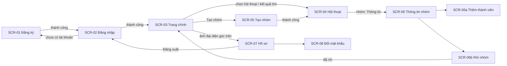

# 03 - Functional Requirements Specification (FRS)

| Mục | Nội dung |
|---|---|
| Dự án | Ứng dụng chat nội bộ (MVP) – Nhóm: *[chưa xác định]* |
| Tệp | `docs/03-frs.md` |
| Phiên bản | 1.0 – Draft |
| Ngày | 2026-11-13 |
| Người soạn | Nhóm BA / Designer / QA (bản nháp có trợ lý AI hỗ trợ soạn thảo) |
| Trạng thái | Draft – chờ Product Owner rà soát mục 10 |
| Căn cứ | (1) PDF "Xây dựng ứng dụng chat nội bộ (MVP)" – nguồn duy nhất của yêu cầu nghiệp vụ; (2) `docs/01-brd.md` v1.1; (3) `docs/02-srs.md` v1.1 (cả hai đều đang ở trạng thái Draft) |

**Quy ước ký hiệu**

| Ký hiệu | Ý nghĩa |
|---|---|
| `FRS-xx` | Một chức năng trong tài liệu này. Mỗi FRS gắn đúng một mã của SRS; **mã gốc TK/CH/NH/TB giữ nguyên**. |
| `SCR-xx` | Một màn hình hoặc hộp thoại. |
| `M-xx` | Một thông báo hiển thị cho người dùng (danh mục ở mục 5). |
| `[PDF]` | Do đề bài quy định. |
| `[QĐ-xx]` | Quyết định của Product Owner (QĐ-01…05 trong BRD, QĐ-06…10 trong SRS). |
| `[GĐ-xx]` / `[GS-xx]` | Giả định đã ghi ở BRD / SRS. |
| `[GF-xx]` | Giả định mới của FRS (chủ yếu về cách hiển thị và thao tác). Xem mục 10.1. |
| `[ĐX]` | Đề xuất của nhóm, ví dụ câu chữ thông báo, bố cục. Không phải yêu cầu đề bài. |
| `[OQ-xx]` | Câu hỏi mở. Xem mục 10.2. |

> Tài liệu này mô tả **cách hệ thống phải hoạt động**. Nó không chứa kết quả chạy thử hay số đo nào.

---

## 1. Nguyên tắc chung

| Mã | Nguyên tắc | Nguồn |
|---|---|---|
| NT-01 | **Máy chủ là nơi quyết định cuối cùng.** Mọi kiểm tra dữ liệu ở trình duyệt chỉ để báo lỗi sớm; máy chủ luôn kiểm tra lại toàn bộ và từ chối nếu sai. | `[ĐX]`, NFR-04 |
| NT-02 | Mọi văn bản người dùng nhập được chuẩn hóa NFC trước khi kiểm tra và lưu. | `[GS-18]` |
| NT-03 | Tên đăng nhập, tên hiển thị, tên nhóm, từ khóa tìm kiếm được bỏ khoảng trắng đầu/cuối. **Mật khẩu và nội dung tin nhắn giữ nguyên** như người dùng gõ. | `[GF-02]` |
| NT-04 | Kiểm tra ở trình duyệt chạy khi rời khỏi ô nhập và khi bấm nút; lỗi hiện ngay dưới ô tương ứng, chữ màu đỏ. | `[GF-03]` |
| NT-05 | Khi đang chờ máy chủ, nút thao tác bị khóa và hiện biểu tượng chờ, để tránh bấm hai lần. | `[ĐX]` |
| NT-06 | Toàn bộ nhãn, nút, thông báo bằng tiếng Việt. | `[PDF §4]` |
| NT-07 | Mọi yêu cầu (trừ đăng ký, đăng nhập) phải kèm phiên hợp lệ. Phiên không hợp lệ thì hiện M-31 và chuyển về SCR-02. | `[PDF TK-03]` |

## 2. Danh sách màn hình và điều hướng

| Mã | Màn hình / hộp thoại | Ai dùng | FRS liên quan |
|---|---|---|---|
| SCR-01 | Đăng ký | Khách | FRS-01, FRS-02 |
| SCR-02 | Đăng nhập | Khách | FRS-03 |
| SCR-03 | Trang chính: danh sách hội thoại, ô tìm người, nút "Tạo nhóm", badge tổng | Người dùng | FRS-06, FRS-07, FRS-10, FRS-15 |
| SCR-04 | Hội thoại (1-1 hoặc nhóm): khung tin, ô soạn tin | Thành viên | FRS-08, FRS-09, FRS-12, FRS-14, FRS-15 |
| SCR-05 | Hộp thoại "Tạo nhóm" | Người dùng | FRS-11 |
| SCR-06 | Bảng "Thông tin nhóm": danh sách thành viên, thêm, xóa, đổi tên, rời nhóm | Thành viên / trưởng nhóm | FRS-13 |
| SCR-06a | Hộp thoại "Thêm thành viên" | Trưởng nhóm | FRS-13 |
| SCR-06b | Hộp thoại "Rời nhóm" (có chọn người nhận quyền nếu là trưởng nhóm) | Thành viên / trưởng nhóm | FRS-13 |
| SCR-07 | Hồ sơ cá nhân (kèm nút "Đổi mật khẩu", "Đăng xuất") | Người dùng | FRS-05, FRS-03 |
| SCR-08 | Hộp thoại "Đổi mật khẩu" | Người dùng | FRS-04 |

Bố cục `[ĐX]`: màn hình rộng hiện SCR-03 và SCR-04 cạnh nhau; màn hình hẹp (điện thoại) hiện lần lượt từng màn, có nút "Quay lại". Chi tiết ở `10-ui-ux.md`.

---

## 3. Đặc tả chức năng

### FRS-01 – Đăng ký tài khoản (TK-01)

| Thuộc tính | Nội dung |
|---|---|
| Mã SRS | TK-01 |
| Màn hình | SCR-01 (bảng trường nhập ở mục 4.1) |
| Actor | Khách |
| Tiền điều kiện | Chưa đăng nhập; người đăng ký đã được tổ chức cấp mã đăng ký `[QĐ-06]` |
| Hậu điều kiện | Có thêm một tài khoản; mật khẩu chỉ được lưu dạng băm |

**Xử lý phía máy chủ** (theo thứ tự):
1. Chuẩn hóa dữ liệu: tên đăng nhập chuyển sang chữ thường `[GF-01]`; tên hiển thị chuẩn hóa NFC và bỏ khoảng trắng đầu/cuối.
2. Kiểm tra **mã đăng ký tổ chức trước tiên**. Sai thì dừng ngay với M-05 và không kiểm tra tiếp, để người ngoài không dò được tên đăng nhập nào đã tồn tại `[ĐX]`.
3. Kiểm tra định dạng tên đăng nhập (QĐ-07), tên hiển thị (GS-02), mật khẩu (FRS-02).
4. Kiểm tra tên đăng nhập chưa tồn tại. Nếu hai người đăng ký trùng tên cùng lúc, chỉ một người thành công, người kia nhận M-01.
5. Băm mật khẩu bằng bcrypt hoặc argon2 `[PDF]` rồi lưu tài khoản.
6. Trả kết quả thành công. Trình duyệt chuyển sang SCR-02, hiện M-40 và điền sẵn tên đăng nhập `[ĐX]`.

**Tiêu chí chấp nhận:** TK-01-AC1…AC4 (SRS).

---

### FRS-02 – Quy tắc mật khẩu (TK-02)

| Thuộc tính | Nội dung |
|---|---|
| Mã SRS | TK-02 |
| Áp dụng tại | SCR-01 (ô Mật khẩu), SCR-08 (ô Mật khẩu mới) |
| Quy tắc | Dài 8–64 ký tự; có ít nhất 1 chữ cái (gồm cả chữ tiếng Việt có dấu) và 1 chữ số 0–9 `[PDF]`, `[GS-04]`, `[GS-05]` |

**Hành vi:**
1. Dưới ô mật khẩu hiện danh sách kiểm tra cập nhật theo từng phím gõ `[ĐX]`: "Ít nhất 8 ký tự", "Có chữ cái", "Có chữ số". Mỗi dòng có dấu ✓ khi đạt.
2. Ô mật khẩu có nút hiện/ẩn ký tự `[ĐX]`.
3. Máy chủ kiểm tra lại cùng quy tắc. Sai thì trả M-06, M-07 hoặc M-08.
4. Máy chủ **không bao giờ** ghi mật khẩu vào log, không gửi lại mật khẩu trong phản hồi, chỉ lưu giá trị băm `[PDF]`.

**Tiêu chí chấp nhận:** TK-02-AC1…AC4.

---

### FRS-03 – Đăng nhập / đăng xuất (TK-03)

| Thuộc tính | Nội dung |
|---|---|
| Mã SRS | TK-03 |
| Màn hình | SCR-02 (đăng nhập), SCR-07 (nút "Đăng xuất") |
| Actor | Khách / Người dùng |

**Đăng nhập:**
1. Máy chủ so tên đăng nhập không phân biệt hoa thường `[QĐ-07]` và đối chiếu mật khẩu với giá trị băm.
2. Sai tên **hoặc** sai mật khẩu đều trả cùng một thông báo M-09 `[ĐX]`.
3. Đúng: tạo phiên có hạn **8 giờ** (cấu hình được) `[QĐ-09]`. Trình duyệt mở kết nối realtime bằng phiên này và chuyển tới SCR-03.
4. Một tài khoản được đăng nhập đồng thời trên nhiều trình duyệt; mỗi nơi là một phiên riêng `[GF-04]`.

**Đăng xuất:**
1. Người dùng bấm "Đăng xuất" ở SCR-07. Không cần hộp xác nhận `[GF-05]`.
2. Máy chủ **hủy phiên** đó ngay `[PDF]` và đóng kết nối realtime của phiên `[GS-07]`.
3. Trình duyệt xóa mọi dữ liệu hội thoại đang giữ tạm và chuyển về SCR-02.

**Hết hạn phiên:** yêu cầu kế tiếp bị từ chối. Trình duyệt hiện M-31 và chuyển về SCR-02. Tin đang soạn dở bị mất `[GF-06]`.

**Ngoài MVP:** khóa tài khoản tạm thời khi nhập sai mật khẩu nhiều lần không thuộc PDF nên không làm.

**Tiêu chí chấp nhận:** TK-03-AC1…AC4.

---

### FRS-04 – Đổi mật khẩu (TK-04)

| Thuộc tính | Nội dung |
|---|---|
| Mã SRS | TK-04 |
| Màn hình | SCR-08 (mục 4.8) |
| Actor | Người dùng đã đăng nhập |

**Xử lý phía máy chủ:**
1. Kiểm tra mật khẩu hiện tại đúng `[PDF]`. Sai thì trả M-10.
2. Kiểm tra mật khẩu mới theo FRS-02, khác mật khẩu hiện tại `[GS-08]`, và khớp ô nhập lại.
3. Lưu giá trị băm mới.
4. **Hủy mọi phiên khác** của tài khoản; giữ phiên hiện tại `[QĐ-09]`.
5. Trả thành công. Trình duyệt đóng hộp thoại và hiện M-41.

**Tiêu chí chấp nhận:** TK-04-AC1…AC3.

---

### FRS-05 – Hồ sơ cá nhân (TK-05)

| Thuộc tính | Nội dung |
|---|---|
| Mã SRS | TK-05 |
| Màn hình | SCR-07 (mục 4.7) |

**Hành vi:**
1. Hiện tên đăng nhập (chỉ xem), tên hiển thị (sửa được) và avatar.
2. Avatar là chữ cái đầu của **từ cuối** trong tên hiển thị, viết hoa, giữ dấu, trên nền màu mặc định `[PDF]`, `[GS-11]`. Ví dụ "Nguyễn Văn Ẩn" → **Ẩ**. Màu nền được chọn cố định theo tài khoản, để cùng một người luôn cùng một màu `[ĐX]`.
3. Bấm "Lưu": máy chủ kiểm tra tên hiển thị (1–50 ký tự) rồi lưu. Trình duyệt hiện M-42 và cập nhật avatar.
4. Người khác thấy tên mới ở mọi nơi (kể cả cạnh tin cũ) sau khi tải lại hoặc khi danh sách được làm mới `[GS-12]`.
5. Không có nút tải ảnh lên `[PDF]`.

**Tiêu chí chấp nhận:** TK-05-AC1…AC3.

---

### FRS-06 – Tìm người dùng (TK-06)

| Thuộc tính | Nội dung |
|---|---|
| Mã SRS | TK-06 |
| Màn hình | Ô tìm người trên SCR-03; cũng dùng lại trong SCR-05 và SCR-06a |

**Hành vi:**
1. Người dùng gõ từ khóa. Trình duyệt tự gửi tìm kiếm sau khi ngừng gõ khoảng 0,3 giây `[GF-07]`; ô trống thì không tìm và xóa kết quả.
2. Máy chủ tìm tài khoản có **tên đăng nhập hoặc tên hiển thị chứa từ khóa**, không phân biệt hoa thường `[PDF]`, `[GS-13]`. Có phân biệt dấu `[GĐ-10]`.
3. Kết quả loại trừ chính người đang tìm `[PDF]`; tối đa 20 dòng `[GS-14]`. Trong SCR-06a còn loại trừ người đã ở trong nhóm `[GF-08]`.
4. Mỗi dòng gồm avatar, tên hiển thị và `@tên đăng nhập` (để phân biệt người trùng tên hiển thị).
5. Không có kết quả thì hiện M-14.
6. Ở SCR-03, bấm một kết quả thì mở chat 1-1 (FRS-07). Ở SCR-05 và SCR-06a, bấm một kết quả thì chọn/bỏ chọn người đó.

**Tiêu chí chấp nhận:** TK-06-AC1…AC3.

---

### FRS-07 – Tạo / mở hội thoại 1-1 (CH-01)

| Thuộc tính | Nội dung |
|---|---|
| Mã SRS | CH-01 |
| Kích hoạt | Bấm một kết quả tìm kiếm ở SCR-03 |

**Xử lý phía máy chủ:**
1. Từ chối nếu người được chọn là chính mình (M-15) hoặc không tồn tại (M-16).
2. Tìm hội thoại 1-1 của **cặp hai người**, không phụ thuộc ai là người mở `[PDF]`.
3. Đã có thì trả về hội thoại đó. Chưa có thì tạo mới. Máy chủ bảo đảm mỗi cặp chỉ có một hội thoại, kể cả khi hai bên cùng bấm một lúc `[GS-17]`.
4. Trình duyệt chuyển tới SCR-04 và tải lịch sử (FRS-09).

**Quy tắc hiển thị:** hội thoại 1-1 chưa có tin nào **không** xuất hiện trong danh sách hội thoại của cả hai bên, cho tới khi có tin đầu tiên `[GS-16]`, `[GF-09]`.

**Tiêu chí chấp nhận:** CH-01-AC1…AC3.

---

### FRS-08 – Gửi / nhận tin văn bản (CH-02)

| Thuộc tính | Nội dung |
|---|---|
| Mã SRS | CH-02 |
| Màn hình | SCR-04 – ô soạn tin (mục 4.4) |

**Phía trình duyệt:**
1. Ô soạn tin nhiều dòng, tự giãn chiều cao tới tối đa khoảng 6 dòng rồi cuộn `[ĐX]`.
2. Trên máy tính: **Enter** để gửi, **Shift + Enter** để xuống dòng. Trên điện thoại: phím Enter xuống dòng, gửi bằng nút "Gửi" `[GF-10]`.
3. Bộ đếm "n / 5.000" hiện khi tin vượt 4.500 ký tự `[GF-11]`. Khi vượt 5.000, bộ đếm chuyển đỏ, hiện M-17 và nút "Gửi" bị khóa.
4. Nút "Gửi" bị khóa khi ô chỉ có khoảng trắng hoặc xuống dòng `[GS-19]`.
5. Mỗi tin gửi đi mang một mã tạm do trình duyệt tạo, để gửi lại không sinh tin trùng `[GF-12]`.
6. Tin vừa gửi hiện ngay trong khung chat. Nếu máy chủ không xác nhận trong 10 giây hoặc mất kết nối, tin chuyển sang trạng thái lỗi với M-20 và nút "Gửi lại" `[GF-13]`. Không hiển thị các nhãn "đang gửi / đã gửi / đã nhận / đã xem" vì đó là CH-04 (NOT MVP).

**Phía máy chủ** (theo thứ tự):
1. Kiểm tra phiên, rồi kiểm tra người gửi **đang là thành viên** hội thoại (mục 6). Sai thì trả M-30.
2. Chuẩn hóa NFC, kiểm tra không trống và **≤ 5.000 ký tự** `[PDF]`, `[GS-18]`.
3. Nếu mã tạm đã được lưu trước đó (trình duyệt gửi lại), trả về tin cũ, không lưu thêm.
4. **Lưu vào cơ sở dữ liệu**, gán thời điểm máy chủ nhận `[GS-20]`.
5. Xác nhận lại cho người gửi, kèm mã tin chính thức và thời gian.
6. Đẩy tin realtime tới mọi kết nối đang mở của **các thành viên hiện tại** `[PDF]`.
7. Cập nhật tin cuối của hội thoại và số chưa đọc của các thành viên khác (FRS-15).

**Hiển thị tin:** dạng chữ thuần, giữ nguyên xuống dòng và dòng trống. Ký tự như `<`, `>` hiện nguyên văn, không thành định dạng `[ĐX]`. Liên kết web không tự chuyển thành đường dẫn bấm được `[GF-14]`. Tin của mình căn phải, của người khác căn trái `[ĐX]`. Thời gian gửi hiện dưới mỗi tin, dạng giờ:phút.

**Tiêu chí chấp nhận:** CH-02-AC1…AC4.

---

### FRS-09 – Lịch sử tin nhắn (CH-03)

| Thuộc tính | Nội dung |
|---|---|
| Mã SRS | CH-03 |
| Màn hình | SCR-04 – khung tin |

**Hành vi:**
1. Khi mở hội thoại, trình duyệt yêu cầu **50 tin gần nhất** `[PDF]`. Tin hiện từ cũ (trên) đến mới (dưới); khung tự cuộn xuống tin mới nhất.
2. Cuộn tới đầu khung thì trình duyệt yêu cầu **50 tin cũ hơn** tin cũ nhất đang hiện `[PDF]`, `[GS-22]`. Trong lúc tải hiện biểu tượng chờ ở đầu khung. Sau khi chèn thêm tin, khung giữ nguyên vị trí người dùng đang đọc.
3. Máy chủ trả ít hơn 50 tin (hoặc 0 tin) nghĩa là đã hết. Trình duyệt hiện dòng M-21 ở đầu khung và ngừng tải tiếp.
4. Tải lỗi thì hiện M-22 kèm nút "Thử lại"; các tin đã hiện vẫn giữ nguyên.
5. Khi người dùng đang cuộn lên đọc tin cũ mà có tin mới đến, khung không tự cuộn xuống. Thay vào đó hiện nút "Có tin nhắn mới ↓" `[GF-15]`.
6. Máy chủ chỉ trả tin nằm trong **phạm vi được xem** của người yêu cầu (mục 6.2).
7. Tin hệ thống nằm trong lịch sử, hiển thị theo FRS-14.

**Tiêu chí chấp nhận:** CH-03-AC1…AC3.

---

### FRS-10 – Danh sách hội thoại (CH-06)

| Thuộc tính | Nội dung |
|---|---|
| Mã SRS | CH-06 |
| Màn hình | SCR-03 (mục 4.3) |

**Hành vi:**
1. Máy chủ trả các hội thoại mà người dùng **đang là thành viên** và đã có ít nhất một tin trong phạm vi được xem. Nhóm luôn có ít nhất tin hệ thống "đã tạo nhóm" `[GS-30]`.
2. Sắp theo thời gian tin cuối, mới nhất ở trên `[PDF]`.
3. Mỗi dòng: avatar (chữ cái của người kia hoặc của tên nhóm), tên, **trích tin cuối**, **thời gian**, **số chưa đọc** `[PDF]`.
   - Trích tin cuối: một dòng, cắt bớt kèm "…". Với nhóm, trước trích tin có "Tên người gửi: ". Tin của chính mình có "Bạn: " phía trước `[GS-25]`, `[ĐX]`. Tin hệ thống hiện nguyên câu, chữ nghiêng.
   - Thời gian: trong ngày hiện "14:05"; hôm qua hiện "Hôm qua"; cũ hơn hiện "dd/mm/yyyy" `[GS-26]`, `[ĐX]`.
   - Số chưa đọc: theo FRS-15; hội thoại có tin chưa đọc thì tên in đậm.
4. Danh sách tự cập nhật khi có tin mới, có nhóm mới, bị xóa khỏi nhóm hoặc nhóm đổi tên, không cần tải lại trang `[GS-27]`.
5. Hội thoại đang mở được tô nền nổi bật.
6. Chưa có hội thoại nào thì hiện M-23. Tải lỗi thì hiện M-24 kèm nút "Thử lại".

**Tiêu chí chấp nhận:** CH-06-AC1…AC3.

---

### FRS-11 – Tạo nhóm (NH-01)

| Thuộc tính | Nội dung |
|---|---|
| Mã SRS | NH-01 |
| Màn hình | SCR-05 (mục 4.5) |

**Xử lý phía máy chủ:**
1. Kiểm tra tên nhóm 1–100 ký tự `[GS-28]`.
2. Kiểm tra danh sách thành viên được chọn có **từ 2 người trở lên**, không tính người tạo `[PDF]`, `[GĐ-05]`. Không có người tạo, không trùng lặp, mọi tài khoản đều tồn tại.
3. Tạo nhóm. Người tạo là **trưởng nhóm** `[PDF]`. Tất cả thành viên ban đầu có phạm vi xem bắt đầu từ lúc tạo nhóm.
4. Sinh tin hệ thống "đã tạo nhóm" (FRS-14).
5. Đẩy nhóm mới vào danh sách hội thoại của mọi thành viên.
6. Trình duyệt người tạo đóng SCR-05 và mở nhóm trong SCR-04.

**Tiêu chí chấp nhận:** NH-01-AC1…AC3.

---

### FRS-12 – Nhắn tin nhóm (NH-02)

| Thuộc tính | Nội dung |
|---|---|
| Mã SRS | NH-02 |
| Màn hình | SCR-04 khi hội thoại là nhóm |

**Hành vi:**
1. Gửi, nhận, lịch sử và giới hạn ký tự giống hệt FRS-08 và FRS-09 `[PDF]`.
2. **Mỗi** tin của người khác đều hiện **tên hiển thị và avatar** người gửi ngay cạnh tin `[PDF]`. Không gộp ẩn tên khi một người gửi nhiều tin liên tiếp `[GF-16]`.
3. Tin của chính mình căn phải; có thể không cần hiện tên mình `[ĐX]`.
4. Đầu SCR-04 hiện tên nhóm, số thành viên và nút "Thông tin nhóm" (mở SCR-06).

**Tiêu chí chấp nhận:** NH-02-AC1, AC2.

---

### FRS-13 – Quản lý thành viên nhóm (NH-03)

| Thuộc tính | Nội dung |
|---|---|
| Mã SRS | NH-03 |
| Màn hình | SCR-06, SCR-06a, SCR-06b (mục 4.6) |

**Quyền theo vai trò** (giao diện chỉ hiện nút theo quyền; máy chủ vẫn kiểm tra lại – mục 6):

| Thao tác | Trưởng nhóm | Thành viên |
|---|---|---|
| Xem danh sách thành viên | ✓ | ✓ |
| Thêm thành viên | ✓ `[PDF]` | ✗ |
| Xóa thành viên | ✓ `[PDF]` (không xóa chính mình) | ✗ |
| Đổi tên nhóm | ✓ `[PDF]` | ✗ |
| Rời nhóm | ✓, bắt buộc chọn người nhận quyền `[QĐ-03]` | ✓ `[PDF]` |

**Thêm thành viên (SCR-06a):**
1. Trưởng nhóm tìm và chọn một hoặc nhiều người (FRS-06, đã loại người đang trong nhóm) `[GF-17]`.
2. Ô đánh dấu **"Cho xem tin nhắn trước đó"**, mặc định **không đánh dấu** `[QĐ-08]`, `[GS-35]`. Lựa chọn áp dụng cho tất cả người được thêm trong lần đó.
3. Máy chủ kiểm tra người yêu cầu là trưởng nhóm, người được thêm tồn tại và chưa là thành viên.
4. Lưu thành viên mới cùng phạm vi xem: từ lúc tạo nhóm nếu đánh dấu `[GS-36]`, từ lúc được thêm nếu không đánh dấu.
5. Sinh **một tin hệ thống cho mỗi người** được thêm. Đẩy cập nhật tới thành viên hiện tại và tới người mới.

**Xóa thành viên:**
1. Trưởng nhóm bấm "Xóa" cạnh tên thành viên. Hộp xác nhận hiện M-43.
2. Máy chủ kiểm tra quyền, rồi **xóa quyền truy cập ngay**: người bị xóa không còn xem được bất kỳ tin nào của nhóm, kể cả tin cũ `[QĐ-04]`.
3. Sinh tin hệ thống, đẩy tới các thành viên còn lại. Gửi sự kiện "bị xóa khỏi nhóm" tới người bị xóa.
4. Trình duyệt của người bị xóa gỡ nhóm khỏi danh sách. Nếu đang mở nhóm đó, hiện M-32 và quay về SCR-03 `[GF-18]`.

**Đổi tên nhóm:**
1. Trưởng nhóm bấm biểu tượng sửa cạnh tên nhóm, nhập tên mới, bấm "Lưu".
2. Máy chủ kiểm tra quyền và tên (1–100 ký tự). Tên mới giống tên cũ thì không làm gì, không sinh tin hệ thống `[GF-19]`.
3. Sinh tin hệ thống. Tên nhóm cập nhật realtime ở đầu SCR-04 và trong danh sách của mọi thành viên.

**Rời nhóm (SCR-06b):**
1. **Thành viên:** hộp xác nhận hiện M-44. Đồng ý thì máy chủ xóa quyền truy cập (như khi bị xóa) và sinh tin hệ thống "đã rời nhóm".
2. **Trưởng nhóm:** hộp thoại yêu cầu chọn **một** thành viên hiện tại làm trưởng nhóm mới `[QĐ-03]`, `[GĐ-17]`. Nút "Rời nhóm" bị khóa cho tới khi đã chọn. Máy chủ thực hiện **trong cùng một lần**: chuyển quyền, rồi cho trưởng nhóm cũ rời. Sinh 2 tin hệ thống theo thứ tự "chuyển quyền" rồi "rời nhóm" `[GĐ-19]`.
3. Nhóm chỉ còn trưởng nhóm thì nút "Rời nhóm" bị khóa và hiện M-28 `[GĐ-18]`.
4. Sau khi rời, trình duyệt quay về SCR-03; nhóm biến mất khỏi danh sách.

**Không có trong MVP:** chuyển quyền trưởng nhóm mà không rời nhóm, vì QĐ-03 chỉ yêu cầu chuyển quyền khi rời `[GF-20]`.

**Tiêu chí chấp nhận:** NH-03-AC1, AC1b, AC2…AC4.

---

### FRS-14 – Tin hệ thống trong nhóm (NH-04)

| Thuộc tính | Nội dung |
|---|---|
| Mã SRS | NH-04 |
| Hiển thị | Trong khung tin SCR-04: căn giữa, chữ nhỏ màu xám, không có avatar, kèm giờ `[ĐX]` |

**Danh mục tin hệ thống.** `{A}`, `{B}`, `{D}` là tên hiển thị tại thời điểm sự kiện `[GS-32]`. Câu chữ là đề xuất `[ĐX]`.

| Mã loại | Sự kiện | Câu hiển thị | Nguồn bắt buộc |
|---|---|---|---|
| HT-01 | Tạo nhóm | {A} đã tạo nhóm "{tên nhóm}" | `[GS-30]` |
| HT-02 | Thêm thành viên | {A} đã thêm {D} vào nhóm | `[PDF]` |
| HT-03 | Xóa thành viên | {A} đã xóa {D} khỏi nhóm | `[PDF]` |
| HT-04 | Thành viên rời nhóm | {D} đã rời nhóm | `[PDF]` |
| HT-05 | Đổi tên nhóm | {A} đã đổi tên nhóm thành "{tên mới}" | `[PDF]` |
| HT-06 | Chuyển quyền trưởng nhóm | {A} đã chuyển quyền trưởng nhóm cho {B} | `[GĐ-19]`, `[OQ-10]` |

**Quy tắc:**
1. Máy chủ tự sinh tin hệ thống **cùng lúc** với sự kiện. Nếu sự kiện thất bại thì không có tin hệ thống; nếu sự kiện thành công thì chắc chắn có tin hệ thống `[GF-21]`.
2. Mỗi sự kiện sinh đúng một tin. Thêm 3 người một lúc sinh 3 tin HT-02.
3. Tin hệ thống được lưu và nằm trong lịch sử như tin thường; đẩy realtime tới các thành viên hiện tại.
4. Người vừa bị xóa hoặc vừa rời **không** nhận tin HT-03/HT-04 về chính mình `[QĐ-04]`.
5. Tin hệ thống **không** tính vào số chưa đọc `[QĐ-10]`, nhưng **có** làm hội thoại nhảy lên đầu danh sách và hiện thành trích tin cuối `[GS-25]`.

**Tiêu chí chấp nhận:** NH-04-AC1…AC3.

---

### FRS-15 – Badge số tin chưa đọc (TB-01)

| Thuộc tính | Nội dung |
|---|---|
| Mã SRS | TB-01 |
| Màn hình | SCR-03 (từng dòng và biểu tượng tổng); tiêu đề tab trình duyệt |

**Cách đếm** (máy chủ tính, trình duyệt chỉ hiển thị):
1. Mỗi người dùng có một **mốc đã đọc** cho mỗi hội thoại `[GS-34]`.
2. Số chưa đọc của hội thoại = số **tin văn bản do người khác gửi**, đến sau mốc đã đọc **và** nằm trong phạm vi được xem. Không tính tin của mình, không tính tin hệ thống `[QĐ-10]`.
3. Thành viên mới được cho xem tin cũ: các tin trước lúc được thêm **không** tính vào số chưa đọc `[GF-22]`.
4. Tổng số = tổng số chưa đọc của mọi hội thoại.

**Khi nào đánh dấu đã đọc:**
1. Người dùng mở hội thoại ở SCR-04 thì mốc đã đọc được đặt tới tin mới nhất; số của hội thoại **về 0** `[PDF §5]`.
2. Đang mở hội thoại **và** tab trình duyệt đang được xem mà có tin mới thì đánh dấu đã đọc ngay `[GS-33]`. Nếu tab đang bị ẩn (chuyển sang tab khác), tin vẫn tính là chưa đọc cho tới khi người dùng quay lại tab.
3. Mốc đã đọc lưu ở máy chủ; máy chủ đẩy số mới tới mọi tab và trình duyệt của cùng tài khoản `[GS-34]`.

**Hiển thị:**
- Từng dòng ở SCR-03: hình tròn màu nổi bật chứa số; ẩn khi bằng 0; tối đa "99+" `[ĐX]`.
- Tổng số: trên biểu tượng ứng dụng ở đầu SCR-03 và ở **tiêu đề tab**, dạng "(5) Chat nội bộ". Ẩn khi bằng 0 `[GĐ-15]`.

**Tiêu chí chấp nhận:** TB-01-AC1…AC4.

---

### FRS-16 – Tự kết nối lại và gửi lại (NFR-13 – mức khuyến khích)

Chức năng này **không phải mã bắt buộc**. PDF §4 ghi "khuyến khích" (ưu tiên Should). Được ghi ở đây để giao diện xử lý mất mạng nhất quán.

1. Mất kết nối realtime thì hiện thanh báo M-33 ở đầu màn hình.
2. Trình duyệt tự thử kết nối lại sau 1, 2, 4, 8… giây, tối đa 30 giây giữa hai lần `[GF-23]`.
3. Kết nối lại được thì ẩn thanh báo, tải lại danh sách hội thoại và các tin bị lỡ của hội thoại đang mở.
4. Tin gửi lỗi giữ nguyên trong khung chat kèm nút "Gửi lại" (FRS-08). Gửi lại không tạo tin trùng nhờ mã tạm `[GF-12]`.
5. Nếu kết nối lại bị từ chối vì phiên hết hạn thì xử lý như NT-07.

---

## 4. Đặc tả từng màn hình

Cột "Kiểm tra" áp dụng **cả ở trình duyệt và máy chủ** (NT-01). Cột "Lỗi" dẫn tới danh mục thông báo ở mục 5.

### 4.1 SCR-01 – Đăng ký (FRS-01, FRS-02)

| Trường | Loại | Bắt buộc | Kiểm tra | Lỗi |
|---|---|---|---|---|
| Tên đăng nhập | Ô chữ | ✓ | 3–30 ký tự; chỉ a–z, 0–9, `.`, `_`; chữ hoa được tự đổi sang chữ thường `[QĐ-07]`, `[GF-01]`; chưa tồn tại | M-01, M-02 |
| Tên hiển thị | Ô chữ | ✓ | 1–50 ký tự sau khi bỏ khoảng trắng; cho phép tiếng Việt có dấu `[GS-02]` | M-03 |
| Mật khẩu | Ô mật khẩu (có nút hiện/ẩn) | ✓ | Theo FRS-02 | M-06, M-07, M-08 |
| Nhập lại mật khẩu | Ô mật khẩu | ✓ | Giống ô Mật khẩu `[ĐX]` | M-04 |
| Mã đăng ký tổ chức | Ô chữ | ✓ | Khớp mã cấu hình `[QĐ-06]` | M-05 |

| Hành động | Phản hồi khi thành công | Lỗi có thể gặp |
|---|---|---|
| Bấm "Đăng ký" | Chuyển sang SCR-02, hiện M-40, điền sẵn tên đăng nhập | M-01…M-08, M-34 |
| Bấm "Đã có tài khoản? Đăng nhập" | Chuyển sang SCR-02 | – |

### 4.2 SCR-02 – Đăng nhập (FRS-03)

| Trường | Loại | Bắt buộc | Kiểm tra | Lỗi |
|---|---|---|---|---|
| Tên đăng nhập | Ô chữ | ✓ | Không trống | M-35 |
| Mật khẩu | Ô mật khẩu (có nút hiện/ẩn) | ✓ | Không trống | M-35 |

| Hành động | Phản hồi khi thành công | Lỗi có thể gặp |
|---|---|---|
| Bấm "Đăng nhập" hoặc Enter | Chuyển tới SCR-03 | M-09, M-34 |
| Bấm "Chưa có tài khoản? Đăng ký" | Chuyển sang SCR-01 | – |

### 4.3 SCR-03 – Trang chính (FRS-06, FRS-07, FRS-10, FRS-15)

| Thành phần | Loại | Kiểm tra / quy tắc | Lỗi |
|---|---|---|---|
| Ô "Tìm đồng nghiệp…" | Ô chữ | Tìm khi có ≥ 1 ký tự sau khi bỏ khoảng trắng `[GS-14]` | M-14 (không có kết quả) |
| Danh sách kết quả tìm | Danh sách | Tối đa 20 dòng; không có chính mình | – |
| Nút "Tạo nhóm" | Nút | – | – |
| Danh sách hội thoại | Danh sách | Theo FRS-10 | M-23, M-24 |
| Badge từng hội thoại, badge tổng, tiêu đề tab | Số | Theo FRS-15 | – |
| Avatar của mình (góc trên) | Nút | Mở SCR-07 | – |

| Hành động | Phản hồi | Lỗi có thể gặp |
|---|---|---|
| Gõ từ khóa | Hiện kết quả sau ~0,3 giây | M-14, M-34 |
| Bấm một kết quả | Mở SCR-04 (hội thoại 1-1 cũ hoặc mới) | M-15, M-16 |
| Bấm một hội thoại | Mở SCR-04, số chưa đọc về 0 | M-30 |
| Bấm "Tạo nhóm" | Mở SCR-05 | – |

### 4.4 SCR-04 – Hội thoại (FRS-08, FRS-09, FRS-12, FRS-14)

| Thành phần | Loại | Kiểm tra / quy tắc | Lỗi |
|---|---|---|---|
| Đầu trang | Thông tin | 1-1: avatar + tên người kia. Nhóm: tên nhóm, số thành viên, nút "Thông tin nhóm" | – |
| Khung tin | Danh sách | 50 tin/lần, cuộn lên tải thêm (FRS-09); tin hệ thống theo FRS-14; nhóm có tên + avatar cạnh mỗi tin (FRS-12) | M-21, M-22 |
| Ô soạn tin | Ô chữ nhiều dòng | Không trống; ≤ 5.000 ký tự sau chuẩn hóa `[PDF]` | M-17 |
| Bộ đếm ký tự | Chữ | Hiện khi > 4.500 ký tự `[GF-11]` | – |
| Nút "Gửi" | Nút | Khóa khi trống hoặc > 5.000 ký tự | – |

| Hành động | Phản hồi | Lỗi có thể gặp |
|---|---|---|
| Enter (máy tính) / bấm "Gửi" | Tin hiện ngay trong khung, ô soạn được xóa | M-17, M-20, M-30 |
| Shift + Enter | Xuống dòng trong ô soạn | – |
| Cuộn lên đầu khung | Tải thêm 50 tin cũ hơn | M-21, M-22 |
| Bấm "Gửi lại" trên tin lỗi | Gửi lại đúng tin đó | M-20 |
| Bấm "Có tin nhắn mới ↓" | Cuộn xuống tin mới nhất | – |
| Bấm "Thông tin nhóm" | Mở SCR-06 | – |

### 4.5 SCR-05 – Tạo nhóm (FRS-11)

| Trường | Loại | Bắt buộc | Kiểm tra | Lỗi |
|---|---|---|---|---|
| Tên nhóm | Ô chữ | ✓ | 1–100 ký tự sau khi bỏ khoảng trắng `[GS-28]` | M-25 |
| Thêm thành viên | Ô tìm (FRS-06) + danh sách đã chọn dạng thẻ có nút "×" | ✓ | ≥ 2 người, không gồm mình, không trùng `[PDF]` | M-26, M-27 |
| Dòng "Đã chọn: n người" | Chữ | – | Cập nhật theo lựa chọn | – |

| Hành động | Phản hồi | Lỗi có thể gặp |
|---|---|---|
| Bấm "Tạo nhóm" (chỉ bật khi tên hợp lệ và đã chọn ≥ 2 người) | Đóng hộp thoại, mở nhóm trong SCR-04, có tin HT-01 | M-25, M-26, M-27, M-34 |
| Bấm "Hủy" | Đóng hộp thoại, không tạo gì | – |

### 4.6 SCR-06, SCR-06a, SCR-06b – Thông tin nhóm (FRS-13)

**SCR-06 Thông tin nhóm**

| Thành phần | Ai thấy | Quy tắc | Lỗi |
|---|---|---|---|
| Tên nhóm + biểu tượng sửa | Sửa: chỉ trưởng nhóm | 1–100 ký tự | M-25, M-29 |
| Danh sách thành viên (avatar, tên, nhãn "Trưởng nhóm") | Mọi thành viên | – | – |
| Nút "Xóa" cạnh mỗi thành viên (trừ chính mình) | Chỉ trưởng nhóm | Hỏi xác nhận M-43 | M-29 |
| Nút "Thêm thành viên" | Chỉ trưởng nhóm | Mở SCR-06a | – |
| Nút "Rời nhóm" | Mọi thành viên | Mở SCR-06b | M-28 |

**SCR-06a Thêm thành viên**

| Trường | Loại | Bắt buộc | Kiểm tra | Lỗi |
|---|---|---|---|---|
| Chọn người | Ô tìm (FRS-06, đã loại thành viên hiện có) | ✓ (≥ 1 người) | Tồn tại, chưa là thành viên | M-36 |
| "Cho xem tin nhắn trước đó" | Ô đánh dấu, mặc định **không** đánh dấu `[QĐ-08]`, `[GS-35]` | – | – | – |

| Hành động | Phản hồi | Lỗi có thể gặp |
|---|---|---|
| Bấm "Thêm" | Đóng hộp thoại; mỗi người được thêm có một tin HT-02 | M-29, M-36, M-34 |

**SCR-06b Rời nhóm**

| Trường | Ai thấy | Bắt buộc | Kiểm tra | Lỗi |
|---|---|---|---|---|
| Câu xác nhận M-44 | Mọi thành viên | – | – | – |
| "Chọn trưởng nhóm mới" (danh sách thành viên còn lại) | Chỉ trưởng nhóm | ✓ với trưởng nhóm `[QĐ-03]` | Người được chọn đang là thành viên | M-37, M-28 |

| Hành động | Phản hồi | Lỗi có thể gặp |
|---|---|---|
| Bấm "Rời nhóm" | Quay về SCR-03, nhóm biến mất khỏi danh sách | M-28, M-37, M-34 |
| Bấm "Hủy" | Đóng hộp thoại | – |

### 4.7 SCR-07 – Hồ sơ cá nhân (FRS-05, FRS-03)

| Trường | Loại | Bắt buộc | Kiểm tra | Lỗi |
|---|---|---|---|---|
| Avatar | Hiển thị | – | Chữ cái theo FRS-05 | – |
| Tên đăng nhập | Chỉ xem | – | Không sửa được `[GS-10]` | – |
| Tên hiển thị | Ô chữ | ✓ | 1–50 ký tự sau khi bỏ khoảng trắng | M-03 |

| Hành động | Phản hồi | Lỗi có thể gặp |
|---|---|---|
| Bấm "Lưu" (bật khi tên đã thay đổi) | Hiện M-42, avatar cập nhật | M-03, M-34 |
| Bấm "Đổi mật khẩu" | Mở SCR-08 | – |
| Bấm "Đăng xuất" | Hủy phiên, chuyển về SCR-02 | – |

### 4.8 SCR-08 – Đổi mật khẩu (FRS-04)

| Trường | Loại | Bắt buộc | Kiểm tra | Lỗi |
|---|---|---|---|---|
| Mật khẩu hiện tại | Ô mật khẩu | ✓ | Đúng mật khẩu đang dùng `[PDF]` | M-10 |
| Mật khẩu mới | Ô mật khẩu (danh sách kiểm tra theo FRS-02) | ✓ | Theo FRS-02; khác mật khẩu hiện tại `[GS-08]` | M-06, M-07, M-08, M-11 |
| Nhập lại mật khẩu mới | Ô mật khẩu | ✓ | Giống ô Mật khẩu mới | M-04 |

| Hành động | Phản hồi | Lỗi có thể gặp |
|---|---|---|
| Bấm "Đổi mật khẩu" | Đóng hộp thoại, hiện M-41; các phiên khác bị đăng xuất `[QĐ-09]` | M-04, M-06…M-11, M-34 |
| Bấm "Hủy" | Đóng hộp thoại | – |

---

## 5. Danh mục thông báo

Toàn bộ câu chữ là **đề xuất `[ĐX]`**: PDF chỉ yêu cầu "báo lỗi" và giao diện tiếng Việt, không quy định câu chữ. Cột "Mã SRS" nối với mã lỗi trong `02-srs.md`.

| Mã | Nội dung hiển thị | Loại | Mã SRS |
|---|---|---|---|
| M-01 | Tên đăng nhập đã tồn tại. Vui lòng chọn tên khác. | Lỗi | E-TK01-1 |
| M-02 | Tên đăng nhập dài 3–30 ký tự, chỉ gồm chữ không dấu (a–z), số (0–9), dấu chấm (.) hoặc gạch dưới (_). | Lỗi | E-TK01-2 |
| M-03 | Tên hiển thị không được để trống và tối đa 50 ký tự. | Lỗi | E-TK01-4, E-TK05-1 |
| M-04 | Mật khẩu nhập lại không khớp. | Lỗi | E-TK04-4 |
| M-05 | Mã đăng ký tổ chức không đúng. Vui lòng liên hệ đầu mối của tổ chức để nhận mã. | Lỗi | E-TK01-5 |
| M-06 | Mật khẩu phải có ít nhất 8 ký tự. | Lỗi | E-TK02-1 |
| M-07 | Mật khẩu phải có cả chữ cái và chữ số. | Lỗi | E-TK02-2 |
| M-08 | Mật khẩu tối đa 64 ký tự. | Lỗi | E-TK02-3 |
| M-09 | Tên đăng nhập hoặc mật khẩu không đúng. | Lỗi | E-TK03-1 |
| M-10 | Mật khẩu hiện tại không đúng. | Lỗi | E-TK04-1 |
| M-11 | Mật khẩu mới phải khác mật khẩu hiện tại. | Lỗi | E-TK04-3 |
| M-14 | Không tìm thấy người dùng phù hợp. | Thông tin | TK-06 (không lỗi) |
| M-15 | Bạn không thể tự nhắn tin cho chính mình. | Lỗi | E-CH01-1 |
| M-16 | Người dùng này không tồn tại. | Lỗi | E-CH01-2 |
| M-17 | Tin nhắn vượt quá 5.000 ký tự (hiện có {n} ký tự). | Lỗi | E-CH02-1 |
| M-20 | Gửi không thành công. [Gửi lại] | Lỗi | E-CH02-4 |
| M-21 | Đã hiển thị toàn bộ lịch sử. | Thông tin | CH-03 R3 |
| M-22 | Không tải được tin nhắn cũ. [Thử lại] | Lỗi | E-CH03-2 |
| M-23 | Bạn chưa có cuộc trò chuyện nào. Hãy tìm đồng nghiệp ở ô phía trên để bắt đầu. | Thông tin | CH-06 (không lỗi) |
| M-24 | Không tải được danh sách hội thoại. [Thử lại] | Lỗi | E-CH06-1 |
| M-25 | Tên nhóm không được để trống và tối đa 100 ký tự. | Lỗi | E-NH01-1, E-NH03-5 |
| M-26 | Hãy chọn ít nhất 2 thành viên. | Lỗi | E-NH01-2 |
| M-27 | Có người dùng không còn tồn tại. Vui lòng chọn lại. | Lỗi | E-NH01-3 |
| M-28 | Bạn là thành viên duy nhất của nhóm nên chưa thể rời nhóm. | Lỗi | E-NH03-4 |
| M-29 | Chỉ trưởng nhóm mới thực hiện được thao tác này. | Lỗi | E-NH03-1 |
| M-30 | Không tìm thấy hội thoại hoặc bạn không có quyền truy cập. | Lỗi | E-CH02-3, E-CH03-1 |
| M-31 | Phiên đăng nhập đã hết hạn. Vui lòng đăng nhập lại. | Lỗi | E-TK03-2 |
| M-32 | Bạn không còn là thành viên của nhóm này. | Thông tin | NH-03 R7 |
| M-33 | Mất kết nối. Đang thử kết nối lại… | Cảnh báo | NFR-13 |
| M-34 | Không kết nối được máy chủ. Vui lòng thử lại. | Lỗi | (chung) |
| M-35 | Vui lòng nhập đủ tên đăng nhập và mật khẩu. | Lỗi | TK-03 |
| M-36 | Người này đã ở trong nhóm hoặc không còn tồn tại. | Lỗi | E-NH03-2 |
| M-37 | Hãy chọn người nhận quyền trưởng nhóm trước khi rời nhóm. | Lỗi | E-NH03-3 |
| M-40 | Đăng ký thành công. Vui lòng đăng nhập. | Thành công | TK-01 |
| M-41 | Đổi mật khẩu thành công. Các thiết bị khác đã được đăng xuất. | Thành công | TK-04 |
| M-42 | Đã lưu tên hiển thị. | Thành công | TK-05 |
| M-43 | Xóa {tên} khỏi nhóm? Người này sẽ không xem được lịch sử nhóm nữa. | Xác nhận | NH-03, QĐ-04 |
| M-44 | Rời nhóm "{tên nhóm}"? Bạn sẽ không xem được lịch sử nhóm nữa. | Xác nhận | NH-03, QĐ-04 |

Mã M-12, M-13, M-18, M-19, M-38, M-39 được để trống, dành cho bổ sung sau.

---

## 6. Chính sách quyền truy cập (kiểm tra phía máy chủ)

### 6.1 Nguyên tắc
1. **Mọi kiểm tra quyền thực hiện ở máy chủ**, cho mọi yêu cầu qua API và mọi sự kiện qua kênh realtime. Việc giao diện ẩn nút không được coi là kiểm soát quyền `[PDF §4]`.
2. Thứ tự kiểm tra: (1) phiên hợp lệ → (2) là thành viên **hiện tại** của hội thoại → (3) vai trò, nếu là thao tác của trưởng nhóm → (4) dữ liệu hợp lệ.
3. Người **không phải thành viên** nhận cùng một phản hồi "không tìm thấy" (M-30), dù hội thoại có tồn tại hay không, để không lộ thông tin `[ĐX]`, NFR-04.
4. Thành viên thường thử thao tác của trưởng nhóm nhận M-29.
5. Máy chủ chỉ đẩy tin realtime tới kết nối của **thành viên hiện tại**. Khi một người bị xóa hoặc rời nhóm, máy chủ ngừng đẩy ngay, trước khi gửi tin hệ thống cho những người còn lại `[QĐ-04]`.
6. Phiên bị hủy (đăng xuất, đổi mật khẩu, hết hạn) thì đóng luôn kết nối realtime của phiên đó `[GS-07]`.

### 6.2 Phạm vi được xem
Mỗi lần một người tham gia nhóm có một **mốc bắt đầu xem**:

| Trường hợp | Mốc bắt đầu xem | Nguồn |
|---|---|---|
| Hai người trong hội thoại 1-1 | Từ đầu hội thoại | `[PDF]` |
| Thành viên ban đầu của nhóm (lúc tạo) | Từ lúc tạo nhóm | NH-01 |
| Được thêm, có đánh dấu "Cho xem tin nhắn trước đó" | Từ lúc tạo nhóm | `[QĐ-08]`, `[GS-36]` |
| Được thêm, không đánh dấu (mặc định) | Từ lúc được thêm | `[QĐ-08]`, `[GS-35]` |
| Đã bị xóa hoặc đã rời | Không xem được gì | `[QĐ-04]` |
| Được thêm lại sau khi đã rời / bị xóa | Theo lựa chọn của lần thêm mới nhất | `[GS-35]` |

Mốc này áp dụng đồng thời cho **lịch sử** (FRS-09), **trích tin cuối** trong danh sách (FRS-10) và **số chưa đọc** (FRS-15).

### 6.3 Bảng quyền theo thao tác

| Thao tác | Phiên | Điều kiện cho phép | Khi bị từ chối |
|---|---|---|---|
| Đăng ký | Không cần | Mã đăng ký tổ chức đúng | M-05 |
| Đăng nhập | Không cần | Đúng tên đăng nhập và mật khẩu | M-09 |
| Đăng xuất | Cần | Phiên của chính mình | M-31 |
| Xem / sửa hồ sơ | Cần | Chỉ hồ sơ của chính mình | M-31 |
| Đổi mật khẩu | Cần | Đúng mật khẩu hiện tại | M-10 |
| Tìm người dùng | Cần | Mọi người dùng đã đăng nhập; chỉ trả tên đăng nhập, tên hiển thị, avatar | M-31 |
| Mở hội thoại 1-1 | Cần | Người kia tồn tại và không phải chính mình | M-15, M-16 |
| Xem danh sách hội thoại | Cần | Chỉ các hội thoại mình là thành viên hiện tại | M-31 |
| Xem lịch sử | Cần | Thành viên hiện tại; chỉ tin trong phạm vi được xem | M-30 |
| Gửi tin | Cần | Thành viên hiện tại | M-30 |
| Đánh dấu đã đọc | Cần | Thành viên hiện tại | M-30 |
| Tạo nhóm | Cần | Mọi người dùng đã đăng nhập | M-25…M-27 |
| Thêm thành viên | Cần | Trưởng nhóm hiện tại của nhóm | M-30 / M-29 |
| Xóa thành viên | Cần | Trưởng nhóm; người bị xóa là thành viên và không phải chính trưởng nhóm | M-30 / M-29 |
| Đổi tên nhóm | Cần | Trưởng nhóm | M-30 / M-29 |
| Rời nhóm | Cần | Thành viên hiện tại. Nếu là trưởng nhóm: phải chỉ định một thành viên hiện tại khác | M-30 / M-37 / M-28 |
| Mở kết nối realtime | Cần | Phiên hợp lệ | Đóng kết nối, M-31 |

**Kiểm chứng:** AT-06; NH-03-AC1, AC2; TK-03-AC2. Thêm phép thử "đổi mã hội thoại trên địa chỉ trang hoặc trong yêu cầu gửi tới máy chủ, bằng tài khoản ngoài hội thoại" ở `11-test-cases.md`.

---

## 7. Ma trận truy vết FRS → SRS

| FRS | Mã SRS (giữ nguyên) | Tiêu chí chấp nhận SRS | NFR | Màn hình | AT |
|---|---|---|---|---|---|
| FRS-01 | TK-01 | TK-01-AC1…AC4 | NFR-02, NFR-08 | SCR-01 | AT-01 |
| FRS-02 | TK-02 | TK-02-AC1…AC4 | NFR-02 | SCR-01, SCR-08 | AT-01 |
| FRS-03 | TK-03 | TK-03-AC1…AC4 | NFR-03 | SCR-02, SCR-07 | AT-01, AT-05 |
| FRS-04 | TK-04 | TK-04-AC1…AC3 | NFR-02, NFR-03 | SCR-08 | – |
| FRS-05 | TK-05 | TK-05-AC1…AC3 | NFR-08 | SCR-07 | – |
| FRS-06 | TK-06 | TK-06-AC1…AC3 | NFR-09 | SCR-03, SCR-05, SCR-06a | AT-02 |
| FRS-07 | CH-01 | CH-01-AC1…AC3 | – | SCR-03 → SCR-04 | AT-02 |
| FRS-08 | CH-02 | CH-02-AC1…AC4 | NFR-05, NFR-08 | SCR-04 | AT-02 |
| FRS-09 | CH-03 | CH-03-AC1…AC3 | NFR-06, NFR-07 | SCR-04 | AT-05 |
| FRS-10 | CH-06 | CH-06-AC1…AC3 | – | SCR-03 | AT-04 |
| FRS-11 | NH-01 | NH-01-AC1…AC3 | – | SCR-05 | AT-03 |
| FRS-12 | NH-02 | NH-02-AC1, AC2 | NFR-05 | SCR-04 | AT-03 |
| FRS-13 | NH-03 | NH-03-AC1, AC1b, AC2…AC4 | NFR-04 | SCR-06, SCR-06a, SCR-06b | AT-03 |
| FRS-14 | NH-04 | NH-04-AC1…AC3 | – | SCR-04 | AT-03 |
| FRS-15 | TB-01 | TB-01-AC1…AC4 | – | SCR-03, tiêu đề tab | AT-04 |
| FRS-16 | (không có mã PDF – NFR) | – | NFR-13 (Should) | Mọi màn hình | – |
| Mục 6 | QT-CHUNG-1, QT-CHUNG-2 | – | NFR-01, NFR-03, NFR-04 | Máy chủ | AT-06 |

**Kiểm tra độ phủ:** 15/15 mã MVP có đúng một FRS (FRS-01…FRS-15); không mã nào bị đổi ID. FRS-16 chỉ là yêu cầu phi chức năng mức khuyến khích.

## 8. Tính năng NOT MVP – không đặc tả

Theo QĐ-01, các mã ở PDF §6 **không** có FRS. Khi thiết kế giao diện, không thêm các thành phần sau:

| Không làm | Thuộc mã |
|---|---|
| Nhãn "đang gửi / đã gửi / đã nhận / đã xem" | CH-04 |
| Chấm xanh online, "hoạt động x phút trước" | CH-05 |
| "Đã xem bởi n người" trong nhóm | NH-05 |
| Thông báo bật lên của trình duyệt | TB-03 |
| Màn hình quản trị, thống kê | QT-01, QT-02 |
| Emoji picker, reaction, đính kèm file/ảnh, trả lời trích dẫn, "đang nhập…" | TN-01…TN-07 |
| Email, quên mật khẩu, sửa/thu hồi/gỡ tin | TK-07…11, TN-10…TN-14 |

Người dùng vẫn gõ được emoji bằng bàn phím hệ điều hành như mọi ký tự Unicode khác. Đây không phải TN-01.

## 9. Ghi chú chuyển giao
- Câu chữ mục 5 dùng nguyên văn trong giao diện và test case.
- Mốc bắt đầu xem (mục 6.2) và mốc đã đọc (FRS-15) là dữ liệu cần có trong `06-erd.md`.
- Mã tạm của tin (GF-12) cần ràng buộc không trùng trong `09-detailed-design.md`.

## 10. Giả định & câu hỏi mở

### 10.1 ASSUMPTIONS – Giả định của FRS
Các QĐ, GĐ, GS trong BRD và SRS vẫn giữ nguyên hiệu lực. Bảng dưới chỉ gồm giả định mới.

| Mã | Giả định | Áp dụng |
|---|---|---|
| GF-01 | Người dùng gõ được chữ hoa trong tên đăng nhập; hệ thống tự đổi sang chữ thường trước khi kiểm tra và lưu, nên "NhanVien01" trùng "nhanvien01" (cách hiểu QĐ-07 "a–z" kết hợp "không phân biệt hoa thường") | FRS-01, FRS-03 |
| GF-02 | Bỏ khoảng trắng đầu/cuối cho tên đăng nhập, tên hiển thị, tên nhóm, từ khóa; không bỏ cho mật khẩu và nội dung tin | NT-03 |
| GF-03 | Kiểm tra ở trình duyệt chạy khi rời ô và khi bấm nút | NT-04 |
| GF-04 | Một tài khoản được đăng nhập đồng thời trên nhiều trình duyệt | FRS-03, FRS-15 |
| GF-05 | Đăng xuất không cần hộp xác nhận | FRS-03 |
| GF-06 | Phiên hết hạn thì tin đang soạn dở bị mất | FRS-03 |
| GF-07 | Tìm kiếm tự chạy sau khi ngừng gõ khoảng 0,3 giây | FRS-06 |
| GF-08 | Khi thêm thành viên, kết quả tìm đã loại người đang trong nhóm | FRS-06, FRS-13 |
| GF-09 | Hội thoại 1-1 chưa có tin không hiện trong danh sách của **cả hai** bên | FRS-07, FRS-10 |
| GF-10 | Máy tính: Enter gửi, Shift+Enter xuống dòng. Điện thoại: Enter xuống dòng, gửi bằng nút | FRS-08 |
| GF-11 | Bộ đếm ký tự hiện khi vượt 4.500 ký tự | FRS-08 |
| GF-12 | Mỗi tin có mã tạm do trình duyệt tạo; máy chủ dùng mã này để gửi lại không sinh tin trùng | FRS-08, FRS-16 |
| GF-13 | Quá 10 giây không có xác nhận thì coi là gửi lỗi | FRS-08 |
| GF-14 | Liên kết web trong tin không tự thành đường dẫn bấm được | FRS-08 |
| GF-15 | Đang đọc tin cũ mà có tin mới thì hiện nút "Có tin nhắn mới ↓", không tự cuộn | FRS-09 |
| GF-16 | Nhóm hiện tên và avatar cạnh **mỗi** tin, không gộp tin liên tiếp (bám sát chữ "cạnh mỗi tin" của PDF) | FRS-12 |
| GF-17 | Trưởng nhóm thêm được nhiều người một lần; tùy chọn "Cho xem tin nhắn trước đó" áp dụng chung cho cả lần thêm đó | FRS-13 |
| GF-18 | Người đang mở nhóm mà bị xóa thì nhận M-32 và được đưa về trang chính | FRS-13 |
| GF-19 | Đổi tên nhóm thành đúng tên cũ thì không làm gì, không sinh tin hệ thống | FRS-13 |
| GF-20 | Không có chức năng chuyển quyền trưởng nhóm riêng lẻ (chỉ chuyển khi rời) | FRS-13 |
| GF-21 | Sự kiện nhóm và tin hệ thống của nó được lưu cùng lúc: cùng thành công hoặc cùng thất bại | FRS-14 |
| GF-22 | Thành viên mới được cho xem tin cũ: các tin trước lúc được thêm không tính vào số chưa đọc | FRS-15 |
| GF-23 | Tự kết nối lại sau 1, 2, 4, 8… giây, tối đa 30 giây giữa hai lần | FRS-16 |

### 10.2 OPEN QUESTIONS – Câu hỏi mở

| Mã | Câu hỏi | Giả định tạm | Ảnh hưởng |
|---|---|---|---|
| OQ-08 | Tìm người dùng có bỏ qua dấu tiếng Việt không? | GĐ-10: không | FRS-06 |
| OQ-10 | Có tin hệ thống khi chuyển quyền trưởng nhóm không? | GĐ-19: có (HT-06) | FRS-13, FRS-14 |
| OQ-11 | Trưởng nhóm là người cuối cùng trong nhóm thì xử lý thế nào? | GĐ-18: không cho rời (M-28) | FRS-13 |
| OQ-15 | Được phép xóa/rời khiến nhóm còn dưới 3 người không? | GS-31: được | FRS-13 |
| OQ-16 | Giới hạn độ dài tên hiển thị, tên nhóm, mật khẩu? | 50 / 100 / 64 ký tự | FRS-01, FRS-02, FRS-11 |
| OQ-17 | Tùy chọn xem tin cũ: ai chọn, mặc định, có đổi sau khi thêm được không, xem từ lúc nào? | GS-35, GS-36, GF-17 | FRS-13, FRS-15, mục 6.2 |
| OQ-18 | Câu chữ thông báo ở mục 5 có cần Product Owner duyệt từng câu không? | Dùng bản đề xuất ở mục 5 | Toàn bộ giao diện |
