# 04 - Use Cases

| Mục | Nội dung |
|---|---|
| Dự án | Ứng dụng chat nội bộ (MVP) – Nhóm: *[chưa xác định]* |
| Tệp | `04-use-cases.md` |
| Phiên bản | 1.1 – Draft |
| Ngày | 2026-11-13 |
| Người soạn | Nhóm BA / QA (bản nháp có trợ lý AI hỗ trợ soạn thảo) |
| Trạng thái | Draft – chờ Product Owner rà soát mục 7 |
| Căn cứ | (1) PDF "Xây dựng ứng dụng chat nội bộ (MVP)" – nguồn duy nhất của yêu cầu nghiệp vụ; (2) `01-brd.md` v1.1; (3) `02-srs.md` v1.1. `03-frs.md` **chưa có trên repository** nên không được dẫn chiếu |

**Lịch sử thay đổi**

| Phiên bản | Ngày | Nội dung |
|---|---|---|
| 1.0 | 2026-11-13 | Bản nháp đầu tiên |
| 1.1 | 2026-11-13 | Vẽ lại toàn bộ 18 sơ đồ theo mẫu lưu đồ (Start → bước → câu hỏi Yes/No → END) do Product Owner cung cấp; thêm mục 2.1 giải thích ký hiệu. Nội dung luồng không đổi |

**Quy ước ký hiệu**

| Ký hiệu | Ý nghĩa |
|---|---|
| `UC-xx` | Một use case: chuỗi bước giữa người dùng và hệ thống để đạt một mục tiêu nghiệp vụ. |
| `E-xxxx-n` | Mã lỗi đã định nghĩa trong `02-srs.md` mục 4. |
| `AC` | Tiêu chí chấp nhận trong `02-srs.md` (ví dụ TK-01-AC1). |
| `AT-01…AT-06` | 6 bước nghiệm thu theo PDF §5. |
| `[PDF]` | Do đề bài quy định. |
| `[QĐ-xx]` / `[GĐ-xx]` / `[GS-xx]` | Quyết định / giả định đã ghi ở BRD và SRS. |
| `[GU-xx]` | Giả định mới của tài liệu này. Xem mục 7.1. |
| `[OQ-xx]` | Câu hỏi mở. Xem mục 7.2. |

> Use case mô tả **việc gì xảy ra và theo thứ tự nào**, không mô tả nút bấm hay bố cục màn hình. Tài liệu không chứa kết quả chạy thử.

---

## 1. Actor

| Actor | Loại | Mô tả | Nguồn |
|---|---|---|---|
| Khách | Chính | Người **chưa đăng nhập**. Có thể đăng ký (nếu có mã đăng ký tổ chức) và đăng nhập. | `[PDF TK-01, TK-03]`, `[QĐ-06]` |
| Người dùng | Chính | Người **đã đăng nhập** với phiên còn hiệu lực. | `[PDF §1]` |
| Thành viên hội thoại | Chính (vai trò của Người dùng) | Người dùng đang ở trong một hội thoại 1-1 hoặc một nhóm. Chỉ vai trò này mới đọc và gửi tin trong hội thoại đó. | `[PDF §4]` |
| Trưởng nhóm | Chính (vai trò của Thành viên) | Người tạo nhóm hoặc người được chuyển quyền. Thêm/xóa thành viên, đổi tên nhóm. | `[PDF NH-01, NH-03]`, `[QĐ-03]` |
| Người ngoài hội thoại | Chính (vai trò của Người dùng) | Người dùng **không** phải thành viên hiện tại của một hội thoại cụ thể, kể cả người đã rời hoặc bị xóa khỏi nhóm. Mọi yêu cầu đọc/gửi vào hội thoại đó đều bị từ chối. | `[PDF §4, §5 bước 6]`, `[QĐ-04]` |
| Hệ thống | Phụ | Tự sinh tin hệ thống, tự hủy phiên hết hạn, tự đẩy tin realtime. | `[PDF NH-04, TK-03]` |
| Người triển khai | Hỗ trợ (ngoài luồng) | Cấu hình mã đăng ký tổ chức trước khi hệ thống hoạt động. Không tham gia use case nào. | `[QĐ-06]` |

Không có actor **Quản trị viên** vì gói mở rộng A (QT-01, QT-02) không được đăng ký `[QĐ-01]`.

## 2. Sơ đồ tổng quan

### 2.1 Cách đọc sơ đồ

Mọi sơ đồ trong tài liệu dùng chung kiểu lưu đồ theo mẫu Product Owner cung cấp:

| Hình | Ý nghĩa |
|---|---|
| Hình bầu dục **Start** | Điểm bắt đầu |
| Hình chữ nhật | Một bước do người dùng hoặc hệ thống thực hiện |
| Hình thoi | Một câu hỏi kiểm tra; đi tiếp theo nhánh **Yes** (đúng) hoặc **No** (sai) |
| Hình chữ nhật **Hiển thị "…"** | Thông báo người dùng nhìn thấy khi có lỗi |
| Mũi tên **Nhập lại / Chọn lại / Thử lại / Gửi lại** | Người dùng quay lại bước trước để sửa |
| Hình tròn **END** | Kết thúc use case |

Câu chữ trong các ô "Hiển thị" là đề xuất `[ĐX]` để dễ đọc. Mã lỗi chính thức nằm trong phần luồng lỗi của từng UC (mã E-xx của SRS); câu chữ cuối cùng sẽ chốt ở `03-frs.md`.

### 2.2 Sơ đồ hành trình tổng quan

Sơ đồ dưới cho thấy người dùng đi qua các use case theo thứ tự nào. Việc **actor nào thực hiện use case nào** được liệt kê ở bảng mục 3.

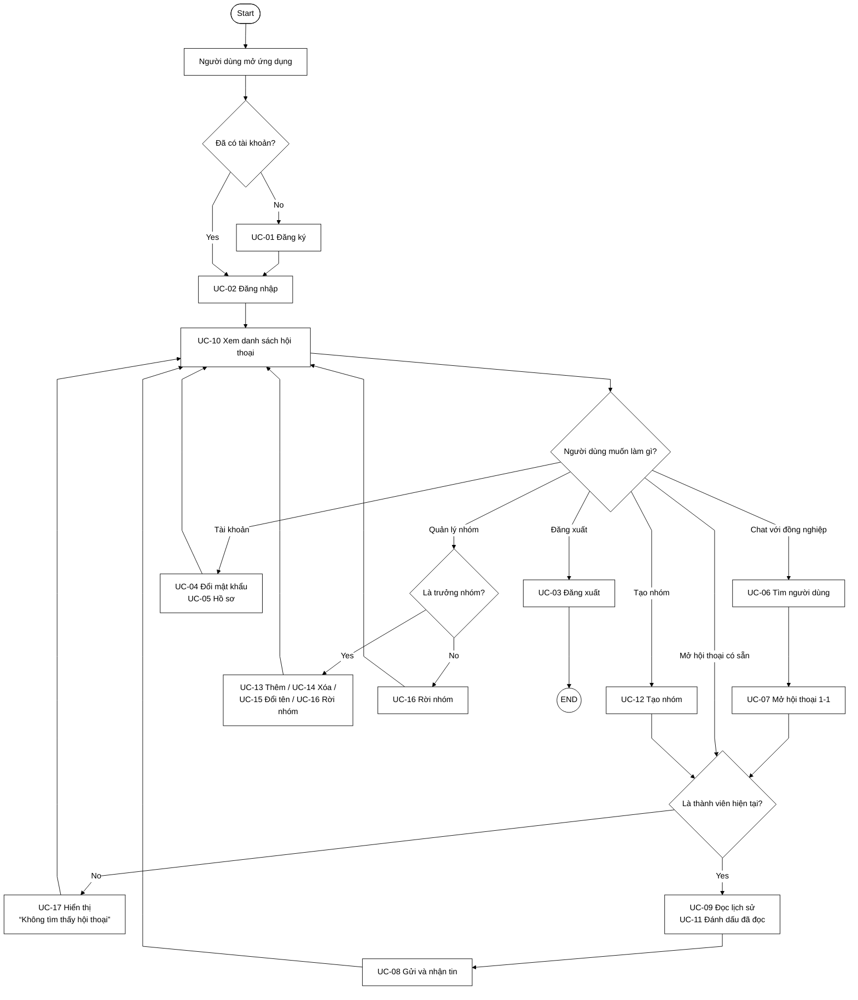


## 3. Danh sách use case

| Mã UC | Tên | Actor chính | Mã SRS liên quan | AT |
|---|---|---|---|---|
| UC-01 | Đăng ký tài khoản | Khách | TK-01, TK-02 | AT-01 |
| UC-02 | Đăng nhập | Khách | TK-03 | AT-01, AT-05 |
| UC-03 | Đăng xuất / hết hạn phiên | Người dùng, Hệ thống | TK-03 | AT-05 |
| UC-04 | Đổi mật khẩu | Người dùng | TK-04, TK-02 | – |
| UC-05 | Xem và sửa hồ sơ | Người dùng | TK-05 | – |
| UC-06 | Tìm người dùng | Người dùng | TK-06 | AT-02 |
| UC-07 | Mở hội thoại 1-1 | Người dùng | CH-01 | AT-02 |
| UC-08 | Gửi và nhận tin (1-1 và nhóm) | Thành viên hội thoại | CH-02, NH-02 | AT-02, AT-03 |
| UC-09 | Đọc lịch sử tin nhắn | Thành viên hội thoại | CH-03 | AT-05 |
| UC-10 | Xem danh sách hội thoại và số chưa đọc | Người dùng | CH-06, TB-01 | AT-04 |
| UC-11 | Đánh dấu đã đọc | Thành viên hội thoại, Hệ thống | TB-01 | AT-04 |
| UC-12 | Tạo nhóm | Người dùng | NH-01, NH-04 | AT-03 |
| UC-13 | Thêm thành viên nhóm | Trưởng nhóm | NH-03, NH-04 | AT-03 |
| UC-14 | Xóa thành viên nhóm | Trưởng nhóm | NH-03, NH-04 | AT-03 |
| UC-15 | Đổi tên nhóm | Trưởng nhóm | NH-03, NH-04 | – |
| UC-16 | Rời nhóm | Thành viên, Trưởng nhóm | NH-03, NH-04 | – |
| UC-17 | Từ chối người ngoài đọc hội thoại | Người ngoài hội thoại | QT-CHUNG-2, NFR-04 | AT-06 |

UC-13 đến UC-16 hợp thành nhóm chức năng **"Quản lý nhóm"** (NH-03).

---

## 4. Đặc tả use case

### UC-01 – Đăng ký tài khoản

| Mục | Nội dung |
|---|---|
| Mục tiêu | Người thuộc tổ chức tự tạo tài khoản để dùng ứng dụng. |
| Actor chính | Khách |
| Trigger | Khách yêu cầu tạo tài khoản mới. |
| Tiền điều kiện | Khách chưa đăng nhập; đã được tổ chức cấp mã đăng ký `[QĐ-06]`. |
| Hậu điều kiện – thành công | Có thêm một tài khoản; mật khẩu chỉ lưu dạng băm `[PDF TK-02]`. |
| Hậu điều kiện – thất bại | Không có tài khoản nào được tạo. |
| Mã SRS | TK-01, TK-02 · TK-01-AC1…AC4, TK-02-AC1…AC4 · NFR-01, NFR-02, NFR-08 · AT-01 |

**Luồng chính**
1. Khách yêu cầu đăng ký.
2. Hệ thống yêu cầu: tên đăng nhập, tên hiển thị, mật khẩu, mật khẩu nhập lại, mã đăng ký tổ chức.
3. Khách cung cấp thông tin.
4. Hệ thống kiểm tra mã đăng ký tổ chức khớp mã đã cấu hình `[QĐ-06]`.
5. Hệ thống đổi tên đăng nhập sang chữ thường, chuẩn hóa tên hiển thị, rồi kiểm tra định dạng: tên đăng nhập 3–30 ký tự gồm a–z, 0–9, `.`, `_` `[QĐ-07]`; tên hiển thị 1–50 ký tự `[GS-02]`; mật khẩu tối thiểu 8 ký tự, có chữ và số `[PDF]`; hai lần nhập mật khẩu giống nhau.
6. Hệ thống kiểm tra tên đăng nhập chưa tồn tại, không phân biệt hoa thường `[PDF]`, `[QĐ-07]`.
7. Hệ thống băm mật khẩu bằng bcrypt hoặc argon2 và lưu tài khoản `[PDF]`.
8. Hệ thống báo đăng ký thành công và chuyển Khách sang UC-02.

**Luồng lỗi**
- 4a. Mã đăng ký sai hoặc bỏ trống → hệ thống báo E-TK01-5 và **dừng, không kiểm tra tiếp**. Quay lại bước 3.
- 5a. Tên đăng nhập sai định dạng → E-TK01-2. Quay lại bước 3.
- 5b. Mật khẩu không đạt quy tắc → E-TK01-3 (chi tiết E-TK02-1/2/3). Quay lại bước 3.
- 5c. Tên hiển thị trống hoặc quá dài → E-TK01-4. Quay lại bước 3.
- 5d. Hai lần nhập mật khẩu không khớp → báo lỗi không khớp `[GU-01]`. Quay lại bước 3.
- 6a. Tên đăng nhập đã tồn tại → E-TK01-1. Quay lại bước 3.
- 6b. Hai Khách đăng ký cùng một tên gần như cùng lúc → chỉ một người thành công; người còn lại nhận E-TK01-1.
- 7a. Lưu dữ liệu thất bại → báo lỗi chung; không tạo tài khoản dở dang.

**Kiểm tra bảo mật**
- Kiểm tra mã đăng ký **trước** các kiểm tra khác, để người ngoài tổ chức không dò được tên đăng nhập nào đã tồn tại `[GU-02]`.
- Mật khẩu không được ghi log, không trả lại trong phản hồi `[PDF TK-02]`.
- Dữ liệu chỉ truyền qua HTTPS `[PDF §4]`.

```mermaid
%%{init: {"theme": "neutral", "flowchart": {"curve": "linear"}}}%%
flowchart TD
    classDef default fill:#ffffff,stroke:#000000,color:#000000
    linkStyle default stroke:#000000
    S(["Start"])
    S --> A["Khách nhập tên đăng nhập, tên hiển thị,<br/>mật khẩu, nhập lại mật khẩu, mã tổ chức"]
    A --> B{"Mã đăng ký tổ chức đúng?"}
    B -->|No| X1["Hiển thị<br/>“Mã đăng ký tổ chức không đúng”"]
    X1 -->|Nhập lại| A
    B -->|Yes| C{"Tên đăng nhập đúng định dạng?"}
    C -->|No| X2["Hiển thị<br/>“Tên đăng nhập không hợp lệ”"]
    X2 -->|Nhập lại| A
    C -->|Yes| D{"Tên hiển thị hợp lệ?"}
    D -->|No| X3["Hiển thị<br/>“Tên hiển thị không hợp lệ”"]
    X3 -->|Nhập lại| A
    D -->|Yes| F{"Mật khẩu hợp lệ?"}
    F -->|No| X4["Hiển thị<br/>“Mật khẩu không hợp lệ”"]
    X4 -->|Nhập lại| A
    F -->|Yes| G{"Hai lần nhập mật khẩu khớp?"}
    G -->|No| X5["Hiển thị<br/>“Mật khẩu nhập lại không khớp”"]
    X5 -->|Nhập lại| A
    G -->|Yes| H{"Tên đăng nhập đã tồn tại chưa?"}
    H -->|Yes| X6["Hiển thị<br/>“Tên đăng nhập đã tồn tại”"]
    X6 -->|Nhập lại| A
    H -->|No| I["Hệ thống băm mật khẩu,<br/>lưu tài khoản"]
    I --> J["Thông báo<br/>“Đăng ký thành công”"]
    J --> K["Chuyển sang UC-02 Đăng nhập"]
    K --> E
    E(("END"))
```

---

### UC-02 – Đăng nhập

| Mục | Nội dung |
|---|---|
| Mục tiêu | Người dùng vào hệ thống để nhắn tin. |
| Actor chính | Khách |
| Trigger | Khách yêu cầu đăng nhập. |
| Tiền điều kiện | Đã có tài khoản (UC-01). |
| Hậu điều kiện – thành công | Có một phiên mới, hạn 8 giờ `[QĐ-09]`; kết nối realtime được mở bằng phiên này. |
| Hậu điều kiện – thất bại | Không có phiên nào được tạo. |
| Mã SRS | TK-03 · TK-03-AC1, AC4 · NFR-01, NFR-03 · AT-01, AT-05 |

**Luồng chính**
1. Khách yêu cầu đăng nhập.
2. Khách cung cấp tên đăng nhập và mật khẩu `[PDF]`.
3. Hệ thống tìm tài khoản theo tên đăng nhập, không phân biệt hoa thường `[QĐ-07]`.
4. Hệ thống đối chiếu mật khẩu với giá trị băm đã lưu.
5. Hệ thống tạo phiên có thời hạn `[PDF]`, `[QĐ-09]`.
6. Hệ thống mở kết nối realtime gắn với phiên.
7. Hệ thống chuyển Người dùng tới UC-10 (danh sách hội thoại).

**Luồng thay thế**
- 5a. Tài khoản đang đăng nhập ở trình duyệt khác → hệ thống vẫn tạo thêm một phiên riêng; phiên cũ không bị ảnh hưởng `[GU-03]`.

**Luồng lỗi**
- 3a. Không có tài khoản với tên này → E-TK03-1. Quay lại bước 2.
- 4a. Sai mật khẩu → **cùng** thông báo E-TK03-1 như 3a. Quay lại bước 2.
- 2a. Bỏ trống tên đăng nhập hoặc mật khẩu → yêu cầu nhập đủ; không gửi đi.

**Kiểm tra bảo mật**
- Thông báo lỗi không cho biết sai tên hay sai mật khẩu (SRS TK-03 R5).
- Mật khẩu chỉ được so với giá trị băm, không bao giờ so với bản gốc được lưu.

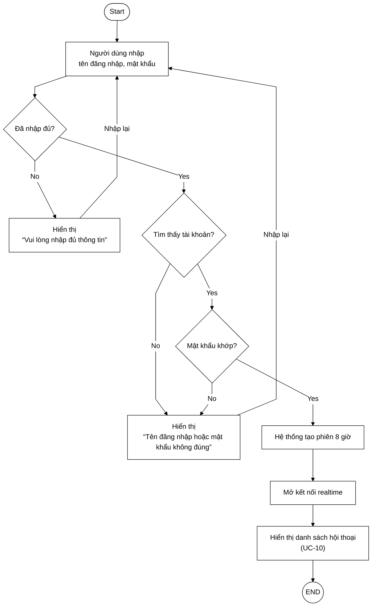

---

### UC-03 – Đăng xuất / hết hạn phiên

| Mục | Nội dung |
|---|---|
| Mục tiêu | Kết thúc phiên để người khác không dùng lại được. |
| Actor chính | Người dùng (đăng xuất); Hệ thống (hết hạn) |
| Trigger | Người dùng yêu cầu đăng xuất, **hoặc** phiên quá 8 giờ. |
| Tiền điều kiện | Người dùng đang có phiên. |
| Hậu điều kiện | Phiên bị hủy ở máy chủ `[PDF "đăng xuất hủy token"]`; kết nối realtime của phiên bị đóng `[GS-07]`; dữ liệu đã lưu (tin nhắn, hội thoại) **không** bị ảnh hưởng. |
| Mã SRS | TK-03 · TK-03-AC2, AC3, AC4 · NFR-03 · AT-05 |

**Luồng chính – đăng xuất**
1. Người dùng yêu cầu đăng xuất.
2. Hệ thống hủy phiên hiện tại ở máy chủ.
3. Hệ thống đóng kết nối realtime gắn với phiên đó.
4. Trình duyệt xóa dữ liệu hội thoại đang giữ tạm.
5. Người dùng trở về trạng thái Khách.

**Luồng thay thế – hết hạn phiên**
- A1. Phiên đã quá thời hạn.
- A2. Người dùng gửi yêu cầu bất kỳ → hệ thống từ chối (E-TK03-2) và đóng kết nối realtime.
- A3. Người dùng được yêu cầu đăng nhập lại (UC-02). Nội dung đang soạn dở có thể mất `[GU-04]`.

**Luồng lỗi**
- E1. Có người dùng lại phiên đã đăng xuất (ví dụ phiên bị sao chép từ trước) → hệ thống từ chối với E-TK03-2, kể cả khi phiên chưa hết thời hạn.

**Kiểm tra bảo mật**
- Hủy phiên phải ở **máy chủ**, không chỉ xóa ở trình duyệt `[PDF]`.
- Mọi yêu cầu sau đó qua API hoặc kết nối realtime đều kiểm tra phiên còn hiệu lực.

**Kiểm chứng AT-05:** sau bước 5, thực hiện UC-02 rồi UC-09 → toàn bộ lịch sử còn nguyên (TK-03-AC4).

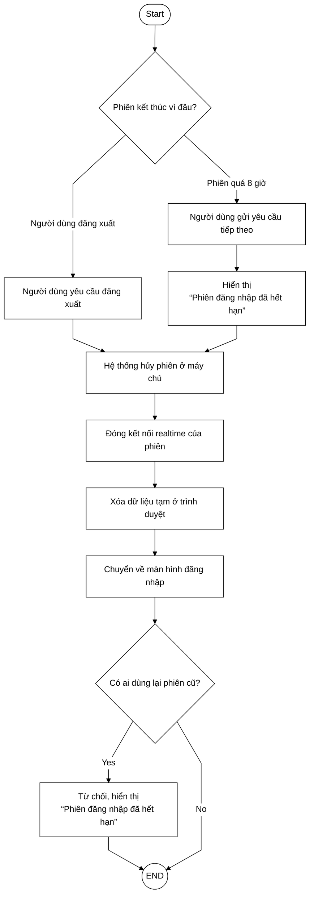

---

### UC-04 – Đổi mật khẩu

| Mục | Nội dung |
|---|---|
| Mục tiêu | Người dùng thay mật khẩu khi cần. |
| Actor chính | Người dùng |
| Trigger | Người dùng yêu cầu đổi mật khẩu. |
| Tiền điều kiện | Đã đăng nhập. |
| Hậu điều kiện – thành công | Mật khẩu mới (dạng băm) thay mật khẩu cũ; **các phiên khác** của tài khoản bị hủy, phiên hiện tại giữ nguyên `[QĐ-09]`. |
| Hậu điều kiện – thất bại | Mật khẩu cũ vẫn dùng được; không phiên nào bị hủy. |
| Mã SRS | TK-04, TK-02 · TK-04-AC1…AC3 · NFR-02, NFR-03 |

**Luồng chính**
1. Người dùng yêu cầu đổi mật khẩu.
2. Người dùng cung cấp mật khẩu hiện tại, mật khẩu mới và mật khẩu mới nhập lại `[PDF]`.
3. Hệ thống kiểm tra phiên hợp lệ.
4. Hệ thống kiểm tra mật khẩu hiện tại đúng.
5. Hệ thống kiểm tra mật khẩu mới: đạt quy tắc TK-02, khác mật khẩu hiện tại `[GS-08]`, khớp lần nhập lại.
6. Hệ thống băm và lưu mật khẩu mới.
7. Hệ thống hủy mọi phiên khác của tài khoản và đóng kết nối realtime của các phiên đó.
8. Hệ thống báo đổi mật khẩu thành công.

**Luồng lỗi**
- 3a. Phiên hết hạn → E-TK03-2; chuyển sang UC-02.
- 4a. Mật khẩu hiện tại sai → E-TK04-1. Quay lại bước 2.
- 5a. Mật khẩu mới không đạt quy tắc → E-TK04-2.
- 5b. Mật khẩu mới trùng mật khẩu hiện tại → E-TK04-3.
- 5c. Nhập lại không khớp → E-TK04-4.

**Kiểm tra bảo mật**
- Bắt buộc xác minh mật khẩu hiện tại, kể cả khi đã đăng nhập.
- Hủy các phiên khác để ai đang giữ phiên cũ trên máy khác bị đăng xuất.

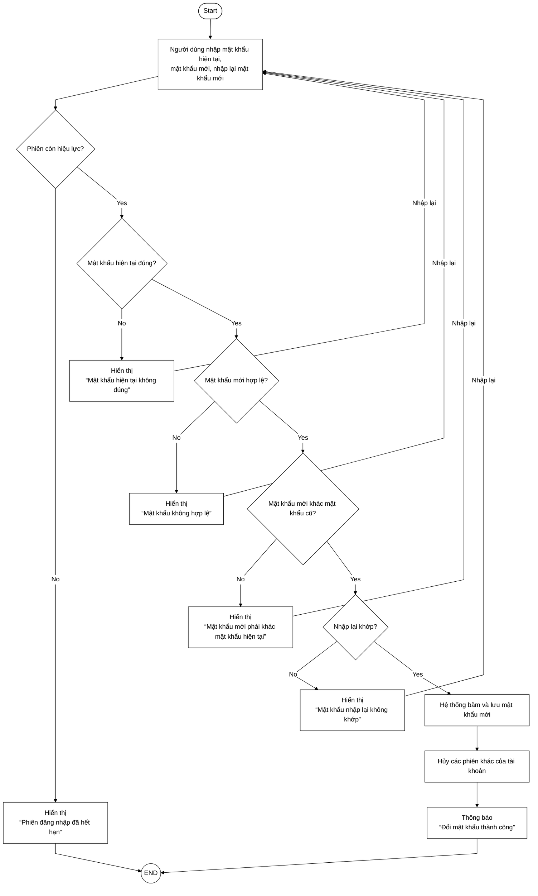

---

### UC-05 – Xem và sửa hồ sơ

| Mục | Nội dung |
|---|---|
| Mục tiêu | Người dùng xem thông tin của mình và đổi tên hiển thị. |
| Actor chính | Người dùng |
| Trigger | Người dùng yêu cầu xem hồ sơ. |
| Tiền điều kiện | Đã đăng nhập. |
| Hậu điều kiện | Tên hiển thị mới được lưu; avatar chữ cái tính lại theo tên mới; người khác thấy tên mới ở mọi nơi `[GS-12]`. |
| Mã SRS | TK-05 · TK-05-AC1…AC3 · NFR-08 |

**Luồng chính**
1. Người dùng yêu cầu xem hồ sơ.
2. Hệ thống trả về tên đăng nhập (chỉ xem), tên hiển thị và avatar chữ cái `[PDF]`, `[GS-11]`.
3. Người dùng cung cấp tên hiển thị mới.
4. Hệ thống kiểm tra phiên, rồi kiểm tra tên mới dài 1–50 ký tự sau khi bỏ khoảng trắng.
5. Hệ thống lưu tên mới và tính lại avatar.
6. Hệ thống báo đã lưu.

**Luồng lỗi**
- 4a. Tên trống hoặc quá dài → E-TK05-1; giữ tên cũ.

**Kiểm tra bảo mật**
- Người dùng chỉ xem và sửa được hồ sơ **của chính mình**.
- Tên đăng nhập không sửa được `[GS-10]`.
- Không có chức năng tải ảnh lên `[PDF]`.

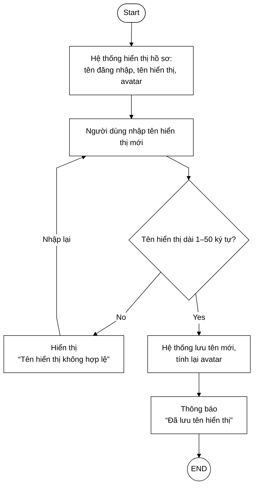

---

### UC-06 – Tìm người dùng

| Mục | Nội dung |
|---|---|
| Mục tiêu | Tìm đồng nghiệp để bắt đầu trò chuyện hoặc thêm vào nhóm. |
| Actor chính | Người dùng |
| Trigger | Người dùng nhập từ khóa tìm kiếm. |
| Tiền điều kiện | Đã đăng nhập. |
| Hậu điều kiện | Người dùng nhận danh sách tối đa 20 tài khoản khớp `[GS-14]`; không có dữ liệu nào bị thay đổi. |
| Mã SRS | TK-06 · TK-06-AC1…AC3 · NFR-09 · AT-02 |

**Luồng chính**
1. Người dùng cung cấp từ khóa.
2. Hệ thống kiểm tra phiên.
3. Hệ thống chuẩn hóa từ khóa (bỏ khoảng trắng đầu/cuối, NFC).
4. Hệ thống tìm tài khoản có **tên đăng nhập hoặc tên hiển thị chứa từ khóa**, không phân biệt hoa thường `[PDF]`, `[GS-13]`.
5. Hệ thống loại chính người đang tìm khỏi kết quả `[PDF "tài khoản khác"]`.
6. Hệ thống trả tối đa 20 kết quả, mỗi kết quả gồm tên đăng nhập, tên hiển thị, avatar.
7. Người dùng chọn một người. Nếu đang ở ngoài nhóm → UC-07. Nếu đang tạo nhóm hoặc thêm thành viên → người đó được đưa vào danh sách chọn (UC-12, UC-13).

**Luồng thay thế**
- 1a. Từ khóa trống sau khi bỏ khoảng trắng → không tìm, không báo lỗi (E-TK06-1).
- 6a. Không có kết quả → báo "không tìm thấy" (không phải lỗi).
- 5a. Khi dùng cho UC-13, hệ thống loại thêm những người đã ở trong nhóm `[GU-05]`.

**Kiểm tra bảo mật**
- Chỉ trả 3 thông tin công khai (tên đăng nhập, tên hiển thị, avatar). Không trả mật khẩu băm, thời điểm đăng nhập hay danh sách hội thoại của người khác.
- Tìm kiếm phân biệt dấu: "nguyen" không ra "Nguyễn" `[GĐ-10]`, `[OQ-08]`.

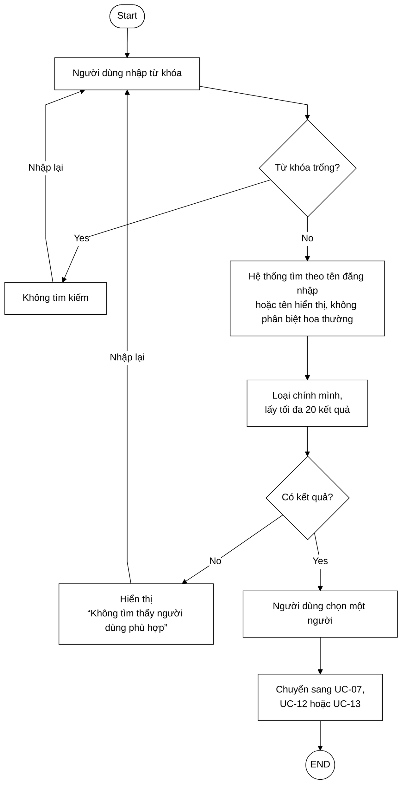

---

### UC-07 – Mở hội thoại 1-1

| Mục | Nội dung |
|---|---|
| Mục tiêu | Bắt đầu hoặc tiếp tục trò chuyện riêng với một đồng nghiệp. |
| Actor chính | Người dùng |
| Trigger | Người dùng chọn một người từ kết quả UC-06. |
| Tiền điều kiện | Đã đăng nhập. |
| Hậu điều kiện | Tồn tại **đúng một** hội thoại 1-1 giữa hai người `[PDF]`; Người dùng đang ở trong hội thoại đó. |
| Mã SRS | CH-01 · CH-01-AC1…AC3 · AT-02 |

**Luồng chính**
1. Người dùng chọn người B.
2. Hệ thống kiểm tra phiên, kiểm tra B tồn tại và B không phải chính Người dùng `[GĐ-14]`.
3. Hệ thống tìm hội thoại 1-1 của cặp (Người dùng, B), không phụ thuộc ai mở trước.
4. Hệ thống tìm thấy hội thoại cũ và mở lại `[PDF]`.
5. Hệ thống thực hiện UC-09 (tải 50 tin gần nhất) và UC-11 (đánh dấu đã đọc).

**Luồng thay thế**
- 4a. Chưa có hội thoại → hệ thống tạo mới rồi tiếp tục bước 5 (lịch sử rỗng).
- 4b. B cũng đang mở hội thoại với Người dùng cùng lúc → hệ thống bảo đảm cả hai vào **cùng một** hội thoại, không tạo hai `[GS-17]`.
- 4c. Hội thoại mới chưa có tin nào → chưa hiện trong danh sách hội thoại của **cả hai** người cho tới khi có tin đầu tiên `[GS-16]`, `[GU-06]`.

**Luồng lỗi**
- 2a. Chọn chính mình → E-CH01-1.
- 2b. B không tồn tại → E-CH01-2.

**Kiểm tra bảo mật**
- Hội thoại 1-1 chỉ có đúng hai thành viên; không ai thêm được người thứ ba vào hội thoại 1-1 `[GU-07]`.

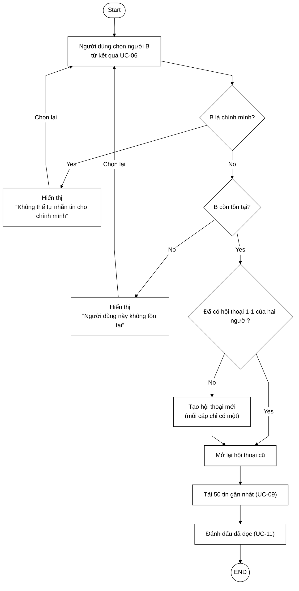

---

### UC-08 – Gửi và nhận tin (1-1 và nhóm)

| Mục | Nội dung |
|---|---|
| Mục tiêu | Trao đổi tin văn bản tiếng Việt tức thì. |
| Actor chính | Thành viên hội thoại (người gửi) |
| Actor phụ | Các thành viên khác (người nhận); Hệ thống |
| Trigger | Người gửi gửi một tin. |
| Tiền điều kiện | Đã đăng nhập; là **thành viên hiện tại** của hội thoại. |
| Hậu điều kiện – thành công | Tin được lưu ở cơ sở dữ liệu `[PDF §4]`; thành viên đang trực tuyến nhận được tin trong < 2 giây `[PDF §4]`; tin cuối và số chưa đọc của người khác được cập nhật. |
| Hậu điều kiện – thất bại | Không có tin nào được lưu hay phát đi. |
| Mã SRS | CH-02, NH-02 · CH-02-AC1…AC4, NH-02-AC1, AC2 · NFR-05, NFR-08, NFR-13 · AT-02, AT-03 |

**Luồng chính**
1. Người gửi soạn nội dung: tiếng Việt có dấu, có thể nhiều dòng `[PDF]`.
2. Người gửi gửi tin.
3. Hệ thống kiểm tra phiên.
4. Hệ thống kiểm tra người gửi **đang là thành viên** hội thoại (QT-CHUNG-2).
5. Hệ thống chuẩn hóa NFC, kiểm tra tin không trống và **≤ 5.000 ký tự** `[PDF]`, `[GS-18]`.
6. Hệ thống **lưu tin vào cơ sở dữ liệu**, gán thời điểm máy chủ nhận `[GS-20]`.
7. Hệ thống xác nhận cho người gửi.
8. Hệ thống đẩy tin realtime qua WebSocket tới mọi kết nối đang mở của các thành viên hiện tại `[PDF]`.
9. Hệ thống cập nhật tin cuối của hội thoại và tăng số chưa đọc cho các thành viên khác (UC-10).
10. Người nhận thấy tin đúng từng ký tự, giữ nguyên xuống dòng. Trong nhóm, mỗi tin kèm tên hiển thị và avatar người gửi `[PDF NH-02]`.

**Luồng thay thế**
- 8a. Người nhận không trực tuyến → tin vẫn được lưu; người nhận thấy tin khi mở hội thoại (UC-09) và thấy số chưa đọc tăng (UC-10).
- 10a. Người nhận đang mở đúng hội thoại và đang xem tab trình duyệt → hệ thống đánh dấu đã đọc ngay (UC-11) `[GS-33]`.
- 10b. Người nhận đăng nhập trên nhiều trình duyệt → mọi nơi đều nhận tin.

**Luồng lỗi**
- 5a. Tin dài hơn 5.000 ký tự → E-CH02-1; không lưu.
- 5b. Tin trống hoặc chỉ có khoảng trắng → E-CH02-2; không lưu.
- 4a. Người gửi không còn là thành viên (đã rời, bị xóa) → E-CH02-3; không lưu, không phát. Xem UC-17.
- 3a. Phiên hết hạn → E-TK03-2.
- 7a. Mất kết nối trước khi nhận xác nhận → tin được đánh dấu gửi lỗi và giữ nguyên để gửi lại. Gửi lại không tạo tin trùng `[GU-08]` (NFR-13, mức khuyến khích).

**Kiểm tra bảo mật**
- Kiểm tra thành viên ở **mỗi lần gửi**, không chỉ lúc mở hội thoại.
- Nội dung được hiển thị dạng chữ thuần, không chạy được mã (CH-02-AC4).
- Hệ thống chỉ đẩy tin tới thành viên hiện tại.

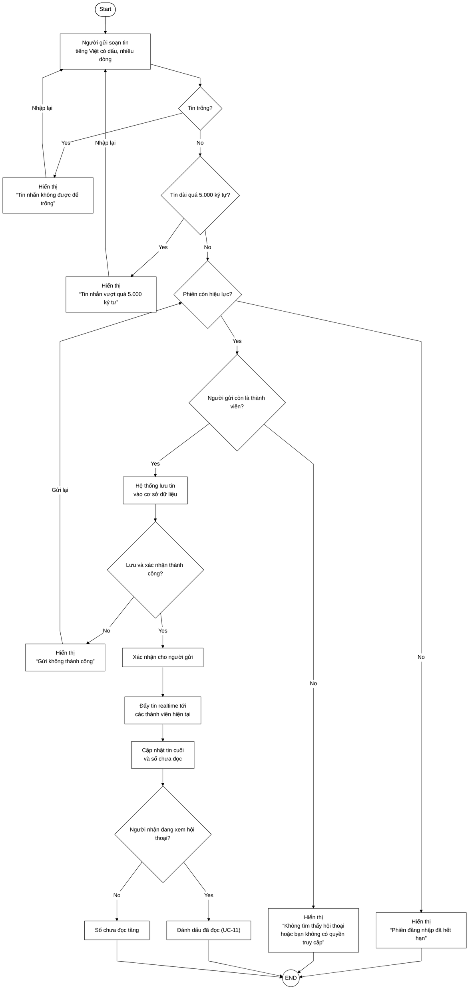

---

### UC-09 – Đọc lịch sử tin nhắn

| Mục | Nội dung |
|---|---|
| Mục tiêu | Xem lại toàn bộ trao đổi trước đây, từng phần 50 tin. |
| Actor chính | Thành viên hội thoại |
| Trigger | Người dùng mở một hội thoại, hoặc yêu cầu xem tin cũ hơn. |
| Tiền điều kiện | Đã đăng nhập; là thành viên hiện tại của hội thoại. |
| Hậu điều kiện | Người dùng thấy các tin trong **phạm vi được xem** của mình; không tin nào bị trùng hay thiếu. |
| Mã SRS | CH-03 · CH-03-AC1…AC3 · NFR-06, NFR-07 · AT-05 |

**Luồng chính**
1. Người dùng mở hội thoại.
2. Hệ thống kiểm tra phiên và kiểm tra người dùng là thành viên hiện tại.
3. Hệ thống xác định **phạm vi được xem** của người dùng (xem mục 5).
4. Hệ thống trả **50 tin gần nhất** trong phạm vi đó `[PDF]`, kể cả tin hệ thống.
5. Người dùng yêu cầu xem tin cũ hơn.
6. Hệ thống trả **50 tin cũ hơn** tin cũ nhất người dùng đang có `[PDF]`, `[GS-22]`.
7. Lặp lại bước 5–6 cho tới khi hệ thống trả ít hơn 50 tin. Khi đó hệ thống báo đã hết lịch sử.

**Luồng thay thế**
- 4a. Hội thoại có ít hơn 50 tin → trả toàn bộ và báo đã hết.
- 6a. Có tin mới đến trong lúc người dùng đang xem tin cũ → tin mới được thêm vào cuối, không làm trùng hay sót trang cũ `[GS-22]`.
- 3a. Thành viên nhóm được thêm **không** kèm quyền xem tin cũ → phạm vi bắt đầu từ lúc được thêm `[QĐ-08]`.

**Luồng lỗi**
- 2a. Không phải thành viên → E-CH03-1; không trả tin nào. Xem UC-17.
- 6b. Tải lỗi do mạng → E-CH03-2; các tin đã có vẫn giữ nguyên, người dùng có thể thử lại.

**Kiểm tra bảo mật**
- Phạm vi được xem do máy chủ tính; trình duyệt không thể yêu cầu tin ngoài phạm vi.
- Lịch sử lưu ở cơ sở dữ liệu, còn nguyên sau khi khởi động lại dịch vụ `[PDF §4]` (CH-03-AC3).

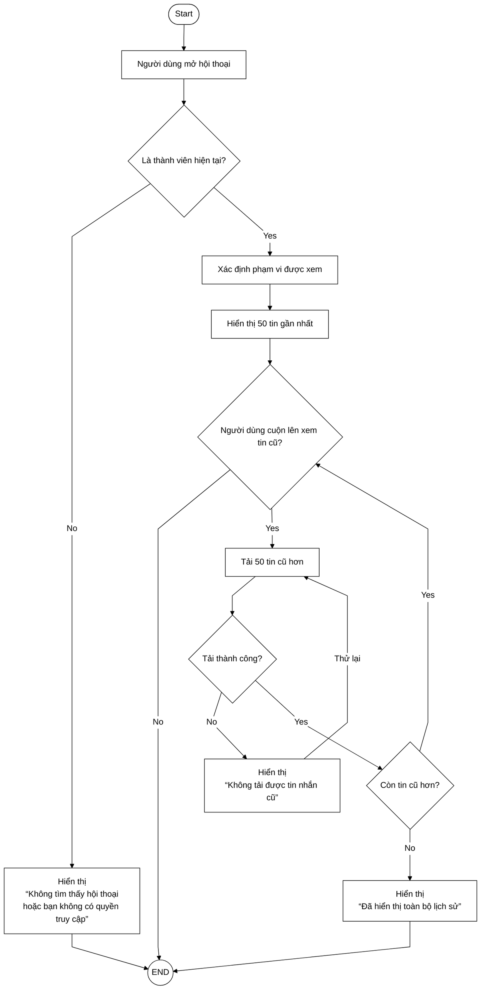

---

### UC-10 – Xem danh sách hội thoại và số chưa đọc

| Mục | Nội dung |
|---|---|
| Mục tiêu | Biết mình đang có những cuộc trò chuyện nào và cuộc nào có tin mới. |
| Actor chính | Người dùng |
| Trigger | Đăng nhập thành công (UC-02), hoặc có sự kiện làm thay đổi danh sách (tin mới, nhóm mới, bị xóa khỏi nhóm, đổi tên nhóm). |
| Tiền điều kiện | Đã đăng nhập. |
| Hậu điều kiện | Người dùng thấy danh sách đúng, kèm số chưa đọc từng hội thoại và tổng số. |
| Mã SRS | CH-06, TB-01 · CH-06-AC1…AC3, TB-01-AC1 · AT-04 |

**Luồng chính**
1. Người dùng đăng nhập hoặc quay lại danh sách.
2. Hệ thống kiểm tra phiên.
3. Hệ thống lấy các hội thoại mà người dùng **đang là thành viên** và đã có ít nhất một tin trong phạm vi được xem.
4. Hệ thống sắp xếp theo thời gian tin cuối, mới nhất trước `[PDF]`.
5. Với mỗi hội thoại, hệ thống trả: tên, avatar, trích tin cuối, thời gian, số chưa đọc `[PDF]`.
6. Hệ thống tính tổng số chưa đọc để hiển thị trên tab/biểu tượng ứng dụng `[PDF TB-01]`.
7. Khi có tin mới hoặc thay đổi nhóm, hệ thống đẩy cập nhật và danh sách được sắp xếp lại mà không cần tải lại `[GS-27]`.

**Luồng thay thế**
- 3a. Chưa có hội thoại nào → danh sách rỗng, kèm hướng dẫn tìm người (UC-06).
- 7a. Người dùng vừa bị xóa khỏi nhóm hoặc vừa rời nhóm → nhóm biến mất khỏi danh sách ngay `[QĐ-04]`.
- 7b. Tin mới nhất là tin hệ thống → hội thoại vẫn nhảy lên đầu, nhưng số chưa đọc **không** tăng `[QĐ-10]`.

**Luồng lỗi**
- 2a. Phiên hết hạn → E-TK03-2.
- 3b. Tải danh sách lỗi → E-CH06-1; cho thử lại.

**Kiểm tra bảo mật**
- Danh sách chỉ gồm hội thoại người dùng đang tham gia. Trích tin cuối và số chưa đọc chỉ tính trong phạm vi được xem.

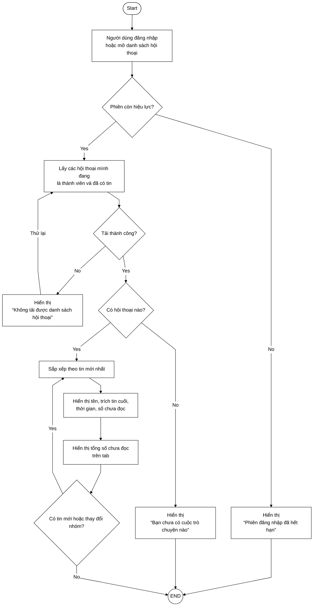

---

### UC-11 – Đánh dấu đã đọc

| Mục | Nội dung |
|---|---|
| Mục tiêu | Số chưa đọc phản ánh đúng những gì người dùng chưa xem. |
| Actor chính | Thành viên hội thoại (hành động mở hội thoại); Hệ thống (tự đánh dấu) |
| Trigger | Người dùng mở một hội thoại; **hoặc** có tin mới khi người dùng đang mở hội thoại đó và đang xem tab trình duyệt. |
| Tiền điều kiện | Đã đăng nhập; là thành viên hiện tại. |
| Hậu điều kiện | Mốc đã đọc của người dùng trong hội thoại được đặt tới tin mới nhất; số chưa đọc của hội thoại **về 0** `[PDF §5 bước 4]`; tổng số giảm tương ứng; mọi tab/trình duyệt của cùng tài khoản được cập nhật `[GS-34]`. |
| Mã SRS | TB-01, CH-06 · TB-01-AC2…AC4 · AT-04 |

Đánh dấu đã đọc là hành vi **tự động** khi người dùng xem hội thoại; người dùng không phải làm thao tác riêng `[GU-09]`.

**Luồng chính**
1. Người dùng mở hội thoại (từ UC-07 hoặc UC-10).
2. Hệ thống kiểm tra phiên và kiểm tra thành viên.
3. Hệ thống đặt mốc đã đọc tới tin mới nhất trong phạm vi được xem.
4. Hệ thống đặt số chưa đọc của hội thoại về 0 và tính lại tổng số.
5. Hệ thống đẩy số mới tới mọi tab và trình duyệt của cùng tài khoản.

**Luồng thay thế**
- 1a. Tin mới đến khi người dùng đang mở hội thoại **và** đang xem tab → hệ thống tự thực hiện bước 3–5 `[GS-33]`.
- 1b. Tin mới đến khi tab đang bị ẩn → **không** đánh dấu; số chưa đọc tăng. Khi người dùng quay lại tab → thực hiện bước 3–5.

**Quy tắc đếm**
- Chỉ đếm tin văn bản **do người khác gửi**, sau mốc đã đọc, trong phạm vi được xem.
- Không đếm tin của chính mình và tin hệ thống `[QĐ-10]`.
- Thành viên mới được cho xem tin cũ: các tin trước lúc được thêm **không** tính vào số chưa đọc `[GU-10]`.

**Luồng lỗi**
- 2a. Không còn là thành viên → từ chối, không thay đổi gì (UC-17).

**Kiểm chứng AT-04:** B gửi 3 tin cho A khi A đang ở hội thoại khác → A thấy số 3 (UC-10) → A mở hội thoại với B → số về 0 (TB-01-AC1, AC2).

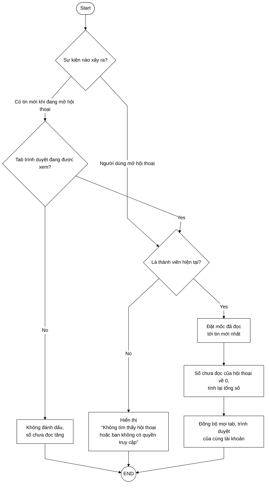

---

### UC-12 – Tạo nhóm

| Mục | Nội dung |
|---|---|
| Mục tiêu | Lập một nhóm trao đổi chung cho nhiều người. |
| Actor chính | Người dùng (trở thành Trưởng nhóm) |
| Actor phụ | Hệ thống (sinh tin hệ thống) |
| Trigger | Người dùng yêu cầu tạo nhóm. |
| Tiền điều kiện | Đã đăng nhập. |
| Hậu điều kiện – thành công | Nhóm mới có người tạo là **trưởng nhóm** `[PDF]` và ít nhất 2 thành viên khác; có tin hệ thống "đã tạo nhóm" `[GS-30]`; nhóm xuất hiện trong danh sách của mọi thành viên. |
| Hậu điều kiện – thất bại | Không có nhóm nào được tạo. |
| Mã SRS | NH-01, NH-04 · NH-01-AC1…AC3 · AT-03 |

**Luồng chính**
1. Người dùng yêu cầu tạo nhóm.
2. Người dùng cung cấp tên nhóm.
3. Người dùng chọn thành viên qua UC-06.
4. Hệ thống kiểm tra phiên.
5. Hệ thống kiểm tra tên nhóm dài 1–100 ký tự `[GS-28]`.
6. Hệ thống kiểm tra đã chọn **từ 2 người trở lên**, không tính người tạo `[PDF]`, `[GĐ-05]`; không trùng lặp; mọi tài khoản đều tồn tại.
7. Hệ thống tạo nhóm, gán người tạo làm trưởng nhóm, thêm các thành viên được chọn.
8. Hệ thống sinh tin hệ thống "đã tạo nhóm" `[GS-30]`.
9. Hệ thống đẩy nhóm mới vào danh sách hội thoại của mọi thành viên.
10. Người tạo vào nhóm vừa tạo.

**Luồng lỗi**
- 5a. Tên nhóm trống hoặc quá dài → E-NH01-1.
- 6a. Chọn ít hơn 2 người → E-NH01-2.
- 6b. Có tài khoản không tồn tại → E-NH01-3.
- 4a. Phiên hết hạn → E-TK03-2.

**Kiểm tra bảo mật**
- Người tạo luôn là trưởng nhóm; trình duyệt không chỉ định được người khác làm trưởng nhóm lúc tạo.
- Tạo nhóm và tin hệ thống được lưu cùng lúc: cùng thành công hoặc cùng thất bại `[GU-11]`.

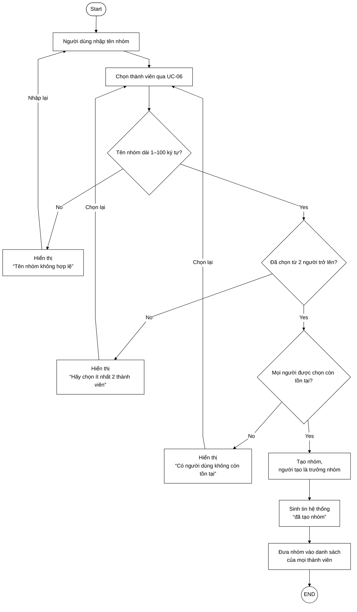

---

### Quản lý nhóm (NH-03, NH-04)

Bảng quyền dùng chung cho UC-13…UC-16 `[PDF NH-03]`, `[QĐ-03]`:

| Thao tác | Trưởng nhóm | Thành viên thường |
|---|---|---|
| Thêm thành viên (UC-13) | Được | Không |
| Xóa thành viên (UC-14) | Được, trừ chính mình | Không |
| Đổi tên nhóm (UC-15) | Được | Không |
| Rời nhóm (UC-16) | Được, bắt buộc chuyển quyền trước | Được |

Mọi thao tác thành công đều sinh tin hệ thống `[PDF NH-04]`. Tin hệ thống được lưu cùng lúc với sự kiện `[GU-11]` và không tính vào số chưa đọc `[QĐ-10]`.

### UC-13 – Thêm thành viên nhóm

| Mục | Nội dung |
|---|---|
| Mục tiêu | Đưa thêm người vào nhóm đang có. |
| Actor chính | Trưởng nhóm |
| Trigger | Trưởng nhóm yêu cầu thêm thành viên. |
| Tiền điều kiện | Đã đăng nhập; là trưởng nhóm hiện tại của nhóm. |
| Hậu điều kiện – thành công | Người được thêm là thành viên, có phạm vi được xem theo lựa chọn `[QĐ-08]`; có một tin hệ thống cho mỗi người được thêm; nhóm xuất hiện trong danh sách của người mới. |
| Mã SRS | NH-03, NH-04, CH-03 · NH-03-AC1, AC1b, NH-04-AC1 · NFR-04 · AT-03 |

**Luồng chính**
1. Trưởng nhóm yêu cầu thêm thành viên.
2. Trưởng nhóm chọn một hoặc nhiều người qua UC-06 (đã loại người đang trong nhóm) `[GU-05]`, `[GU-12]`.
3. Trưởng nhóm quyết định **có hay không** cho người mới xem tin nhắn trước đó; mặc định là **không** `[QĐ-08]`, `[GS-35]`.
4. Hệ thống kiểm tra phiên, kiểm tra người yêu cầu là thành viên của nhóm, rồi kiểm tra là trưởng nhóm.
5. Hệ thống kiểm tra từng người được chọn tồn tại và chưa là thành viên.
6. Hệ thống thêm từng người, kèm mốc bắt đầu xem: từ lúc tạo nhóm nếu cho xem tin cũ `[GS-36]`, từ lúc được thêm nếu không.
7. Hệ thống sinh **một** tin hệ thống "A đã thêm D vào nhóm" cho mỗi người `[PDF NH-04]`.
8. Hệ thống đẩy tin hệ thống tới các thành viên và đẩy nhóm vào danh sách của người mới.

**Luồng lỗi**
- 4a. Người yêu cầu không phải thành viên của nhóm → phản hồi "không tìm thấy" (UC-17).
- 4b. Là thành viên nhưng không phải trưởng nhóm → E-NH03-1; không thay đổi gì.
- 5a. Người được chọn đã là thành viên hoặc không tồn tại → E-NH03-2; không thêm ai trong lần đó `[GU-13]`.

**Kiểm tra bảo mật**
- Quyền trưởng nhóm kiểm tra ở máy chủ cho **mỗi** yêu cầu.
- Người được thêm mà **không** được cho xem tin cũ thì không đọc được tin trước mốc, kể cả khi gọi thẳng tới máy chủ (NH-03-AC1).

**Kiểm chứng AT-03 (phần thêm):** nhóm A, B, C; A thêm D → A, B, C thấy tin hệ thống "A đã thêm D vào nhóm" (NH-04-AC1).

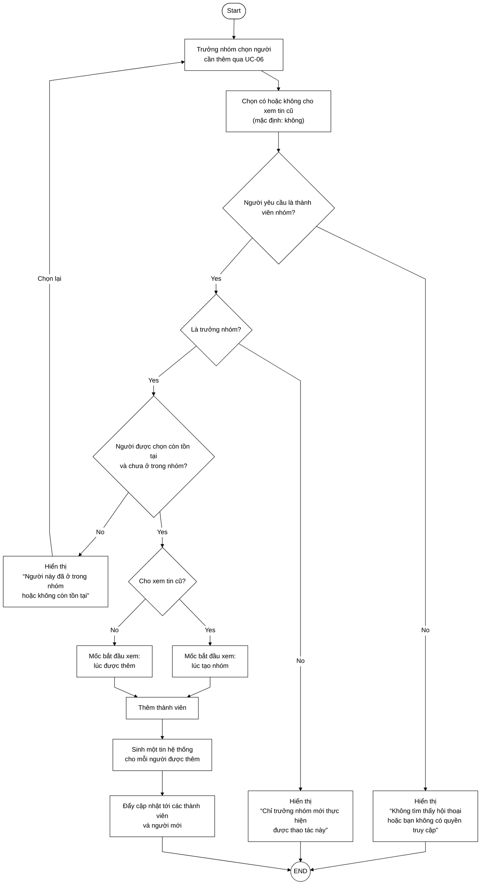

---

### UC-14 – Xóa thành viên nhóm

| Mục | Nội dung |
|---|---|
| Mục tiêu | Đưa một người ra khỏi nhóm. |
| Actor chính | Trưởng nhóm |
| Actor phụ | Thành viên bị xóa |
| Trigger | Trưởng nhóm yêu cầu xóa thành viên D. |
| Tiền điều kiện | Đã đăng nhập; là trưởng nhóm; D đang là thành viên. |
| Hậu điều kiện – thành công | D **mất quyền xem toàn bộ** nhóm, kể cả tin cũ `[QĐ-04]`; có tin hệ thống "A đã xóa D khỏi nhóm" cho các thành viên còn lại; nhóm biến mất khỏi danh sách của D. |
| Mã SRS | NH-03, NH-04 · NH-03-AC2, NH-04-AC1, CH-06-AC3 · NFR-04 · AT-03 |

**Luồng chính**
1. Trưởng nhóm yêu cầu xóa D.
2. Trưởng nhóm xác nhận.
3. Hệ thống kiểm tra phiên, thành viên, quyền trưởng nhóm.
4. Hệ thống kiểm tra D là thành viên và D không phải trưởng nhóm.
5. Hệ thống **thu hồi quyền của D ngay**, ngừng đẩy tin của nhóm tới D.
6. Hệ thống sinh tin hệ thống và đẩy tới các thành viên còn lại `[PDF NH-04]`.
7. Hệ thống báo cho D biết đã bị xóa; nhóm biến mất khỏi danh sách của D.

**Luồng thay thế**
- 2a. Trưởng nhóm không xác nhận → không làm gì.
- 7a. D đang xem nhóm → D được báo đã không còn là thành viên và được đưa ra khỏi hội thoại.
- 6a. Sau khi xóa, nhóm còn dưới 3 người → vẫn cho phép `[GS-31]`, `[OQ-15]`.

**Luồng lỗi**
- 3a. Không phải trưởng nhóm → E-NH03-1.
- 4a. Trưởng nhóm tự xóa chính mình → từ chối; phải dùng UC-16 `[GU-14]`.
- 4b. D không còn trong nhóm → từ chối, không đổi gì.

**Kiểm tra bảo mật**
- Ngừng đẩy tin tới D **trước** khi phát tin hệ thống, để D không nhận bất kỳ tin nào sau thời điểm bị xóa.
- Mọi yêu cầu sau đó của D vào nhóm đều bị từ chối như người ngoài (UC-17, biến thể V5).

**Kiểm chứng AT-03 (phần xóa):** A xóa D → A, B, C thấy tin hệ thống "A đã xóa D khỏi nhóm".

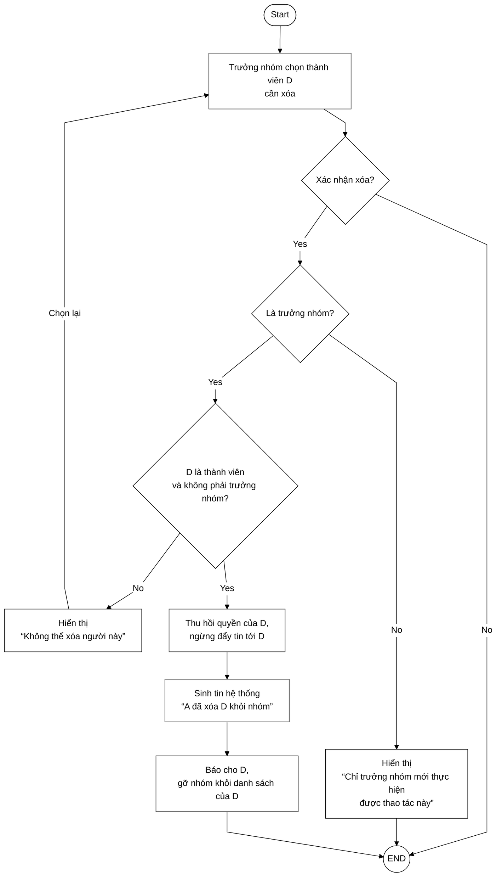

---

### UC-15 – Đổi tên nhóm

| Mục | Nội dung |
|---|---|
| Mục tiêu | Cập nhật tên nhóm cho đúng mục đích sử dụng. |
| Actor chính | Trưởng nhóm |
| Trigger | Trưởng nhóm yêu cầu đổi tên nhóm. |
| Tiền điều kiện | Đã đăng nhập; là trưởng nhóm. |
| Hậu điều kiện – thành công | Nhóm có tên mới; có tin hệ thống "A đã đổi tên nhóm thành …"; mọi thành viên thấy tên mới. |
| Mã SRS | NH-03, NH-04 · NH-04-AC2 |

**Luồng chính**
1. Trưởng nhóm cung cấp tên mới.
2. Hệ thống kiểm tra phiên, thành viên, quyền trưởng nhóm.
3. Hệ thống kiểm tra tên mới dài 1–100 ký tự.
4. Hệ thống lưu tên mới.
5. Hệ thống sinh tin hệ thống đổi tên `[PDF NH-04]`.
6. Hệ thống đẩy tên mới tới mọi thành viên.

**Luồng thay thế**
- 3a. Tên mới giống hệt tên cũ → không làm gì, không sinh tin hệ thống `[GU-15]`.

**Luồng lỗi**
- 2a. Không phải trưởng nhóm → E-NH03-1.
- 3b. Tên không hợp lệ → E-NH03-5; giữ tên cũ.

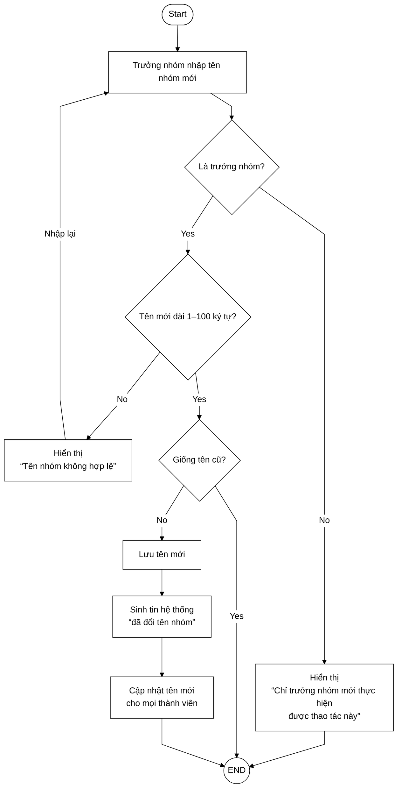

---

### UC-16 – Rời nhóm

| Mục | Nội dung |
|---|---|
| Mục tiêu | Thành viên tự ra khỏi nhóm. |
| Actor chính | Thành viên thường; Trưởng nhóm |
| Trigger | Thành viên yêu cầu rời nhóm. |
| Tiền điều kiện | Đã đăng nhập; là thành viên hiện tại. |
| Hậu điều kiện – thành công | Người rời mất quyền xem toàn bộ nhóm `[QĐ-04]`; có tin hệ thống "D đã rời nhóm". Nếu người rời là trưởng nhóm thì nhóm có trưởng nhóm mới và có thêm tin hệ thống chuyển quyền. |
| Mã SRS | NH-03, NH-04 · NH-03-AC4, NH-04-AC2 · NFR-04 |

**Luồng chính – thành viên thường**
1. Thành viên yêu cầu rời nhóm.
2. Thành viên xác nhận.
3. Hệ thống kiểm tra phiên và kiểm tra thành viên.
4. Hệ thống thu hồi quyền của người rời và ngừng đẩy tin tới họ.
5. Hệ thống sinh tin hệ thống "D đã rời nhóm" và đẩy tới các thành viên còn lại `[PDF NH-04]`.
6. Nhóm biến mất khỏi danh sách của người rời.

**Luồng thay thế – trưởng nhóm rời** `[QĐ-03]`
- A1. Trưởng nhóm yêu cầu rời nhóm.
- A2. Hệ thống yêu cầu chọn **một** thành viên hiện tại làm trưởng nhóm mới `[GĐ-17]`.
- A3. Trưởng nhóm chọn người B và xác nhận.
- A4. Hệ thống kiểm tra B đang là thành viên.
- A5. Hệ thống thực hiện **trong cùng một lần**: chuyển quyền cho B, rồi cho trưởng nhóm cũ rời. Nếu một bước thất bại thì không bước nào được áp dụng `[GU-11]`.
- A6. Hệ thống sinh 2 tin hệ thống theo thứ tự: "A đã chuyển quyền trưởng nhóm cho B" `[GĐ-19]`, `[OQ-10]`, rồi "A đã rời nhóm".
- A7. Tiếp tục bước 6.

**Luồng lỗi**
- A3a. Trưởng nhóm không chọn người nhận quyền → E-NH03-3.
- A2a. Nhóm chỉ còn trưởng nhóm → E-NH03-4; không cho rời `[GĐ-18]`, `[OQ-11]`.
- A4a. B không còn là thành viên → từ chối; yêu cầu chọn lại.
- 3a. Không còn là thành viên → phản hồi "không tìm thấy" (UC-17).

**Kiểm tra bảo mật**
- Nhóm không bao giờ ở trạng thái **không có trưởng nhóm**.
- Người rời không nhận tin hệ thống về việc mình rời và mọi tin sau đó.

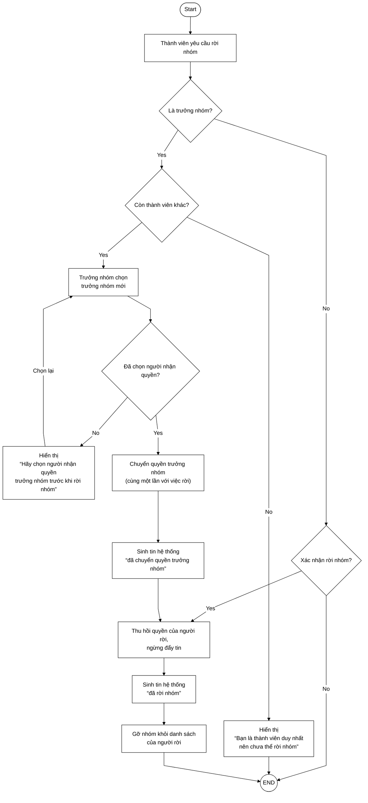

---

### UC-17 – Từ chối người ngoài đọc hội thoại

| Mục | Nội dung |
|---|---|
| Mục tiêu | Bảo đảm **chỉ thành viên hiện tại** mới đọc hoặc gửi được tin trong một hội thoại. |
| Actor chính | Người ngoài hội thoại (người dùng C) |
| Bối cảnh | A và B có một hội thoại 1-1. C là người dùng hợp lệ khác, không thuộc hội thoại này (đúng tình huống AT-06). |
| Trigger | C gửi bất kỳ yêu cầu nào nhắm vào hội thoại của A và B: đọc lịch sử, gửi tin, đánh dấu đã đọc, nhận tin realtime, hoặc tự đoán mã hội thoại. |
| Tiền điều kiện | C đã đăng nhập (có phiên hợp lệ). |
| Hậu điều kiện | C **không nhận được bất kỳ dữ liệu nào** của hội thoại: nội dung, trích tin cuối, số chưa đọc, danh sách thành viên. Hội thoại của A và B không bị thay đổi. |
| Mã SRS | QT-CHUNG-2, NFR-04, CH-03 (E-CH03-1), CH-02 (E-CH02-3), NH-03 (QĐ-04) · BR-15 · **AT-06** |

**Luồng chính (từ chối)**
1. C gửi yêu cầu đọc lịch sử hội thoại X (của A và B).
2. Hệ thống kiểm tra phiên của C: hợp lệ.
3. Hệ thống kiểm tra C có phải **thành viên hiện tại** của X: không.
4. Hệ thống **từ chối** và trả phản hồi "không tìm thấy", giống hệt như khi X không tồn tại `[PDF §4]`, NFR-04.
5. Hệ thống không trả nội dung, trích tin cuối, số chưa đọc hay thành viên của X.
6. X không xuất hiện trong danh sách hội thoại của C (UC-10).

**Các biến thể cùng cách xử lý**

| Biến thể | Tình huống | Kết quả bắt buộc |
|---|---|---|
| V1 | C yêu cầu lịch sử của X bằng cách tự điền mã hội thoại | Từ chối như bước 4 |
| V2 | C gửi tin vào X | E-CH02-3; không lưu, không phát tới A, B |
| V3 | C yêu cầu đánh dấu đã đọc trong X | Từ chối; số chưa đọc của A, B không đổi |
| V4 | C cố nhận tin realtime của X | Hệ thống không đẩy tin của X tới C |
| V5 | D vừa bị xóa (UC-14) hoặc vừa rời (UC-16) nhóm, cố đọc tin cũ của nhóm | Từ chối như bước 4, kể cả tin trước khi rời `[QĐ-04]` |
| V6 | E được thêm vào nhóm **không** kèm quyền xem tin cũ, cố đọc tin trước mốc tham gia | Hệ thống chỉ trả tin từ mốc tham gia; tin trước mốc không bao giờ được trả `[QĐ-08]` |
| V7 | Yêu cầu không có phiên hoặc phiên đã hết hạn | Từ chối với E-TK03-2, trước cả khi xét thành viên |

**Kiểm tra bảo mật**
- Kiểm tra thành viên được thực hiện **ở máy chủ** cho mọi yêu cầu API và mọi sự kiện realtime. Việc ẩn hội thoại trên giao diện không được coi là kiểm soát quyền.
- Thứ tự kiểm tra: phiên → thành viên hiện tại → vai trò (nếu cần) → dữ liệu.
- Phản hồi khi từ chối không tiết lộ hội thoại có tồn tại hay không.

**Kiểm chứng AT-06:** A và B nhắn tin 1-1. C đăng nhập bằng tài khoản thứ ba và thử V1, V2, V4 → cả ba đều bị từ chối và C không thấy nội dung nào.

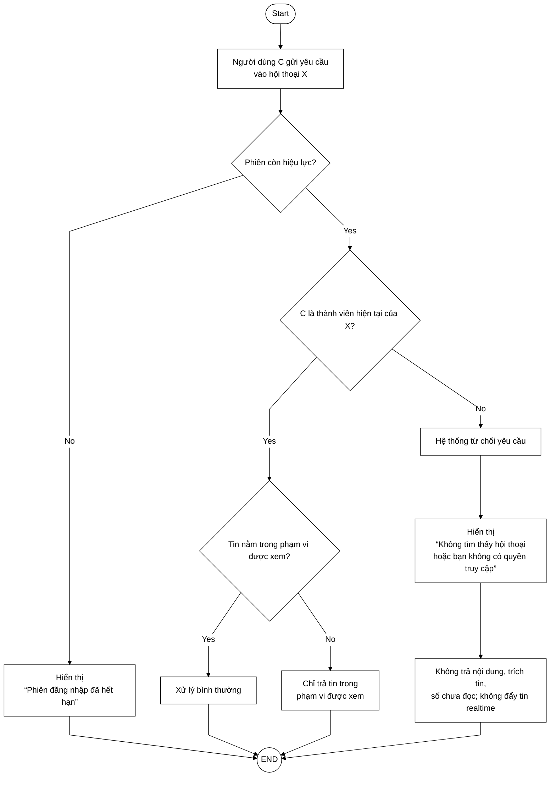

---

## 5. Phạm vi được xem (dùng chung cho UC-09, UC-10, UC-11, UC-17)

| Trường hợp | Được xem tin từ | Nguồn |
|---|---|---|
| Thành viên hội thoại 1-1 | Đầu hội thoại | `[PDF]` |
| Thành viên ban đầu của nhóm | Lúc tạo nhóm | NH-01 |
| Được thêm, **có** cho xem tin cũ | Lúc tạo nhóm | `[QĐ-08]`, `[GS-36]` |
| Được thêm, **không** cho xem tin cũ (mặc định) | Lúc được thêm | `[QĐ-08]`, `[GS-35]` |
| Đã rời hoặc bị xóa | Không xem được gì | `[QĐ-04]` |
| Được thêm lại sau khi rời / bị xóa | Theo lựa chọn của lần thêm mới nhất | `[GS-35]` |

## 6. Truy vết mã SRS → use case

| Mã SRS | Use case | AT |
|---|---|---|
| TK-01 | UC-01 | AT-01 |
| TK-02 | UC-01, UC-04 | AT-01 |
| TK-03 | UC-02, UC-03 | AT-01, AT-05 |
| TK-04 | UC-04 | – |
| TK-05 | UC-05 | – |
| TK-06 | UC-06 | AT-02 |
| CH-01 | UC-07 | AT-02 |
| CH-02 | UC-08 | AT-02 |
| CH-03 | UC-09 | AT-05 |
| CH-06 | UC-10 | AT-04 |
| NH-01 | UC-12 | AT-03 |
| NH-02 | UC-08 | AT-03 |
| NH-03 | UC-13, UC-14, UC-15, UC-16 | AT-03 |
| NH-04 | UC-12…UC-16 (hệ thống sinh tin) | AT-03 |
| TB-01 | UC-10, UC-11 | AT-04 |
| QT-CHUNG-2 / NFR-04 | UC-17 (và bước kiểm tra thành viên trong UC-08, UC-09, UC-11, UC-13…UC-16) | AT-06 |

**Độ phủ:** 15/15 mã MVP có ít nhất một use case. 6/6 bước nghiệm thu có use case tương ứng. Các mã ở PDF §6 **không** có use case nào vì là phần mở rộng không đăng ký `[QĐ-01]`. Cụ thể, UC-08 không có trạng thái "đã gửi / đã xem" (CH-04) và không có trạng thái online (CH-05).

## 7. Giả định & câu hỏi mở

### 7.1 ASSUMPTIONS – Giả định của tài liệu này
Các QĐ, GĐ, GS trong BRD và SRS vẫn giữ hiệu lực. Các giả định dưới đây chưa có trong hai tài liệu đó.

| Mã | Giả định | Áp dụng |
|---|---|---|
| GU-01 | Khi đăng ký, người dùng nhập mật khẩu hai lần; hai lần phải giống nhau | UC-01 |
| GU-02 | Kiểm tra mã đăng ký tổ chức trước mọi kiểm tra khác | UC-01 |
| GU-03 | Một tài khoản được đăng nhập đồng thời trên nhiều trình duyệt, mỗi nơi một phiên | UC-02, UC-08, UC-11 |
| GU-04 | Phiên hết hạn thì nội dung đang soạn dở có thể mất | UC-03 |
| GU-05 | Khi chọn người để thêm vào nhóm, kết quả tìm đã loại người đang trong nhóm | UC-06, UC-13 |
| GU-06 | Hội thoại 1-1 chưa có tin không hiện trong danh sách của **cả hai** người (SRS GS-16 mới nói về người kia) | UC-07, UC-10 |
| GU-07 | Hội thoại 1-1 không bao giờ có thêm người thứ ba | UC-07 |
| GU-08 | Mỗi tin có mã tạm để gửi lại không sinh tin trùng | UC-08 |
| GU-09 | Đánh dấu đã đọc là hành vi tự động khi xem hội thoại, không phải thao tác riêng | UC-11 |
| GU-10 | Thành viên mới được cho xem tin cũ: các tin trước lúc được thêm không tính vào số chưa đọc | UC-11 |
| GU-11 | Một sự kiện nhóm và tin hệ thống của nó (kể cả chuyển quyền + rời) được lưu cùng lúc: cùng thành công hoặc cùng thất bại | UC-12…UC-16 |
| GU-12 | Trưởng nhóm thêm được nhiều người một lần; lựa chọn "cho xem tin cũ" dùng chung cho lần đó | UC-13 |
| GU-13 | Nếu một người trong lần thêm không hợp lệ thì không thêm ai trong lần đó | UC-13 |
| GU-14 | Trưởng nhóm không tự xóa mình; muốn ra khỏi nhóm thì dùng UC-16 | UC-14 |
| GU-15 | Đổi tên nhóm thành đúng tên cũ thì không làm gì | UC-15 |

Ghi chú: GU-03, 05, 06, 08, 11, 12, 14, 15 có nội dung trùng với giả định trong bản nháp `03-frs.md` (chưa có trên repository). Khi FRS được duyệt, nên thống nhất mã giả định giữa hai tài liệu.

### 7.2 OPEN QUESTIONS – Câu hỏi mở

| Mã | Câu hỏi | Giả định tạm | Use case bị ảnh hưởng |
|---|---|---|---|
| OQ-08 | Tìm người dùng có bỏ qua dấu tiếng Việt không? | Không (GĐ-10) | UC-06 |
| OQ-10 | Có tin hệ thống khi chuyển quyền trưởng nhóm không? | Có (GĐ-19) | UC-16 |
| OQ-11 | Trưởng nhóm là người cuối cùng thì xử lý thế nào? | Không cho rời (GĐ-18) | UC-16 |
| OQ-15 | Được phép xóa/rời khiến nhóm còn dưới 3 người không? | Được (GS-31) | UC-14, UC-16 |
| OQ-16 | Giới hạn độ dài tên hiển thị, tên nhóm, mật khẩu? | 50 / 100 / 64 | UC-01, UC-05, UC-12, UC-15 |
| OQ-17 | Chi tiết tùy chọn "cho xem tin cũ" (ai chọn, mặc định, đổi được không, xem từ lúc nào)? | GS-35, GS-36, GU-12 | UC-13, mục 5 |
| OQ-19 | `03-frs.md` chưa có trên repository: có cần duyệt và commit FRS trước khi dùng làm căn cứ cho use case không? | Use case chỉ dẫn chiếu SRS | Toàn tài liệu |
| OQ-20 | Một lần thêm nhiều người mà có một người không hợp lệ: từ chối cả lần hay vẫn thêm những người hợp lệ? | Từ chối cả lần (GU-13) | UC-13 |
