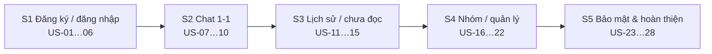

# 05 - User Stories

| Mục | Nội dung |
|---|---|
| Dự án | Ứng dụng chat nội bộ (MVP) – Nhóm: *[chưa xác định]* |
| Tệp | `05-user-stories.md` |
| Phiên bản | 1.0 – Draft |
| Ngày | 2026-11-13 |
| Người soạn | Nhóm BA / QA (bản nháp có trợ lý AI hỗ trợ soạn thảo) |
| Trạng thái | Draft – chờ Product Owner rà soát mục 7 |
| Căn cứ | (1) PDF "Xây dựng ứng dụng chat nội bộ (MVP)" – nguồn duy nhất của yêu cầu nghiệp vụ; (2) `01-brd.md` v1.1; (3) `02-srs.md` v1.1. Mã UC lấy từ bản nháp `04-use-cases.md` **chưa có trên repository** `[OQ-19]` |

**Quy ước ký hiệu**

| Ký hiệu | Ý nghĩa |
|---|---|
| `US-xx` | Một user story: phần việc nhỏ, làm và kiểm thử được độc lập. |
| `EP-xx` | Epic: nhóm các story cùng chủ đề. |
| `S1…S5` | Lát cắt dọc (vertical slice) theo thứ tự phát triển khuyến nghị (mục 2). |
| `E-xxxx-n`, `…-ACn` | Mã lỗi và tiêu chí chấp nhận trong `02-srs.md`. |
| `AT-01…AT-06` | 6 bước nghiệm thu theo PDF §5. |
| `[PDF]` / `[QĐ]` / `[GĐ]` / `[GS]` | Đề bài / quyết định / giả định đã ghi ở BRD, SRS. |
| `[GUS-xx]` | Giả định mới của tài liệu này. Xem mục 7.1. |
| `[ĐX]` | Đề xuất của nhóm, ví dụ điểm ước lượng. |

**Cách đọc một story:** câu "Là … tôi muốn … để …" cho biết **ai** cần, **cần gì** và **vì sao**. Tiêu chí chấp nhận (Cho trước / Khi / Thì) là các phép thử cụ thể để biết story đã xong. Mỗi story có ít nhất một tình huống **đúng** (✅) và một tình huống **sai** (❌).

> Tài liệu không chứa kết quả chạy thử. Điểm ước lượng là đề xuất ban đầu của nhóm `[ĐX]`, không phải số đo.

---

## 1. Quy tắc ưu tiên

Mức ưu tiên lấy theo PDF. **Không story nào ở mức Must bị hạ xuống.**

| Mức | Nghĩa | Áp dụng cho | Căn cứ |
|---|---|---|---|
| **Must** | Thiếu thì **không ĐẠT** | 15 mã bắt buộc của PDF §3; yêu cầu phi chức năng tối thiểu PDF §4 (bảo mật, hiệu năng, dữ liệu, ngôn ngữ); nền tảng PDF §2; sản phẩm phải nộp PDF §8 | `[PDF §3, §4, §5, §8, §9]` |
| **Should** | Nên có, PDF ghi "khuyến khích" | Tự kết nối lại, gửi lại tin lỗi | `[PDF §4 – Khả dụng]` |
| **Could** | Điểm cộng | Toàn bộ mã PDF §6. Dự án **không đăng ký** nên không có story | `[PDF §6]`, `[QĐ-01]` |

Các quy tắc do Product Owner bổ sung (QĐ-03, QĐ-05…QĐ-10) nằm **bên trong** story Must của mã gốc tương ứng. Chúng không tạo ra mã yêu cầu mới.

## 2. Lát cắt dọc khuyến nghị

Mỗi lát cắt cho ra một phần ứng dụng **dùng được thật từ đầu đến cuối**: giao diện, máy chủ và cơ sở dữ liệu. Không làm riêng từng tầng.

| Lát | Tên | Story | Kết quả demo được sau lát | Bước nghiệm thu mở khóa |
|---|---|---|---|---|
| S1 | Đăng ký / đăng nhập | US-01 → US-06 | Tạo tài khoản, đăng nhập, đăng xuất, đổi mật khẩu, sửa hồ sơ | AT-01 |
| S2 | Chat 1-1 | US-07 → US-10 | Tìm đồng nghiệp, mở chat, nhắn tin realtime tiếng Việt | AT-02 |
| S3 | Lịch sử / chưa đọc | US-11 → US-15 | Cuộn xem tin cũ, danh sách hội thoại, số chưa đọc | AT-04, AT-05 |
| S4 | Nhóm / quản lý | US-16 → US-22 | Tạo nhóm, nhắn nhóm, thêm/xóa/đổi tên/rời, tin hệ thống | AT-03 |
| S5 | Bảo mật & hoàn thiện | US-23 → US-28 | Chặn người ngoài, HTTPS/WSS, đo hiệu năng, đa trình duyệt, kết nối lại, bản demo trực tuyến | AT-06, toàn bộ AT trên môi trường demo |

Lưu ý: kiểm tra **quyền thành viên** (US-23) không đợi tới S5 mới làm. Từ S2, mọi story đọc/gửi tin đều phải kiểm tra thành viên ở máy chủ (xem DoD mục 5). US-23 ở S5 là bước **kiểm thử tổng hợp** mọi đường truy cập.

---

## 3. Epic

| Epic | Tên | Mã PDF | Story |
|---|---|---|---|
| EP-TK | Tài khoản | TK-01…TK-06 | US-01…US-07 |
| EP-CH | Chat 1-1 & lịch sử | CH-01, CH-02, CH-03, CH-06 | US-08…US-13 |
| EP-TB | Thông báo chưa đọc | TB-01 | US-14, US-15 |
| EP-NH | Nhóm | NH-01…NH-04 | US-16…US-22 |
| EP-NFR | Bảo mật, hiệu năng, tương thích, bàn giao | PDF §2, §4, §8 | US-23…US-28 |

---

## 4. User story

### S1 – Đăng ký / đăng nhập

#### US-01 – Đăng ký bằng mã tổ chức

**Là** nhân viên mới, **tôi muốn** tự tạo tài khoản bằng tên đăng nhập, tên hiển thị, mật khẩu và mã đăng ký của tổ chức, **để** bắt đầu dùng ứng dụng mà không phải nhờ ai tạo hộ.

| Ưu tiên | Điểm `[ĐX]` | Lát | SRS | UC | Phụ thuộc |
|---|---|---|---|---|---|
| Must | 3 | S1 | TK-01 (QĐ-05, QĐ-06, QĐ-07) | UC-01 | US-02 |

Tiêu chí chấp nhận:
- ✅ **Cho trước** mã tổ chức đúng và tên `nhanvien01` chưa tồn tại, **khi** tôi đăng ký với mật khẩu `Matkhau123`, tên hiển thị `Nguyễn Văn An`, **thì** tài khoản được tạo và tôi đăng nhập được ngay bằng thông tin đó (TK-01-AC1, AT-01).
- ✅ **Cho trước** tên hiển thị `Đặng Thị Ẩn`, **khi** đăng ký thành công, **thì** tên được lưu và hiển thị lại đúng từng ký tự (TK-01-AC4).
- ❌ **Cho trước** `nhanvien01` đã tồn tại, **khi** tôi đăng ký `NhanVien01`, **thì** hệ thống báo trùng (E-TK01-1) và tổng số tài khoản không đổi (TK-01-AC2).
- ❌ **Khi** tôi đăng ký với mã tổ chức sai, **thì** hệ thống báo lỗi E-TK01-5, không tạo tài khoản và không kiểm tra tiếp tên đăng nhập (TK-01-AC3).
- ❌ **Khi** tên đăng nhập là `ab` hoặc `an nguyen`, **thì** hệ thống báo sai định dạng (E-TK01-2).

#### US-02 – Mật khẩu đủ mạnh và được bảo vệ

**Là** nhân viên, **tôi muốn** hệ thống chỉ nhận mật khẩu đủ mạnh và không bao giờ lưu mật khẩu ở dạng đọc được, **để** tài khoản của tôi khó bị đoán và không lộ nếu dữ liệu bị lộ.

| Ưu tiên | Điểm `[ĐX]` | Lát | SRS | UC | Phụ thuộc |
|---|---|---|---|---|---|
| Must | 2 | S1 | TK-02, NFR-02 | UC-01, UC-04 | – |

Tiêu chí chấp nhận:
- ✅ **Khi** tôi nhập `abc12345` (8 ký tự, có chữ và số), **thì** mật khẩu được chấp nhận (TK-02-AC1).
- ❌ **Khi** tôi nhập `abcdefgh`, `12345678` hoặc `abc1234`, **thì** cả ba đều bị từ chối với lý do tương ứng (TK-02-AC2).
- ✅ **Cho trước** tôi đã đăng ký với `Matkhau123`, **khi** QA mở cơ sở dữ liệu, **thì** giá trị lưu khác `Matkhau123` và có định dạng bcrypt hoặc argon2 (TK-02-AC3).
- ❌ **Khi** QA tìm chuỗi `Matkhau123` trong log máy chủ sau khi đăng ký và đăng nhập, **thì** không tìm thấy (TK-02-AC4).

#### US-03 – Đăng nhập

**Là** nhân viên đã có tài khoản, **tôi muốn** đăng nhập bằng tên đăng nhập và mật khẩu, **để** vào xem và gửi tin nhắn.

| Ưu tiên | Điểm `[ĐX]` | Lát | SRS | UC | Phụ thuộc |
|---|---|---|---|---|---|
| Must | 3 | S1 | TK-03 (QĐ-07, QĐ-09), NFR-03 | UC-02 | US-01 |

Tiêu chí chấp nhận:
- ✅ **Cho trước** tài khoản `nhanvien01` / `Matkhau123`, **khi** tôi đăng nhập bằng `NHANVIEN01` / `Matkhau123`, **thì** tôi vào được danh sách hội thoại và có phiên hạn 8 giờ (TK-03-AC1, QĐ-09).
- ✅ **Cho trước** tôi đã đăng nhập trên Chrome, **khi** tôi đăng nhập thêm trên Firefox, **thì** cả hai nơi đều dùng được `[GUS-03]`.
- ❌ **Khi** tôi nhập sai mật khẩu, và **khi** tôi nhập một tên không tồn tại, **thì** cả hai lần nhận **cùng một** thông báo E-TK03-1 và không có phiên nào được tạo (TK-03-AC1).

#### US-04 – Đăng xuất và hết hạn phiên

**Là** nhân viên, **tôi muốn** đăng xuất và phiên của tôi thật sự bị hủy, **để** người khác dùng chung máy không vào được tài khoản của tôi.

| Ưu tiên | Điểm `[ĐX]` | Lát | SRS | UC | Phụ thuộc |
|---|---|---|---|---|---|
| Must | 3 | S1 | TK-03, NFR-03 | UC-03 | US-03 |

Tiêu chí chấp nhận:
- ✅ **Khi** tôi đăng xuất, **thì** tôi trở về trạng thái chưa đăng nhập; đăng nhập lại thì toàn bộ lịch sử vẫn còn (TK-03-AC4, AT-05 – kiểm tra đầy đủ ở US-12).
- ❌ **Cho trước** QA đã sao chép phiên của tôi trước khi tôi đăng xuất, **khi** QA dùng lại phiên đó gọi máy chủ và kết nối realtime, **thì** cả hai đều bị từ chối (E-TK03-2) (TK-03-AC2).
- ❌ **Cho trước** môi trường kiểm thử đặt thời hạn phiên rất ngắn, **khi** phiên quá hạn, **thì** yêu cầu kế tiếp bị từ chối và tôi phải đăng nhập lại (TK-03-AC3).

#### US-05 – Đổi mật khẩu

**Là** nhân viên đã đăng nhập, **tôi muốn** đổi mật khẩu bằng cách nhập mật khẩu cũ và mật khẩu mới, **để** bảo vệ tài khoản khi nghi bị lộ.

| Ưu tiên | Điểm `[ĐX]` | Lát | SRS | UC | Phụ thuộc |
|---|---|---|---|---|---|
| Must | 3 | S1 | TK-04 (QĐ-09), TK-02 | UC-04 | US-02, US-03 |

Tiêu chí chấp nhận:
- ✅ **Khi** tôi đổi từ `Matkhau123` sang `Matkhau456`, **thì** đăng nhập bằng `Matkhau456` thành công và bằng `Matkhau123` thất bại (TK-04-AC1).
- ✅ **Cho trước** tôi đang đăng nhập trên trình duyệt B, **khi** tôi đổi mật khẩu ở trình duyệt A, **thì** yêu cầu kế tiếp từ B bị từ chối, còn A vẫn dùng tiếp (TK-04-AC3, QĐ-09).
- ❌ **Khi** tôi nhập sai mật khẩu cũ, **thì** hệ thống báo E-TK04-1 và mật khẩu cũ vẫn dùng được (TK-04-AC2).
- ❌ **Khi** mật khẩu mới là `Matkhau123` (trùng mật khẩu cũ), **thì** hệ thống báo E-TK04-3.

#### US-06 – Hồ sơ và avatar chữ cái

**Là** nhân viên, **tôi muốn** xem hồ sơ và sửa tên hiển thị, đi kèm một avatar chữ cái, **để** đồng nghiệp nhận ra tôi.

| Ưu tiên | Điểm `[ĐX]` | Lát | SRS | UC | Phụ thuộc |
|---|---|---|---|---|---|
| Must | 2 | S1 | TK-05 | UC-05 | US-03 |

Tiêu chí chấp nhận:
- ✅ **Khi** tôi đổi tên hiển thị thành `Trần Thị Bình`, **thì** hồ sơ của tôi, danh sách hội thoại của người khác và tên cạnh tin trong nhóm đều hiện tên mới sau khi tải lại (TK-05-AC1).
- ✅ **Khi** tôi xem hồ sơ, **thì** tôi thấy avatar chữ cái theo GS-11 và **không** có chức năng tải ảnh lên (TK-05-AC2).
- ❌ **Khi** tôi lưu tên hiển thị chỉ gồm khoảng trắng, **thì** hệ thống báo E-TK05-1 và giữ tên cũ (TK-05-AC3).

---

### S2 – Chat 1-1

#### US-07 – Tìm đồng nghiệp

**Là** nhân viên, **tôi muốn** tìm đồng nghiệp theo tên đăng nhập hoặc tên hiển thị, **để** bắt đầu trò chuyện với đúng người.

| Ưu tiên | Điểm `[ĐX]` | Lát | SRS | UC | Phụ thuộc |
|---|---|---|---|---|---|
| Must | 2 | S2 | TK-06, NFR-09 | UC-06 | US-03 |

Tiêu chí chấp nhận:
- ✅ **Cho trước** tài khoản `an.nguyen` / "Nguyễn Văn An", **khi** tôi tìm `AN`, `an.ng` hoặc `Văn An`, **thì** đều thấy tài khoản này (TK-06-AC1).
- ✅ **Khi** tôi tìm `đặng`, **thì** thấy "Đặng Thị Ẩn" (TK-06-AC3).
- ❌ **Cho trước** tôi là `an.nguyen`, **khi** tôi tìm `an.nguyen`, **thì** kết quả không có chính tôi (TK-06-AC2).
- ❌ **Khi** tôi tìm `xyz123` không khớp ai, **thì** hệ thống báo không tìm thấy, không báo lỗi.

#### US-08 – Mở hội thoại 1-1 không bị trùng

**Là** nhân viên, **tôi muốn** chọn một đồng nghiệp là vào ngay cuộc trò chuyện với họ, **để** luôn thấy đủ lịch sử trong một chỗ, không bị tách thành nhiều cuộc.

| Ưu tiên | Điểm `[ĐX]` | Lát | SRS | UC | Phụ thuộc |
|---|---|---|---|---|---|
| Must | 3 | S2 | CH-01 | UC-07 | US-07 |

Tiêu chí chấp nhận:
- ✅ **Khi** A mở chat với B hai lần liên tiếp, **thì** cả hai lần vào cùng một hội thoại (CH-01-AC1).
- ✅ **Cho trước** A đã chat với B, **khi** B mở chat với A, **thì** B vào đúng hội thoại cũ và thấy tin của A (CH-01-AC2).
- ❌ **Khi** A và B cùng mở chat với nhau gần như đồng thời, **thì** dữ liệu chỉ có đúng 1 hội thoại 1-1 giữa hai người (CH-01-AC3, GS-17).
- ❌ **Khi** có yêu cầu mở hội thoại với chính mình gửi thẳng tới máy chủ, **thì** bị từ chối (E-CH01-1).

#### US-09 – Gửi và nhận tin realtime tiếng Việt

**Là** nhân viên, **tôi muốn** gửi tin tiếng Việt có dấu, có xuống dòng, và người nhận thấy ngay, **để** trao đổi công việc nhanh như nói chuyện trực tiếp.

| Ưu tiên | Điểm `[ĐX]` | Lát | SRS | UC | Phụ thuộc |
|---|---|---|---|---|---|
| Must | 5 | S2 | CH-02, NFR-05, NFR-08 | UC-08 | US-08 |

Tiêu chí chấp nhận:
- ✅ **Cho trước** A và B đang mở cùng hội thoại trên hai trình duyệt, **khi** A gửi `Chào bạn, hôm nay họp lúc 14h nhé! Ừ, được.`, **thì** B thấy đúng từng ký tự trong **dưới 2 giây** (CH-02-AC1, AT-02; cách đo theo NFR-05).
- ✅ **Khi** A gửi tin 3 dòng có dòng giữa trống, **thì** cả hai phía hiện đúng 3 dòng (CH-02-AC2).
- ✅ **Cho trước** B không trực tuyến, **khi** A gửi tin, **thì** tin vẫn được lưu và B thấy khi mở hội thoại.
- ❌ **Khi** A gửi ``, **thì** B thấy nguyên văn chuỗi đó và không có hộp thoại nào bật lên (CH-02-AC4).
- ❌ **Cho trước** tin chưa được lưu vào cơ sở dữ liệu, **thì** hệ thống không báo gửi thành công và không phát tin đi (SRS CH-02 R5).

#### US-10 – Giới hạn độ dài và chặn tin trống

**Là** nhân viên, **tôi muốn** biết ngay khi tin quá dài hoặc trống, **để** không gửi nhầm tin lỗi.

| Ưu tiên | Điểm `[ĐX]` | Lát | SRS | UC | Phụ thuộc |
|---|---|---|---|---|---|
| Must | 2 | S2 | CH-02 (5.000 ký tự `[PDF]`, GS-18, GS-19) | UC-08 | US-09 |

Tiêu chí chấp nhận:
- ✅ **Khi** A gửi tin đúng 5.000 ký tự, **thì** B nhận đủ 5.000 ký tự (CH-02-AC3).
- ❌ **Khi** A gửi tin 5.001 ký tự (kể cả gửi thẳng tới máy chủ, bỏ qua kiểm tra ở trình duyệt), **thì** bị từ chối với E-CH02-1 và không có gì được lưu (CH-02-AC3).
- ❌ **Khi** A gửi tin chỉ gồm khoảng trắng và xuống dòng, **thì** bị từ chối (E-CH02-2).

---

### S3 – Lịch sử / chưa đọc

#### US-11 – Xem lịch sử, mỗi lần 50 tin

**Là** nhân viên, **tôi muốn** cuộn lên để xem dần các tin cũ, mỗi lần 50 tin, **để** tra lại nội dung đã trao đổi mà không phải chờ tải toàn bộ.

| Ưu tiên | Điểm `[ĐX]` | Lát | SRS | UC | Phụ thuộc |
|---|---|---|---|---|---|
| Must | 3 | S3 | CH-03, NFR-06 | UC-09 | US-09 |

Tiêu chí chấp nhận:
- ✅ **Cho trước** hội thoại có 120 tin, **khi** tôi mở hội thoại, **thì** tôi thấy tin 71–120. Cuộn lên lần 1 thấy thêm tin 21–70, lần 2 thấy thêm tin 1–20 và được báo đã hết. Tổng đủ 120 tin, không trùng, không thiếu (CH-03-AC1).
- ✅ **Khi** tôi mở hội thoại có ≥ 50 tin, **thì** 50 tin gần nhất hiện đủ trong **dưới 1,5 giây** (CH-03-AC2; cách đo theo NFR-06).
- ❌ **Cho trước** tôi đang đọc tin cũ, **khi** có tin mới đến, **thì** các trang đã tải không bị trùng hoặc mất tin (GS-22).
- ❌ **Khi** tải trang lỗi do mạng, **thì** hệ thống báo lỗi E-CH03-2, các tin đã hiện vẫn giữ nguyên và tôi thử lại được.

#### US-12 – Lịch sử còn nguyên sau đăng xuất và khởi động lại

**Là** nhân viên, **tôi muốn** lịch sử tin nhắn không bao giờ mất khi tôi đăng xuất hay khi máy chủ khởi động lại, **để** tin tưởng dùng ứng dụng cho công việc.

| Ưu tiên | Điểm `[ĐX]` | Lát | SRS | UC | Phụ thuộc |
|---|---|---|---|---|---|
| Must | 2 | S3 | CH-03, TK-03, NFR-07 | UC-09, UC-03 | US-04, US-11 |

Tiêu chí chấp nhận:
- ✅ **Cho trước** A và B có 120 tin, **khi** A đăng xuất rồi đăng nhập lại, **thì** A thấy đủ 120 tin đúng thứ tự (TK-03-AC4, **AT-05**).
- ✅ **Khi** QA khởi động lại dịch vụ máy chủ, **thì** sau đó cả 120 tin, tài khoản, nhóm và số chưa đọc vẫn còn (CH-03-AC3, NFR-07).
- ❌ **Cho trước** máy chủ dừng ngay sau khi người gửi nhận xác nhận, **khi** khởi động lại, **thì** tin đã xác nhận không bị mất (SRS CH-02 R5).

#### US-13 – Danh sách hội thoại

**Là** nhân viên, **tôi muốn** thấy các cuộc trò chuyện xếp theo tin mới nhất, kèm trích tin cuối và thời gian, **để** biết ngay cuộc nào cần xem trước.

| Ưu tiên | Điểm `[ĐX]` | Lát | SRS | UC | Phụ thuộc |
|---|---|---|---|---|---|
| Must | 3 | S3 | CH-06 | UC-10 | US-09 |

Tiêu chí chấp nhận:
- ✅ **Cho trước** A có 3 hội thoại, **khi** B gửi tin cho A, **thì** hội thoại với B nhảy lên đầu danh sách của A, kèm trích tin và thời gian mới, mà A không cần tải lại trang (CH-06-AC1).
- ✅ **Cho trước** A chưa có hội thoại nào, **khi** A mở trang chính, **thì** A thấy hướng dẫn tìm đồng nghiệp.
- ❌ **Cho trước** C vừa bị xóa khỏi nhóm X, **thì** nhóm X biến mất khỏi danh sách của C (CH-06-AC3, QĐ-04).
- ❌ **Cho trước** A mở hội thoại 1-1 với D nhưng chưa ai gửi tin, **thì** hội thoại này chưa hiện trong danh sách của D (GS-16).

#### US-14 – Badge số tin chưa đọc

**Là** nhân viên, **tôi muốn** thấy số tin chưa đọc trên từng cuộc trò chuyện và tổng số trên tab trình duyệt, **để** không bỏ sót tin quan trọng.

| Ưu tiên | Điểm `[ĐX]` | Lát | SRS | UC | Phụ thuộc |
|---|---|---|---|---|---|
| Must | 3 | S3 | TB-01 (QĐ-10, GĐ-15) | UC-10, UC-11 | US-13 |

Tiêu chí chấp nhận:
- ✅ **Cho trước** A đang ở hội thoại khác, **khi** B gửi 3 tin cho A, **thì** hội thoại với B hiện **3** và tổng số trên tab tăng thêm 3 (TB-01-AC1, **AT-04**).
- ✅ **Khi** A mở hội thoại với B, **thì** số của hội thoại đó về **0** và tổng giảm 3, không cần tải lại (TB-01-AC2, **AT-04**).
- ❌ **Khi** A tự gửi tin, **thì** số chưa đọc của chính A không tăng.
- ❌ **Cho trước** nhóm A, B, C, **khi** A thêm D (sinh tin hệ thống), **thì** số chưa đọc của B và C **không** tăng (TB-01-AC4, QĐ-10).

#### US-15 – Đánh dấu đã đọc, đồng bộ nhiều tab

**Là** nhân viên dùng nhiều tab hoặc nhiều máy, **tôi muốn** đọc ở một nơi thì nơi khác cũng hết báo chưa đọc, **để** không phải "đọc lại" cùng một tin nhiều lần.

| Ưu tiên | Điểm `[ĐX]` | Lát | SRS | UC | Phụ thuộc |
|---|---|---|---|---|---|
| Must | 3 | S3 | TB-01 (GS-33, GS-34) | UC-11 | US-14 |

Tiêu chí chấp nhận:
- ✅ **Cho trước** A mở cùng tài khoản trên 2 tab, **khi** A đọc hội thoại ở tab 1, **thì** tab 2 cũng về 0 (TB-01-AC3).
- ✅ **Cho trước** A đang mở hội thoại với B và đang xem tab, **khi** B gửi tin, **thì** số chưa đọc của hội thoại đó vẫn là 0 (GS-33).
- ❌ **Cho trước** A đang mở hội thoại với B nhưng chuyển sang tab trình duyệt khác, **khi** B gửi 2 tin, **thì** hội thoại hiện 2 chưa đọc cho tới khi A quay lại tab (GS-33).

---

### S4 – Nhóm / quản lý

#### US-16 – Tạo nhóm

**Là** nhân viên, **tôi muốn** tạo nhóm có tên và chọn từ 2 đồng nghiệp trở lên, **để** trao đổi chung trong một chỗ.

| Ưu tiên | Điểm `[ĐX]` | Lát | SRS | UC | Phụ thuộc |
|---|---|---|---|---|---|
| Must | 3 | S4 | NH-01, NH-04 (GS-30) | UC-12 | US-07, US-13 |

Tiêu chí chấp nhận:
- ✅ **Khi** A tạo nhóm "Phòng Kế hoạch" với B và C, **thì** nhóm có 3 thành viên, A là trưởng nhóm, nhóm hiện trong danh sách của A, B, C kèm tin hệ thống "đã tạo nhóm" (NH-01-AC1, **AT-03**).
- ✅ **Khi** tên nhóm là `Nhóm Đổi Mới 2026`, **thì** tên được lưu và hiển thị đúng (NH-01-AC3).
- ❌ **Khi** A chỉ chọn B, **thì** không tạo được nhóm (E-NH01-2) (NH-01-AC2).
- ❌ **Khi** tên nhóm trống, **thì** không tạo được (E-NH01-1).

#### US-17 – Nhắn tin nhóm, thấy rõ ai gửi

**Là** thành viên nhóm, **tôi muốn** thấy tên và avatar người gửi cạnh mỗi tin, **để** biết ai nói gì trong cuộc trao đổi nhiều người.

| Ưu tiên | Điểm `[ĐX]` | Lát | SRS | UC | Phụ thuộc |
|---|---|---|---|---|---|
| Must | 3 | S4 | NH-02, CH-02, NFR-05 | UC-08 | US-09, US-16 |

Tiêu chí chấp nhận:
- ✅ **Cho trước** nhóm A, B, C, **khi** A gửi tin, **thì** B và C đều thấy tin kèm tên và avatar của A trong dưới 2 giây (NH-02-AC1, **AT-03**).
- ✅ **Khi** A gửi 3 tin liên tiếp, **thì** **mỗi** tin đều có tên và avatar của A `[PDF "cạnh mỗi tin"]`, `[GUS-04]`.
- ❌ **Cho trước** C đã bị xóa khỏi nhóm, **khi** C gửi tin vào nhóm, **thì** bị từ chối và A, B không nhận gì (NH-02-AC2).

#### US-18 – Thêm thành viên, có tùy chọn cho xem tin cũ

**Là** trưởng nhóm, **tôi muốn** thêm đồng nghiệp vào nhóm và quyết định họ có được xem tin nhắn trước đó hay không, **để** mở rộng nhóm mà vẫn kiểm soát thông tin cũ.

| Ưu tiên | Điểm `[ĐX]` | Lát | SRS | UC | Phụ thuộc |
|---|---|---|---|---|---|
| Must | 5 | S4 | NH-03, NH-04, CH-03 (QĐ-08, GS-35, GS-36) | UC-13 | US-16 |

Tiêu chí chấp nhận:
- ✅ **Cho trước** nhóm A, B, C, **khi** A thêm D, **thì** A, B, C thấy tin hệ thống "A đã thêm D vào nhóm" (NH-04-AC1, **AT-03**).
- ✅ **Cho trước** nhóm đã có 30 tin, **khi** A thêm E và **chọn** cho xem tin cũ, **thì** E cuộn lên thấy đủ 30 tin cũ, đúng thứ tự (NH-03-AC1b).
- ❌ **Cho trước** nhóm đã có 30 tin, **khi** A thêm D **không** chọn cho xem tin cũ (mặc định), **thì** D không thấy 30 tin đó, kể cả khi gọi thẳng máy chủ (NH-03-AC1).
- ❌ **Khi** B (thành viên thường) cố thêm người, **thì** bị từ chối (E-NH03-1) (NH-03-AC3).
- ❌ **Khi** A thêm người đã ở trong nhóm, **thì** bị từ chối (E-NH03-2).

#### US-19 – Xóa thành viên

**Là** trưởng nhóm, **tôi muốn** xóa một người khỏi nhóm và người đó không còn xem được gì của nhóm, **để** bảo vệ thông tin khi họ không còn liên quan.

| Ưu tiên | Điểm `[ĐX]` | Lát | SRS | UC | Phụ thuộc |
|---|---|---|---|---|---|
| Must | 3 | S4 | NH-03, NH-04 (QĐ-04), NFR-04 | UC-14 | US-18 |

Tiêu chí chấp nhận:
- ✅ **Cho trước** nhóm A, B, C, D, **khi** A xóa D, **thì** A, B, C thấy tin hệ thống "A đã xóa D khỏi nhóm" (NH-04-AC1, **AT-03**).
- ❌ **Sau khi** D bị xóa, **khi** D cố đọc tin của nhóm qua giao diện, gọi thẳng máy chủ hoặc nhận tin realtime, **thì** tất cả đều bị từ chối, kể cả tin cũ (NH-03-AC2, QĐ-04).
- ❌ **Khi** B (thành viên thường) cố xóa C, **thì** bị từ chối (E-NH03-1).

#### US-20 – Đổi tên nhóm

**Là** trưởng nhóm, **tôi muốn** đổi tên nhóm, **để** tên phản ánh đúng mục đích hiện tại của nhóm.

| Ưu tiên | Điểm `[ĐX]` | Lát | SRS | UC | Phụ thuộc |
|---|---|---|---|---|---|
| Must | 2 | S4 | NH-03, NH-04 | UC-15 | US-16 |

Tiêu chí chấp nhận:
- ✅ **Khi** A đổi tên nhóm thành "Phòng Kế hoạch 2", **thì** mọi thành viên thấy tên mới và tin hệ thống đổi tên kèm tên mới (NH-04-AC2).
- ❌ **Khi** B (thành viên thường) cố đổi tên, **thì** bị từ chối (E-NH03-1) (NH-03-AC3).
- ❌ **Khi** A đặt tên mới trống, **thì** bị từ chối và giữ tên cũ (E-NH03-5).

#### US-21 – Rời nhóm, trưởng nhóm phải chuyển quyền

**Là** thành viên nhóm, **tôi muốn** tự rời nhóm; nếu tôi là trưởng nhóm thì tôi chọn người thay mình, **để** nhóm luôn có người quản lý.

| Ưu tiên | Điểm `[ĐX]` | Lát | SRS | UC | Phụ thuộc |
|---|---|---|---|---|---|
| Must | 5 | S4 | NH-03, NH-04 (QĐ-03, QĐ-04, GĐ-17, GĐ-18, GĐ-19) | UC-16 | US-16 |

Tiêu chí chấp nhận:
- ✅ **Khi** B (thành viên) rời nhóm, **thì** A, C thấy "B đã rời nhóm" và B không còn thấy nhóm (NH-04-AC2).
- ✅ **Khi** A (trưởng nhóm) rời nhóm và chọn B nhận quyền, **thì** B thành trưởng nhóm, nhóm có 2 tin hệ thống theo thứ tự "chuyển quyền" rồi "rời nhóm", và A mất quyền xem nhóm (NH-03-AC4).
- ❌ **Khi** A rời nhóm mà không chọn người nhận quyền, **thì** bị từ chối (E-NH03-3) (NH-03-AC4).
- ❌ **Cho trước** nhóm chỉ còn A, **khi** A rời nhóm, **thì** bị từ chối (E-NH03-4) `[GĐ-18]`, `[OQ-11]`.

#### US-22 – Tin hệ thống rõ ràng trong nhóm

**Là** thành viên nhóm, **tôi muốn** thấy dòng thông báo mỗi khi có người được thêm, bị xóa, rời nhóm hoặc nhóm đổi tên, **để** luôn biết ai đang ở trong cuộc trao đổi.

| Ưu tiên | Điểm `[ĐX]` | Lát | SRS | UC | Phụ thuộc |
|---|---|---|---|---|---|
| Must | 2 | S4 | NH-04 (QĐ-10, GS-32) | UC-12…UC-16 | US-18, US-19, US-20, US-21 |

Tiêu chí chấp nhận:
- ✅ **Cho trước** nhóm A, B, C, **khi** A thêm D rồi xóa D, **thì** lịch sử có **đúng 2** tin hệ thống theo đúng thứ tự, cả A, B, C đều thấy realtime (NH-04-AC1, **AT-03**).
- ✅ **Khi** xem nhóm, **thì** tin hệ thống nhìn khác hẳn tin thường và không có avatar (NH-04-AC3).
- ✅ **Cho trước** tin cuối của nhóm là tin hệ thống, **thì** nhóm nhảy lên đầu danh sách nhưng số chưa đọc không tăng (QĐ-10).
- ❌ **Khi** một sự kiện nhóm thất bại (ví dụ người không phải trưởng nhóm thử xóa thành viên), **thì** không có tin hệ thống nào được tạo `[GUS-05]`.

---

### S5 – Bảo mật & hoàn thiện

#### US-23 – Người ngoài không đọc được hội thoại

**Là** nhân viên, **tôi muốn** chắc chắn rằng người không thuộc cuộc trò chuyện không thể đọc tin của tôi bằng bất kỳ cách nào, **để** yên tâm trao đổi thông tin nội bộ.

| Ưu tiên | Điểm `[ĐX]` | Lát | SRS | UC | Phụ thuộc |
|---|---|---|---|---|---|
| Must | 5 | S5 (kiểm tra thành viên đã làm từ S2) | QT-CHUNG-2, NFR-04, CH-03, CH-02 | UC-17 | US-09, US-11, US-19 |

Tiêu chí chấp nhận:
- ✅ **Cho trước** A và B có hội thoại 1-1, **khi** A hoặc B mở hội thoại, **thì** đọc được bình thường.
- ❌ **Cho trước** C là tài khoản thứ ba, **khi** C yêu cầu lịch sử hội thoại của A và B (kể cả bằng cách tự điền mã hội thoại), **thì** C nhận phản hồi "không tìm thấy" và không thấy nội dung nào (**AT-06**, UC-17 V1).
- ❌ **Khi** C gửi tin vào hội thoại của A và B, **thì** bị từ chối (E-CH02-3), A và B không nhận gì (UC-17 V2).
- ❌ **Khi** C mở kết nối realtime trong lúc A và B nhắn tin, **thì** C không nhận được tin nào của hội thoại đó (UC-17 V4).
- ❌ **Khi** C gửi yêu cầu đánh dấu đã đọc vào hội thoại của A và B, **thì** bị từ chối, số chưa đọc của A, B không đổi (UC-17 V3).
- ❌ **Khi** C gửi yêu cầu không có phiên, **thì** bị từ chối trước cả khi xét thành viên (E-TK03-2) (UC-17 V7).

#### US-24 – Kết nối được mã hóa

**Là** nhân viên, **tôi muốn** mọi dữ liệu giữa trình duyệt và máy chủ đều được mã hóa, **để** không ai nghe lén được mật khẩu và tin nhắn trên đường truyền.

| Ưu tiên | Điểm `[ĐX]` | Lát | SRS | UC | Phụ thuộc |
|---|---|---|---|---|---|
| Must | 2 | S5 | NFR-01 | UC-01…UC-17 | US-28 |

Tiêu chí chấp nhận:
- ✅ **Khi** mở ứng dụng trên môi trường demo, **thì** địa chỉ bắt đầu bằng `https://` và kết nối realtime dùng `wss://` (NFR-01).
- ❌ **Khi** truy cập bằng `http://`, **thì** được chuyển sang `https://` hoặc bị từ chối (NFR-01).

#### US-25 – Đo và đạt ngưỡng hiệu năng

**Là** giảng viên nghiệm thu, **tôi muốn** có số đo thật cho thời gian tin đến và thời gian mở hội thoại, **để** xác nhận sản phẩm đạt yêu cầu hiệu năng tối thiểu.

| Ưu tiên | Điểm `[ĐX]` | Lát | SRS | UC | Phụ thuộc |
|---|---|---|---|---|---|
| Must | 3 | S5 | NFR-05, NFR-06 | UC-08, UC-09 | US-09, US-11, US-28 |

Tiêu chí chấp nhận:
- ✅ **Khi** QA đo ít nhất 20 lần thời gian từ lúc A gửi đến lúc B thấy tin trên môi trường demo, **thì** **mọi** lần đều < 2 giây và kết quả thật được ghi vào `12-test-reports.md` (NFR-05; cách đo `[ĐX]` theo SRS).
- ✅ **Khi** QA đo ít nhất 20 lần thời gian mở hội thoại có ≥ 50 tin, **thì** **mọi** lần đều < 1,5 giây và được ghi lại (NFR-06).
- ❌ **Nếu** có lần đo vượt ngưỡng, **thì** story **chưa xong**; ghi lỗi vào danh sách lỗi, không làm tròn hay bỏ lần đo đó.

#### US-26 – Chạy trên 4 trình duyệt, co giãn theo màn hình

**Là** nhân viên, **tôi muốn** dùng ứng dụng trên trình duyệt quen thuộc, kể cả màn hình nhỏ, **để** không bị buộc dùng một máy hay một trình duyệt cố định.

| Ưu tiên | Điểm `[ĐX]` | Lát | SRS | UC | Phụ thuộc |
|---|---|---|---|---|---|
| Must | 3 | S5 | NFR-10, NFR-11, NFR-12 | Toàn bộ | US-01…US-23 |

Tiêu chí chấp nhận:
- ✅ **Khi** QA chạy AT-01…AT-06 trên Chrome, Edge, Firefox và Safari bản mới, **thì** cả 6 bước đều chạy được trên cả 4 trình duyệt (NFR-11).
- ✅ **Khi** xem ở chiều rộng 360 px, 768 px, 1280 px, **thì** dùng được đầy đủ chức năng, không bị tràn ngang (NFR-12; chiều rộng `[ĐX]`).
- ❌ **Khi** rà soát mọi màn hình, **thì** không còn nhãn, nút hay thông báo nào bằng tiếng Anh (NFR-10).

#### US-27 – Tự kết nối lại và gửi lại tin lỗi

**Là** nhân viên dùng mạng không ổn định, **tôi muốn** ứng dụng tự kết nối lại khi mất mạng và cho tôi gửi lại tin bị lỗi, **để** không mất tin đang soạn.

| Ưu tiên | Điểm `[ĐX]` | Lát | SRS | UC | Phụ thuộc |
|---|---|---|---|---|---|
| **Should** (PDF ghi "khuyến khích") | 3 | S5 | NFR-13, CH-02 (E-CH02-4) | UC-08 | US-09 |

Tiêu chí chấp nhận:
- ✅ **Khi** ngắt mạng 10 giây rồi bật lại, **thì** ứng dụng tự kết nối lại và hiện các tin bị lỡ trong lúc mất mạng (NFR-13; thời gian `[ĐX]`).
- ✅ **Cho trước** một tin gửi lỗi vì mất mạng, **khi** gửi lại, **thì** người nhận chỉ thấy **một** tin, không bị trùng `[GUS-06]`.
- ❌ **Khi** kết nối lại mà phiên đã hết hạn, **thì** người dùng được yêu cầu đăng nhập lại (E-TK03-2).

Lưu ý: story này **không** gồm trạng thái "đang gửi / đã gửi / đã nhận / đã xem". Đó là CH-04, thuộc phần mở rộng.

#### US-28 – Bản demo trực tuyến và README

**Là** giảng viên nghiệm thu, **tôi muốn** mở được bản demo trực tuyến và đọc README hướng dẫn chạy ở máy cá nhân, **để** chấm bài theo 6 bước nghiệm thu.

| Ưu tiên | Điểm `[ĐX]` | Lát | SRS | UC | Phụ thuộc |
|---|---|---|---|---|---|
| Must | 3 | S5 (nên dựng môi trường từ S1) | PDF §8; QĐ-02; PT-01 (BRD) | – | – |

Tiêu chí chấp nhận:
- ✅ **Khi** giảng viên mở địa chỉ demo trên trình duyệt, **thì** chạy được trọn AT-01…AT-06 (QĐ-02).
- ✅ **Khi** một người không tham gia phát triển làm theo README, **thì** chạy được ứng dụng ở máy cá nhân, gồm cả phần máy chủ và phần web (PDF §8; ĐX-04 của BRD).
- ❌ **Khi** rà soát repository, **thì** không thấy mật khẩu, khóa bí mật hay mã đăng ký tổ chức thật trong mã nguồn và README (QĐ-06).

Ghi chú: "Ghi chú thiết kế 1–2 trang" (PDF §8) là tài liệu, được theo dõi ở `08-high-level-design.md`, không phải story phát triển.

---

## 5. Definition of Done (DoD)

Một story chỉ được đánh dấu **Xong** khi đạt **toàn bộ** các mục dưới đây. Đây là đề xuất quy trình của nhóm `[ĐX]`; riêng các mục có ghi `[PDF]` là bắt buộc từ đề bài.

### 5.1 Mã nguồn (code)
- [ ] Đáp ứng **mọi** tiêu chí chấp nhận của story, gồm cả tình huống ❌.
- [ ] Mọi kiểm tra dữ liệu và **kiểm tra quyền thành viên / trưởng nhóm** được làm **ở máy chủ**, không chỉ ở giao diện `[PDF §4]`.
- [ ] Không lưu, không ghi log, không trả lại mật khẩu dạng gốc `[PDF TK-02]`.
- [ ] Văn bản tiếng Việt được chuẩn hóa NFC; giao diện hoàn toàn tiếng Việt `[PDF §4]`.
- [ ] Không có mật khẩu, khóa bí mật hay mã đăng ký tổ chức thật trong mã nguồn; cấu hình nằm ở biến môi trường.
- [ ] Không thêm chức năng thuộc PDF §6 (CH-04, CH-05, TN-xx…) `[QĐ-01]`.

### 5.2 Kiểm thử (test)
- [ ] Mỗi tiêu chí chấp nhận có ít nhất một test case trong `11-test-cases.md`, ghi rõ mã US và mã SRS.
- [ ] Quy tắc dữ liệu (mật khẩu, 5.000 ký tự, 50 tin/trang, từ 2 thành viên) có kiểm thử tự động ở máy chủ `[GUS-07]`.
- [ ] Story có đọc/gửi tin: có ít nhất một test chứng minh **người ngoài bị từ chối**.
- [ ] Đã chạy thử trên Chrome. Trước buổi nghiệm thu: chạy trên đủ 4 trình duyệt (US-26).
- [ ] Kết quả thật ghi vào `12-test-reports.md`; không ghi "đạt" khi chưa chạy.

### 5.3 Rà soát (review)
- [ ] Ít nhất **1 thành viên khác** trong nhóm đã đọc và đồng ý thay đổi `[GUS-08]`.
- [ ] Người rà soát đã tự chạy lại ít nhất một tình huống ✅ và một tình huống ❌.
- [ ] Không còn lỗi mức "Nghiêm trọng" ảnh hưởng 6 bước nghiệm thu (ĐX-02 của BRD).

### 5.4 Lưu vào Git (commit)
- [ ] Làm trên nhánh riêng cho story, ví dụ `feature/US-09-gui-tin` `[GUS-09]`.
- [ ] Thông điệp commit có mã story, ví dụ `feat(US-09): gui nhan tin realtime CH-02`.
- [ ] Gộp vào nhánh `main` qua pull request đã được rà soát (5.3); `main` luôn chạy được.
- [ ] README và tài liệu liên quan (các tệp `01-…md`–`12-…md` ở thư mục gốc) được cập nhật nếu cách cài đặt hoặc hành vi thay đổi.
- [ ] Bản trên môi trường demo trực tuyến được cập nhật sau khi gộp `[QĐ-02]`.

---

## 6. Backlog và truy vết

### 6.1 Backlog

| Mã US | Tên | Epic | Lát | Ưu tiên | Điểm `[ĐX]` | Trạng thái |
|---|---|---|---|---|---|---|
| US-01 | Đăng ký bằng mã tổ chức | EP-TK | S1 | Must | 3 | Chưa bắt đầu |
| US-02 | Mật khẩu đủ mạnh và được bảo vệ | EP-TK | S1 | Must | 2 | Chưa bắt đầu |
| US-03 | Đăng nhập | EP-TK | S1 | Must | 3 | Chưa bắt đầu |
| US-04 | Đăng xuất và hết hạn phiên | EP-TK | S1 | Must | 3 | Chưa bắt đầu |
| US-05 | Đổi mật khẩu | EP-TK | S1 | Must | 3 | Chưa bắt đầu |
| US-06 | Hồ sơ và avatar chữ cái | EP-TK | S1 | Must | 2 | Chưa bắt đầu |
| US-07 | Tìm đồng nghiệp | EP-TK | S2 | Must | 2 | Chưa bắt đầu |
| US-08 | Mở hội thoại 1-1 không bị trùng | EP-CH | S2 | Must | 3 | Chưa bắt đầu |
| US-09 | Gửi và nhận tin realtime tiếng Việt | EP-CH | S2 | Must | 5 | Chưa bắt đầu |
| US-10 | Giới hạn độ dài và chặn tin trống | EP-CH | S2 | Must | 2 | Chưa bắt đầu |
| US-11 | Xem lịch sử, mỗi lần 50 tin | EP-CH | S3 | Must | 3 | Chưa bắt đầu |
| US-12 | Lịch sử còn nguyên sau đăng xuất và khởi động lại | EP-CH | S3 | Must | 2 | Chưa bắt đầu |
| US-13 | Danh sách hội thoại | EP-CH | S3 | Must | 3 | Chưa bắt đầu |
| US-14 | Badge số tin chưa đọc | EP-TB | S3 | Must | 3 | Chưa bắt đầu |
| US-15 | Đánh dấu đã đọc, đồng bộ nhiều tab | EP-TB | S3 | Must | 3 | Chưa bắt đầu |
| US-16 | Tạo nhóm | EP-NH | S4 | Must | 3 | Chưa bắt đầu |
| US-17 | Nhắn tin nhóm, thấy rõ ai gửi | EP-NH | S4 | Must | 3 | Chưa bắt đầu |
| US-18 | Thêm thành viên, có tùy chọn cho xem tin cũ | EP-NH | S4 | Must | 5 | Chưa bắt đầu |
| US-19 | Xóa thành viên | EP-NH | S4 | Must | 3 | Chưa bắt đầu |
| US-20 | Đổi tên nhóm | EP-NH | S4 | Must | 2 | Chưa bắt đầu |
| US-21 | Rời nhóm, trưởng nhóm phải chuyển quyền | EP-NH | S4 | Must | 5 | Chưa bắt đầu |
| US-22 | Tin hệ thống rõ ràng trong nhóm | EP-NH | S4 | Must | 2 | Chưa bắt đầu |
| US-23 | Người ngoài không đọc được hội thoại | EP-NFR | S5 | Must | 5 | Chưa bắt đầu |
| US-24 | Kết nối được mã hóa | EP-NFR | S5 | Must | 2 | Chưa bắt đầu |
| US-25 | Đo và đạt ngưỡng hiệu năng | EP-NFR | S5 | Must | 3 | Chưa bắt đầu |
| US-26 | Chạy trên 4 trình duyệt, co giãn theo màn hình | EP-NFR | S5 | Must | 3 | Chưa bắt đầu |
| US-27 | Tự kết nối lại và gửi lại tin lỗi | EP-NFR | S5 | **Should** | 3 | Chưa bắt đầu |
| US-28 | Bản demo trực tuyến và README | EP-NFR | S5 | Must | 3 | Chưa bắt đầu |

Tổng: 28 story, gồm 27 Must và 1 Should; tổng 84 điểm đề xuất. Không có story Could vì dự án không đăng ký phần mở rộng `[QĐ-01]`.

### 6.2 Truy vết mã SRS → UC → US

| Mã SRS | UC (bản nháp 04) | US |
|---|---|---|
| TK-01 | UC-01 | US-01 |
| TK-02 | UC-01, UC-04 | US-02, US-05 |
| TK-03 | UC-02, UC-03 | US-03, US-04, US-12 |
| TK-04 | UC-04 | US-05 |
| TK-05 | UC-05 | US-06 |
| TK-06 | UC-06 | US-07 |
| CH-01 | UC-07 | US-08 |
| CH-02 | UC-08 | US-09, US-10, US-27 |
| CH-03 | UC-09 | US-11, US-12, US-18 |
| CH-06 | UC-10 | US-13 |
| NH-01 | UC-12 | US-16 |
| NH-02 | UC-08 | US-17 |
| NH-03 | UC-13, UC-14, UC-15, UC-16 | US-18, US-19, US-20, US-21 |
| NH-04 | UC-12…UC-16 | US-16, US-18…US-22 |
| TB-01 | UC-10, UC-11 | US-14, US-15 |
| QT-CHUNG-2 / NFR-04 | UC-17 | US-23, US-19 |
| NFR-01 | – | US-24 |
| NFR-02, NFR-03 | UC-01…UC-04 | US-02, US-04, US-05 |
| NFR-05, NFR-06 | UC-08, UC-09 | US-09, US-11, US-25 |
| NFR-07 | UC-09 | US-12 |
| NFR-08…NFR-12 | – | US-01, US-07, US-26 |
| NFR-13 (Should) | UC-08 | US-27 |
| PDF §8 (sản phẩm nộp) | – | US-28 |

**Độ phủ:** 15/15 mã MVP có ít nhất một story Must.

### 6.3 Truy vết bước nghiệm thu → US

| AT | Nội dung (PDF §5) | Story có tiêu chí chấp nhận tương ứng |
|---|---|---|
| AT-01 | Hai người đăng ký mới trên hai trình duyệt và đăng nhập được | US-01, US-03 |
| AT-02 | Chat 1-1 realtime dưới 2 giây, tiếng Việt có dấu | US-07, US-08, US-09 |
| AT-03 | Nhóm 3 người, nhắn nhóm, thêm/xóa thành viên có tin hệ thống | US-16, US-17, US-18, US-19, US-22 |
| AT-04 | Số chưa đọc đúng, đọc xong về 0 | US-14 |
| AT-05 | Đăng xuất, đăng nhập lại, lịch sử còn nguyên | US-04, US-12 |
| AT-06 | Tài khoản thứ ba không đọc được hội thoại 1-1 | US-23 |

## 7. Giả định & câu hỏi mở

### 7.1 ASSUMPTIONS – Giả định của tài liệu này
QĐ, GĐ, GS trong BRD và SRS vẫn giữ hiệu lực. Bảng dưới chỉ gồm giả định mới.

| Mã | Giả định | Áp dụng |
|---|---|---|
| GUS-01 | Điểm ước lượng theo thang 1, 2, 3, 5 là đề xuất ban đầu; nhóm sẽ điều chỉnh khi lập kế hoạch | Toàn bộ |
| GUS-02 | Thứ tự S1 → S5 là khuyến nghị; tài liệu không gán story vào buổi hay ngày cụ thể vì chưa có thông tin nhân sự và lịch làm việc | Mục 2 |
| GUS-03 | Một tài khoản đăng nhập đồng thời trên nhiều trình duyệt được | US-03, US-15 |
| GUS-04 | Tên và avatar hiện cạnh **mỗi** tin trong nhóm, không gộp tin liên tiếp | US-17 |
| GUS-05 | Sự kiện nhóm và tin hệ thống của nó cùng thành công hoặc cùng thất bại | US-22 |
| GUS-06 | Gửi lại tin lỗi không tạo tin trùng | US-27 |
| GUS-07 | Có kiểm thử tự động cho các quy tắc dữ liệu chính ở máy chủ | DoD 5.2 |
| GUS-08 | Mỗi thay đổi cần ít nhất 1 thành viên khác rà soát | DoD 5.3 |
| GUS-09 | Mỗi story làm trên nhánh riêng và gộp vào `main` qua pull request | DoD 5.4 |

### 7.2 OPEN QUESTIONS – Câu hỏi mở

| Mã | Câu hỏi | Giả định tạm | Story bị ảnh hưởng |
|---|---|---|---|
| OQ-19 | `03-frs.md` và `04-use-cases.md` chưa có trên repository: có duyệt và commit trước không? | Mã UC dùng theo bản nháp | Toàn bộ cột UC |
| OQ-21 | Nhóm có bao nhiêu người, bao nhiêu buổi làm việc, để gán story vào từng buổi? | Không gán (GUS-02) | Mục 2, 6.1 |
| OQ-22 | Quy trình Git: làm nhánh riêng + pull request, hay commit thẳng vào `main`? Cần mấy người rà soát? | Nhánh riêng + PR, 1 người rà soát (GUS-08, GUS-09) | DoD |
| OQ-17 | Chi tiết tùy chọn cho xem tin cũ | GS-35, GS-36 | US-18 |
| OQ-20 | Thêm nhiều người một lần mà có một người không hợp lệ thì sao? | Từ chối cả lần | US-18 |
| OQ-11 | Trưởng nhóm là người cuối cùng thì xử lý thế nào? | Không cho rời (GĐ-18) | US-21 |
| OQ-15 | Được phép để nhóm còn dưới 3 người không? | Được (GS-31) | US-19, US-21 |
| OQ-10 | Có tin hệ thống khi chuyển quyền trưởng nhóm không? | Có (GĐ-19) | US-21, US-22 |
| OQ-08 | Tìm người có bỏ qua dấu không? | Không (GĐ-10) | US-07 |
