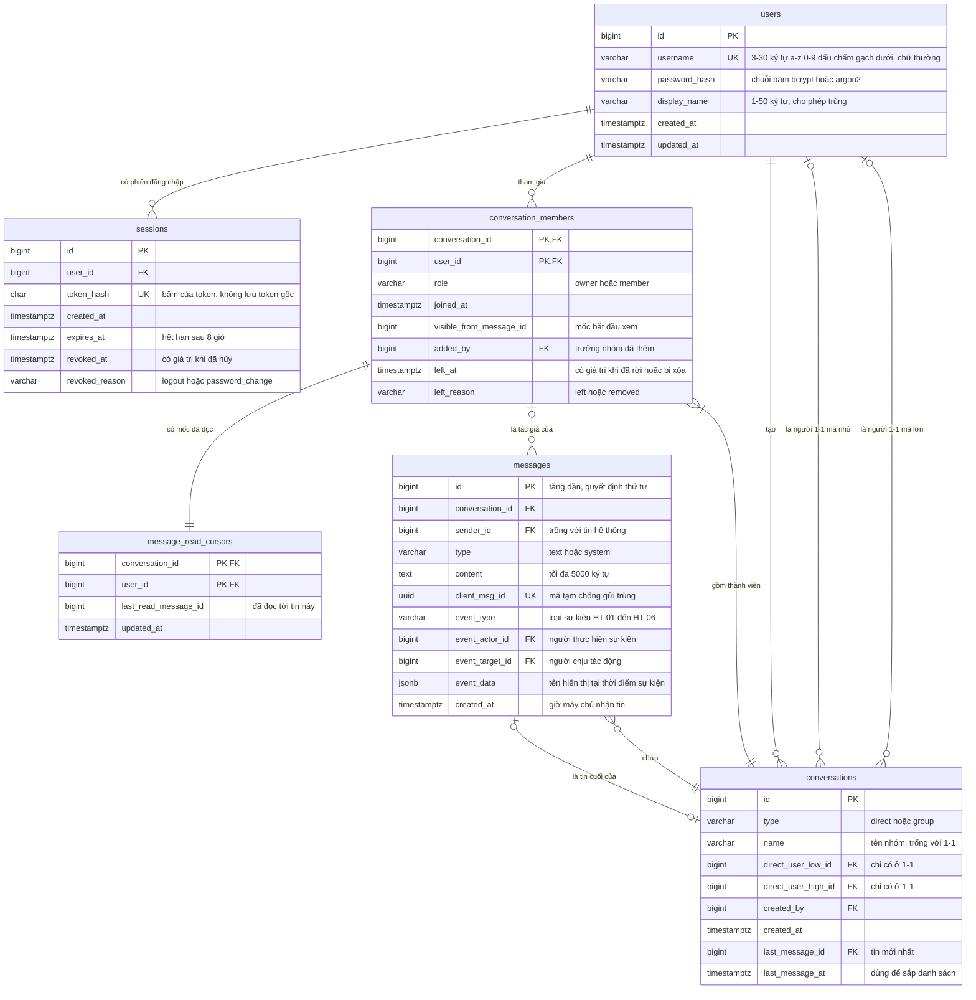

# 06 - Mô hình dữ liệu (ERD)

| Mục | Nội dung |
|---|---|
| Dự án | Ứng dụng chat nội bộ (MVP) – Nhóm: *[chưa xác định]* |
| Tệp | `06-erd.md` |
| Phiên bản | 1.0 – Draft |
| Ngày | 2026-11-14 |
| Người soạn | Nhóm BA / Architect / QA (bản nháp có trợ lý AI hỗ trợ soạn thảo) |
| Trạng thái | Draft – chờ Product Owner rà soát mục 12 và 13 |
| Căn cứ | (1) PDF "Xây dựng ứng dụng chat nội bộ (MVP)", ngày 13~14/11/2026 – **nguồn duy nhất của yêu cầu nghiệp vụ**; (2) `01-brd.md` v1.1; (3) `02-srs.md` (bản trên repository ghi v1.0); (4) `03-frs.md` v1.0; (5) `04-use-cases.md` v1.1; (6) `05-user-stories.md` v1.0. Tất cả đang ở trạng thái Draft. `08-high-level-design.md` **chưa có trên repository** (xem OQ-23) |

**Quy ước ký hiệu**

| Ký hiệu | Ý nghĩa |
|---|---|
| `[PDF]` | Do đề bài quy định. Không được tự thay đổi. |
| `[QĐ-xx]` | Quyết định của Product Owner đã ghi ở các tài liệu trước. |
| `[GĐ-xx]` / `[GS-xx]` / `[GF-xx]` / `[GU-xx]` | Giả định đã ghi ở BRD / SRS / FRS / Use case. |
| `[GE-xx]` | Giả định mới của tài liệu này (lựa chọn thiết kế dữ liệu). Xem mục 12. |
| `[ĐX]` | Đề xuất kỹ thuật của nhóm, không phải yêu cầu đề bài. |
| `[OQ-xx]` | Câu hỏi mở. Xem mục 13. |
| PK / FK / UK | Khóa chính / khóa ngoại / ràng buộc không trùng. |

> Tài liệu này **không chứa kết quả chạy thử hay số đo hiệu năng nào**. Các ngưỡng thời gian lấy từ PDF §4 và phải được đo trên môi trường thật, ghi tại `12-test-reports.md`.

---

## 1. Mục đích và phạm vi

Tài liệu mô tả cơ sở dữ liệu (CSDL) lưu **người dùng, phiên đăng nhập, hội thoại, thành viên, tin nhắn và tình trạng đã đọc** cho đúng 15 mã MVP: TK-01…TK-06, CH-01, CH-02, CH-03, CH-06, NH-01…NH-04, TB-01 `[PDF §3]`.

**Có trong CSDL:**

- Tài khoản và mật khẩu dạng băm (TK-01…TK-05).
- Phiên đăng nhập có hạn và có thể hủy (TK-03, TK-04).
- Hội thoại 1-1 và nhóm, thành viên, vai trò trưởng nhóm (CH-01, NH-01, NH-03).
- Toàn bộ tin nhắn, kể cả tin hệ thống (CH-02, CH-03, NH-02, NH-04). Tin nhắn lưu trong CSDL, không chỉ trong bộ nhớ `[PDF §4]`.
- Mốc đã đọc của từng người trong từng hội thoại (TB-01, CH-06).

**Không có trong CSDL (có chủ đích):**

| Nội dung | Lý do |
|---|---|
| Mật khẩu nguyên văn | Cấm theo `[PDF TK-02]`. Chỉ có cột `password_hash`. |
| Mã đăng ký tổ chức | Là cấu hình do người triển khai đặt `[QĐ-05]`, `[GĐ-16]`, không phải dữ liệu người dùng. Chi tiết ở `08`/`09`. |
| Ảnh đại diện | Avatar là chữ cái đầu, tính từ tên hiển thị khi hiển thị `[PDF TK-05]`, `[GS-11]`. |
| Trạng thái online, "đã nhận / đã xem" từng tin, file đính kèm, sửa / thu hồi tin | Thuộc phần mở rộng PDF §6 (CH-04, CH-05, NH-05, TN-xx…), dự án không đăng ký `[QĐ-01]`. Xem mục 11. |

## 2. Lựa chọn hệ quản trị CSDL

| Nội dung | Lựa chọn | Nguồn |
|---|---|---|
| Hệ quản trị | **PostgreSQL**, phiên bản 13 trở lên (cần hàm kiểm tra chuẩn hóa NFC) | PDF §7 gợi ý PostgreSQL cho tài khoản/hội thoại/tin nhắn. HLD chưa chốt nên đây là **giả định** `[GE-01]`, `[OQ-23]` |
| Bảng mã | UTF-8 cho toàn CSDL, để lưu đúng tiếng Việt có dấu | `[PDF §4]`, NFR-08 |
| Thời gian | Kiểu `TIMESTAMPTZ` (có múi giờ), lưu theo giờ chuẩn quốc tế; giao diện đổi sang giờ máy người dùng | `[GS-26]`, `[ĐX]` |
| Redis | Không dùng để lưu tin hay trạng thái đã đọc. PDF chỉ gợi ý Redis cho presence/rate limit (tùy chọn) | `[PDF §7]` |

Nếu HLD chọn hệ quản trị khác, các nguyên tắc ở mục 7–9 vẫn giữ nguyên; chỉ cú pháp ở Phụ lục A thay đổi.

## 3. Danh sách thực thể

| Bảng | Giải thích một dòng |
|---|---|
| `users` | Mỗi dòng là một tài khoản nhân viên: tên đăng nhập, mật khẩu đã băm, tên hiển thị. |
| `sessions` | Mỗi dòng là một lần đăng nhập trên một trình duyệt; có hạn dùng và bị đánh dấu hủy khi đăng xuất. |
| `conversations` | Mỗi dòng là một cuộc trò chuyện, loại 1-1 (`direct`) hoặc nhóm (`group`). |
| `conversation_members` | Ai đang (hoặc đã từng) ở trong cuộc trò chuyện nào, với vai trò gì, và được xem tin từ mốc nào. |
| `messages` | Mỗi dòng là một tin: tin do người gõ (`text`) hoặc tin hệ thống (`system`). |
| `message_read_cursors` | "Dấu trang" đã đọc: mỗi người, trong mỗi cuộc trò chuyện, đã đọc tới tin nào. |

**Về `system_events`:** tài liệu **không** tạo bảng riêng. Sự kiện nhóm được lưu thành tin `messages.type = 'system'` `[GE-02]`. Lý do: PDF NH-04 yêu cầu sự kiện "hiển thị thành dòng tin hệ thống trong hội thoại", nên để chung một dòng thời gian thì lịch sử, phân trang 50 tin và trích tin cuối hoạt động giống hệt tin thường.

## 4. Sơ đồ ERD



*Để sơ đồ dễ đọc, ba khóa ngoại phụ trỏ về `users` (`conversation_members.added_by`, `messages.event_actor_id`, `messages.event_target_id`) và khóa ngoại trực tiếp `messages.sender_id → users.id` không vẽ thành đường nối; chúng được ghi đầy đủ ở mục 6.*

## 5. Các mối quan hệ

| Quan hệ | Loại | Giải thích dễ hiểu |
|---|---|---|
| `users` – `conversations` (qua `conversation_members`) | **Nhiều – nhiều (n-n)** | Một người ở nhiều cuộc trò chuyện; một cuộc trò chuyện có nhiều người. Bảng `conversation_members` là "bảng nối" ghi từng cặp người – cuộc trò chuyện. |
| `users` – `sessions` | 1 – n | Một người có thể đăng nhập trên nhiều trình duyệt cùng lúc, mỗi nơi một phiên `[GF-04]`, `[GU-03]`. |
| `conversations` – `messages` | 1 – n | Mỗi tin thuộc đúng một cuộc trò chuyện. |
| `conversation_members` – `messages` | 1 – n (tùy chọn) | Mỗi tin văn bản có một tác giả, và tác giả **phải là thành viên** của chính cuộc trò chuyện đó (mục 7.2). Tin hệ thống không có tác giả. |
| `conversation_members` – `message_read_cursors` | **1 – 1** | Mỗi thành viên có đúng một mốc đã đọc trong mỗi cuộc trò chuyện. |
| `users` – `conversations` (người tạo) | 1 – n | Ai tạo cuộc trò chuyện. Với nhóm, người tạo là trưởng nhóm ban đầu `[PDF NH-01]`. |
| `users` – `conversations` (cặp 1-1) | 1 – n (hai lần) | Hai cột `direct_user_low_id`, `direct_user_high_id` ghi hai người của hội thoại 1-1, dùng để chống trùng (mục 7.1). |
| `conversations` – `messages` (tin cuối) | 1 – 1 (tùy chọn) | Mỗi cuộc trò chuyện trỏ tới tin mới nhất của nó, để danh sách hội thoại không phải tìm lại tin cuối. |

## 6. Từ điển dữ liệu

Cột "Nguồn" cho biết quy định đến từ PDF hay là lựa chọn thiết kế.

### 6.1 `users` – tài khoản

| Cột | Kiểu | Bắt buộc | Ràng buộc | Mô tả | Nguồn |
|---|---|---|---|---|---|
| `id` | BIGINT | Có | PK, tự tăng | Mã tài khoản | `[GE-03]` |
| `username` | VARCHAR(30) | Có | **UK**; CHECK khớp mẫu `^[a-z0-9._]{3,30}$` | Tên đăng nhập. Máy chủ đổi sang chữ thường trước khi lưu, nên "NhanVien01" trùng "nhanvien01" | Duy nhất: `[PDF TK-01]`. Định dạng và chữ thường: `[QĐ-07]`, `[GS-01]`, `[GF-01]` |
| `password_hash` | VARCHAR(255) | Có | – | Chuỗi băm bcrypt hoặc argon2 (đã gồm "muối" và tham số) | `[PDF TK-02]` |
| `display_name` | VARCHAR(50) | Có | CHECK không trống sau khi bỏ khoảng trắng; CHECK đã chuẩn hóa NFC | Tên hiển thị, được trùng | `[PDF TK-01, TK-05]`, `[GS-02]`, `[GS-18]` |
| `created_at` | TIMESTAMPTZ | Có | Mặc định giờ hiện tại | Thời điểm đăng ký | `[ĐX]` |
| `updated_at` | TIMESTAMPTZ | Có | Mặc định giờ hiện tại | Lần sửa hồ sơ hoặc đổi mật khẩu gần nhất | `[ĐX]` |

Ghi chú:

- Tìm người dùng (TK-06) so khớp "chứa từ khóa", không phân biệt hoa thường, **có** phân biệt dấu `[PDF §4]`, `[GS-13]`, `[GĐ-10]`. Câu tìm phải "thoát" ký tự `%` và `_` trong từ khóa, vì `_` là ký tự hợp lệ trong tên đăng nhập `[ĐX]`. Việc đổi chữ hoa/thường với chữ có dấu (ví dụ "Đ" ↔ "đ") phụ thuộc cài đặt ngôn ngữ của CSDL, nên phải kiểm chứng bằng TK-06-AC3 `[GE-04]`.
- Không có cột mã đăng ký tổ chức, avatar, email hay trạng thái khóa (QT-01, TK-07…11 là NOT MVP).

### 6.2 `sessions` – phiên đăng nhập

| Cột | Kiểu | Bắt buộc | Ràng buộc | Mô tả | Nguồn |
|---|---|---|---|---|---|
| `id` | BIGINT | Có | PK, tự tăng | Mã phiên (nếu dùng JWT thì đây là mã định danh ghi trong token) | `[GE-05]` |
| `user_id` | BIGINT | Có | FK → `users.id` | Chủ phiên | – |
| `token_hash` | CHAR(64) | Có | **UK** | Giá trị băm SHA-256 của token. Không lưu token gốc, để lộ CSDL không lộ phiên `[ĐX]` | `[GE-05]` |
| `created_at` | TIMESTAMPTZ | Có | Mặc định giờ hiện tại | Lúc đăng nhập | – |
| `expires_at` | TIMESTAMPTZ | Có | CHECK lớn hơn `created_at` | Lúc hết hạn = lúc đăng nhập + 8 giờ | Có hạn: `[PDF TK-03]`. 8 giờ: `[QĐ-09]`, `[GS-06]` |
| `revoked_at` | TIMESTAMPTZ | Không | – | Lúc phiên bị hủy | `[PDF TK-03]` "đăng xuất hủy token" |
| `revoked_reason` | VARCHAR(20) | Không | CHECK `logout` hoặc `password_change`; có giá trị khi và chỉ khi `revoked_at` có giá trị | Lý do hủy | `[QĐ-09]`, `[GS-09]` |

Index: `ix_sessions_user_active` trên `user_id` cho các phiên chưa hủy, để khi đổi mật khẩu hủy nhanh mọi phiên khác của tài khoản (TK-04).

**Phiên hợp lệ** khi: tìm thấy `token_hash`, `revoked_at` trống **và** `expires_at` còn ở tương lai. Mỗi yêu cầu API và mỗi lần mở kết nối WebSocket đều kiểm tra điều này `[PDF TK-03, §4]`, `[GS-07]`.

### 6.3 `conversations` – cuộc trò chuyện

| Cột | Kiểu | Bắt buộc | Ràng buộc | Mô tả | Nguồn |
|---|---|---|---|---|---|
| `id` | BIGINT | Có | PK, tự tăng | Mã hội thoại | `[GE-03]` |
| `type` | VARCHAR(10) | Có | CHECK `direct` hoặc `group` | Loại hội thoại | `[PDF §3.2, §3.3]` |
| `name` | VARCHAR(100) | Chỉ với nhóm | CHECK: nhóm thì bắt buộc và không trống; 1-1 thì phải trống | Tên nhóm, được trùng với nhóm khác | `[PDF NH-01]`, `[GS-28]` |
| `direct_user_low_id` | BIGINT | Chỉ với 1-1 | FK → `users.id` | Mã **nhỏ hơn** trong hai người của hội thoại 1-1 | `[GE-06]` |
| `direct_user_high_id` | BIGINT | Chỉ với 1-1 | FK → `users.id`; CHECK `low < high` | Mã **lớn hơn** trong hai người | `[GE-06]` |
| – | – | – | **UK** (`direct_user_low_id`, `direct_user_high_id`) | Mỗi cặp người chỉ có một hội thoại 1-1 | `[PDF CH-01]` |
| `created_by` | BIGINT | Có | FK → `users.id` | Người tạo | `[PDF NH-01]` |
| `created_at` | TIMESTAMPTZ | Có | Mặc định giờ hiện tại | Lúc tạo | – |
| `last_message_id` | BIGINT | Không | FK → `messages.id` | Tin mới nhất (kể cả tin hệ thống). Trống khi hội thoại 1-1 chưa có tin | `[GS-25]`, `[GE-07]` |
| `last_message_at` | TIMESTAMPTZ | Không | – | Thời điểm tin mới nhất, dùng để sắp danh sách hội thoại | `[PDF CH-06]`, `[GE-07]` |

### 6.4 `conversation_members` – thành viên

| Cột | Kiểu | Bắt buộc | Ràng buộc | Mô tả | Nguồn |
|---|---|---|---|---|---|
| `conversation_id` | BIGINT | Có | **PK kép**, FK → `conversations.id` | Hội thoại | – |
| `user_id` | BIGINT | Có | **PK kép**, FK → `users.id` | Thành viên | – |
| `role` | VARCHAR(10) | Có | CHECK `owner` hoặc `member`; mặc định `member` | Vai trò. Hội thoại 1-1: cả hai là `member` | `[PDF NH-01, NH-03]` |
| `joined_at` | TIMESTAMPTZ | Có | Mặc định giờ hiện tại | Lúc được thêm lần gần nhất | – |
| `visible_from_message_id` | BIGINT | Có | Mặc định 0 | **Mốc bắt đầu xem**: chỉ được xem tin có `messages.id` ≥ giá trị này (mục 7.4) | `[QĐ-04]`, `[QĐ-08]`, `[GS-35]`, `[GS-36]`, FRS mục 6.2 |
| `added_by` | BIGINT | Không | FK → `users.id` | Trưởng nhóm đã thêm người này; trống với thành viên lúc tạo và với 1-1 | `[ĐX]` |
| `left_at` | TIMESTAMPTZ | Không | – | Lúc rời hoặc bị xóa. **Trống = đang là thành viên** | `[PDF NH-03]`, `[QĐ-04]` |
| `left_reason` | VARCHAR(10) | Không | CHECK `left` hoặc `removed`; có giá trị khi và chỉ khi `left_at` có giá trị | Tự rời hay bị xóa | `[PDF NH-03]` |

Index và ràng buộc thêm:

- `uq_members_one_active_owner`: UK trên `conversation_id`, chỉ áp cho dòng `role = 'owner'` và `left_at` trống → mỗi nhóm có **tối đa một** trưởng nhóm đang hoạt động (mục 7.3).
- `ix_members_user_active`: index trên `user_id` cho thành viên đang hoạt động, để lấy nhanh danh sách hội thoại của một người (CH-06).

Vì sao giữ dòng khi rời nhóm thay vì xóa: (1) khóa ngoại tác giả của tin cũ (mục 7.2) cần dòng này tồn tại; (2) khi được thêm lại, cập nhật đúng dòng cũ theo lựa chọn của lần thêm mới nhất `[GS-35]`. Dòng có `left_at` **không** cho quyền xem gì `[QĐ-04]`. Đây là ghi nhận trạng thái thành viên, **không phải** cơ chế "xóa mềm" dữ liệu (xem mục 12, GE-12).

### 6.5 `messages` – tin nhắn

| Cột | Kiểu | Bắt buộc | Ràng buộc | Mô tả | Nguồn |
|---|---|---|---|---|---|
| `id` | BIGINT | Có | PK, tự tăng | Mã tin. Tăng dần nên dùng làm thứ tự tin, mốc phân trang, mốc đã đọc | `[GS-20]`, `[GS-22]`, `[GE-03]` |
| `conversation_id` | BIGINT | Có | FK → `conversations.id` | Hội thoại chứa tin | – |
| `sender_id` | BIGINT | Chỉ với tin văn bản | FK → `users.id`; **FK kép** (`conversation_id`, `sender_id`) → `conversation_members` | Người gửi. Tin hệ thống thì trống | `[PDF §4]`, mục 7.2 |
| `type` | VARCHAR(10) | Có | CHECK `text` hoặc `system` | Loại tin | `[PDF NH-04]` |
| `content` | TEXT | Có | Với `text`: CHECK có ít nhất một ký tự không phải khoảng trắng, ≤ 5.000 ký tự, đã chuẩn hóa NFC | Nội dung, giữ nguyên xuống dòng. Với `system`: câu hiển thị đã dựng sẵn bằng tiếng Việt | 5.000 ký tự, xuống dòng: `[PDF CH-02]`. Không trống: `[GS-19]`. NFC: `[GS-18]`. Cách đếm: `[OQ-24]` |
| `client_msg_id` | UUID | Không | **UK** (`sender_id`, `client_msg_id`) khi có giá trị; tin hệ thống phải trống | Mã tạm do trình duyệt tạo. Gửi lại cùng mã thì máy chủ trả tin cũ, không lưu thêm | `[GF-12]`, `[GU-08]` |
| `event_type` | VARCHAR(20) | Chỉ với tin hệ thống | CHECK một trong sáu giá trị ở bảng dưới; tin văn bản phải trống | Loại sự kiện nhóm | `[PDF NH-04]`, FRS-14 |
| `event_actor_id` | BIGINT | Không | FK → `users.id` | Người thực hiện (ví dụ trưởng nhóm thêm người) | `[ĐX]` |
| `event_target_id` | BIGINT | Không | FK → `users.id` | Người chịu tác động (người được thêm/bị xóa/nhận quyền) | `[ĐX]` |
| `event_data` | JSONB | Không | – | Tên hiển thị của các bên **tại thời điểm sự kiện**, tên nhóm mới | `[GS-32]` |
| `created_at` | TIMESTAMPTZ | Có | Mặc định giờ máy chủ | Lúc máy chủ nhận và lưu tin | `[GS-20]` |

Giá trị `event_type` (khớp danh mục HT ở FRS-14):

| `event_type` | Mã HT | Sự kiện | Nguồn |
|---|---|---|---|
| `group_created` | HT-01 | Tạo nhóm | `[GS-30]` – bổ sung, PDF không liệt kê |
| `member_added` | HT-02 | Thêm thành viên | `[PDF NH-04]` |
| `member_removed` | HT-03 | Xóa thành viên | `[PDF NH-04]` |
| `member_left` | HT-04 | Thành viên rời nhóm | `[PDF NH-04]` |
| `group_renamed` | HT-05 | Đổi tên nhóm | `[PDF NH-04]` |
| `owner_transferred` | HT-06 | Chuyển quyền trưởng nhóm | `[GĐ-19]`, `[OQ-10]` – bổ sung |

Index:

- `ix_messages_conv_id` trên (`conversation_id`, `id` giảm dần): mở hội thoại và cuộn ngược 50 tin (CH-03).
- `ix_messages_conv_unread` trên (`conversation_id`, `id`), kèm `sender_id`, chỉ cho tin `text`: đếm chưa đọc (mục 8).
- `uq_messages_client_msg`: chống lưu trùng khi gửi lại (GF-12).

### 6.6 `message_read_cursors` – mốc đã đọc

| Cột | Kiểu | Bắt buộc | Ràng buộc | Mô tả | Nguồn |
|---|---|---|---|---|---|
| `conversation_id` | BIGINT | Có | **PK kép**; FK kép → `conversation_members` (xóa theo khi dòng thành viên bị xóa) | Hội thoại | – |
| `user_id` | BIGINT | Có | **PK kép** | Người đọc | – |
| `last_read_message_id` | BIGINT | Có | Mặc định 0; CHECK ≥ 0 | Mã tin mới nhất người này đã đọc trong hội thoại. **Chỉ tăng, không giảm** | `[GS-34]`, FRS-15 |
| `updated_at` | TIMESTAMPTZ | Có | Mặc định giờ hiện tại | Lần đánh dấu đọc gần nhất | – |

Vì sao tách khỏi `conversation_members` `[GE-08]`: mốc đã đọc thay đổi **rất thường xuyên** (mỗi lần mở hội thoại, mỗi tin đến khi đang xem), còn dòng thành viên được máy chủ "giữ chỗ" mỗi lần kiểm tra quyền gửi tin (mục 7.2). Tách ra giúp hai việc này không chờ nhau. Bảng này **không** lưu "ai đã xem tin nào" – đó là NH-05/CH-04, NOT MVP.

## 7. Quy tắc toàn vẹn quan trọng

### 7.1 Hội thoại 1-1 không trùng theo cặp người (CH-01)

| Lớp | Cách làm | Nguồn |
|---|---|---|
| CSDL | Hội thoại 1-1 ghi hai người theo thứ tự cố định: mã nhỏ vào `direct_user_low_id`, mã lớn vào `direct_user_high_id`. UK trên cặp hai cột → A mở với B hay B mở với A đều ra **cùng một** cặp, CSDL từ chối dòng thứ hai | `[PDF CH-01]`, `[GE-06]` |
| CSDL | CHECK `low < high` → không thể tạo hội thoại với chính mình | `[GĐ-14]` |
| CSDL | CHECK hình dạng: `direct` phải có đủ hai cột và không có tên; `group` thì ngược lại | `[ĐX]` |
| Máy chủ | Khi mở chat: "tạo nếu chưa có, nếu đã có thì lấy lại" trong một câu lệnh (`INSERT … ON CONFLICT DO NOTHING` rồi đọc lại). Hai người mở cùng lúc vẫn chỉ ra một hội thoại | `[GS-17]` |
| Máy chủ | Trong cùng giao dịch, thêm đúng hai dòng `conversation_members` và hai dòng `message_read_cursors`. Không bao giờ thêm người thứ ba vào hội thoại `direct` | `[GU-07]` |

Cách khác đã cân nhắc: cột `direct_key` dạng chuỗi "minId:maxId" có UK. Không chọn vì hai cột số có khóa ngoại tới `users`, CSDL tự bảo đảm hai người tồn tại.

### 7.2 Tác giả phải thuộc hội thoại – kiểm ở máy chủ và chặn ở CSDL

PDF §4 yêu cầu "người ngoài hội thoại không đọc được tin nhắn" và AT-06 kiểm tra điều đó. Tài liệu dùng **hai lớp**:

| Lớp | Chặn được gì | Không chặn được gì |
|---|---|---|
| **CSDL** – FK kép `messages(conversation_id, sender_id)` → `conversation_members(conversation_id, user_id)` | Lưu tin với tác giả **chưa từng** là thành viên của hội thoại đó (ví dụ tài khoản thứ ba của AT-06 cố ghi vào hội thoại 1-1) | Người **đã rời / bị xóa** vẫn còn dòng thành viên nên FK vẫn đúng |
| **Máy chủ** – trong giao dịch gửi tin: đọc dòng thành viên với điều kiện `left_at` trống và **khóa chia sẻ** dòng đó, rồi mới lưu tin | Người đã rời/bị xóa gửi tin (NH-02-AC2); trường hợp "vừa bị xóa đúng lúc đang gửi" – lệnh xóa phải chờ giao dịch gửi xong hoặc ngược lại | – |

Quy tắc đọc (lịch sử, trích tin cuối, số chưa đọc, đẩy realtime) đều **gắn điều kiện thành viên vào chính câu truy vấn**: chỉ trả tin khi tồn tại dòng `conversation_members` của người hỏi với `left_at` trống và `messages.id ≥ visible_from_message_id`. Người ngoài nhận 0 dòng và API trả "không tìm thấy" như nhau, không lộ hội thoại có tồn tại hay không `[PDF §4]`, NFR-04, FRS mục 6.1.

Tin hệ thống có `sender_id` trống nên FK kép không áp dụng (quy tắc mặc định của khóa ngoại khi có cột trống); quyền sinh tin hệ thống do máy chủ kiểm (là trưởng nhóm, hoặc là thành viên tự rời).

Tùy chọn tăng cường (không bắt buộc cho MVP): một trigger trong CSDL từ chối tin `text` khi `left_at` của tác giả có giá trị `[GE-09]`.

### 7.3 Một trưởng nhóm

- UK có điều kiện `uq_members_one_active_owner` → **tối đa một** trưởng nhóm đang hoạt động mỗi nhóm.
- "**Ít nhất một**" do máy chủ bảo đảm: trưởng nhóm chỉ rời được khi chuyển quyền trong cùng một giao dịch `[QĐ-03]`; nhóm chỉ còn trưởng nhóm thì không cho rời `[GĐ-18]`.
- Thứ tự trong giao dịch chuyển quyền + rời: (1) hạ trưởng nhóm cũ thành `member`; (2) nâng người nhận thành `owner`; (3) ghi `left_at` cho người cũ; (4) lưu hai tin hệ thống HT-06 rồi HT-04 `[GĐ-19]`, `[GF-21]`. Làm sai thứ tự (nâng trước, hạ sau) sẽ vi phạm UK ở bước giữa.

### 7.4 Phạm vi được xem (`visible_from_message_id`)

Mốc này áp dụng đồng thời cho lịch sử, trích tin cuối và số chưa đọc (FRS mục 6.2).

| Trường hợp | `visible_from_message_id` | `last_read_message_id` khởi tạo | Nguồn |
|---|---|---|---|
| Hai người trong hội thoại 1-1 | 0 (từ đầu) | 0 | `[PDF]` |
| Thành viên lúc tạo nhóm (kể cả trưởng nhóm) | 0 (từ lúc tạo nhóm – tin đầu tiên của nhóm là HT-01) | Mã tin HT-01 | NH-01, FRS-11 |
| Được thêm, **có** "Cho xem tin nhắn trước đó" | 0 (từ lúc tạo nhóm) | Mã tin HT-02 của chính lần thêm này → tin cũ không thành "chưa đọc" | `[QĐ-08]`, `[GS-36]`, `[GF-22]` |
| Được thêm, **không** cho xem (mặc định) | Mã tin HT-02 của chính lần thêm này (người mới thấy dòng "A đã thêm D") | Mã tin HT-02 đó | `[QĐ-08]`, `[GS-35]` |
| Đã rời / bị xóa (`left_at` có giá trị) | Không dùng – không xem được gì | Không dùng | `[QĐ-04]` |
| Được thêm lại | Cập nhật lại dòng cũ theo lựa chọn của lần thêm mới nhất; xóa `left_at`, `left_reason` | Đặt lại như dòng tương ứng ở trên | `[GS-35]` |

Lưu ý: SRS trên repository (bản ghi v1.0, GS-23) còn quy định "thành viên mới không xem tin trước khi được thêm", chưa có tùy chọn QĐ-08. Cột `visible_from_message_id` đáp ứng được cả hai cách; chỉ khác giá trị gán khi thêm người `[OQ-25]`.

### 7.5 Tin hệ thống lưu cùng sự kiện (NH-04)

Mỗi thao tác nhóm (tạo, thêm, xóa, rời, đổi tên, chuyển quyền) và tin hệ thống của nó nằm trong **một giao dịch**: cùng thành công hoặc cùng thất bại `[GF-21]`, `[GU-11]`. Thêm 3 người một lúc sinh 3 dòng `member_added` `[FRS-14]`; nếu một người không hợp lệ thì không thêm ai `[GU-13]`. Đổi tên trùng tên cũ: không ghi gì `[GF-19]`.

### 7.6 Thứ tự tin và nhận lại tin bị lỡ

- Thứ tự tin trong hội thoại = thứ tự `messages.id` `[GS-20]`.
- Để mã tin trong **cùng một hội thoại** được ghi nhận theo đúng thứ tự tăng dần, giao dịch gửi tin khóa dòng `conversations` của hội thoại đó trước khi lưu tin, rồi cập nhật `last_message_id`, `last_message_at` trong cùng giao dịch `[GE-10]`. Nhờ vậy, khi mất mạng rồi kết nối lại, trình duyệt chỉ cần xin "các tin có mã lớn hơn tin cuối tôi đã có" mà không bị sót (NFR-13, mức khuyến khích).
- Tin chỉ được báo "đã gửi" sau khi giao dịch lưu thành công `[PDF §4]`, CH-02 R5.

### 7.7 Phiên và đăng xuất (TK-03, TK-04)

- Đăng nhập: thêm một dòng `sessions` với `expires_at` = giờ hiện tại + 8 giờ `[QĐ-09]`.
- Đăng xuất: ghi `revoked_at`, `revoked_reason = 'logout'` cho phiên hiện tại → token cũ bị từ chối dù chưa hết hạn `[PDF TK-03]`.
- Đổi mật khẩu: cập nhật `users.password_hash` và ghi `revoked_reason = 'password_change'` cho **mọi phiên khác** chưa hủy của tài khoản, trong cùng giao dịch `[QĐ-09]`, `[GS-09]`.
- Máy chủ đóng kết nối WebSocket gắn với phiên bị hủy `[GS-07]` (chi tiết ở `07`/`09`).

## 8. Cách tính số chưa đọc hiệu quả (TB-01, CH-06)

### 8.1 Quy tắc đếm (theo FRS-15)

Số chưa đọc của người U trong hội thoại C = số tin thỏa **đồng thời**:

1. thuộc hội thoại C;
2. là tin văn bản (`type = 'text'`) – không tính tin hệ thống `[QĐ-10]`, `[GĐ-08]`;
3. do **người khác** gửi (`sender_id ≠ U`) – không tính tin của mình `[GĐ-08]`;
4. có mã lớn hơn mốc đã đọc của U, và nằm trong phạm vi được xem của U (mục 7.4).

### 8.2 Vì sao không phải quét toàn bộ tin

- Mốc đã đọc là **một con số** (`last_read_message_id`). Vì mã tin tăng dần, "tin chưa đọc" luôn là **đoạn cuối** của hội thoại.
- Index `ix_messages_conv_unread` sắp tin văn bản theo (hội thoại, mã tin) và mang sẵn `sender_id`. CSDL nhảy thẳng tới vị trí "sau mốc đã đọc" trong đúng hội thoại đó và chỉ đi qua các tin chưa đọc; không đọc tin cũ, không đọc hội thoại khác.
- Giao diện chỉ hiện tối đa "99+" `[ĐX]` (FRS-15), nên mỗi hội thoại chỉ cần đếm **tới 100 tin** rồi dừng. Chi phí mỗi hội thoại vì thế có giới hạn trên, kể cả khi người dùng bỏ đọc rất lâu `[GE-11]`.

Câu truy vấn tham khảo cho danh sách hội thoại của người dùng `:me`:

```sql
SELECT c.id, c.type, c.name, c.last_message_id, c.last_message_at, u.unread_count
FROM conversation_members cm
JOIN conversations c         ON c.id = cm.conversation_id
JOIN message_read_cursors r  ON r.conversation_id = cm.conversation_id
                            AND r.user_id = cm.user_id
CROSS JOIN LATERAL (
    SELECT count(*) AS unread_count
    FROM (
        SELECT 1
        FROM messages m
        WHERE m.conversation_id = cm.conversation_id
          AND m.type = 'text'
          AND m.id > GREATEST(r.last_read_message_id, cm.visible_from_message_id - 1)
          AND m.sender_id <> cm.user_id
        LIMIT 100
    ) AS capped
) AS u
WHERE cm.user_id = :me
  AND cm.left_at IS NULL              -- chỉ hội thoại đang là thành viên
  AND c.last_message_id IS NOT NULL   -- 1-1 chưa có tin thì không hiện (GF-09)
ORDER BY c.last_message_at DESC;      -- tin mới nhất ở trên (CH-06)
```

- **Tổng số trên tab/biểu tượng** (TB-01) = cộng `unread_count` của các dòng trên; giao diện hiện "99+" khi vượt.
- **Trích tin cuối** lấy từ `c.last_message_id` (một lần đọc theo khóa chính), không cần tìm tin cuối. Vì mọi thành viên hiện tại đều xem được tin mới nhất (mốc xem luôn nhỏ hơn hoặc bằng tin mới nhất), một cột tin cuối dùng chung cho mọi thành viên là đủ.

### 8.3 Đánh dấu đã đọc

- Khi người dùng mở hội thoại, hoặc đang xem hội thoại mà có tin mới `[GS-33]`, máy chủ đặt mốc tới tin mới nhất của hội thoại.
- Mốc **chỉ tăng**: `last_read_message_id = GREATEST(giá trị cũ, giá trị mới)`, và giá trị mới không vượt quá `conversations.last_message_id`. Hai tab cùng gửi "đã đọc" theo thứ tự lộn xộn cũng không làm số chưa đọc tăng trở lại.
- Chỉ thành viên hiện tại được cập nhật mốc (FRS mục 6.3). Mốc lưu ở máy chủ nên đồng bộ mọi tab, mọi trình duyệt, và còn nguyên sau khi đăng xuất hoặc khởi động lại dịch vụ `[GS-34]`, TB-01 R7.

### 8.4 Cách khác đã cân nhắc (không chọn cho MVP)

Lưu sẵn một cột "số chưa đọc" và cộng 1 cho mọi thành viên mỗi khi có tin. Đọc danh sách nhanh hơn, nhưng mỗi tin nhóm phải ghi thêm vào dòng của **mọi** thành viên và dễ lệch số khi có lỗi giữa chừng. Chỉ nên cân nhắc nếu đo thực tế cho thấy cách ở 8.2 không đạt yêu cầu.

## 9. Index đề xuất và lý do

Mục tiêu hiệu năng do PDF §4 đặt ra: tin đến người nhận < 2 giây; mở hội thoại (50 tin gần nhất) < 1,5 giây. Bảng dưới chỉ nêu **lý do thiết kế**; việc có đạt hay không phải đo theo NFR-05, NFR-06.

| Index / ràng buộc | Bảng | Phục vụ | Lý do |
|---|---|---|---|
| PK `id` | mọi bảng có `id` | Tất cả | Truy cập theo mã |
| `uq_users_username` | `users` | TK-01, TK-03 | Chặn trùng tên đăng nhập; tìm tài khoản khi đăng nhập |
| `uq_sessions_token_hash` | `sessions` | TK-03 | Kiểm tra phiên ở **mọi** yêu cầu và mỗi lần mở WebSocket |
| `ix_sessions_user_active` (có điều kiện) | `sessions` | TK-04 | Hủy nhanh mọi phiên khác khi đổi mật khẩu |
| `uq_conversations_direct_pair` | `conversations` | CH-01 | Chống trùng hội thoại 1-1; tìm hội thoại cũ của một cặp |
| PK (`conversation_id`, `user_id`) | `conversation_members` | Mọi thao tác trong hội thoại | Kiểm tra "có phải thành viên" bằng một lần tra khóa |
| `ix_members_user_active` (có điều kiện) | `conversation_members` | CH-06, TB-01 | Lấy các hội thoại đang tham gia của một người |
| `uq_members_one_active_owner` (có điều kiện) | `conversation_members` | NH-01, NH-03 | Tối đa một trưởng nhóm |
| `ix_messages_conv_id` (`conversation_id`, `id` giảm dần) | `messages` | CH-03, NFR-06 | Lấy 50 tin mới nhất và 50 tin cũ hơn một mốc bằng một lần đi theo index rồi dừng; không phụ thuộc hội thoại dài bao nhiêu |
| `ix_messages_conv_unread` (có điều kiện `type = 'text'`, kèm `sender_id`) | `messages` | TB-01, CH-06 | Đếm chưa đọc chỉ trên đoạn tin sau mốc đã đọc (mục 8.2) |
| `uq_messages_client_msg` (có điều kiện) | `messages` | CH-02, NFR-13 | Gửi lại không sinh tin trùng |
| PK (`conversation_id`, `user_id`) | `message_read_cursors` | TB-01 | Đọc/ghi mốc đã đọc bằng một lần tra khóa |

Không đề xuất index tìm kiếm toàn văn cho TK-06 trong MVP: câu tìm giới hạn 20 kết quả `[GS-14]` và số tài khoản nội bộ dự kiến nhỏ. Nếu đo thực tế thấy chậm, bổ sung index trigram cho `username` và `display_name` `[GE-04]`.

## 10. Truy vết mã yêu cầu → bảng / cột

| Mã | Bảng / cột đáp ứng | Ràng buộc chính | AT |
|---|---|---|---|
| TK-01 | `users.username`, `users.display_name`, `users.password_hash` | UK `username` (chữ thường), CHECK định dạng | AT-01 |
| TK-02 | `users.password_hash` | Chỉ có cột băm; không có cột mật khẩu nguyên văn | AT-01 |
| TK-03 | `sessions` (`expires_at`, `revoked_at`, `revoked_reason`, `token_hash`) | UK `token_hash`; phiên hợp lệ = chưa hủy và chưa hết hạn | AT-01, AT-05 |
| TK-04 | `users.password_hash`, `users.updated_at`, `sessions.revoked_reason = 'password_change'` | `ix_sessions_user_active` | – |
| TK-05 | `users.display_name` (avatar tính từ cột này, không lưu) | CHECK không trống, NFC | – |
| TK-06 | `users.username`, `users.display_name` | Tìm "chứa từ khóa", không phân biệt hoa thường | AT-02 |
| CH-01 | `conversations` (`type = 'direct'`, `direct_user_low_id`, `direct_user_high_id`), `conversation_members` | UK cặp; CHECK `low < high` | AT-02 |
| CH-02 | `messages` (`content`, `type = 'text'`, `sender_id`, `client_msg_id`, `created_at`) | CHECK ≤ 5.000 ký tự, không trống; FK kép tác giả | AT-02 |
| CH-03 | `messages.id`, `conversation_members.visible_from_message_id` | `ix_messages_conv_id` | AT-05 |
| CH-06 | `conversations.last_message_id`, `conversations.last_message_at`, `message_read_cursors` | `ix_members_user_active` | AT-04 |
| NH-01 | `conversations` (`type = 'group'`, `name`, `created_by`), `conversation_members.role = 'owner'`, `messages.event_type = 'group_created'` | CHECK hình dạng; UK một trưởng nhóm | AT-03 |
| NH-02 | `messages.sender_id` → `users.display_name` (tên, avatar cạnh tin) | FK kép tác giả | AT-03 |
| NH-03 | `conversation_members` (`role`, `left_at`, `left_reason`, `added_by`, `visible_from_message_id`), `conversations.name` | UK một trưởng nhóm; kiểm vai trò ở máy chủ | AT-03 |
| NH-04 | `messages` (`type = 'system'`, `event_type`, `event_actor_id`, `event_target_id`, `event_data`) | CHECK tin hệ thống không có tác giả; cùng giao dịch với sự kiện | AT-03 |
| TB-01 | `message_read_cursors.last_read_message_id` | `ix_messages_conv_unread`; mốc chỉ tăng | AT-04 |
| NFR-04 (PDF §4 bảo mật) | `conversation_members` (`left_at`, `visible_from_message_id`) | FK kép tác giả + điều kiện thành viên trong mọi truy vấn đọc | AT-06 |
| NFR-07 (PDF §4 dữ liệu) | Mọi bảng | Tin, tài khoản, nhóm, mốc đã đọc đều lưu trong CSDL | AT-05 |
| NFR-08 (PDF §4 ngôn ngữ) | `users.display_name`, `conversations.name`, `messages.content` | UTF-8; CHECK NFC | AT-02 |

**Kiểm tra độ phủ:** 15/15 mã MVP có ít nhất một bảng/cột đáp ứng. Không có cột nào chỉ phục vụ mã NOT MVP.

## 11. Ngoài MVP – không có trong lược đồ

| Mã (PDF §6) | Dữ liệu sẽ cần nếu sau này làm | Trạng thái |
|---|---|---|
| CH-04 Trạng thái tin nhắn, NH-05 Đã xem trong nhóm | Ghi nhận "đã nhận / đã xem" theo từng tin hoặc từng người | NOT MVP. `message_read_cursors` chỉ phục vụ đếm chưa đọc TB-01, **không** dùng để hiện "đã xem" |
| CH-05 Trạng thái online | Thời điểm hoạt động gần nhất | NOT MVP. Không thêm cột vào `users` hay `sessions` |
| QT-01, QT-02 | Trạng thái khóa tài khoản, vai trò quản trị | NOT MVP |
| TN-01…TN-07 | Reaction, file, ảnh, trả lời trích dẫn | NOT MVP |
| TK-07…11 | Email, mã đặt lại mật khẩu | NOT MVP |
| TN-10…TN-14 | Lịch sử sửa, thu hồi, bản ghi gốc phục vụ kiểm toán | NOT MVP |

Nếu Product Owner thay đổi QĐ-01, mỗi mục trên cần một bản sửa ERD riêng; **không** được thêm sẵn cột "để dành".

## 12. ASSUMPTIONS – Giả định của tài liệu này

Các QĐ, GĐ, GS, GF, GU của tài liệu trước vẫn giữ hiệu lực. Bảng dưới chỉ gồm giả định mới.

| Mã | Giả định | Áp dụng | Câu hỏi |
|---|---|---|---|
| GE-01 | Hệ quản trị CSDL là PostgreSQL ≥ 13, bảng mã UTF-8, theo gợi ý PDF §7 | Toàn tài liệu | OQ-23 |
| GE-02 | Không có bảng `system_events`; sự kiện nhóm lưu thành `messages.type = 'system'` | NH-04 | – |
| GE-03 | Khóa chính là số nguyên lớn tự tăng (BIGINT). Mã tin tăng dần là cơ sở của thứ tự, phân trang và mốc đã đọc. Việc lộ mã số tuần tự không làm lộ dữ liệu vì mọi truy cập đều kiểm quyền (NFR-04) | Toàn tài liệu | OQ-23 |
| GE-04 | Tìm người dùng dùng so khớp "chứa", không phân biệt hoa thường theo cài đặt ngôn ngữ của CSDL; phải kiểm chứng chữ có dấu bằng TK-06-AC3. MVP chưa cần index tìm kiếm riêng | TK-06 | – |
| GE-05 | Phiên dùng token ngẫu nhiên; CSDL chỉ lưu giá trị băm SHA-256. Nếu HLD chọn JWT thì vẫn giữ bảng `sessions` (mã phiên ghi trong token) để đăng xuất hủy được token | TK-03, TK-04 | OQ-23 |
| GE-06 | Chống trùng hội thoại 1-1 bằng hai cột mã người dùng sắp theo thứ tự nhỏ – lớn, có UK | CH-01 | – |
| GE-07 | Lưu sẵn tin cuối (`last_message_id`, `last_message_at`) trên `conversations`, cập nhật trong cùng giao dịch gửi tin | CH-06 | – |
| GE-08 | Mốc đã đọc tách thành bảng `message_read_cursors` quan hệ 1-1 với `conversation_members` | TB-01 | – |
| GE-09 | Trigger CSDL chặn tác giả đã rời là tùy chọn, không bắt buộc cho MVP; lớp bắt buộc là kiểm tra ở máy chủ | NFR-04 | – |
| GE-10 | Gửi tin khóa dòng hội thoại để mã tin trong một hội thoại được ghi nhận theo đúng thứ tự | CH-02, NFR-13 | – |
| GE-11 | Đếm chưa đọc dừng ở 100 tin mỗi hội thoại, khớp cách hiển thị "99+" | TB-01 | – |
| GE-12 | **Xóa mềm:** MVP **không** có cột `deleted_at` hay cờ xóa trên `users`, `conversations`, `messages`. PDF không có chức năng xóa tài khoản, xóa hội thoại hay xóa tin trong MVP (thu hồi tin TN-11 là NOT MVP). `left_at` chỉ ghi trạng thái thành viên theo NH-03/QĐ-04, không phải xóa mềm. Mọi khóa ngoại dùng quy tắc "không cho xóa nếu còn dữ liệu liên quan", trừ `message_read_cursors` đi theo dòng thành viên (mà dòng thành viên cũng không bị xóa trong MVP) | Toàn tài liệu | OQ-26 |
| GE-13 | **Thời hạn lưu trữ:** MVP **không** tự xóa tin nhắn, hội thoại, tài khoản `[GS-21]`. Riêng dòng `sessions` đã hết hạn hoặc đã hủy: chưa có quyết định dọn dẹp; nếu dọn thì chỉ là việc vận hành, không ảnh hưởng chức năng | CH-03, TK-03 | OQ-26 |
| GE-14 | Kiểm tra 5.000 ký tự trong CSDL đếm theo **điểm mã Unicode** sau chuẩn hóa NFC. Với chữ tiếng Việt, mỗi chữ có dấu sau NFC là một điểm mã nên khớp với "ký tự người đọc nhìn thấy" (GS-18); có thể lệch với một số biểu tượng cảm xúc ghép | CH-02 | OQ-24 |

## 13. OPEN QUESTIONS – Câu hỏi mở

| Mã | Câu hỏi | Giả định tạm | Ảnh hưởng | Người phụ trách |
|---|---|---|---|---|
| OQ-23 | `08-high-level-design.md` chưa có. Nhóm chốt PostgreSQL, khóa BIGINT, và session token hay JWT? | GE-01, GE-03, GE-05 | Toàn bộ kiểu dữ liệu, bảng `sessions`, Phụ lục A | DungNQ |
| OQ-24 | Giới hạn 5.000 ký tự đếm theo cách nào khi tin có biểu tượng cảm xúc ghép (một hình nhưng nhiều điểm mã)? Trình duyệt và máy chủ phải đếm giống CSDL | GE-14 | CH-02, CHECK `content` | DungNQ |
| OQ-25 | SRS trên repository là bản v1.0 (GS-23: thành viên mới không xem tin cũ), trong khi FRS, Use case, User story dẫn chiếu SRS v1.1 với QĐ-06…QĐ-10 (QĐ-08: tùy chọn "Cho xem tin nhắn trước đó"). Bản nào là bản đã duyệt? | Theo QĐ-08 như FRS mục 6.2 | Giá trị gán cho `visible_from_message_id` | DungNQ |
| OQ-26 | Có cần chính sách xóa mềm hoặc thời hạn lưu trữ nào (tin, tài khoản, phiên cũ) không? | GE-12, GE-13: không cho MVP | Thêm cột / tác vụ dọn dẹp | DungNQ |
| OQ-10 | Có tin hệ thống khi chuyển quyền trưởng nhóm không? (kế thừa) | GĐ-19: có | Giá trị `owner_transferred` | DungNQ |

---

## Phụ lục A – Bản phác DDL tham khảo (PostgreSQL)

Bản phác giúp kiểm tra tính nhất quán của mục 6–9. Câu lệnh tạo bảng chính thức, công cụ migration và dữ liệu mẫu chốt tại `09-detailed-design.md`.

```sql
CREATE TABLE users (
  id             BIGINT GENERATED ALWAYS AS IDENTITY PRIMARY KEY,
  username       VARCHAR(30)  NOT NULL,
  password_hash  VARCHAR(255) NOT NULL,
  display_name   VARCHAR(50)  NOT NULL,
  created_at     TIMESTAMPTZ  NOT NULL DEFAULT now(),
  updated_at     TIMESTAMPTZ  NOT NULL DEFAULT now(),
  CONSTRAINT uq_users_username UNIQUE (username),
  CONSTRAINT ck_users_username_format CHECK (username ~ '^[a-z0-9._]{3,30}$'),
  CONSTRAINT ck_users_display_name CHECK (btrim(display_name) <> '' AND display_name IS NFC NORMALIZED)
);

CREATE TABLE sessions (
  id              BIGINT GENERATED ALWAYS AS IDENTITY PRIMARY KEY,
  user_id         BIGINT      NOT NULL REFERENCES users (id),
  token_hash      CHAR(64)    NOT NULL,
  created_at      TIMESTAMPTZ NOT NULL DEFAULT now(),
  expires_at      TIMESTAMPTZ NOT NULL,
  revoked_at      TIMESTAMPTZ NULL,
  revoked_reason  VARCHAR(20) NULL,
  CONSTRAINT uq_sessions_token_hash UNIQUE (token_hash),
  CONSTRAINT ck_sessions_expiry CHECK (expires_at > created_at),
  CONSTRAINT ck_sessions_revoked CHECK (
    (revoked_at IS NULL AND revoked_reason IS NULL) OR
    (revoked_at IS NOT NULL AND revoked_reason IN ('logout', 'password_change')))
);
CREATE INDEX ix_sessions_user_active ON sessions (user_id) WHERE revoked_at IS NULL;

CREATE TABLE conversations (
  id                   BIGINT GENERATED ALWAYS AS IDENTITY PRIMARY KEY,
  type                 VARCHAR(10)  NOT NULL,
  name                 VARCHAR(100) NULL,
  direct_user_low_id   BIGINT NULL REFERENCES users (id),
  direct_user_high_id  BIGINT NULL REFERENCES users (id),
  created_by           BIGINT NOT NULL REFERENCES users (id),
  created_at           TIMESTAMPTZ NOT NULL DEFAULT now(),
  last_message_id      BIGINT NULL,
  last_message_at      TIMESTAMPTZ NULL,
  CONSTRAINT ck_conversations_type CHECK (type IN ('direct', 'group')),
  CONSTRAINT ck_conversations_shape CHECK (
    (type = 'direct' AND name IS NULL
       AND direct_user_low_id IS NOT NULL AND direct_user_high_id IS NOT NULL
       AND direct_user_low_id < direct_user_high_id)
    OR
    (type = 'group' AND name IS NOT NULL AND btrim(name) <> ''
       AND direct_user_low_id IS NULL AND direct_user_high_id IS NULL)),
  CONSTRAINT uq_conversations_direct_pair UNIQUE (direct_user_low_id, direct_user_high_id)
);

CREATE TABLE conversation_members (
  conversation_id          BIGINT NOT NULL REFERENCES conversations (id),
  user_id                  BIGINT NOT NULL REFERENCES users (id),
  role                     VARCHAR(10) NOT NULL DEFAULT 'member',
  joined_at                TIMESTAMPTZ NOT NULL DEFAULT now(),
  visible_from_message_id  BIGINT NOT NULL DEFAULT 0,
  added_by                 BIGINT NULL REFERENCES users (id),
  left_at                  TIMESTAMPTZ NULL,
  left_reason              VARCHAR(10) NULL,
  CONSTRAINT pk_conversation_members PRIMARY KEY (conversation_id, user_id),
  CONSTRAINT ck_members_role CHECK (role IN ('owner', 'member')),
  CONSTRAINT ck_members_left CHECK (
    (left_at IS NULL AND left_reason IS NULL) OR
    (left_at IS NOT NULL AND left_reason IN ('left', 'removed')))
);
CREATE UNIQUE INDEX uq_members_one_active_owner
  ON conversation_members (conversation_id) WHERE role = 'owner' AND left_at IS NULL;
CREATE INDEX ix_members_user_active
  ON conversation_members (user_id) INCLUDE (conversation_id) WHERE left_at IS NULL;

CREATE TABLE messages (
  id               BIGINT GENERATED ALWAYS AS IDENTITY PRIMARY KEY,
  conversation_id  BIGINT NOT NULL REFERENCES conversations (id),
  sender_id        BIGINT NULL REFERENCES users (id),
  type             VARCHAR(10) NOT NULL,
  content          TEXT NOT NULL,
  client_msg_id    UUID NULL,
  event_type       VARCHAR(20) NULL,
  event_actor_id   BIGINT NULL REFERENCES users (id),
  event_target_id  BIGINT NULL REFERENCES users (id),
  event_data       JSONB NULL,
  created_at       TIMESTAMPTZ NOT NULL DEFAULT now(),
  CONSTRAINT ck_messages_type CHECK (type IN ('text', 'system')),
  CONSTRAINT ck_messages_text CHECK (
    type <> 'text' OR (sender_id IS NOT NULL AND event_type IS NULL
      AND content ~ '\S' AND char_length(content) <= 5000 AND content IS NFC NORMALIZED)),
  CONSTRAINT ck_messages_system CHECK (
    type <> 'system' OR (sender_id IS NULL AND client_msg_id IS NULL AND event_type IN
      ('group_created', 'member_added', 'member_removed', 'member_left', 'group_renamed', 'owner_transferred'))),
  CONSTRAINT fk_messages_sender_is_member FOREIGN KEY (conversation_id, sender_id)
    REFERENCES conversation_members (conversation_id, user_id)
);
CREATE INDEX ix_messages_conv_id ON messages (conversation_id, id DESC);
CREATE INDEX ix_messages_conv_unread ON messages (conversation_id, id) INCLUDE (sender_id) WHERE type = 'text';
CREATE UNIQUE INDEX uq_messages_client_msg ON messages (sender_id, client_msg_id) WHERE client_msg_id IS NOT NULL;

ALTER TABLE conversations
  ADD CONSTRAINT fk_conversations_last_message FOREIGN KEY (last_message_id) REFERENCES messages (id);

CREATE TABLE message_read_cursors (
  conversation_id       BIGINT NOT NULL,
  user_id               BIGINT NOT NULL,
  last_read_message_id  BIGINT NOT NULL DEFAULT 0,
  updated_at            TIMESTAMPTZ NOT NULL DEFAULT now(),
  CONSTRAINT pk_message_read_cursors PRIMARY KEY (conversation_id, user_id),
  CONSTRAINT fk_cursor_member FOREIGN KEY (conversation_id, user_id)
    REFERENCES conversation_members (conversation_id, user_id) ON DELETE CASCADE,
  CONSTRAINT ck_cursor_non_negative CHECK (last_read_message_id >= 0)
);
```
