# 07 - Luồng dữ liệu (Data Flow)

| Mục | Nội dung |
|---|---|
| Dự án | Ứng dụng chat nội bộ (MVP) – Nhóm: *[chưa xác định]* |
| Tệp | `07-data-flow.md` |
| Phiên bản | 1.0 – Draft |
| Ngày | 2026-11-14 |
| Người soạn | Nhóm BA / Architect / QA (bản nháp có trợ lý AI hỗ trợ soạn thảo) |
| Trạng thái | Draft – chờ Product Owner rà soát mục 10 và 11 |
| Căn cứ | (1) PDF "Xây dựng ứng dụng chat nội bộ (MVP)", ngày 13~14/11/2026 – **nguồn duy nhất của yêu cầu nghiệp vụ**; (2) `01-brd.md` v1.1; (3) `02-srs.md` (bản trên repository ghi v1.0); (4) `03-frs.md` v1.0; (5) `04-use-cases.md` v1.1; (6) `05-user-stories.md` v1.0; (7) `06-erd.md` v1.0 – bản nháp, **chưa có trên repository** (GL-09, OQ-27). `08-high-level-design.md` chưa có (OQ-23) |

**Quy ước ký hiệu**

| Ký hiệu | Ý nghĩa |
|---|---|
| `[PDF]` | Do đề bài quy định. Không được tự thay đổi. |
| `[QĐ-xx]` | Quyết định của Product Owner đã ghi ở các tài liệu trước. |
| `[GĐ-xx]` / `[GS-xx]` / `[GF-xx]` / `[GU-xx]` / `[GE-xx]` | Giả định đã ghi ở BRD / SRS / FRS / Use case / ERD. |
| `[GL-xx]` | Giả định mới của tài liệu này (lựa chọn thiết kế luồng dữ liệu). Xem mục 10. |
| `[ĐX]` | Đề xuất kỹ thuật của nhóm, không phải yêu cầu đề bài. |
| `[OQ-xx]` | Câu hỏi mở. Xem mục 11. |
| `M-xx` | Thông báo hiển thị cho người dùng, theo danh mục ở `03-frs.md` mục 5. |
| P1…P5 | Tiến trình (việc máy chủ làm). |
| D1…D6 | Kho dữ liệu = bảng trong `06-erd.md`, tên giữ nguyên. |
| G1…G4 | Cửa kiểm tra (xác thực, quyền). Xem mục 6. |
| R-01…R-19 | Tuyến (một loại yêu cầu từ trình duyệt hoặc một loại tin máy chủ đẩy về). Xem mục 6.2. |

> Tài liệu này **không chứa kết quả chạy thử hay số đo nào**. Ngưỡng "tin đến < 2 giây" và "mở 50 tin < 1,5 giây" lấy từ PDF §4 và phải được đo trên môi trường thật, ghi tại `12-test-reports.md`.

---

## 1. Mục đích và cách đọc sơ đồ

Tài liệu cho thấy **dữ liệu đi đâu** khi nhân viên đăng nhập, gửi tin, xem lịch sử và quản lý nhóm: dữ liệu xuất phát từ đâu, đi qua kênh nào, ai kiểm tra, được ghi vào bảng nào, và được gửi tới ai.

| Hình trên sơ đồ | Ý nghĩa |
|---|---|
| Hình chữ nhật | Con người hoặc hệ thống bên ngoài (tác nhân) |
| Hình chữ nhật bo tròn | Tiến trình – một việc máy chủ thực hiện |
| Hình trụ | Kho dữ liệu – một bảng trong cơ sở dữ liệu (CSDL) |
| Hình lục giác | Cửa kiểm tra – nơi máy chủ quyết định cho qua hay từ chối |
| Mũi tên liền `-->` | Dữ liệu đi qua **HTTPS** (hỏi – đáp, giống mở một trang web) |
| Mũi tên chấm `-.->` | Dữ liệu đi qua **WebSocket bảo mật (WSS)** – đường truyền luôn mở, máy chủ chủ động đẩy tin |
| Mũi tên đậm `==>` | Máy chủ đọc hoặc ghi CSDL |
| Chữ trên mũi tên | **Tên dữ liệu** được chuyển đi, không phải tên thao tác |

## 2. Ranh giới hệ thống

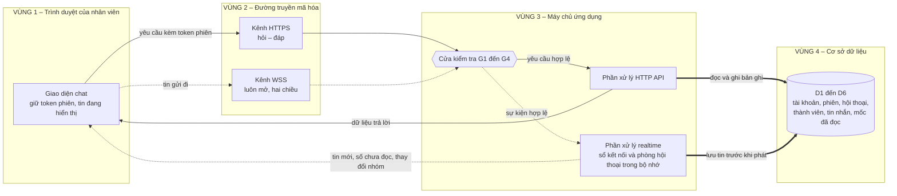

| Vùng | Chứa gì | Không chứa gì | Nguồn |
|---|---|---|---|
| 1. Trình duyệt | Token phiên, tin đang hiển thị, tin đang soạn | Mật khẩu sau khi đăng nhập xong; dữ liệu của hội thoại mình không tham gia | `[PDF TK-03]`, `[PDF §4]` |
| 2. Đường truyền | Mọi dữ liệu đều được mã hóa bằng HTTPS hoặc WSS | Kết nối không mã hóa (HTTP, WS thường) | `[PDF §4]`, NFR-01 |
| 3. Máy chủ | Toàn bộ quy tắc và cửa kiểm tra; danh sách kết nối đang mở (chỉ là "ai đang nối vào phòng nào", không chứa tin) | Nơi lưu tin lâu dài | `[PDF §2]` "Backend API + realtime dùng chung"; `[GL-03]` |
| 4. CSDL | Tài khoản, mật khẩu dạng băm, phiên, hội thoại, thành viên, **mọi tin nhắn**, mốc đã đọc | Mật khẩu nguyên văn | `[PDF TK-02, §4]` |

Quy tắc xuyên suốt: **trình duyệt không bao giờ đọc CSDL trực tiếp.** Mọi dữ liệu phải đi qua máy chủ và qua cửa kiểm tra `[PDF §4]`, FRS NT-01.

## 3. HTTP API và WebSocket – thao tác nào đi kênh nào

PDF quy định chat realtime dùng WebSocket `[PDF §2]` và mọi kết nối phải dùng HTTPS/WSS `[PDF §4]`. **Việc chia từng thao tác cho từng kênh là lựa chọn thiết kế** dựa trên `02-srs.md` mục 6.2–6.3 `[GL-01]`.

| Kênh | Chiều | Thao tác | Mã |
|---|---|---|---|
| **HTTPS** | Trình duyệt hỏi, máy chủ đáp | Đăng ký, đăng nhập, đăng xuất, đổi mật khẩu, xem/sửa hồ sơ | TK-01…TK-05 |
| HTTPS | như trên | Tìm người dùng; mở hội thoại 1-1 | TK-06, CH-01 |
| HTTPS | như trên | Lấy danh sách hội thoại kèm số chưa đọc; **tải lịch sử 50 tin/lần**; tải tin bị lỡ sau khi mất mạng | CH-06, CH-03, TB-01 |
| HTTPS | như trên | Đánh dấu đã đọc `[GL-02]` | TB-01 |
| HTTPS | như trên | Tạo nhóm, thêm/xóa thành viên, đổi tên nhóm, rời nhóm | NH-01, NH-03 |
| **WSS** | Trình duyệt → máy chủ | **Gửi tin** | CH-02, NH-02 |
| WSS | Máy chủ → trình duyệt | Xác nhận tin đã lưu; tin mới (kể cả tin hệ thống); cập nhật danh sách và số chưa đọc; bị xóa khỏi nhóm; phiên hết hiệu lực | CH-02, NH-02, NH-04, CH-06, TB-01, NH-03, TK-03 |

Lý do chia như vậy `[ĐX]`: thao tác cần câu trả lời ngay một lần (đăng nhập, tải 50 tin) hợp với kiểu hỏi – đáp của HTTPS. Còn tin nhắn cần **máy chủ chủ động đẩy** tới người nhận mà người nhận không phải hỏi, nên phải đi qua WSS.

## 4. DFD mức ngữ cảnh (mức 0)

Cả hệ thống được xem như một khối. Sơ đồ chỉ cho thấy ai trao đổi dữ liệu gì với hệ thống.

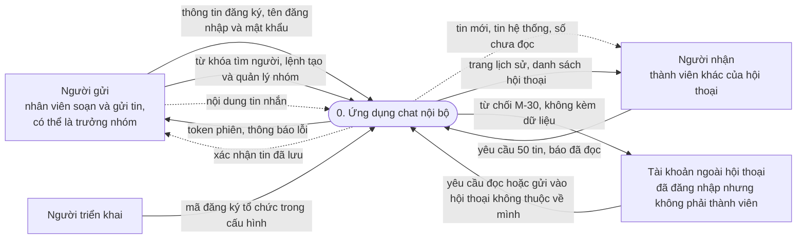

| Tác nhân | Vai trò | Nguồn |
|---|---|---|
| Người gửi | Nhân viên đã đăng nhập, đang gửi tin hoặc thao tác nhóm. Mỗi người lúc gửi là "người gửi", lúc nhận là "người nhận" | `[PDF §1]` |
| Người nhận | Thành viên **hiện tại** khác của cùng hội thoại | `[PDF CH-02, NH-02]`, `[QĐ-04]` |
| Tài khoản ngoài hội thoại | Người đã đăng nhập nhưng không phải thành viên (gồm cả người đã rời hoặc bị xóa khỏi nhóm). Chỉ nhận lời từ chối | `[PDF §4, §5 bước 6]`, `[QĐ-04]` |
| Người triển khai | Đặt mã đăng ký tổ chức trong cấu hình máy chủ; không dùng giao diện | `[QĐ-05]`, `[GĐ-16]` |

## 5. DFD mức 1

### 5.1 Sơ đồ

Để dễ đọc, DFD mức 1 được chia thành ba phần theo nhóm việc. Ba phần dùng chung tác nhân, tiến trình và kho dữ liệu; ghép lại là toàn bộ hệ thống.

**Phần 1 – Xác thực và hội thoại (P1, P2)**

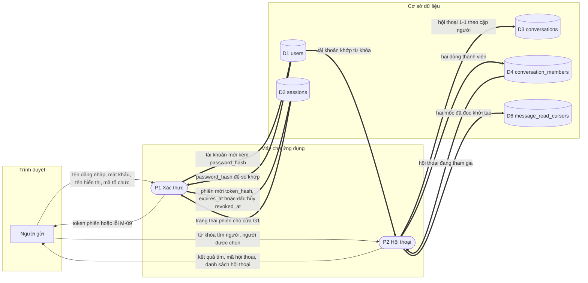

**Phần 2 – Gửi tin và đọc tin (P3, P4), kể cả từ chối người ngoài hội thoại**

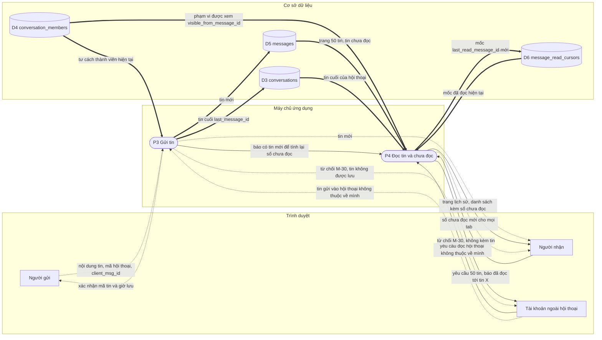

**Phần 3 – Nhóm (P5)**

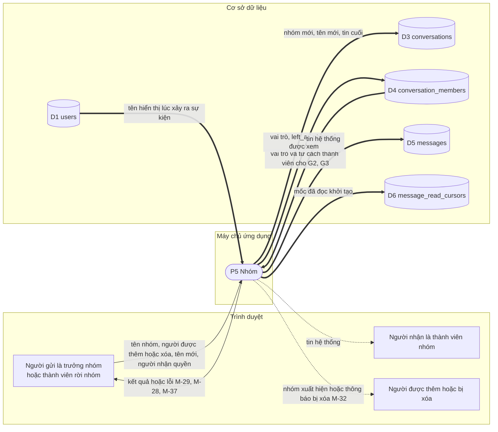

*Mọi mũi tên đi từ trình duyệt vào P2…P5 đều phải qua cửa G1 (phiên hợp lệ); thao tác trong một hội thoại còn qua G2 (là thành viên hiện tại); thao tác của trưởng nhóm còn qua G3. Các cửa được vẽ riêng ở mục 6.*

### 5.2 Các tiến trình

| Tiến trình | Làm gì (lời thường) | Kênh vào | Kho dữ liệu dùng | Mã |
|---|---|---|---|---|
| P1 Xác thực | Tạo tài khoản; kiểm tra mật khẩu; cấp, kiểm tra và hủy phiên; đổi mật khẩu; sửa tên hiển thị | HTTPS | D1, D2 | TK-01…TK-05 |
| P2 Hội thoại | Tìm người; mở (hoặc mở lại) hội thoại 1-1; lập danh sách hội thoại | HTTPS | D1, D3, D4 | TK-06, CH-01, CH-06 |
| P3 Gửi tin | Nhận tin, kiểm tra, **lưu vào CSDL rồi mới** xác nhận và phát tới người nhận | WSS | D3, D4, D5 | CH-02, NH-02 |
| P4 Đọc tin và chưa đọc | Trả lịch sử 50 tin/lần; tải tin bị lỡ; tính số chưa đọc; ghi mốc đã đọc | HTTPS (vào), WSS (đẩy số mới) | D3, D4, D5, D6 | CH-03, CH-06, TB-01 |
| P5 Nhóm | Tạo nhóm, thêm, xóa, đổi tên, rời, chuyển quyền; sinh tin hệ thống trong cùng lần ghi | HTTPS (vào), WSS (đẩy) | D1, D3, D4, D5, D6 | NH-01, NH-03, NH-04 |

### 5.3 Kho dữ liệu – khớp tên bảng ở `06-erd.md`

| Kho | Bảng | Nhóm dữ liệu | Nội dung chính |
|---|---|---|---|
| D1 | `users` | accounts – tài khoản | `username`, `password_hash`, `display_name` |
| D2 | `sessions` | accounts – phiên | `token_hash`, `expires_at`, `revoked_at`, `revoked_reason` |
| D3 | `conversations` | membership – hội thoại | `type`, `name`, `direct_user_low_id`, `direct_user_high_id`, `last_message_id`, `last_message_at` |
| D4 | `conversation_members` | membership – thành viên | `role`, `left_at`, `left_reason`, `visible_from_message_id` |
| D5 | `messages` | messages – tin nhắn | `type`, `content`, `sender_id`, `client_msg_id`, `event_type`, `event_data` |
| D6 | `message_read_cursors` | read cursor – mốc đã đọc | `last_read_message_id` |

Mã đăng ký tổ chức **không** nằm trong kho nào; P1 đọc từ cấu hình máy chủ `[GĐ-16]`, `06-erd.md` mục 1.

### 5.4 Danh mục dữ liệu trên mũi tên

| Mã | Tên dữ liệu | Gồm | Kênh | Ghi chú |
|---|---|---|---|---|
| F-01 | Thông tin đăng ký | tên đăng nhập, mật khẩu, nhập lại mật khẩu, tên hiển thị, mã tổ chức | HTTPS | Mật khẩu chỉ đi trên đường truyền mã hóa và bị băm ngay ở máy chủ `[PDF TK-02]` |
| F-02 | Thông tin đăng nhập | tên đăng nhập, mật khẩu | HTTPS | `[PDF TK-03]` |
| F-03 | Token phiên | chuỗi ngẫu nhiên; máy chủ chỉ lưu bản băm `token_hash` | HTTPS | Hạn 8 giờ `[QĐ-09]`; chi tiết lưu ở trình duyệt chốt tại `09` |
| F-04 | Tin gửi đi | `conversation_id`, nội dung, `client_msg_id` | WSS | ≤ 5.000 ký tự `[PDF CH-02]` |
| F-05 | Xác nhận tin | `client_msg_id`, mã tin chính thức, giờ máy chủ | WSS | Chỉ gửi sau khi đã lưu CSDL `[PDF §4]` |
| F-06 | Tin mới | mã tin, hội thoại, người gửi (tên, avatar), nội dung, giờ, loại tin | WSS | Gồm cả tin hệ thống `[PDF NH-04]` |
| F-07 | Trang lịch sử | tối đa 50 tin, cờ "còn tin cũ hơn" | HTTPS | `[PDF CH-03]` |
| F-08 | Danh sách hội thoại | mỗi dòng: tên, avatar, trích tin cuối, thời gian, số chưa đọc; kèm tổng số | HTTPS / WSS | `[PDF CH-06, TB-01]` |
| F-09 | Báo đã đọc | `conversation_id`, mã tin mới nhất đang thấy | HTTPS | `[GL-02]` |
| F-10 | Lệnh nhóm | tên nhóm / người được thêm hoặc xóa / cờ "cho xem tin cũ" / tên mới / người nhận quyền | HTTPS | `[PDF NH-01, NH-03]`, `[QĐ-03]`, `[QĐ-08]` |
| F-11 | Thay đổi thành viên | nhóm, người bị ảnh hưởng, loại thay đổi | WSS | FRS-13 |
| F-12 | Từ chối | mã lỗi và câu thông báo M-xx; **không kèm dữ liệu hội thoại** | HTTPS / WSS | FRS mục 6.1 |
| F-13 | Phiên hết hiệu lực | lý do (hết hạn, đăng xuất, đổi mật khẩu) | WSS | `[GS-07]` |

## 6. Cửa kiểm tra xác thực và quyền

### 6.1 Bốn cửa, kiểm tra theo thứ tự

Mọi kiểm tra diễn ra **ở máy chủ**, cho cả HTTPS lẫn WSS. Việc giao diện ẩn nút không được coi là kiểm soát quyền `[PDF §4]`, FRS mục 6.1.

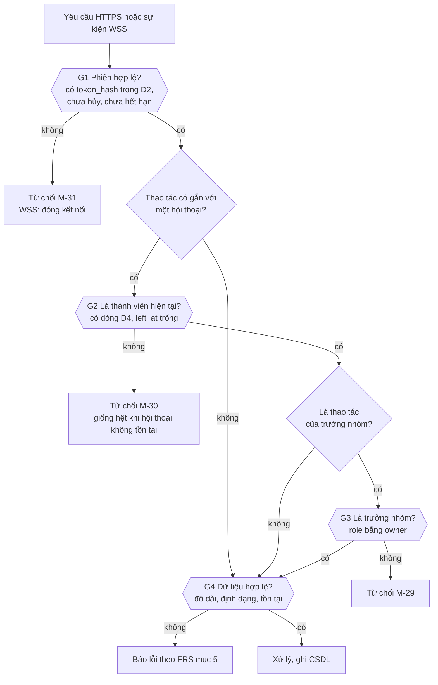

| Cửa | Câu hỏi | Dữ liệu dùng để trả lời | Từ chối thì | Nguồn |
|---|---|---|---|---|
| G1 | Người này đã đăng nhập và phiên còn hiệu lực? | D2 `sessions` | M-31; đóng kết nối WSS | `[PDF TK-03]`, `[GS-07]` |
| G2 | Người này đang là thành viên hội thoại? | D4 `conversation_members` (`left_at` trống) | M-30; **không đọc D5**, không phát gì | `[PDF §4]`, `[QĐ-04]` |
| G3 | Người này là trưởng nhóm? | D4 `role = 'owner'` | M-29 | `[PDF NH-03]` |
| G4 | Dữ liệu gửi lên có hợp lệ? | Quy tắc ở FRS mục 4 | Thông báo lỗi tương ứng | `[PDF TK-02, CH-02]` |

Với thao tác **đọc**, G2 còn giới hạn **phạm vi**: chỉ trả tin có mã ≥ `visible_from_message_id` của người hỏi (`06-erd.md` mục 7.4). Mỗi lần cần dữ liệu, G2 được kiểm tra lại trên CSDL, không dựa vào kết quả cũ trong bộ nhớ, vì thành viên có thể vừa bị xóa `[ĐX]`.

### 6.2 Cửa áp dụng cho từng tuyến

| Tuyến | Thao tác | Kênh | G1 | G2 | G3 | Tiến trình | Kho đọc / ghi | Mã |
|---|---|---|---|---|---|---|---|---|
| R-01 | Đăng ký | HTTPS | – | – | – | P1 | ghi D1 | TK-01, TK-02 |
| R-02 | Đăng nhập | HTTPS | – | – | – | P1 | đọc D1, ghi D2 | TK-03 |
| R-03 | Đăng xuất | HTTPS | ✓ | – | – | P1 | ghi D2 | TK-03 |
| R-04 | Đổi mật khẩu | HTTPS | ✓ | – | – | P1 | đọc/ghi D1, ghi D2 | TK-04 |
| R-05 | Xem / sửa hồ sơ (chỉ của mình) | HTTPS | ✓ | – | – | P1 | đọc/ghi D1 | TK-05 |
| R-06 | Tìm người dùng | HTTPS | ✓ | – | – | P2 | đọc D1 | TK-06 |
| R-07 | Mở hội thoại 1-1 | HTTPS | ✓ | – | – | P2 | đọc/ghi D3, D4, D6 | CH-01 |
| R-08 | Danh sách hội thoại và số chưa đọc | HTTPS | ✓ | lọc theo D4 | – | P2, P4 | đọc D3, D4, D5, D6 | CH-06, TB-01 |
| R-09 | Tải lịch sử 50 tin / tải tin bị lỡ | HTTPS | ✓ | ✓ kèm phạm vi | – | P4 | đọc D4, D5 | CH-03 |
| R-10 | Báo đã đọc | HTTPS | ✓ | ✓ | – | P4 | ghi D6 | TB-01 |
| R-11 | Gửi tin | WSS | ✓ | ✓ | – | P3 | đọc D4, ghi D5, D3 | CH-02, NH-02 |
| R-12 | Tạo nhóm | HTTPS | ✓ | – | – | P5 | đọc D1, ghi D3, D4, D5, D6 | NH-01, NH-04 |
| R-13 | Thêm thành viên | HTTPS | ✓ | ✓ | ✓ | P5 | ghi D4, D5, D6, D3 | NH-03, NH-04 |
| R-14 | Xóa thành viên | HTTPS | ✓ | ✓ | ✓ | P5 | ghi D4, D5, D3 | NH-03, NH-04 |
| R-15 | Đổi tên nhóm | HTTPS | ✓ | ✓ | ✓ | P5 | ghi D3, D5 | NH-03, NH-04 |
| R-16 | Rời nhóm (trưởng nhóm phải chỉ định người nhận quyền) | HTTPS | ✓ | ✓ | – | P5 | ghi D4, D5, D3 | NH-03, NH-04 |
| R-17 | Mở kết nối WSS | WSS | ✓ | – | – | P1 | đọc D2, D4 | TK-03 |
| R-18 | Máy chủ đẩy tin mới, tin hệ thống, số chưa đọc | WSS | ✓ khi kết nối | chỉ phát vào phòng của thành viên hiện tại | – | P3, P4, P5 | – | CH-02, NH-02, NH-04, TB-01 |
| R-19 | Máy chủ báo phiên hết hiệu lực / bị xóa khỏi nhóm | WSS | – | – | – | P1, P5 | – | TK-03, NH-03 |

Danh sách đường dẫn API và tên sự kiện cụ thể chốt tại `09-detailed-design.md`.

## 7. Luồng chi tiết

Mỗi luồng ghi rõ cửa kiểm tra. Kí hiệu "AT-06" đánh dấu bước bảo vệ cho bước nghiệm thu 6 của PDF §5.

### 7.1 Đăng ký và đăng nhập (TK-01, TK-02, TK-03)

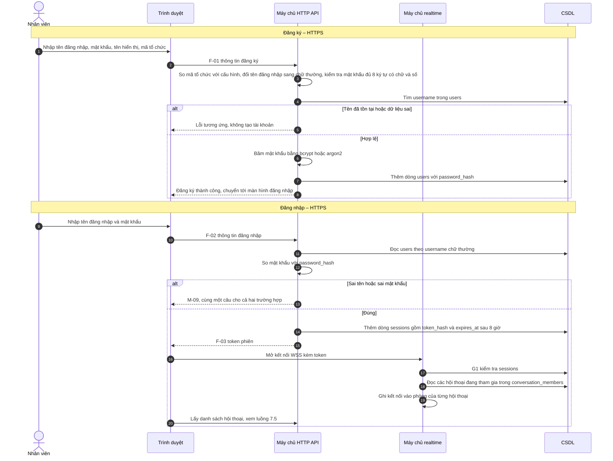

Điểm chính:

- Mật khẩu chỉ xuất hiện trên đường truyền mã hóa và trong bộ nhớ máy chủ lúc so khớp; CSDL chỉ có `password_hash`; không ghi vào log `[PDF TK-02]`, TK-02-AC4.
- Phòng hội thoại là danh sách kết nối trong bộ nhớ máy chủ; không chứa tin `[GL-03]`, `[GL-05]`.

### 7.2 Đăng xuất và đổi mật khẩu – hủy phiên (TK-03, TK-04)

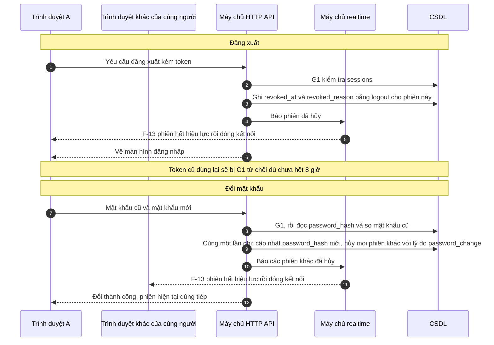

Nguồn: hủy token khi đăng xuất `[PDF TK-03]`; hủy phiên khác khi đổi mật khẩu `[QĐ-09]`, `[GS-09]`; đóng kết nối realtime `[GS-07]`.

### 7.3 Mở hội thoại 1-1 và xem lịch sử (CH-01, CH-03)

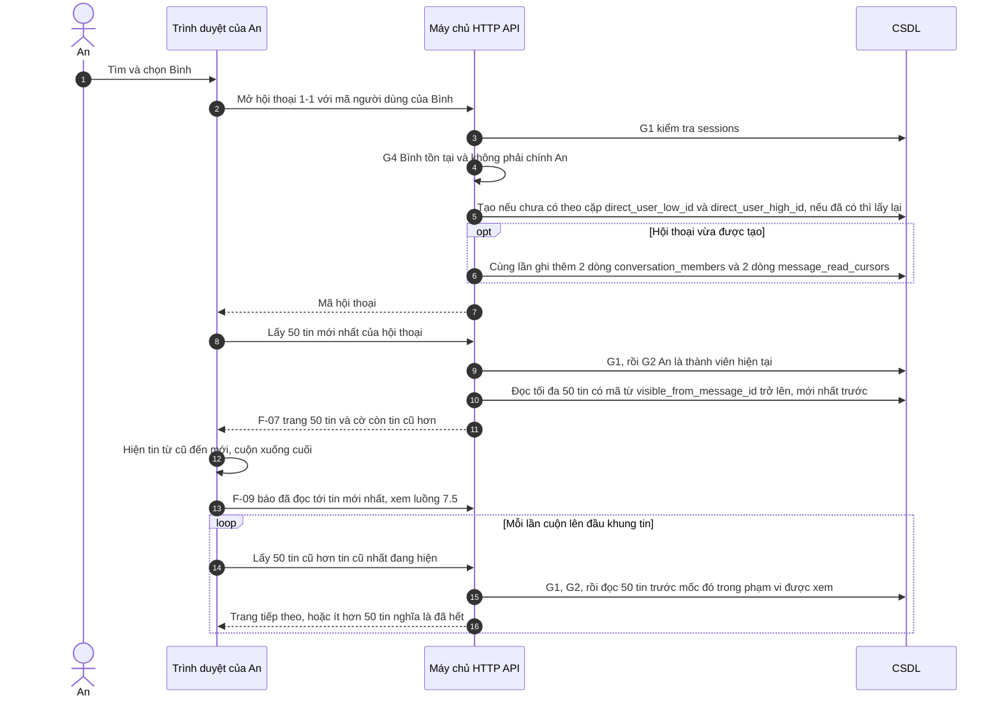

- Không trùng hội thoại: CSDL chặn cặp người lặp lại, nên hai người mở cùng lúc vẫn chỉ ra một hội thoại `[PDF CH-01]`, `[GS-17]`, `06-erd.md` mục 7.1.
- Phân trang theo "trước tin X" (không theo số trang), nên tin mới đến trong lúc cuộn không gây trùng hay sót `[GS-22]`.
- Ngưỡng mở 50 tin < 1,5 giây `[PDF §4]` được đo theo NFR-06; tài liệu này không khẳng định đã đạt.

### 7.4 Gửi tin 1-1 realtime (CH-02; nhóm NH-02 tương tự)

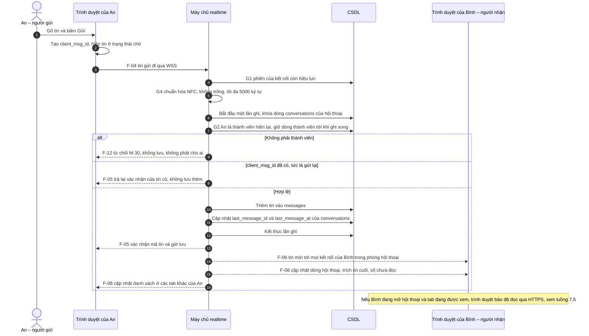

- **Lưu trước, phát sau:** tin chỉ được xác nhận và phát sau khi đã ghi vào CSDL, nên khởi động lại dịch vụ không mất tin `[PDF §4]`, CH-02 R5.
- **Chỉ phát vào phòng:** máy chủ chỉ đẩy tin tới kết nối của thành viên hiện tại; tài khoản thứ ba không có kết nối trong phòng nên không bao giờ nhận được (AT-06).
- Ngưỡng tin đến < 2 giây `[PDF §4]` được đo theo NFR-05.
- Trình duyệt chờ quá 10 giây không thấy xác nhận thì báo M-20 và cho gửi lại cùng `client_msg_id` `[GF-12]`, `[GF-13]`. Không hiển thị "đã gửi / đã nhận / đã xem" vì đó là CH-04, NOT MVP.

### 7.5 Đọc hội thoại và đưa badge về 0 (TB-01, CH-06)

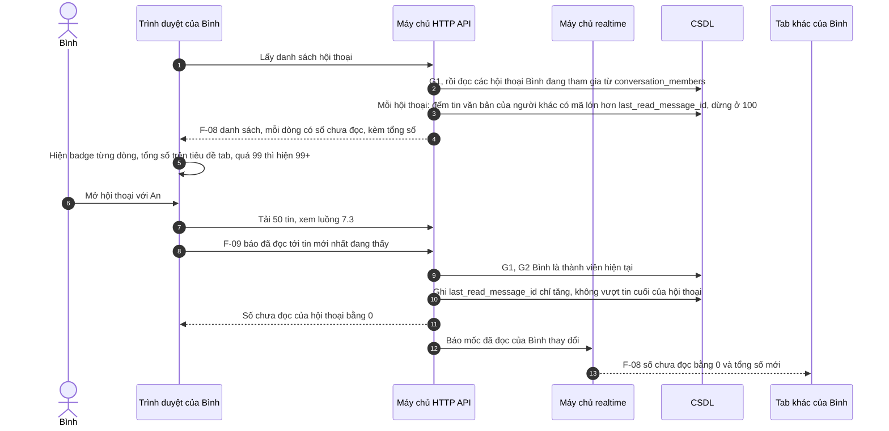

- Không tính tin của chính mình và tin hệ thống `[GĐ-08]`, `[QĐ-10]`. Tin hệ thống vẫn đưa hội thoại lên đầu danh sách `[GS-25]`.
- Đang mở hội thoại và tab đang được xem mà có tin đến: trình duyệt gửi F-09 ngay `[GS-33]`. Tab bị ẩn thì chưa gửi, tin vẫn tính là chưa đọc.
- Mốc đã đọc lưu ở máy chủ nên mọi tab, mọi trình duyệt đều về 0, và còn nguyên sau khi đăng xuất hay khởi động lại `[GS-34]`.
- Cách đếm không cần quét toàn bộ tin: xem `06-erd.md` mục 8.

### 7.6 Thêm thành viên nhóm và sinh tin hệ thống (NH-03, NH-04)

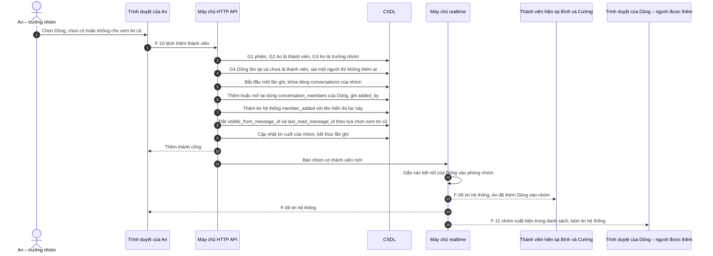

**Biến thể – xóa thành viên hoặc thành viên rời nhóm** (cùng cửa G1, G2, và G3 với thao tác xóa):

1. Trong một lần ghi: ghi `left_at`, `left_reason` cho người rời, thêm tin hệ thống `member_removed` hoặc `member_left`. Nếu là trưởng nhóm rời: chuyển quyền trước, sinh `owner_transferred` rồi `member_left` `[QĐ-03]`, `[GĐ-19]`.
2. Máy chủ **gỡ kết nối của người rời khỏi phòng trước**, rồi mới phát tin hệ thống cho những người còn lại `[QĐ-04]`, FRS mục 6.1.
3. Người bị xóa nhận F-11 "bị xóa khỏi nhóm" (M-32); nhóm biến mất khỏi danh sách của họ.

Điểm chính: sự kiện nhóm và tin hệ thống được lưu **cùng lúc** – cùng thành công hoặc cùng thất bại `[GF-21]`. Tin hệ thống không tăng số chưa đọc `[QĐ-10]`. Tạo nhóm (NH-01) đi theo cùng mẫu với tin hệ thống `group_created` `[GS-30]`.

### 7.7 Từ chối tài khoản ngoài hội thoại (PDF §5 bước 6)

Cường đã đăng nhập hợp lệ nhưng **không** thuộc hội thoại 1-1 giữa An và Bình. Mọi đường Cường thử đều dừng ở G2:

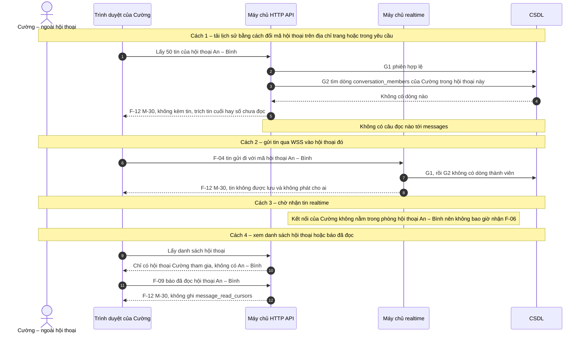

| Đường thử | Cửa chặn | Dữ liệu bị rò rỉ | Nguồn |
|---|---|---|---|
| Tải lịch sử (R-09) | G2 | Không. Phản hồi giống hệt khi hội thoại không tồn tại | `[PDF §4]`, FRS mục 6.1 |
| Gửi tin (R-11) | G2 | Không. Tin không được lưu, không phát | `[PDF §4]` |
| Nhận realtime (R-18) | Phòng hội thoại chỉ chứa thành viên hiện tại | Không | `[PDF §4]` |
| Danh sách hội thoại (R-08) | Lọc theo D4 | Không thấy hội thoại, trích tin hay số chưa đọc | NFR-04 |
| Báo đã đọc (R-10) | G2 | Không | FRS mục 6.3 |
| Không đăng nhập, hoặc phiên hết hạn/đã hủy | G1 | Không. M-31, đóng WSS | `[PDF TK-03]` |
| Người **đã rời / bị xóa** khỏi nhóm | G2 (`left_at` có giá trị) | Không, kể cả tin cũ | `[QĐ-04]`, NH-03-AC2 |
| Thành viên mới không được cho xem tin cũ, xin tin trước mốc tham gia | G2 kèm phạm vi | Không. Chỉ trả tin từ `visible_from_message_id` | `[QĐ-08]` |

### 7.8 Mất mạng: tự kết nối lại và tải tin bị lỡ (NFR-13 – mức khuyến khích)

PDF §4 ghi phần này là **khuyến khích**, không phải điều kiện ĐẠT.

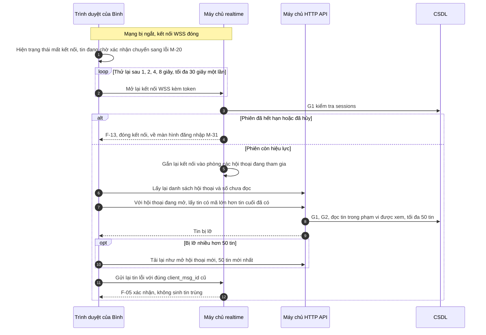

Không mất tin: vì mã tin trong một hội thoại được ghi theo đúng thứ tự (`06-erd.md` mục 7.6, GE-10), câu hỏi "tin có mã lớn hơn X" luôn trả đủ tin bị lỡ. Nguồn: `[PDF §4]` (khuyến khích), `[GF-12]`, `[GF-23]`, `[GL-06]`.

## 8. Truy vết tiến trình → mã SRS

| Tiến trình | Mã SRS (giữ nguyên) | Tuyến | Luồng | NFR | AT |
|---|---|---|---|---|---|
| P1 Xác thực | TK-01, TK-02, TK-03, TK-04, TK-05 | R-01…R-05, R-17, R-19 | 7.1, 7.2 | NFR-01, NFR-02, NFR-03 | AT-01, AT-05 |
| P2 Hội thoại | TK-06, CH-01, CH-06 | R-06, R-07, R-08 | 7.3, 7.5 | NFR-09 | AT-02, AT-04 |
| P3 Gửi tin | CH-02, NH-02 | R-11, R-18 | 7.4, 7.8 | NFR-05, NFR-07, NFR-08, NFR-13 | AT-02, AT-03 |
| P4 Đọc tin và chưa đọc | CH-03, CH-06, TB-01 | R-08, R-09, R-10, R-18 | 7.3, 7.5, 7.8 | NFR-06, NFR-07 | AT-04, AT-05 |
| P5 Nhóm | NH-01, NH-03, NH-04 | R-12…R-16, R-18, R-19 | 7.6 | NFR-04 | AT-03 |
| Cửa G1…G4 | QT-CHUNG-1, QT-CHUNG-2 | Mọi tuyến | 6, 7.7 | NFR-03, NFR-04 | AT-06 |

**Kiểm tra độ phủ:** 15/15 mã MVP có ít nhất một tiến trình và một luồng: TK-01, TK-02, TK-03 (7.1, 7.2); TK-04 (7.2); TK-05 (P1, R-05 – luồng đơn giản đọc/ghi `display_name`, không vẽ riêng); TK-06 (7.3); CH-01 (7.3); CH-02 (7.4); CH-03 (7.3); CH-06 (7.5); NH-01 (7.6 – cùng mẫu); NH-02 (7.4); NH-03, NH-04 (7.6); TB-01 (7.5).

## 9. Ngoài MVP – không có luồng

Các luồng dưới đây **không** được thiết kế vì thuộc PDF §6 và dự án không đăng ký `[QĐ-01]`. Máy chủ không phát các sự kiện tương ứng.

| Không có luồng | Mã |
|---|---|
| Báo "đã nhận / đã xem" từng tin | CH-04, NH-05 |
| Báo online/offline, thời điểm hoạt động gần nhất | CH-05 |
| "X đang nhập…" | TN-07 |
| Thông báo bật lên của trình duyệt | TB-03 |
| Tải file / ảnh, reaction, trả lời trích dẫn | TN-01…TN-06 |
| Sửa, thu hồi, gỡ tin | TN-10…TN-14 |
| Email, quên mật khẩu; quản trị, thống kê | TK-07…11, QT-01, QT-02 |

Lưu ý: xác nhận F-05 ở luồng 7.4 chỉ để trình duyệt biết tin đã lưu và hiện nút "Gửi lại" khi lỗi (NFR-13). Nó **không** phải trạng thái tin nhắn CH-04.

## 10. ASSUMPTIONS – Giả định của tài liệu này

Các QĐ, GĐ, GS, GF, GU, GE của tài liệu trước vẫn giữ hiệu lực. Bảng dưới chỉ gồm giả định mới.

| Mã | Giả định | Áp dụng | Câu hỏi |
|---|---|---|---|
| GL-01 | Chỉ **gửi tin** đi từ trình duyệt qua WSS; mọi thao tác khác của trình duyệt đi qua HTTPS; máy chủ đẩy mọi cập nhật realtime qua WSS. Không có đường gửi tin dự phòng qua HTTPS | Mục 3 | – |
| GL-02 | Báo đã đọc đi qua HTTPS (theo `02-srs.md` mục 6.2) | R-10, 7.5 | – |
| GL-03 | Bản demo chạy **một** máy chủ ứng dụng xử lý cả HTTP API và WebSocket. Danh sách kết nối và phòng hội thoại nằm trong bộ nhớ máy chủ đó; nó chỉ ghi "kết nối nào thuộc phòng nào", không chứa tin | Mục 2, 7.1 | OQ-28 |
| GL-04 | Kết nối WSS được xác thực bằng token phiên khi mở. Mỗi sự kiện gửi tin kiểm tra lại phiên trên `sessions`. Khi phiên bị hủy, máy chủ chủ động đóng kết nối | R-11, R-17, 7.2 | OQ-29 |
| GL-05 | Mỗi kết nối được gắn vào phòng của **mọi** hội thoại người đó đang tham gia, không chỉ hội thoại đang mở, để danh sách và badge cập nhật realtime | 7.1, 7.4 | – |
| GL-06 | Sau khi kết nối lại: tải lại danh sách hội thoại; với hội thoại đang mở thì tải tin có mã lớn hơn tin cuối đã có, tối đa 50; lỡ nhiều hơn thì tải lại 50 tin mới nhất như mở mới | 7.8 | OQ-30 |
| GL-07 | Mỗi lần cần dữ liệu, G2 kiểm tra lại trên CSDL, không dựa vào kết quả kiểm tra cũ trong bộ nhớ | Mục 6 | – |
| GL-08 | Máy chủ HTTP API báo cho phần realtime (trong cùng máy chủ) khi phiên bị hủy, mốc đã đọc đổi hoặc thành viên nhóm đổi | 7.2, 7.5, 7.6 | OQ-28 |
| GL-09 | Tên kho D1…D6 lấy theo bản nháp `06-erd.md` v1.0, chưa có trên repository | Mục 5.3 | OQ-27 |

## 11. OPEN QUESTIONS – Câu hỏi mở

| Mã | Câu hỏi | Giả định tạm | Ảnh hưởng | Người phụ trách |
|---|---|---|---|---|
| OQ-27 | `06-erd.md` v1.0 đã được duyệt và đưa lên repository chưa? Tài liệu này dùng nguyên tên bảng và cột của bản đó | GL-09 | Toàn bộ mục 5.3, mục 7 | DungNQ |
| OQ-28 | Bản demo chạy một hay nhiều máy chủ ứng dụng? Nếu nhiều, cần thêm kênh phát chung giữa các máy chủ (PDF §7 có nhắc Redis nhưng là tùy chọn) | GL-03: một máy chủ | Mục 2, luồng realtime | DungNQ |
| OQ-29 | Kết nối WSS chỉ kiểm tra phiên khi mở, hay kiểm tra lại ở mỗi sự kiện gửi tin? | GL-04: kiểm tra lại mỗi lần gửi | R-11, NFR-03 | DungNQ |
| OQ-30 | Mất mạng lâu, lỡ hơn 50 tin: tải bù toàn bộ hay chỉ 50 tin mới nhất? | GL-06: 50 tin mới nhất | 7.8 | DungNQ |
| OQ-23 | (Kế thừa từ `06-erd.md`) Chưa có HLD: chốt PostgreSQL, session token hay JWT? | GE-01, GE-05 | G1, F-03 | DungNQ |
| OQ-25 | (Kế thừa) SRS v1.0 trên repository hay SRS v1.1 có QĐ-08 là bản đã duyệt? | Theo QĐ-08 | Luồng 7.6, phạm vi xem ở 7.7 | DungNQ |
