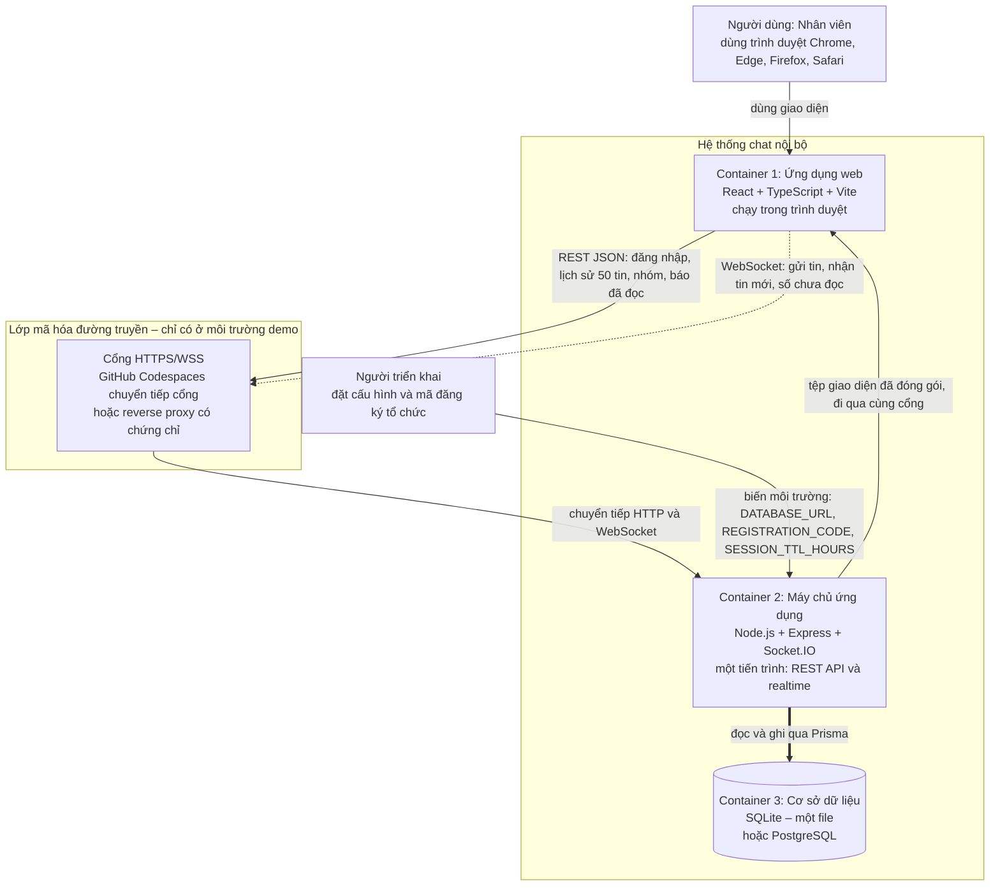
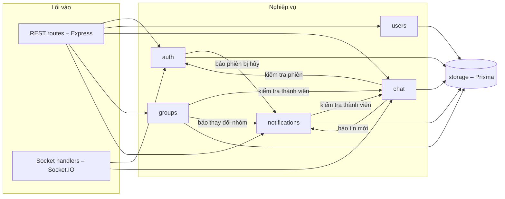

# 08 - Thiết kế tổng thể (High-Level Design)

| Mục | Nội dung |
|---|---|
| Dự án | Ứng dụng chat nội bộ (MVP) – Nhóm: *[chưa xác định]* |
| Tệp | `docs/08-high-level-design.md` |
| Phiên bản | 1.0 – Draft |
| Ngày | 2026-11-14 |
| Người soạn | Nhóm Architect / BA / QA (bản nháp có trợ lý AI hỗ trợ soạn thảo) |
| Trạng thái | Draft – chờ Product Owner rà soát mục 12 (ADR), 13 và 14 |
| Căn cứ | (1) PDF "Xây dựng ứng dụng chat nội bộ (MVP)", ngày 13~14/11/2026 – **nguồn duy nhất của yêu cầu nghiệp vụ**; (2) `01-brd.md` v1.1; (3) `02-srs.md` (bản trên repository ghi v1.0); (4) `03-frs.md` v1.0; (5) `04-use-cases.md` v1.1; (6) `05-user-stories.md` v1.0; (7) `06-erd.md` v1.0 và (8) `07-data-flow.md` v1.0 – hai bản nháp **chưa có trên repository** (OQ-27) |

**Quy ước ký hiệu**

| Ký hiệu | Ý nghĩa |
|---|---|
| `[PDF]` | Do đề bài quy định. Không được tự thay đổi. |
| `[QĐ-xx]` | Quyết định của Product Owner đã ghi ở các tài liệu trước. |
| `[GĐ-xx]` / `[GS-xx]` / `[GF-xx]` / `[GU-xx]` / `[GE-xx]` / `[GL-xx]` | Giả định đã ghi ở BRD / SRS / FRS / Use case / ERD / Data flow. |
| `[GH-xx]` | Giả định mới của tài liệu này. Xem mục 13. |
| `[ADR-xx]` | Quyết định kiến trúc. Xem mục 12. |
| `[ĐX]` | Đề xuất, đánh giá của nhóm. Các mức "Thấp / Trung bình / Cao" trong bảng so sánh là **nhận định**, không phải số đo. |
| `[OQ-xx]` | Câu hỏi mở. Xem mục 14. |

> Tài liệu này **không chứa kết quả chạy thử hay số đo nào**. Mọi ngưỡng hiệu năng lấy từ PDF §4 và phải được đo trên môi trường demo, ghi tại `12-test-reports.md`.

---

## 1. Mục tiêu kiến trúc

| # | Mục tiêu | Gắn với |
|---|---|---|
| MT-1 | **Không lộ tin cho người ngoài**: mọi đường đọc/ghi tin (REST và WebSocket) đi qua **một** hàm kiểm tra thành viên dùng chung ở máy chủ | `[PDF §4]`, NFR-04, AT-06 |
| MT-2 | **Không mất tin**: tin được ghi vào CSDL trước khi xác nhận và phát; khởi động lại dịch vụ không mất dữ liệu | `[PDF §4]`, NFR-07, AT-05 |
| MT-3 | **Realtime qua WebSocket**, tin đến người nhận nhanh (ngưỡng PDF < 2 giây, phải đo); tự kết nối lại khi mất mạng | `[PDF §2, §4]`, NFR-05, NFR-13 |
| MT-4 | **Đơn giản để nhóm và AI viết mã đúng cấu trúc**: một ngôn ngữ (TypeScript) cho cả trình duyệt và máy chủ; chia module rõ ràng với quy tắc phụ thuộc cố định (mục 4.3) | `[PDF §7, §9]` "cấu trúc mã rõ ràng" |
| MT-5 | **Đổi CSDL được mà không viết lại nghiệp vụ**: chỉ module `storage` chạm vào CSDL | ADR-01 |

## 2. Lựa chọn công nghệ

PDF §7 chỉ **gợi ý** công nghệ và cho phép chọn khác, miễn giải thích trong ghi chú thiết kế `[PDF §7]`. Mọi lựa chọn dưới đây là **lựa chọn thiết kế** của nhóm, không phải yêu cầu đề bài.

Tiêu chí so sánh: (a) độ khó cho người mới, (b) tốc độ làm MVP, (c) hỗ trợ realtime, (d) chi phí, (e) AI viết mã tốt. Đánh giá là nhận định của nhóm `[ĐX]`.

### 2.1 Frontend (giao diện web)

| Phương án | (a) Độ khó | (b) Tốc độ MVP | (c) Realtime | (d) Chi phí | (e) AI viết mã | Ghi chú |
|---|---|---|---|---|---|---|
| **React + TypeScript + Vite** | Trung bình | Cao | Tốt (dùng thư viện client của Socket.IO) | Miễn phí | Cao | PDF §7 gợi ý React + TypeScript |
| Vue 3 + TypeScript + Vite | Thấp – Trung bình | Cao | Tốt | Miễn phí | Trung bình – Cao | Không nằm trong gợi ý của PDF |
| HTML + JavaScript thuần | Thấp lúc đầu, khó khi lớn | Thấp | Tự làm nhiều | Miễn phí | Trung bình | Khó giữ cấu trúc, dễ lỗi hiển thị |

**Chọn: React + TypeScript + Vite.** Lý do: đúng gợi ý PDF; TypeScript giúp bắt lỗi kiểu dữ liệu giữa giao diện và API; React tự "thoát" ký tự đặc biệt khi hiển thị nên tin dạng `<script>` hiện nguyên văn (CH-02-AC4). Giao diện responsive bằng CSS (chi tiết ở `10-ui-ux.md`) `[PDF §2]`.

### 2.2 Backend và Realtime

| Phương án | (a) Độ khó | (b) Tốc độ MVP | (c) Realtime | (d) Chi phí | (e) AI viết mã | Ghi chú |
|---|---|---|---|---|---|---|
| **Node.js + Express + Socket.IO** | Thấp – Trung bình | Cao | Có sẵn phòng (room), xác nhận (ack), tự kết nối lại | Miễn phí | Cao | Đúng gợi ý PDF §7 |
| Node.js + NestJS + Socket.IO | Trung bình – Cao | Trung bình | Như trên | Miễn phí | Cao | Cấu trúc chặt hơn nhưng nhiều khái niệm cho người mới |
| Python FastAPI + WebSocket thuần | Trung bình | Trung bình | Phải tự làm phòng, ack, kết nối lại | Miễn phí | Cao | Hai ngôn ngữ trong dự án |
| Node.js + thư viện `ws` (WebSocket thuần) | Trung bình | Trung bình | Phải tự làm phòng, ack, kết nối lại | Miễn phí | Trung bình | Ít "phép màu", nhiều việc tự viết |

**Chọn: Node.js + Express + Socket.IO**, chạy **trong cùng một tiến trình** (một máy chủ phục vụ cả REST API và realtime) `[PDF §2]` "Backend API + realtime dùng chung". Socket.IO được cấu hình **chỉ dùng WebSocket**, tắt cơ chế dự phòng long-polling, để bám đúng yêu cầu "realtime qua WebSocket" và tránh phức tạp khi triển khai `[ADR-03]`, `[GH-04]`.

### 2.3 Cơ sở dữ liệu và ORM

| Phương án CSDL | (a) Độ khó | (b) Tốc độ MVP | (c) Realtime | (d) Chi phí | (e) AI viết mã | Ghi chú |
|---|---|---|---|---|---|---|
| **SQLite** (một file) | Thấp nhất – không cần cài máy chủ CSDL | Cao | Không liên quan | Miễn phí | Cao | Chỉ một tiến trình ghi tại một thời điểm; tìm kiếm không phân biệt hoa thường chỉ đúng với chữ không dấu (xem 2.3.1) |
| PostgreSQL | Trung bình – cần cài hoặc chạy bằng Docker | Trung bình – Cao | Không liên quan | Miễn phí khi tự chạy; dịch vụ online tùy nhà cung cấp | Cao | Gợi ý của PDF §7; `06-erd.md` Phụ lục A viết cho PostgreSQL |

| Phương án ORM / truy cập dữ liệu | (a) Độ khó | (b) Tốc độ MVP | (e) AI viết mã | Ghi chú |
|---|---|---|---|---|
| **Prisma** | Thấp – Trung bình | Cao | Cao | Một file mô tả lược đồ; tạo migration tự động; đổi SQLite ↔ PostgreSQL bằng cấu hình `provider`. Ràng buộc CHECK và UK có điều kiện nên viết bằng SQL trong file migration |
| Drizzle ORM | Trung bình | Cao | Trung bình – Cao | Gần SQL hơn; ít tài liệu cho người mới hơn |
| SQL thuần + driver | Cao | Trung bình | Trung bình | Toàn quyền nhưng dễ lỗi, khó đổi CSDL |

**Chọn: SQLite cho chạy local và demo, truy cập qua Prisma; PostgreSQL là phương án hợp lệ khi cần (mục 2.3.2)** `[ADR-01]`. Lý do: người mới chạy được ngay bằng `npm install` mà không cài máy chủ CSDL; dữ liệu nằm trong file trên đĩa nên **không mất khi khởi động lại dịch vụ** `[PDF §4]`; bản demo chỉ có một máy chủ ứng dụng `[GL-03]` nên giới hạn "một tiến trình ghi" của SQLite không là vấn đề.

Lựa chọn này **khác** giả định GE-01 của `06-erd.md` (PostgreSQL). `06-erd.md` mục 2 đã dự liệu: nguyên tắc ở mục 7–9 giữ nguyên, chỉ cú pháp thay đổi. Các điểm cần điều chỉnh liệt kê ở 2.3.1 và mục 15 `[OQ-31]`.

#### 2.3.1 Những gì khác nhau khi dùng SQLite

| Nội dung trong `06-erd.md` | PostgreSQL | SQLite | Cách xử lý trong MVP |
|---|---|---|---|
| Khóa tự tăng `BIGINT IDENTITY` | Có | `INTEGER PRIMARY KEY AUTOINCREMENT` (mã không bị dùng lại) | Prisma tự sinh theo `provider` |
| Khóa ngoại, khóa ngoại kép (tác giả thuộc hội thoại) | Có | Có, **cần bật** chế độ kiểm tra khóa ngoại cho mỗi kết nối | Bật khi khởi động; có test kiểm chứng (mục 11) `[GH-05]` |
| CHECK, UK có điều kiện (một trưởng nhóm, chống trùng `client_msg_id`) | Có | Có | Viết bằng SQL trong file migration |
| CHECK chuẩn hóa NFC, CHECK mẫu tên đăng nhập | Có | Không có hàm tương ứng | **Máy chủ luôn kiểm tra** (FRS NT-01, NT-02); CSDL chỉ là lớp phụ khi dùng PostgreSQL |
| Tìm không phân biệt hoa thường với chữ có dấu ("Đặng" ↔ "đặng") – TK-06, NFR-09 | `lower()` theo cài đặt ngôn ngữ | `lower()`/`LIKE` **chỉ** đổi chữ hoa – thường với chữ không dấu A–Z | Thêm cột tìm kiếm đã chuyển chữ thường do máy chủ tính khi lưu: **đề nghị sửa `06-erd.md`** (CR-01, mục 15) `[GH-06]` |
| Index kèm cột (`INCLUDE`) cho đếm chưa đọc | Có | Không | Index (`conversation_id`, `id`) có điều kiện `type = 'text'`; vẫn chỉ đi qua đoạn tin sau mốc đã đọc |
| Khóa dòng khi gửi tin (GE-10) | `SELECT … FOR UPDATE` | Không cần: mỗi lần ghi khóa cả CSDL nên các lần ghi tự xếp hàng | Lớp `storage` dùng giao dịch ghi ngay từ đầu |
| `JSONB`, `UUID`, `TIMESTAMPTZ` | Có | Lưu dạng chuỗi / số | Prisma quy đổi; giờ luôn lưu theo giờ quốc tế (UTC) |

#### 2.3.2 Kế hoạch đổi sang PostgreSQL

**Khi nào đổi** (bất kỳ điều kiện nào): (1) nền tảng demo online không giữ được file trên đĩa sau khi khởi động lại; (2) cần chạy nhiều hơn một máy chủ ứng dụng (OQ-28); (3) giảng viên hoặc Product Owner yêu cầu PostgreSQL.

**Các bước** `[ĐX]`:

1. Đổi `provider` của Prisma sang `postgresql`, đặt `DATABASE_URL` mới.
2. Tạo **bộ migration mới** cho PostgreSQL (migration của Prisma không dùng chung giữa hai loại CSDL), thêm phần SQL ràng buộc từ `06-erd.md` Phụ lục A.
3. Bỏ cột tìm kiếm phụ (CR-01) hoặc giữ nguyên – cả hai đều đúng.
4. Chạy **toàn bộ** bộ test tự động (mục 11) trên PostgreSQL; chỉ đổi khi tất cả đạt.
5. Dữ liệu demo: tạo lại bằng script dữ liệu mẫu. MVP không có yêu cầu chuyển dữ liệu thật.

Điều kiện để việc đổi dễ dàng: **chỉ module `storage` được gọi Prisma** (mục 4.3); nghiệp vụ không chứa câu SQL riêng của một loại CSDL.

### 2.4 Xác thực

| Phương án | (a) Độ khó | (b) Tốc độ MVP | Đăng xuất hủy được token? | (e) AI viết mã | Ghi chú |
|---|---|---|---|---|---|
| **Token phiên ngẫu nhiên, lưu bản băm trong bảng `sessions`, gửi qua cookie HttpOnly** | Thấp – Trung bình | Cao | **Có**: đánh dấu `revoked_at` | Cao | Khớp `06-erd.md` GE-05 |
| JWT có hạn, không lưu phía máy chủ | Thấp | Cao | **Không** – token còn dùng được tới khi hết hạn | Cao | Không đạt TK-03 "đăng xuất hủy token" |
| JWT có hạn + danh sách thu hồi trong bảng `sessions` | Trung bình | Trung bình | Có | Cao | Vẫn phải tra CSDL mỗi yêu cầu, nên không hơn phương án 1 |

**Chọn: token phiên ngẫu nhiên + bảng `sessions` + cookie HttpOnly** `[ADR-02]`. Mật khẩu băm bằng **bcrypt** `[PDF TK-02]` (argon2 cũng hợp lệ; bcrypt được chọn vì phổ biến và dễ cài trên Node.js) `[GH-07]`.

### 2.5 Nơi chạy demo

| Phương án | (a) Độ khó | HTTPS/WSS | Giữ dữ liệu khi khởi động lại | (d) Chi phí | Ghi chú |
|---|---|---|---|---|---|
| **GitHub Codespaces + chuyển tiếp cổng** | Thấp | Có – GitHub cấp địa chỉ `https://…` và mã hóa đường truyền | Có, file SQLite nằm trong không gian làm việc khi chưa bị xóa | Theo hạn mức tài khoản GitHub, cần kiểm tra | Cần đặt cổng ở chế độ công khai để người nghiệm thu mở bằng trình duyệt ẩn danh `[GH-08]`, `[OQ-32]` |
| Nền tảng PaaS (Render, Railway, Fly.io…) | Trung bình | Có | Tùy gói; nhiều gói miễn phí không giữ đĩa → cần PostgreSQL | Tùy nhà cung cấp, cần kiểm tra | Kích hoạt kế hoạch 2.3.2 |
| Máy chủ ảo tự quản + Caddy/Nginx | Cao | Có nếu tự cấu hình chứng chỉ | Có | Tùy nhà cung cấp | Nhiều việc vận hành |
| Video quay màn hình 3–5 phút | Thấp | Theo môi trường được quay | – | Miễn phí | PDF cho phép `[PDF §8]`; dự án chọn online là chính, video là dự phòng `[QĐ-02]`, BRD R-10 |

**Chọn: GitHub Codespaces cho demo online; video quay trên chính môi trường Codespaces làm dự phòng** `[GH-08]`. Chi tiết ở mục 9.

## 3. Sơ đồ kiến trúc (C4 – mức Container)

| Container | Trách nhiệm | Công nghệ | Không làm |
|---|---|---|---|
| Ứng dụng web | Hiển thị màn hình SCR-01…SCR-08; gọi REST; giữ một kết nối WebSocket; hiển thị badge, tiêu đề tab; tự kết nối lại | React, TypeScript, Vite, `socket.io-client` | Không tự quyết quyền; không lưu mật khẩu; không đọc CSDL |
| Máy chủ ứng dụng | Toàn bộ quy tắc nghiệp vụ, cửa kiểm tra G1–G4 (`07-data-flow.md` mục 6), lưu tin, phát realtime | Node.js, Express, Socket.IO, Prisma, bcrypt | Không giữ tin chỉ trong bộ nhớ |
| Cơ sở dữ liệu | Lưu tài khoản, phiên, hội thoại, thành viên, tin nhắn, mốc đã đọc (`06-erd.md`) | SQLite (mặc định) / PostgreSQL | Không có logic nghiệp vụ ngoài ràng buộc toàn vẹn |
| Cổng HTTPS/WSS | Mã hóa đường truyền | Do nền tảng demo cung cấp | **Không có khi chạy local** (mục 9.1) |

Trong môi trường demo, máy chủ ứng dụng **vừa phục vụ API vừa trả tệp giao diện đã đóng gói**, nên trình duyệt và API cùng một địa chỉ. Nhờ vậy cookie phiên dùng được cho cả REST và WebSocket mà không cần cấu hình chia sẻ giữa nhiều địa chỉ `[GH-02]`.

## 4. Các module của máy chủ

### 4.1 Danh sách module

| Module | Trách nhiệm | Mã yêu cầu | Kho dữ liệu (`06-erd.md`) |
|---|---|---|---|
| `auth` | Đăng ký (kèm mã tổ chức), đăng nhập, đăng xuất, đổi mật khẩu; cấp và kiểm tra phiên (cửa G1) cho cả REST và WebSocket | TK-01, TK-02, TK-03, TK-04 | `users`, `sessions` |
| `users` | Xem/sửa hồ sơ (tên hiển thị); tìm người dùng | TK-05, TK-06 | `users` |
| `chat` | Mở hội thoại 1-1 không trùng; danh sách hội thoại; gửi tin; lịch sử 50 tin/lần; tải tin bị lỡ; **hàm kiểm tra thành viên dùng chung (cửa G2)** | CH-01, CH-02, CH-03, CH-06, NH-02 | `conversations`, `conversation_members`, `messages` |
| `groups` | Tạo nhóm; thêm/xóa thành viên; đổi tên; rời nhóm và chuyển quyền (cửa G3); sinh tin hệ thống trong cùng giao dịch | NH-01, NH-03, NH-04 | `conversations`, `conversation_members`, `messages`, `message_read_cursors` |
| `notifications` | Tính số chưa đọc; ghi mốc đã đọc; **phát mọi sự kiện realtime** (quản lý phòng Socket.IO) | TB-01, CH-06 | `message_read_cursors` |
| `storage` | Lớp duy nhất truy cập CSDL: Prisma client, migration, giao dịch, dữ liệu mẫu. **Trong MVP không lưu file** – lưu file/ảnh là TN-03, TN-04, NOT MVP | Toàn bộ; NFR-07 | Mọi bảng |

Thành phần dùng chung (không phải module nghiệp vụ): `config` (đọc biến môi trường), `errors` (mã lỗi và câu thông báo M-xx theo `03-frs.md` mục 5), `validation` (chuẩn hóa NFC, độ dài, mẫu tên đăng nhập).

### 4.2 Sơ đồ phụ thuộc

### 4.3 Quy tắc giữ cấu trúc (bắt buộc khi viết mã, kể cả khi AI viết)

1. **Ba lớp trong mỗi module:** lối vào (route REST hoặc handler WebSocket) → dịch vụ nghiệp vụ → `storage`. Lối vào không chứa quy tắc nghiệp vụ; dịch vụ không biết Express hay Socket.IO.
2. **Chỉ `storage` gọi Prisma.** Không module nào viết câu SQL hay gọi Prisma trực tiếp (MT-5).
3. **REST và WebSocket gọi chung một dịch vụ.** Ví dụ: gửi tin qua WebSocket và (nếu sau này có) qua REST phải dùng cùng một hàm `chat.sendMessage`.
4. **Một hàm kiểm tra thành viên duy nhất** (`chat` cung cấp) cho mọi thao tác đọc/ghi trong hội thoại; hàm này trả **cùng một lỗi** M-30 cho "không tồn tại" và "không có quyền" (FRS mục 6.1). Không được tự viết lại phép kiểm tra ở module khác.
5. **Chỉ `notifications` phát sự kiện realtime.** Module khác gọi `notifications` để phát; không gọi `io.emit` trực tiếp.
6. **Thao tác nhóm và tin hệ thống nằm trong một giao dịch** do `groups` mở qua `storage` `[GF-21]`.
7. **Kiểm tra dữ liệu luôn chạy ở máy chủ**, kể cả khi giao diện đã kiểm tra (FRS NT-01).
8. **Không thêm tính năng mở rộng** (PDF §6) khi chưa có quyết định thay đổi QĐ-01.

Cây thư mục chi tiết, tên hàm, đường dẫn API và tên sự kiện chốt tại `09-detailed-design.md`.

## 5. Kênh giao tiếp

| Kênh | Dùng cho | Xác thực | Nguồn |
|---|---|---|---|
| REST JSON qua HTTP(S), tiền tố `/api` | Mọi thao tác trừ gửi tin: tài khoản, tìm người, mở hội thoại, danh sách, lịch sử 50 tin/lần, báo đã đọc, nhóm | Cookie phiên, kiểm tra ở mọi yêu cầu (trừ đăng ký, đăng nhập) | `07-data-flow.md` mục 3, `[GL-01]`, `[GL-02]` |
| WebSocket (Socket.IO, chỉ transport WebSocket) | Trình duyệt → máy chủ: gửi tin (có xác nhận). Máy chủ → trình duyệt: tin mới, tin hệ thống, cập nhật danh sách và số chưa đọc, thay đổi thành viên, phiên hết hiệu lực | Cookie phiên kiểm tra khi bắt tay; **kiểm tra lại mỗi lần gửi tin** | `[PDF §2]`, `[GL-04]` |

**Về HTTPS/WSS:** PDF yêu cầu kết nối HTTPS/WSS `[PDF §4]`. Trong kiến trúc này, **mã hóa do lớp cổng phía trước máy chủ đảm nhận** (Codespaces hoặc reverse proxy). Máy chủ Node.js tự nó chạy HTTP/WS thường. Vì vậy:

- **Môi trường demo** (có cổng mã hóa): đạt HTTPS/WSS; kiểm chứng theo NFR-01.
- **Môi trường local của lập trình viên**: chạy `http://localhost` và `ws://localhost` – **không** có HTTPS/WSS, **không** dùng để nghiệm thu NFR-01 `[GH-01]`.

## 6. Thiết kế realtime

| Nội dung | Thiết kế | Nguồn |
|---|---|---|
| Xác thực kết nối | Khi trình duyệt mở kết nối, máy chủ đọc cookie phiên, kiểm tra trên `sessions` (G1). Sai thì từ chối kết nối | `[PDF TK-03]`, `[GL-04]` |
| Phòng (room) | `conv:<conversationId>` cho mỗi hội thoại; `user:<userId>` cho mọi tab của một người; `session:<sessionId>` cho một phiên. Khi kết nối, máy chủ đưa kết nối vào phòng của **mọi** hội thoại người đó đang tham gia | `[GL-05]` |
| Gửi tin | Trình duyệt gửi sự kiện kèm `clientMsgId`; máy chủ chạy G1 → G4 → G2, **lưu CSDL**, rồi trả xác nhận (ack) và phát `message:new` vào `conv:<id>` | `07-data-flow.md` 7.4 |
| Thay đổi thành viên | Thêm người: đưa các kết nối của họ vào phòng **trước** khi phát tin hệ thống. Xóa/rời: **gỡ khỏi phòng trước**, rồi mới phát cho người còn lại | `[QĐ-04]`, FRS mục 6.1 |
| Số chưa đọc | Khi có tin mới hoặc mốc đã đọc đổi, phát cập nhật vào `user:<id>` của người liên quan | `[GS-34]` |
| Hủy phiên | Đăng xuất / đổi mật khẩu: phát "phiên hết hiệu lực" vào `session:<id>` rồi ngắt kết nối | `[GS-07]` |
| Tự kết nối lại | Dùng cơ chế tự kết nối lại của `socket.io-client`, thời gian chờ tăng dần 1, 2, 4… tối đa 30 giây; sau khi nối lại, tải danh sách và tin bị lỡ qua REST | `[GF-23]`, `[GL-06]`, NFR-13 |
| Gửi lại tin lỗi | Không có ack sau 10 giây → hiện M-20; gửi lại với **cùng** `clientMsgId`, máy chủ không lưu trùng | `[GF-12]`, `[GF-13]` |
| Số máy chủ | **Một** tiến trình. Danh sách phòng nằm trong bộ nhớ tiến trình đó; khởi động lại thì trình duyệt tự nối lại và vào lại phòng | `[GL-03]`, `[OQ-28]` |

Tên sự kiện dự kiến (chốt ở `09`): `message:send`, `message:new`, `conversation:updated`, `unread:update`, `member:changed`, `session:revoked`. Không có sự kiện "đang nhập", "online", "đã xem" (CH-05, TN-07, CH-04, NH-05 – NOT MVP).

## 7. Lưu trữ dữ liệu và kiểm soát thành viên

### 7.1 Lưu trữ

- Mọi tin, tài khoản, nhóm, mốc đã đọc lưu trong CSDL; bộ nhớ máy chủ chỉ giữ danh sách kết nối `[PDF §4]`, NFR-07.
- Với SQLite: file CSDL nằm trên đĩa của môi trường chạy, ngoài thư mục mã nguồn được theo dõi bởi Git; bật chế độ ghi nhật ký (WAL) để đọc và ghi đồng thời tốt hơn `[GH-05]`.
- Lược đồ, ràng buộc, index theo `06-erd.md`, điều chỉnh theo mục 2.3.1.
- Sao lưu và thời hạn lưu trữ: MVP không có `[GE-12]`, `[GE-13]`.

### 7.2 Kiểm soát thành viên (cửa G1 – G4)

Theo `07-data-flow.md` mục 6. Ở mức kiến trúc:

| Lớp | Cách làm |
|---|---|
| Máy chủ – bắt buộc | Hàm kiểm tra thành viên dùng chung (mục 4.3 quy tắc 4) được gọi ở **mọi** REST và mọi sự kiện WebSocket có gắn hội thoại. Câu đọc tin luôn kèm điều kiện "người hỏi là thành viên hiện tại" và "mã tin ≥ mốc bắt đầu xem" |
| Realtime | Chỉ phát vào phòng `conv:<id>`; chỉ thành viên hiện tại được vào phòng |
| CSDL – lớp phụ | Khóa ngoại kép "tác giả thuộc hội thoại" (`06-erd.md` mục 7.2); UK một trưởng nhóm |
| Phản hồi | Người ngoài nhận M-30 như nhau dù hội thoại có tồn tại hay không |

Kiểm chứng: AT-06; phép thử đổi mã hội thoại trong yêu cầu; phép thử gửi tin vào hội thoại không thuộc về mình qua WebSocket (mục 11).

## 8. Bảo mật

| Nội dung | Thiết kế | Nguồn |
|---|---|---|
| Mật khẩu | Băm bcrypt; không ghi log, không trả về; kiểm tra 8–64 ký tự, có chữ và số ở máy chủ | `[PDF TK-02]`, `[GS-04]` |
| Phiên | Token ngẫu nhiên đủ dài; CSDL chỉ lưu bản băm; hạn 8 giờ; đăng xuất và đổi mật khẩu đánh dấu hủy ở máy chủ | `[PDF TK-03]`, `[QĐ-09]` |
| Cookie phiên | `HttpOnly` (mã JavaScript không đọc được), `SameSite=Lax`, cờ `Secure` bật trong môi trường HTTPS | `[ADR-02]`, `[GH-03]` |
| Chống giả mạo yêu cầu từ trang khác | Cookie `SameSite`; máy chủ kiểm tra nguồn (`Origin`) của yêu cầu thay đổi dữ liệu và của kết nối WebSocket, chỉ chấp nhận địa chỉ của chính ứng dụng | `[ĐX]`, `[GH-03]` |
| Kiểm tra thành viên | Mọi API và sự kiện đọc/ghi tin (mục 7.2) | `[PDF §4]` |
| Giới hạn độ dài | Tin ≤ 5.000 ký tự đếm sau chuẩn hóa NFC; tên đăng nhập 3–30, tên hiển thị 1–50, tên nhóm 1–100; giới hạn kích thước gói dữ liệu REST và WebSocket | `[PDF CH-02]`, `[QĐ-07]`, `[GS-02]`, `[GS-28]`, `[OQ-24]` |
| Hiển thị an toàn | Tin hiển thị dạng chữ thuần; không dùng chức năng chèn HTML thô của React | CH-02 R6 |
| HTTPS/WSS | Do cổng phía trước đảm nhận (mục 5); local không có | `[PDF §4]`, `[GH-01]` |
| Bí mật cấu hình | Mã đăng ký tổ chức, đường dẫn CSDL đặt trong biến môi trường; **không** commit vào Git, không ghi trong README | `[QĐ-05]`, `[GĐ-16]` |
| Giới hạn số lần thử | Không thuộc MVP (FRS-03 ghi "Ngoài MVP") | – |

## 9. Triển khai

### 9.1 Chạy local (lập trình viên) `[PDF §8]` "README hướng dẫn cài đặt và chạy local"

| Nội dung | Thiết kế |
|---|---|
| Yêu cầu máy | Node.js bản hỗ trợ dài hạn (LTS), npm, Git. Không cần cài máy chủ CSDL |
| Khởi động | Cài thư viện → chạy migration tạo file SQLite → (tùy chọn) nạp dữ liệu mẫu → chạy máy chủ và Vite ở chế độ phát triển |
| Địa chỉ | Giao diện Vite ở `http://localhost:<cổng web>`; Vite chuyển tiếp `/api` và WebSocket sang máy chủ ở `http://localhost:<cổng API>` để trình duyệt thấy cùng một địa chỉ |
| Mã hóa | **Không có HTTPS/WSS.** Cookie phiên tắt cờ `Secure` ở môi trường này `[GH-01]`, `[GH-03]` |
| Mục đích | Phát triển, chạy test tự động. **Không** dùng để nghiệm thu NFR-01 |

### 9.2 Demo online – GitHub Codespaces (phương án chính) `[QĐ-02]`

1. Mở Codespace từ repository; cài thư viện; chạy migration; nạp mã đăng ký tổ chức qua biến môi trường (Codespaces secrets), không ghi vào mã nguồn.
2. Đóng gói giao diện (`vite build`); máy chủ Express phục vụ cả tệp giao diện và API ở **một cổng**.
3. Chuyển tiếp cổng đó, đặt chế độ **công khai**, lấy địa chỉ `https://…` do GitHub cấp. Trình duyệt kết nối bằng HTTPS và WSS tới địa chỉ này; GitHub giải mã rồi chuyển tới máy chủ trong Codespace `[GH-08]`.
4. Bật cờ `Secure` cho cookie.
5. Diễn tập đủ 6 bước nghiệm thu trên chính địa chỉ này trước buổi demo (BRD ĐX-03).

Lưu ý cần kiểm tra trước buổi demo (không khẳng định ở đây): Codespace tự dừng khi không dùng một thời gian theo cài đặt của GitHub; hạn mức sử dụng của tài khoản; cổng công khai có hoạt động với trình duyệt ẩn danh không đăng nhập GitHub `[OQ-32]`.

### 9.3 Phương án thay thế

| Tình huống | Phương án |
|---|---|
| Codespaces không dùng được | PaaS có HTTPS + PostgreSQL theo kế hoạch 2.3.2 |
| Môi trường online gặp sự cố đúng buổi nghiệm thu | Video 3–5 phút quay **trên môi trường online** trước đó, chạy đủ 6 bước `[PDF §8]`, BRD R-10. Video quay ở local thì phải ghi rõ là không có HTTPS/WSS |

## 10. Yêu cầu phi chức năng – cách kiến trúc đáp ứng

| NFR | Yêu cầu (nguồn) | Cơ chế kiến trúc | Cách kiểm chứng |
|---|---|---|---|
| NFR-01 | HTTPS/WSS `[PDF §4]` | Cổng mã hóa của môi trường demo (mục 5, 9.2) | Kiểm tra địa chỉ `https://` và kết nối `wss://` trên môi trường demo; **không** kiểm ở local |
| NFR-02 | Băm bcrypt/argon2 `[PDF §4]` | Module `auth`, bcrypt | Test tích hợp đọc CSDL; tìm mật khẩu trong log |
| NFR-03 | Phiên có hạn, đăng xuất hủy `[PDF TK-03]` | Bảng `sessions`, ADR-02, ngắt WebSocket khi hủy | Test dùng lại token sau đăng xuất qua REST và WebSocket |
| NFR-04 | Người ngoài không đọc được `[PDF §4]` | Hàm kiểm tra thành viên dùng chung, phòng theo hội thoại, khóa ngoại kép | AT-06 tự động và thủ công |
| NFR-05 | Tin đến < 2 giây `[PDF §4]` | Một tiến trình, phát ngay sau khi lưu, WebSocket thường trực | Đo trên môi trường demo theo SRS NFR-05; ghi ở `12` |
| NFR-06 | Mở 50 tin < 1,5 giây `[PDF §4]` | Phân trang theo mốc mã tin, index (`conversation_id`, `id`) | Đo trên môi trường demo theo SRS NFR-06 |
| NFR-07 | Không mất tin khi khởi động lại `[PDF §4]` | Lưu trước khi xác nhận; CSDL trên đĩa | Test khởi động lại dịch vụ, so số tin |
| NFR-08 | Unicode tiếng Việt `[PDF §4]` | Chuẩn hóa NFC ở máy chủ; CSDL UTF-8 | Test với chuỗi có dấu |
| NFR-09 | Tìm không phân biệt hoa thường `[PDF §4]` | Cột tìm kiếm chữ thường do máy chủ tính (CR-01) | TK-06-AC3 |
| NFR-10 | Giao diện tiếng Việt `[PDF §4]` | Toàn bộ chữ trên giao diện theo `03-frs.md` mục 5 | Rà soát màn hình |
| NFR-11 | 4 trình duyệt bản mới `[PDF §2]` | Chỉ dùng tính năng web chuẩn; WebSocket chuẩn | Chạy 6 bước nghiệm thu trên Chrome, Edge, Firefox và Safari thật `[OQ-35]` |
| NFR-12 | Responsive `[PDF §2]` | CSS co giãn (chi tiết ở `10`) | Kiểm tra 360 / 768 / 1280 px |
| NFR-13 | Tự kết nối lại, gửi lại (khuyến khích) `[PDF §4]` | `socket.io-client` tự nối lại; `clientMsgId` chống trùng | Ngắt mạng 10 giây rồi bật lại |

## 11. Chiến lược kiểm thử

Chi tiết test case ở `11-test-cases.md`; kết quả ở `12-test-reports.md`. Tài liệu này **không** chứa kết quả.

| Mức | Công cụ đề xuất `[ĐX]` | Phạm vi | Ví dụ bắt buộc có |
|---|---|---|---|
| Đơn vị (unit) | Vitest | Kiểm tra dữ liệu (độ dài sau NFC, mẫu tên đăng nhập, quy tắc mật khẩu), tính avatar, dựng câu tin hệ thống | Tin đúng 5.000 và 5.001 ký tự; mật khẩu `abc1234`, `abcdefgh`, `12345678` |
| Tích hợp API | Vitest + Supertest, CSDL SQLite tạm riêng cho test | Từng nhóm REST; cửa G1–G4 | Dùng lại token sau đăng xuất (TK-03-AC2); tài khoản thứ ba đọc lịch sử hội thoại 1-1 (AT-06); mở 1-1 hai lần cùng lúc chỉ ra một hội thoại (CH-01) |
| Realtime | Vitest + `socket.io-client` | Gửi/nhận, ack, phòng, hủy phiên | Người ngoài gửi tin qua WebSocket bị từ chối và không ai nhận; người bị xóa không nhận tin tiếp theo; gửi lại cùng `clientMsgId` không sinh tin trùng |
| CSDL | Vitest | Ràng buộc trong CSDL | Khóa ngoại thực sự được bật trên SQLite; UK cặp 1-1; UK một trưởng nhóm |
| Đầu – cuối (E2E) | Playwright với Chromium, Firefox, WebKit | 6 bước nghiệm thu PDF §5 | AT-01…AT-06 tự động. WebKit **không thay thế** Safari thật: vẫn chạy tay trên Safari `[OQ-35]` |
| Hiệu năng | Script đo thời gian trên môi trường demo | NFR-05, NFR-06 | Đo ≥ 20 lần theo SRS; ghi số đo thật ở `12` |
| Thủ công | Danh sách kiểm tra | NFR-01 (trên môi trường demo), NFR-10, NFR-12 | – |

Quy tắc: mọi test tích hợp và realtime chạy trên SQLite mặc định; **trước khi đổi sang PostgreSQL** phải chạy lại toàn bộ trên PostgreSQL (mục 2.3.2).

## 12. Quyết định kiến trúc (ADR)

### ADR-01 – Cơ sở dữ liệu: SQLite mặc định, PostgreSQL khi cần

| Mục | Nội dung |
|---|---|
| Trạng thái | Đề xuất – chờ duyệt (OQ-31) |
| Bối cảnh | PDF yêu cầu CSDL lưu tài khoản và tin, không mất khi khởi động lại `[PDF §2, §4]`; gợi ý PostgreSQL nhưng cho chọn khác `[PDF §7]`. Nhóm cần chạy local dễ, demo một máy chủ. `06-erd.md` viết theo PostgreSQL (GE-01) |
| Quyết định | SQLite qua Prisma cho local và demo Codespaces. Giữ khả năng đổi sang PostgreSQL theo mục 2.3.2. Chỉ module `storage` gọi Prisma |
| Hệ quả tốt | Không cần cài máy chủ CSDL; một file dễ sao chép; đủ cho một máy chủ ứng dụng |
| Hệ quả xấu | Một số ràng buộc của `06-erd.md` chỉ còn ở lớp máy chủ (NFC, mẫu tên); tìm không phân biệt hoa thường với chữ có dấu cần cột phụ (CR-01); không chạy được nhiều máy chủ ghi cùng lúc; phải duy trì hai bộ migration nếu đổi |
| Phương án bị loại | PostgreSQL ngay từ đầu (tốt hơn về ràng buộc, nhưng tăng độ khó cài đặt cho người mới); lưu tin trong bộ nhớ (vi phạm PDF §4) |

### ADR-02 – Xác thực: token phiên lưu ở máy chủ, gửi qua cookie HttpOnly

| Mục | Nội dung |
|---|---|
| Trạng thái | Đề xuất – chờ duyệt (OQ-33) |
| Bối cảnh | PDF: "phiên dùng token (JWT hoặc session) có thời hạn; đăng xuất hủy token" `[PDF TK-03]`. Đổi mật khẩu phải hủy phiên khác `[QĐ-09]`. WebSocket cũng phải xác thực |
| Quyết định | Máy chủ sinh token ngẫu nhiên, lưu bản băm trong `sessions` với hạn 8 giờ; gửi cho trình duyệt bằng cookie `HttpOnly`, `SameSite=Lax`, `Secure` khi có HTTPS. Mọi REST và lần bắt tay WebSocket tra `sessions`. Đăng xuất / đổi mật khẩu ghi `revoked_at` và ngắt WebSocket |
| Hệ quả tốt | Đăng xuất có hiệu lực ngay ở máy chủ; mã JavaScript (kể cả mã độc chèn vào) không đọc được token; một cơ chế cho cả REST và WebSocket |
| Hệ quả xấu | Mỗi yêu cầu tra CSDL một lần; phải chống giả mạo yêu cầu từ trang khác (SameSite + kiểm tra `Origin`); giao diện và API phải cùng địa chỉ (mục 3) |
| Phương án bị loại | JWT không lưu phía máy chủ (không hủy được khi đăng xuất); JWT + danh sách thu hồi (vẫn phải tra CSDL, phức tạp hơn); token trong `localStorage` gửi qua header (mã JavaScript đọc được) |

### ADR-03 – Realtime: Socket.IO chỉ dùng WebSocket, một tiến trình

| Mục | Nội dung |
|---|---|
| Trạng thái | Đề xuất – chờ duyệt (OQ-34) |
| Bối cảnh | PDF yêu cầu realtime qua WebSocket `[PDF §2]`, gợi ý Socket.IO `[PDF §7]`; cần phòng theo hội thoại, xác nhận đã lưu, tự kết nối lại (khuyến khích) |
| Quyết định | Socket.IO chạy chung tiến trình với Express, cấu hình chỉ dùng transport WebSocket. Phòng `conv:<id>`, `user:<id>`, `session:<id>`. Gửi tin dùng ack của Socket.IO. Một tiến trình máy chủ |
| Hệ quả tốt | Có sẵn phòng, ack, tự kết nối lại; đúng gợi ý PDF; không cần cấu hình "phiên dính" vì không dùng long-polling |
| Hệ quả xấu | Mạng chặn WebSocket thì không có đường dự phòng; muốn chạy nhiều tiến trình phải thêm bộ chuyển tiếp (adapter) dùng Redis hoặc PostgreSQL (OQ-28) |
| Phương án bị loại | Thư viện `ws` thuần (phải tự viết phòng, ack, kết nối lại); Socket.IO có long-polling (thêm độ phức tạp, đi lệch yêu cầu WebSocket) |

## 13. ASSUMPTIONS – Giả định của tài liệu này

Các giả định của tài liệu trước vẫn giữ hiệu lực, trừ GE-01 được thay bởi ADR-01 khi được duyệt.

| Mã | Giả định | Áp dụng | Câu hỏi |
|---|---|---|---|
| GH-01 | Môi trường local chạy HTTP/WS thường, không có HTTPS/WSS; NFR-01 chỉ được kiểm chứng trên môi trường demo | Mục 5, 9.1 | – |
| GH-02 | Ở môi trường demo, máy chủ Express phục vụ cả tệp giao diện và API trên một địa chỉ | Mục 3, 9.2 | – |
| GH-03 | Cookie phiên: `HttpOnly`, `SameSite=Lax`; cờ `Secure` bật khi có HTTPS, tắt ở local. Máy chủ kiểm tra `Origin` cho yêu cầu thay đổi dữ liệu và kết nối WebSocket | Mục 8 | OQ-33 |
| GH-04 | Socket.IO chỉ dùng transport WebSocket, không long-polling | Mục 2.2, 6 | OQ-34 |
| GH-05 | Với SQLite: bật kiểm tra khóa ngoại và chế độ WAL khi khởi động; file CSDL không commit vào Git | Mục 2.3.1, 7.1 | – |
| GH-06 | Tìm người dùng dựa trên cột tìm kiếm chữ thường do máy chủ tính (CR-01), dùng được cho cả SQLite và PostgreSQL | TK-06, NFR-09 | OQ-31 |
| GH-07 | Thuật toán băm mật khẩu: bcrypt | TK-02 | – |
| GH-08 | Demo online chạy trên GitHub Codespaces, cổng công khai, HTTPS/WSS do GitHub cung cấp | Mục 2.5, 9.2 | OQ-32 |
| GH-09 | Prisma là cách duy nhất truy cập CSDL; ràng buộc mà lược đồ Prisma không mô tả được thì viết bằng SQL trong migration | Mục 2.3, 4.3 | – |
| GH-10 | Các câu hỏi OQ-28 (một máy chủ) và OQ-29 (kiểm tra phiên mỗi lần gửi tin) của `07-data-flow.md` được trả lời tạm theo ADR-03 và mục 6; chờ Product Owner xác nhận | Mục 6 | OQ-28, OQ-29 |

## 14. OPEN QUESTIONS – Câu hỏi mở

| Mã | Câu hỏi | Giả định tạm | Ảnh hưởng | Người phụ trách |
|---|---|---|---|---|
| OQ-31 | Duyệt SQLite làm CSDL mặc định (thay GE-01 PostgreSQL của `06-erd.md`) và đề nghị sửa CR-01? | ADR-01, GH-06 | `06-erd.md`, migration, test | DungNQ |
| OQ-32 | Ai sở hữu tài khoản GitHub chạy Codespace demo? Đã thử cổng công khai với trình duyệt ẩn danh và giờ tự dừng chưa? | GH-08 | Buổi nghiệm thu | DungNQ |
| OQ-33 | Duyệt cookie HttpOnly (thay vì token trong header) cho phiên? | ADR-02, GH-03 | `09`, giao diện, test | DungNQ |
| OQ-34 | Chấp nhận Socket.IO chỉ dùng WebSocket, không có đường dự phòng khi mạng chặn WebSocket? | ADR-03, GH-04 | Khả năng kết nối ở mạng công ty | DungNQ |
| OQ-35 | Ai có máy Mac để kiểm thử trên Safari thật (NFR-11)? | Kiểm thủ công trên Safari | NFR-11 | DungNQ |
| OQ-27, OQ-28, OQ-29 | (Kế thừa) Duyệt `06-erd.md`, `07-data-flow.md`; một máy chủ; kiểm tra phiên mỗi lần gửi | GL-09, GH-10 | Toàn bộ | DungNQ |
| OQ-24 | (Kế thừa) Cách đếm 5.000 ký tự | Đếm theo điểm mã Unicode sau NFC | Kiểm tra ở giao diện và máy chủ | DungNQ |

## 15. Đề nghị thay đổi tài liệu khác

Tài liệu này **không** sửa trực tiếp tài liệu khác. Các thay đổi cần làm khi ADR được duyệt:

| Mã | Tài liệu | Nội dung đề nghị | Lý do |
|---|---|---|---|
| CR-01 | `06-erd.md` – bảng `users` | Thêm cột `display_name_search` (chữ thường, NFC, do máy chủ tính khi lưu/sửa tên hiển thị); tìm theo cột này và `username` | SQLite không đổi hoa – thường chữ có dấu (mục 2.3.1) |
| CR-02 | `06-erd.md` – mục 2, GE-01, Phụ lục A | Ghi SQLite là mặc định theo ADR-01; Phụ lục A là bản cho PostgreSQL; thêm bảng ánh xạ ở mục 2.3.1 | Thống nhất với ADR-01 |
| CR-03 | `07-data-flow.md` – OQ-28, OQ-29 | Ghi "đã có đề xuất ở ADR-03 / mục 6 của `08`" | Đóng câu hỏi khi được duyệt |
