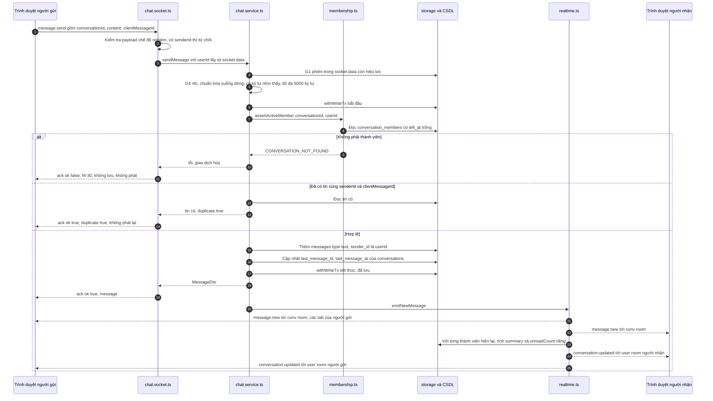
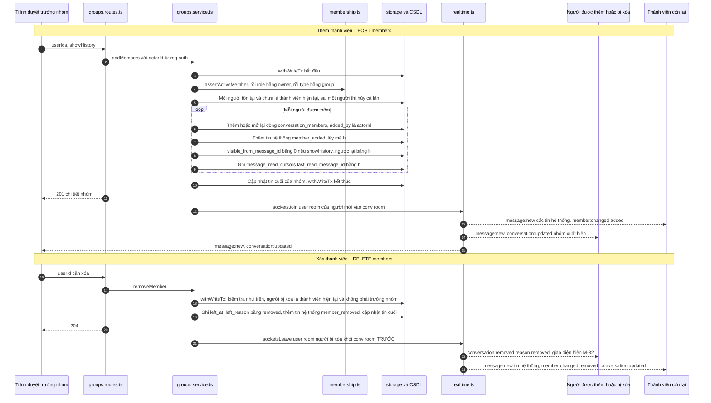
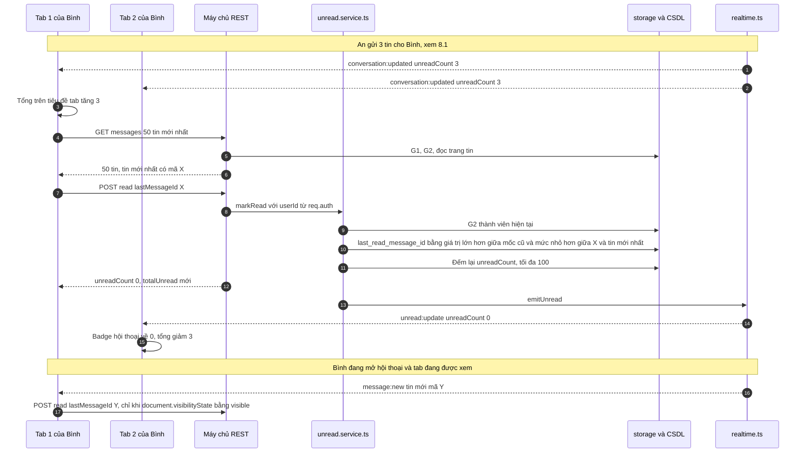
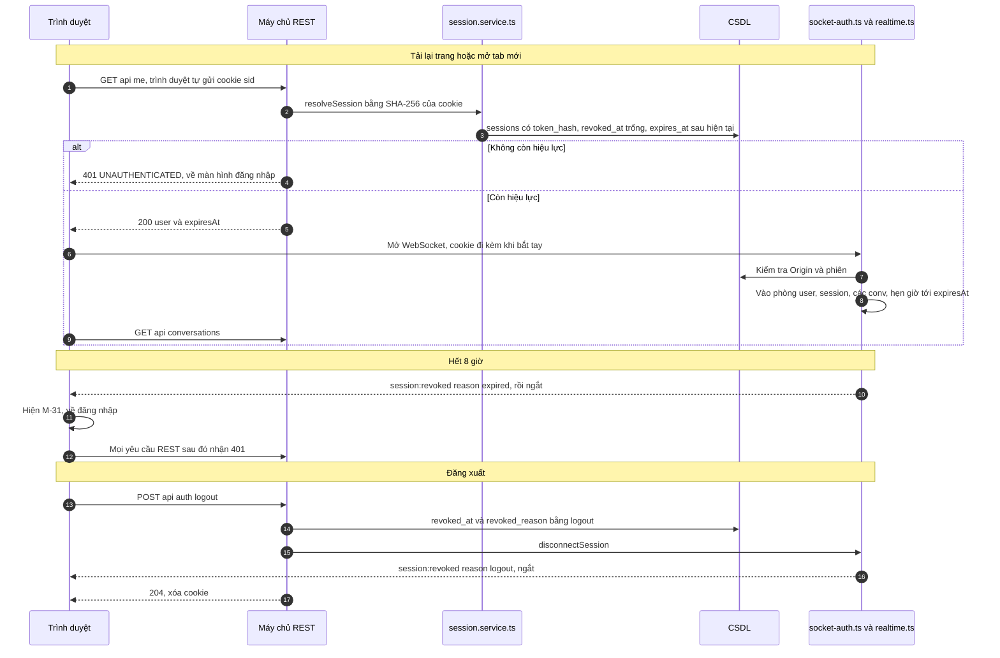

# 09 - Thiết kế chi tiết (Detailed Design)

| Mục | Nội dung |
|---|---|
| Dự án | Ứng dụng chat nội bộ (MVP) – Nhóm: *[chưa xác định]* |
| Tệp | `09-detailed-design.md` |
| Phiên bản | 1.0 – Draft |
| Ngày | 2026-11-14 |
| Người soạn | Nhóm Architect / QA (bản nháp có trợ lý AI hỗ trợ soạn thảo) |
| Trạng thái | Draft – chờ Product Owner rà soát mục 14 và 15 |
| Căn cứ | (1) PDF "Xây dựng ứng dụng chat nội bộ (MVP)", ngày 13~14/11/2026 – **nguồn duy nhất của yêu cầu nghiệp vụ**; (2) `01-brd.md` v1.1; (3) `02-srs.md` (bản trên repository ghi v1.0); (4) `03-frs.md` v1.0; (5) `04-use-cases.md` v1.1; (6) `05-user-stories.md` v1.0; (7) `06-erd.md`, `07-data-flow.md`, `08-high-level-design.md` v1.0 – ba bản nháp **chưa có trên repository** (OQ-27) |

**Quy ước ký hiệu**

| Ký hiệu | Ý nghĩa |
|---|---|
| `[PDF]` | Do đề bài quy định. Không được tự thay đổi. |
| `[QĐ-xx]` / `[GĐ-xx]` / `[GS-xx]` / `[GF-xx]` / `[GU-xx]` / `[GE-xx]` / `[GL-xx]` / `[GH-xx]` | Quyết định và giả định đã ghi ở các tài liệu trước. |
| `[ADR-xx]` | Quyết định kiến trúc ở `08-high-level-design.md` mục 12. |
| `[GT-xx]` | Giả định / lựa chọn kỹ thuật mới của tài liệu này. Xem mục 14. |
| `[ĐX]` | Đề xuất kỹ thuật của nhóm, không phải yêu cầu đề bài. |
| `M-xx` | Câu thông báo theo `03-frs.md` mục 5 – dùng **nguyên văn** trong trường `message` của lỗi. |
| `R-xx`, `F-xx`, `G1…G4` | Tuyến, dòng dữ liệu, cửa kiểm tra theo `07-data-flow.md`. |

> Tài liệu này **không chứa kết quả chạy thử hay số đo nào**. Các mã test ở mục 13 là **kế hoạch**; kết quả ghi tại `12-test-reports.md`.

**Cách dùng cho người lập trình / coding agent:** làm theo thứ tự mục 2 (cấu trúc) → 3 (CSDL) → 4–5 (quy tắc chung) → 6 (REST) → 7 (Socket.IO) → 8–10 (logic) → 13 (test). Mọi điểm chưa chốt nằm ở mục 14–15; **không tự quyết** các điểm đó trong mã.

---

## 1. Quy ước chung

| Nội dung | Quy ước | Nguồn |
|---|---|---|
| Tên trường | API và sự kiện dùng **camelCase** (`conversationId`); CSDL dùng **snake_case** (`conversation_id`) đúng như `06-erd.md`. Prisma ánh xạ bằng `@map` | `[ĐX]` |
| Mã định danh | Số nguyên dương. Trong JSON là kiểu `number` | `[GE-03]` |
| Thời gian | Chuỗi ISO 8601 giờ quốc tế, ví dụ `"2026-11-14T03:05:00.000Z"`. Giao diện tự đổi sang giờ máy người dùng | `[GS-26]` |
| Mã tạm của tin | Trường API `clientMessageId` (UUID v4 do trình duyệt tạo) ↔ cột `messages.client_msg_id` | `[GF-12]`, mục 9 |
| Định dạng lỗi | `{"error": {"code": "<MÃ_LỖI>", "message": "<câu M-xx>", "fields": {"<tên trường>": "<câu M-xx>"}}}`. `fields` chỉ có khi lỗi kiểm tra dữ liệu | `[ĐX]` |
| Tiền tố REST | `/api` | `08` mục 5 |
| Socket.IO | Đường dẫn mặc định `/socket.io`, **chỉ** transport `websocket` | `[ADR-03]`, `[GH-04]` |
| Người thực hiện | **Luôn lấy từ phiên** (`req.auth.userId`, `socket.data.userId`). Mọi trường kiểu `senderId`, `userId` của chính mình, `role` do trình duyệt gửi lên đều **bị từ chối** (mục 4.4) | `[PDF §4]`, NFR-04 |

## 2. Cấu trúc mã nguồn

### 2.1 Cây thư mục

```text
/                               – gốc repository, npm workspaces
├── package.json                – workspaces: ["server", "web"]; script dev, build, test
├── .env.example                – mẫu biến môi trường (mục 11), KHÔNG chứa giá trị thật
├── 01-brd.md … 12-test-reports.md – tài liệu dự án, nằm ngay ở thư mục gốc
├── wireframe.html, ui-design.html – tệp đi kèm 10-ui-ux.md (mục 6, 8.5)
├── server/
│   ├── package.json
│   ├── prisma/
│   │   ├── schema.prisma       – mục 3.2
│   │   ├── migrations/         – SQL do Prisma sinh, đã bổ sung ràng buộc ở mục 3.3
│   │   └── seed.ts             – dữ liệu mẫu cho demo và E2E (không dùng trong test tích hợp)
│   ├── src/
│   │   ├── server.ts           – tạo HTTP server, gắn Express + Socket.IO, lắng nghe PORT
│   │   ├── app.ts              – tạo Express app: json limit, cookie, kiểm tra Origin, routes, xử lý lỗi, phục vụ web/dist
│   │   ├── config/env.ts       – đọc và kiểm tra biến môi trường (mục 11)
│   │   ├── common/
│   │   │   ├── errors.ts       – lớp AppError(code, httpStatus, messageKey) và bảng mã lỗi mục 5
│   │   │   ├── messages.ts     – câu M-01…M-44 nguyên văn từ 03-frs.md mục 5
│   │   │   ├── validation.ts   – chuẩn hóa NFC, đếm ký tự, kiểm tra từng trường (mục 4)
│   │   │   ├── avatar.ts       – tính chữ cái avatar (GS-11)
│   │   │   └── dto.ts          – kiểu dữ liệu trả ra API/sự kiện (mục 6.2)
│   │   ├── storage/
│   │   │   ├── prisma.ts       – PrismaClient duy nhất; bật foreign_keys, WAL, busy_timeout khi SQLite
│   │   │   ├── tx.ts           – withWriteTx(): khóa ghi trong tiến trình + giao dịch Prisma (mục 10.1)
│   │   │   ├── users.repo.ts
│   │   │   ├── sessions.repo.ts
│   │   │   ├── conversations.repo.ts
│   │   │   ├── members.repo.ts
│   │   │   ├── messages.repo.ts
│   │   │   └── unread.repo.ts  – câu đếm chưa đọc (SQL thô, hai biến thể SQLite / PostgreSQL)
│   │   ├── modules/
│   │   │   ├── auth/
│   │   │   │   ├── auth.routes.ts       – /api/auth/*, /api/me/password
│   │   │   │   ├── auth.service.ts      – register, login, logout, changePassword
│   │   │   │   ├── password.ts          – hash, verify (argon2id, GT-01)
│   │   │   │   ├── session.service.ts   – createSession, resolveSession, revoke…
│   │   │   │   ├── session.middleware.ts – requireAuth cho REST (cửa G1)
│   │   │   │   └── socket-auth.ts       – middleware bắt tay Socket.IO (cửa G1)
│   │   │   ├── users/
│   │   │   │   ├── users.routes.ts      – /api/me, /api/users
│   │   │   │   └── users.service.ts     – getMe, updateDisplayName, searchUsers
│   │   │   ├── chat/
│   │   │   │   ├── membership.ts        – assertActiveMember(), cửa G2 DUY NHẤT
│   │   │   │   ├── conversations.routes.ts – /api/conversations, /direct, /:id
│   │   │   │   ├── messages.routes.ts   – /api/conversations/:id/messages
│   │   │   │   ├── chat.service.ts      – openDirect, listConversations, getConversation, getMessages, sendMessage
│   │   │   │   └── chat.socket.ts       – handler message:send
│   │   │   ├── groups/
│   │   │   │   ├── groups.routes.ts     – /group, PATCH /:id, /:id/members, /:id/leave
│   │   │   │   ├── groups.service.ts    – createGroup, addMembers, removeMember, rename, leave (cửa G3)
│   │   │   │   └── system-messages.ts   – dựng nội dung tin hệ thống HT-01…HT-06
│   │   │   └── notifications/
│   │   │       ├── realtime.ts          – giữ io; joinUserRooms, emit*, socketsJoin/Leave, disconnectSession
│   │   │       ├── read.routes.ts       – POST /api/conversations/:id/read
│   │   │       └── unread.service.ts    – markRead, unreadFor
│   │   └── types/express.d.ts  – khai báo req.auth
│   └── test/
│       ├── helpers/            – tạo app với CSDL SQLite tạm, tạo người dùng, đăng nhập, mở socket
│       ├── unit/               – UT-*
│       ├── integration/        – IT-*
│       ├── socket/             – ST-*
│       └── db/                 – DB-*
├── web/
│   ├── package.json
│   ├── vite.config.ts          – proxy /api và /socket.io (ws: true) sang server khi chạy dev
│   └── src/
│       ├── main.tsx, App.tsx   – định tuyến màn hình SCR-01…SCR-08 (chi tiết ở 10-ui-ux.md)
│       ├── api/client.ts       – fetch với credentials: "same-origin"; 401 → về đăng nhập
│       ├── api/*.ts            – một file cho mỗi nhóm endpoint
│       ├── realtime/socket.ts  – io({ transports: ["websocket"], withCredentials: true }); emitWithAck
│       ├── state/              – danh sách hội thoại, tin đang mở, badge
│       ├── lib/text.ts         – countChars() GIỐNG HỆT server (mục 4.1)
│       └── components/, pages/
└── e2e/
    ├── playwright.config.ts    – chromium, firefox, webkit
    └── tests/                  – E2E-AT-01…06
```

### 2.2 Quy tắc phụ thuộc (bắt buộc)

Theo `08-high-level-design.md` mục 4.3, tóm tắt cho người viết mã:

1. `*.routes.ts` và `*.socket.ts` chỉ: đọc tham số → gọi service → trả kết quả. Không có quy tắc nghiệp vụ.
2. `*.service.ts` không import `express`, `socket.io`; chỉ gọi `storage/*` và service module khác.
3. **Chỉ `storage/*` import `PrismaClient`.**
4. **Chỉ `chat/membership.ts`** chứa phép kiểm tra thành viên. Mọi service khác gọi `assertActiveMember`.
5. **Chỉ `notifications/realtime.ts`** gọi `io.to(...).emit`, `socketsJoin`, `socketsLeave`, `disconnectSockets`.
6. Không thêm endpoint hay sự kiện nào không có trong mục 6–7. Mỗi endpoint/sự kiện phải có mã yêu cầu.

## 3. Cơ sở dữ liệu

### 3.1 Bối cảnh

- CSDL mặc định **SQLite** qua Prisma `[ADR-01]`. Lược đồ theo `06-erd.md`, cộng cột `users.display_name_search` theo đề nghị CR-01 của `08` (**chờ duyệt – OQ-31**).
- Khóa chính dùng kiểu `Int` của Prisma (đủ cho MVP). Khi đổi PostgreSQL có thể chuyển `BigInt` `[GT-02]`.
- `type`, `role`, `revoked_reason`, `left_reason`, `event_type` lưu dạng chuỗi; giá trị hợp lệ được giữ bằng CHECK trong migration và kiểu union trong TypeScript `[GT-03]`.
- `event_data` lưu chuỗi JSON `[GT-03]`.

### 3.2 `schema.prisma` (phác thảo)

> Bản phác thảo này **phải** qua `npx prisma validate` trước khi dùng. Tên bảng, tên cột (`@map`) phải giữ đúng như dưới đây.

```prisma
generator client {
  provider = "prisma-client-js"
}

datasource db {
  provider = "sqlite"
  url      = env("DATABASE_URL")
}

model User {
  id                   Int                  @id @default(autoincrement())
  username             String               @unique
  passwordHash         String               @map("password_hash")
  displayName          String               @map("display_name")
  displayNameSearch    String               @map("display_name_search")
  createdAt            DateTime             @default(now()) @map("created_at")
  updatedAt            DateTime             @updatedAt @map("updated_at")
  sessions             Session[]
  memberships          ConversationMember[] @relation("MemberUser")
  addedMembers         ConversationMember[] @relation("MemberAddedBy")
  createdConversations Conversation[]       @relation("ConversationCreatedBy")
  directLow            Conversation[]       @relation("DirectLow")
  directHigh           Conversation[]       @relation("DirectHigh")
  sentMessages         Message[]            @relation("MessageSender")
  eventActorOf         Message[]            @relation("EventActor")
  eventTargetOf        Message[]            @relation("EventTarget")

  @@map("users")
}

model Session {
  id            Int       @id @default(autoincrement())
  userId        Int       @map("user_id")
  tokenHash     String    @unique @map("token_hash")
  createdAt     DateTime  @default(now()) @map("created_at")
  expiresAt     DateTime  @map("expires_at")
  revokedAt     DateTime? @map("revoked_at")
  revokedReason String?   @map("revoked_reason")
  user          User      @relation(fields: [userId], references: [id])

  @@index([userId])
  @@map("sessions")
}

model Conversation {
  id               Int                  @id @default(autoincrement())
  type             String
  name             String?
  directUserLowId  Int?                 @map("direct_user_low_id")
  directUserHighId Int?                 @map("direct_user_high_id")
  createdById      Int                  @map("created_by")
  createdAt        DateTime             @default(now()) @map("created_at")
  lastMessageId    Int?                 @unique @map("last_message_id")
  lastMessageAt    DateTime?            @map("last_message_at")
  directLow        User?                @relation("DirectLow", fields: [directUserLowId], references: [id])
  directHigh       User?                @relation("DirectHigh", fields: [directUserHighId], references: [id])
  createdBy        User                 @relation("ConversationCreatedBy", fields: [createdById], references: [id])
  lastMessage      Message?             @relation("LastMessage", fields: [lastMessageId], references: [id])
  members          ConversationMember[]
  messages         Message[]            @relation("ConversationMessages")

  @@unique([directUserLowId, directUserHighId])
  @@map("conversations")
}

model ConversationMember {
  conversationId       Int                @map("conversation_id")
  userId               Int                @map("user_id")
  role                 String             @default("member")
  joinedAt             DateTime           @default(now()) @map("joined_at")
  visibleFromMessageId Int                @default(0) @map("visible_from_message_id")
  addedById            Int?               @map("added_by")
  leftAt               DateTime?          @map("left_at")
  leftReason           String?            @map("left_reason")
  conversation         Conversation       @relation(fields: [conversationId], references: [id])
  user                 User               @relation("MemberUser", fields: [userId], references: [id])
  addedBy              User?              @relation("MemberAddedBy", fields: [addedById], references: [id])
  readCursor           MessageReadCursor?
  authoredMessages     Message[]          @relation("MessageAuthorMembership")

  @@id([conversationId, userId])
  @@index([userId])
  @@map("conversation_members")
}

model Message {
  id                 Int                 @id @default(autoincrement())
  conversationId     Int                 @map("conversation_id")
  senderId           Int?                @map("sender_id")
  type               String
  content            String
  clientMsgId        String?             @map("client_msg_id")
  eventType          String?             @map("event_type")
  eventActorId       Int?                @map("event_actor_id")
  eventTargetId      Int?                @map("event_target_id")
  eventData          String?             @map("event_data")
  createdAt          DateTime            @default(now()) @map("created_at")
  conversation       Conversation        @relation("ConversationMessages", fields: [conversationId], references: [id])
  sender             User?               @relation("MessageSender", fields: [senderId], references: [id])
  authorMembership   ConversationMember? @relation("MessageAuthorMembership", fields: [conversationId, senderId], references: [conversationId, userId])
  eventActor         User?               @relation("EventActor", fields: [eventActorId], references: [id])
  eventTarget        User?               @relation("EventTarget", fields: [eventTargetId], references: [id])
  lastOfConversation Conversation?       @relation("LastMessage")

  @@unique([senderId, clientMsgId])
  @@index([conversationId, id])
  @@map("messages")
}

model MessageReadCursor {
  conversationId    Int                @map("conversation_id")
  userId            Int                @map("user_id")
  lastReadMessageId Int                @default(0) @map("last_read_message_id")
  updatedAt         DateTime           @updatedAt @map("updated_at")
  member            ConversationMember @relation(fields: [conversationId, userId], references: [conversationId, userId], onDelete: Cascade)

  @@id([conversationId, userId])
  @@map("message_read_cursors")
}
```

Ghi chú:

- `@@unique([senderId, clientMsgId])`: SQLite và PostgreSQL đều coi các giá trị trống là khác nhau, nên tin hệ thống (`sender_id` trống) và tin không có mã tạm không bị chặn. Ràng buộc này thay cho UK có điều kiện ở `06-erd.md` với cùng tác dụng `[GT-04]`.
- `lastMessageId @unique`: Prisma yêu cầu cho quan hệ 1-1; đúng nghĩa vì một tin chỉ là tin cuối của một hội thoại.

### 3.3 Ràng buộc bổ sung bằng SQL trong migration

Prisma không mô tả được các ràng buộc dưới đây. Quy trình: `prisma migrate dev --create-only` → mở file SQL vừa sinh → **thêm** các dòng sau → `prisma migrate dev`. Với SQLite, CHECK phải nằm **trong** câu `CREATE TABLE` do Prisma sinh (SQLite không thêm CHECK vào bảng đã có).

| Bảng | Ràng buộc thêm | Nguồn |
|---|---|---|
| `users` | `CHECK (length(username) BETWEEN 3 AND 30 AND username = lower(username) AND username NOT GLOB '*[^a-z0-9._]*')`; `CHECK (length(trim(display_name)) BETWEEN 1 AND 50)` | `[QĐ-07]`, `[GS-02]` |
| `sessions` | `CHECK (expires_at > created_at)`; CHECK cặp `revoked_at` / `revoked_reason IN ('logout','password_change')`; `CREATE INDEX ix_sessions_user_active ON sessions (user_id) WHERE revoked_at IS NULL` | `06` mục 6.2 |
| `conversations` | `CHECK (type IN ('direct','group'))`; CHECK hình dạng direct/group và `direct_user_low_id < direct_user_high_id`; tên nhóm 1–100 ký tự | `[PDF CH-01]`, `06` mục 7.1 |
| `conversation_members` | `CHECK (role IN ('owner','member'))`; CHECK cặp `left_at` / `left_reason IN ('left','removed')`; `CREATE UNIQUE INDEX uq_members_one_active_owner ON conversation_members (conversation_id) WHERE role = 'owner' AND left_at IS NULL`; `CREATE INDEX ix_members_user_active ON conversation_members (user_id, conversation_id) WHERE left_at IS NULL` | `06` mục 6.4, 7.3 |
| `messages` | CHECK `type IN ('text','system')`; CHECK tin `text`: có tác giả, không có `event_type`, nội dung có ký tự khác khoảng trắng, `length(content) <= 5000`; CHECK tin `system`: không tác giả, không mã tạm, `event_type` thuộc 6 giá trị; `CREATE INDEX ix_messages_conv_unread ON messages (conversation_id, id, sender_id) WHERE type = 'text'` | `[PDF CH-02]`, `06` mục 6.5 |
| `message_read_cursors` | `CHECK (last_read_message_id >= 0)` | `06` mục 6.6 |

Bản SQL đầy đủ để đối chiếu nằm ở **Phụ lục A**. Sau **mỗi** lần tạo migration mới, phải đọc lại file SQL: nếu Prisma sinh lệnh xóa index có điều kiện hoặc tạo lại bảng làm mất CHECK, phải sửa trước khi chạy. Bộ test DB-01…DB-08 phát hiện việc thiếu ràng buộc `[GT-05]`.

### 3.4 Thiết lập kết nối SQLite

Khi khởi động (`storage/prisma.ts`), chạy một lần:

| Lệnh | Mục đích |
|---|---|
| `PRAGMA foreign_keys = ON` | Bật kiểm tra khóa ngoại (gồm khóa ngoại kép "tác giả thuộc hội thoại") `[GH-05]` |
| `PRAGMA journal_mode = WAL` | Đọc không bị chặn khi đang ghi `[GH-05]` |
| `PRAGMA busy_timeout = 5000` | Chờ thay vì báo lỗi ngay nếu CSDL đang bận `[GT-06]` |

Test DB-01 kiểm tra khóa ngoại thực sự được bật.

## 4. Kiểm tra dữ liệu (validation)

Tất cả nằm trong `common/validation.ts`, dùng chung cho REST và Socket.IO. Giao diện dùng **cùng thuật toán** (`web/src/lib/text.ts`) chỉ để báo lỗi sớm; máy chủ luôn kiểm tra lại (FRS NT-01).

### 4.1 Hàm nền

| Hàm | Định nghĩa | Nguồn |
|---|---|---|
| `nfc(s)` | `s.normalize("NFC")` | `[GS-18]`, FRS NT-02 |
| `normalizeNewlines(s)` | Đổi `\r\n` và `\r` thành `\n` | `[GS-18]` "mỗi ký xuống dòng tính 1" |
| `countChars(s)` | Số **điểm mã Unicode**: `Array.from(s).length`. **Không** dùng `s.length` (đếm theo đơn vị UTF-16, sai với một số ký tự) | `[GE-14]`, `[OQ-24]` |
| `hasVisibleChar(s)` | `/\S/u.test(s)` | `[GS-19]` |
| `searchKey(s)` | `nfc(s).trim().toLowerCase()` – JavaScript đổi đúng chữ có dấu (`"Đặng"` → `"đặng"`) | NFR-09, CR-01 |

### 4.2 Quy tắc từng trường

| Trường | Bước xử lý | Quy tắc | Lỗi | Nguồn |
|---|---|---|---|---|
| `username` | `nfc` → `trim` → `toLowerCase` | Khớp `^[a-z0-9._]{3,30}$` | 400 `VALIDATION_ERROR` + M-02 | `[QĐ-07]`, `[GF-01]` |
| `username` (đăng ký) | Như trên | **Duy nhất**: kiểm tra trước bằng truy vấn; vẫn bắt lỗi trùng khóa của CSDL (hai người đăng ký cùng lúc) | 409 `USERNAME_TAKEN` + M-01 | `[PDF TK-01]` |
| `password`, `newPassword` | `nfc`; **không** `trim` | 8 ≤ `countChars` ≤ 64; có ít nhất một chữ cái `/\p{L}/u` và một chữ số `/[0-9]/` | M-06 / M-08 / M-07 | `[PDF TK-02]`, `[GS-04]`, `[GS-05]` |
| `passwordConfirm`, `newPasswordConfirm` | `nfc` | Bằng mật khẩu mới | M-04 | `[GU-01]`, `[ĐX]` |
| `displayName` | `nfc` → `trim` | 1 ≤ `countChars` ≤ 50 | M-03 | `[GS-02]` |
| `registrationCode` | `trim` | So bằng phép so thời gian cố định (`crypto.timingSafeEqual` trên bản băm) với `REGISTRATION_CODE` | 400 `INVALID_REGISTRATION_CODE` + M-05 | `[QĐ-05]`, `[GU-02]` |
| `q` (tìm người) | `searchKey` | 1 ≤ `countChars` ≤ 50 | 400 `VALIDATION_ERROR` | `[GS-14]`, `[ĐX]` giới hạn trên |
| `content` (tin) | `nfc` → `normalizeNewlines`; **không** `trim` | `hasVisibleChar`; `countChars` ≤ 5000 | `MESSAGE_EMPTY`; `MESSAGE_TOO_LONG` + M-17 (kèm `{n}`) | `[PDF CH-02]`, `[GS-19]` |
| `clientMessageId` | – | UUID v4 (chữ thường) | 400 `VALIDATION_ERROR` | `[GF-12]` |
| `name` (nhóm) | `nfc` → `trim` | 1 ≤ `countChars` ≤ 100 | M-25 | `[GS-28]` |
| `memberIds`, `userIds` | – | Mảng số nguyên dương, không trùng, không chứa chính mình; tạo nhóm cần ≥ 2 phần tử | M-26; M-27 / M-36 nếu có người không tồn tại | `[PDF NH-01]`, `[GĐ-05]` |
| `before`, `after`, `lastMessageId` | – | Số nguyên dương; không được có cả `before` và `after` | 400 `VALIDATION_ERROR` | `[GS-22]` |

Lưu ý: kiểm tra trường bằng thư viện lược đồ (đề xuất `zod`) ở **chế độ nghiêm**: trường lạ trong body hoặc payload bị từ chối với 400 `VALIDATION_ERROR` `[GT-07]`.

### 4.3 Băm mật khẩu

| Nội dung | Thiết kế | Nguồn |
|---|---|---|
| Thuật toán | **argon2id** (thư viện `@node-rs/argon2`, có bản dựng sẵn, không cần biên dịch) | `[PDF TK-02]` cho phép argon2; `[GT-01]` |
| Lý do không dùng bcrypt như GH-07 của `08` | bcrypt chỉ dùng **72 byte đầu** của mật khẩu. Mật khẩu 64 ký tự tiếng Việt có dấu có thể vượt 72 byte, phần sau bị bỏ qua mà không báo | `[GT-01]`, `[OQ-36]` |
| Tham số | Mặc định của thư viện; không tự hạ | `[ĐX]` |
| Ghi log | Không bao giờ ghi mật khẩu, token, hay nội dung tin vào log | `[PDF TK-02]`, TK-02-AC4 |

### 4.4 Không tin dữ liệu "danh tính" từ trình duyệt

| Dữ liệu | Lấy từ đâu | Nếu trình duyệt tự gửi |
|---|---|---|
| Người gửi tin (`senderId`) | `socket.data.userId` (gán lúc bắt tay từ phiên) | Payload có `senderId` → 400 `VALIDATION_ERROR` (chế độ nghiêm), **không lưu** |
| Người thực hiện thao tác nhóm | `req.auth.userId` | Không có trường nào để gửi; trường lạ bị từ chối |
| Vai trò trưởng nhóm | Đọc `conversation_members.role` trong CSDL | Không nhận từ trình duyệt |
| Tên hiển thị trong tin hệ thống | Đọc `users.display_name` lúc sự kiện | Không nhận từ trình duyệt |
| Thời gian tin | Giờ máy chủ | Không nhận từ trình duyệt |

Test ST-MSG-06 và IT-GRP-09 kiểm chứng.

## 5. Mã lỗi

`message` là câu M-xx **nguyên văn** từ `03-frs.md` mục 5. Mã HTTP chỉ áp dụng cho REST; Socket.IO trả cùng `code` và `message` trong ack.

| `code` | HTTP | Câu | Khi nào | Mã SRS |
|---|---|---|---|---|
| `VALIDATION_ERROR` | 400 | Câu M-xx của từng trường trong `fields`; `message` chung: "Dữ liệu không hợp lệ." `[ĐX]` | Sai định dạng, trường lạ | nhiều |
| `INVALID_REGISTRATION_CODE` | 400 | M-05 | Mã tổ chức sai | E-TK01-5 |
| `USERNAME_TAKEN` | 409 | M-01 | Trùng tên đăng nhập | E-TK01-1 |
| `INVALID_CREDENTIALS` | 401 | M-09 | Sai tên hoặc mật khẩu (cùng một câu) | E-TK03-1 |
| `UNAUTHENTICATED` | 401 | M-31 | Không có / hết hạn / đã hủy phiên | E-TK03-2 |
| `FORBIDDEN_ORIGIN` | 403 | M-34 | `Origin` không phải địa chỉ của ứng dụng | `[GH-03]` |
| `WRONG_CURRENT_PASSWORD` | 400 | M-10 | Mật khẩu hiện tại sai. Dùng 400, **không** 401, để giao diện không tưởng là hết phiên | E-TK04-1 |
| `SAME_PASSWORD` | 400 | M-11 | Mật khẩu mới trùng cũ | E-TK04-3 |
| `CANNOT_CHAT_SELF` | 400 | M-15 | Mở 1-1 với chính mình | E-CH01-1 |
| `USER_NOT_FOUND` | 404 | M-16 | Người kia không tồn tại | E-CH01-2 |
| `CONVERSATION_NOT_FOUND` | **404** | M-30 | Hội thoại không tồn tại **hoặc** người hỏi không phải thành viên hiện tại – **cùng một phản hồi** | E-CH02-3, E-CH03-1, NFR-04 |
| `MESSAGE_EMPTY` | 400 | "Tin nhắn không được để trống." `[ĐX]`, CR-04 | Tin chỉ có khoảng trắng | E-CH02-2 |
| `MESSAGE_TOO_LONG` | 400 | M-17 (thay `{n}`) | Quá 5.000 ký tự | E-CH02-1 |
| `NOT_GROUP_OWNER` | 403 | M-29 | Không phải trưởng nhóm | E-NH03-1 |
| `GROUP_NAME_INVALID` | 400 | M-25 | Tên nhóm trống/dài | E-NH01-1, E-NH03-5 |
| `GROUP_TOO_FEW_MEMBERS` | 400 | M-26 | Chọn < 2 người | E-NH01-2 |
| `USERS_NOT_FOUND` | 400 | M-27 | Có người không tồn tại khi tạo nhóm | E-NH01-3 |
| `MEMBER_CONFLICT` | 409 | M-36 | Thêm người đã ở trong nhóm hoặc không tồn tại | E-NH03-2 |
| `TARGET_NOT_MEMBER` | 404 | "Người này không còn trong nhóm." `[ĐX]`, CR-04 | Xóa người không phải thành viên hiện tại | NH-03 |
| `CANNOT_REMOVE_SELF` | 400 | "Trưởng nhóm không thể tự xóa mình. Hãy dùng chức năng Rời nhóm." `[ĐX]`, CR-04 | Trưởng nhóm tự xóa mình | `[GU-14]` |
| `NOT_A_GROUP` | 400 | "Thao tác này chỉ áp dụng cho nhóm." `[ĐX]`, CR-04 | Đổi tên / thêm / xóa / rời trên hội thoại 1-1 | `[GU-07]` |
| `NEW_OWNER_REQUIRED` | 400 | M-37 | Trưởng nhóm rời mà không chọn, hoặc chọn người không phải thành viên hiện tại | E-NH03-3 |
| `LAST_MEMBER_CANNOT_LEAVE` | 409 | M-28 | Nhóm chỉ còn trưởng nhóm | E-NH03-4 |
| `INTERNAL` | 500 | M-34 | Lỗi không lường trước. Không trả chi tiết kỹ thuật | – |

Về 403 hay 404 khi không phải thành viên: hướng dẫn chung thường dùng 403, nhưng `03-frs.md` mục 6.1 yêu cầu phản hồi **giống hệt** khi hội thoại không tồn tại để không lộ thông tin. Tài liệu này theo FRS: **404 `CONVERSATION_NOT_FOUND`** cho cả hai trường hợp. 403 chỉ dùng khi người hỏi **là** thành viên nhưng thiếu quyền trưởng nhóm `[GT-08]`.

## 6. REST API

### 6.1 Bảng tổng hợp

Auth: **Không** = không cần phiên; **Phiên** = cần phiên hợp lệ (G1); **Thành viên** = G1 + G2; **Trưởng nhóm** = G1 + G2 + G3.

| # | Method | Path | Mô tả | Auth | Thành công | Tuyến 07 | Mã yêu cầu |
|---|---|---|---|---|---|---|---|
| A1 | POST | `/api/auth/register` | Đăng ký | Không | 201 | R-01 | TK-01, TK-02 |
| A2 | POST | `/api/auth/login` | Đăng nhập, đặt cookie | Không | 200 | R-02 | TK-03 |
| A3 | POST | `/api/auth/logout` | Đăng xuất, hủy phiên | Phiên | 204 | R-03 | TK-03 |
| A4 | PUT | `/api/me/password` | Đổi mật khẩu | Phiên | 204 | R-04 | TK-04, TK-02 |
| U1 | GET | `/api/me` | Hồ sơ của tôi + hạn phiên (dùng khi tải lại trang) | Phiên | 200 | R-05 | TK-05, TK-03 |
| U2 | PUT | `/api/me` | Sửa tên hiển thị | Phiên | 200 | R-05 | TK-05 |
| U3 | GET | `/api/users?q=&excludeConversationId=` | Tìm người dùng | Phiên | 200 | R-06 | TK-06 |
| C1 | POST | `/api/conversations/direct` | Mở hoặc mở lại hội thoại 1-1 | Phiên | 200 / 201 | R-07 | CH-01 |
| C2 | GET | `/api/conversations` | Danh sách hội thoại + số chưa đọc | Phiên | 200 | R-08 | CH-06, TB-01 |
| C3 | GET | `/api/conversations/:id` | Chi tiết hội thoại + danh sách thành viên | Thành viên | 200 | R-09 | CH-01, NH-02, NH-03 |
| C4 | GET | `/api/conversations/:id/messages?before=&after=&limit=` | Trang tin (tối đa 50) | Thành viên | 200 | R-09 | CH-03 |
| C5 | POST | `/api/conversations/:id/read` | Báo đã đọc | Thành viên | 200 | R-10 | TB-01 |
| G1 | POST | `/api/conversations/group` | Tạo nhóm | Phiên | 201 | R-12 | NH-01, NH-04 |
| G2 | PATCH | `/api/conversations/:id` | Đổi tên nhóm | Trưởng nhóm | 200 | R-15 | NH-03, NH-04 |
| G3 | POST | `/api/conversations/:id/members` | Thêm thành viên | Trưởng nhóm | 201 | R-13 | NH-03, NH-04 |
| G4 | DELETE | `/api/conversations/:id/members/:userId` | Xóa thành viên | Trưởng nhóm | 204 | R-14 | NH-03, NH-04 |
| G5 | POST | `/api/conversations/:id/leave` | Rời nhóm (trưởng nhóm kèm người nhận quyền) | Thành viên | 204 | R-16 | NH-03, NH-04 |

**Gửi tin không có endpoint REST** – chỉ qua Socket.IO (mục 7) `[GL-01]`.

Áp dụng cho **mọi** endpoint cần phiên: thiếu/sai phiên → 401 `UNAUTHENTICATED`. Áp dụng cho **mọi** yêu cầu POST/PUT/PATCH/DELETE: `Origin` sai → 403 `FORBIDDEN_ORIGIN`. Áp dụng cho **mọi** endpoint có `:id`: "**Kiểm tra: người gọi là thành viên hiện tại của hội thoại (`left_at` trống); nếu không, trả 404 `CONVERSATION_NOT_FOUND` (M-30)**", không đọc bảng `messages` trước khi qua bước này.

### 6.2 Kiểu dữ liệu trả về (DTO)

```ts
type UserDto = {
  id: number;
  username: string;
  displayName: string;
  avatarInitial: string;            // GS-11, tính ở server (common/avatar.ts)
};

type MessageDto = {
  id: number;
  conversationId: number;
  type: "text" | "system";
  content: string;                  // tin hệ thống: câu đã dựng sẵn (FRS-14)
  sender: UserDto | null;           // null với tin hệ thống; tên hiện tại (GS-12)
  eventType: null | "group_created" | "member_added" | "member_removed"
           | "member_left" | "group_renamed" | "owner_transferred";
  clientMessageId: string | null;
  createdAt: string;
};

type ConversationSummaryDto = {     // một dòng ở SCR-03; tính RIÊNG cho từng người xem
  id: number;
  type: "direct" | "group";
  title: string;                    // tên người kia (direct) hoặc tên nhóm
  avatarInitial: string;
  otherUser: UserDto | null;        // chỉ có với direct
  memberCount: number;              // thành viên hiện tại
  myRole: "owner" | "member";
  lastMessage: null | {
    id: number;
    type: "text" | "system";
    preview: string;                // tối đa 100 ký tự đầu, server cắt sẵn [ĐX]
    senderDisplayName: string | null;
    isMine: boolean;
    createdAt: string;
  };
  lastMessageAt: string | null;
  unreadCount: number;              // 0…100; 100 nghĩa là "100 trở lên" → giao diện hiện 99+
};

type ConversationDetailDto = ConversationSummaryDto & {
  name: string | null;              // tên nhóm gốc
  members: Array<{ user: UserDto; role: "owner" | "member" }>; // chỉ thành viên hiện tại
};
```

### 6.3 Chi tiết từng endpoint

#### A1 `POST /api/auth/register` – TK-01, TK-02

```json
// Request
{ "username": "NhanVien01", "password": "Matkhau123", "passwordConfirm": "Matkhau123",
  "displayName": "Nguyễn Văn An", "registrationCode": "<mã do tổ chức cấp>" }
// 201
{ "user": { "id": 1, "username": "nhanvien01", "displayName": "Nguyễn Văn An", "avatarInitial": "A" } }
```

Thứ tự kiểm tra: mã tổ chức (M-05) → định dạng các trường → trùng tên (409). Không tự đăng nhập; giao diện hiện M-40 và chuyển về đăng nhập `[GS-03]`. Lỗi: 400 `INVALID_REGISTRATION_CODE`, 400 `VALIDATION_ERROR`, 409 `USERNAME_TAKEN`.

#### A2 `POST /api/auth/login` – TK-03

```json
// Request
{ "username": "NHANVIEN01", "password": "Matkhau123" }
// 200, kèm header Set-Cookie: sid=<token>; HttpOnly; SameSite=Lax; Path=/; Max-Age=28800[; Secure]
{ "user": { "id": 1, "username": "nhanvien01", "displayName": "Nguyễn Văn An", "avatarInitial": "A" },
  "session": { "expiresAt": "2026-11-14T11:05:00.000Z" } }
```

Tên không tồn tại vẫn chạy một lần so khớp băm giả để thời gian phản hồi tương đương `[ĐX]`. Lỗi: 400 `VALIDATION_ERROR` (thiếu trường, M-35), 401 `INVALID_CREDENTIALS` (M-09).

#### A3 `POST /api/auth/logout` – TK-03

Body rỗng. 204, kèm `Set-Cookie` xóa cookie. Phía máy chủ: `revoked_at = now`, `revoked_reason = 'logout'`; phát `session:revoked` (`reason: "logout"`) vào phòng `session:<id>` rồi ngắt các socket của phiên. Lỗi: 401.

#### A4 `PUT /api/me/password` – TK-04

```json
{ "currentPassword": "Matkhau123", "newPassword": "Matkhau456", "newPasswordConfirm": "Matkhau456" }
```

Trả 204. Trong **một** giao dịch: cập nhật `password_hash`, hủy mọi phiên **khác** chưa hủy (`revoked_reason = 'password_change'`). Sau giao dịch: phát `session:revoked` + ngắt socket cho từng phiên bị hủy `[QĐ-09]`. Lỗi: 400 `WRONG_CURRENT_PASSWORD`, `SAME_PASSWORD`, `VALIDATION_ERROR` (M-04, M-06…M-08), 401.

#### U1 `GET /api/me` – TK-05, TK-03

```json
// 200
{ "user": { "id": 1, "username": "nhanvien01", "displayName": "Nguyễn Văn An", "avatarInitial": "A" },
  "session": { "expiresAt": "2026-11-14T11:05:00.000Z" } }
```

Giao diện gọi khi tải lại trang để biết còn phiên hay không (mục 8.4). Lỗi: 401.

#### U2 `PUT /api/me` – TK-05

```json
{ "displayName": "Trần Thị Bình" }
// 200 → { "user": UserDto }
```

Cập nhật `display_name`, `display_name_search = searchKey(displayName)`, `updated_at`. Lỗi: 400 (M-03), 401. Không có trường ảnh `[PDF TK-05]`.

#### U3 `GET /api/users?q=an&excludeConversationId=12` – TK-06

```json
// 200
{ "users": [ { "id": 3, "username": "an.nguyen", "displayName": "Nguyễn Văn An", "avatarInitial": "A" } ] }
```

- Khớp khi `searchKey(q)` **nằm trong** `username` hoặc `display_name_search`; không trả chính mình; tối đa 20 kết quả, sắp theo `display_name_search` `[GS-13]`, `[GS-14]`.
- Câu SQL dùng `LIKE ? ESCAPE '\'`, trong đó `%`, `_`, `\` của từ khóa đã được thoát (vì `_` hợp lệ trong tên đăng nhập) `[GT-09]`.
- `excludeConversationId` (tùy chọn): loại thành viên hiện tại của nhóm đó `[GF-08]`; người gọi phải là thành viên hiện tại của nhóm, nếu không thì bỏ qua tham số.
- Không có kết quả → 200 với mảng rỗng; giao diện hiện M-14. Lỗi: 400, 401.

#### C1 `POST /api/conversations/direct` – CH-01

```json
{ "userId": 2 }
// 201 nếu vừa tạo, 200 nếu đã có → { "conversation": ConversationDetailDto }
```

Logic chống trùng ở mục 10.2. Lỗi: 400 `CANNOT_CHAT_SELF`, 404 `USER_NOT_FOUND`, 401.

#### C2 `GET /api/conversations` – CH-06, TB-01

```json
// 200
{ "conversations": [ ConversationSummaryDto, "..." ], "totalUnread": 7 }
```

Chỉ hội thoại có dòng `conversation_members` của người gọi với `left_at` trống **và** `last_message_id` khác trống (`[GF-09]`); sắp `last_message_at` giảm dần, cùng giờ thì `id` giảm dần. `totalUnread` = tổng `unreadCount` (FRS-15). Câu SQL đếm ở mục 10.3. Lỗi: 401.

#### C3 `GET /api/conversations/:id` – CH-01, NH-02, NH-03

200 → `{ "conversation": ConversationDetailDto }`. **Kiểm tra: người gọi là thành viên hiện tại, nếu không trả 404 `CONVERSATION_NOT_FOUND`.**

#### C4 `GET /api/conversations/:id/messages` – CH-03

**Kiểm tra: người gọi là thành viên hiện tại, nếu không trả 404 `CONVERSATION_NOT_FOUND`.** Phân trang theo con trỏ là mã tin (mục 10.4).

| Tham số | Ý nghĩa |
|---|---|
| (không có) | 50 tin mới nhất |
| `before=<messageId>` | 50 tin cũ hơn tin này (cuộn ngược) |
| `after=<messageId>` | Tối đa 50 tin mới hơn tin này (tải tin bị lỡ sau khi mất mạng – `[GL-06]`) |
| `limit` | Tùy chọn, 1…50, mặc định 50. Giá trị > 50 → 400 `[PDF CH-03]` |

```json
// 200 – tin sắp từ cũ đến mới
{ "messages": [ MessageDto, "..." ],
  "hasMore": true,          // before / mặc định: còn tin cũ hơn; after: còn tin mới hơn → tải lại 50 tin mới nhất
  "nextCursor": 1201 }      // mã tin cũ nhất trong trang (before) hoặc mới nhất (after); null nếu trang rỗng
```

Lỗi: 400 (có cả `before` và `after`, giá trị sai), 401, 404.

#### C5 `POST /api/conversations/:id/read` – TB-01

```json
{ "lastMessageId": 1250 }     // tùy chọn; thiếu thì lấy tin mới nhất của hội thoại
// 200
{ "conversationId": 12, "lastReadMessageId": 1250, "unreadCount": 0, "totalUnread": 4 }
```

**Kiểm tra: người gọi là thành viên hiện tại, nếu không trả 404 `CONVERSATION_NOT_FOUND`.** Mốc chỉ tăng, không vượt tin mới nhất (mục 10.5). Sau khi ghi: phát `unread:update` vào `user:<id>`. Lỗi: 400, 401, 404.

#### G1 `POST /api/conversations/group` – NH-01, NH-04

```json
{ "name": "Phòng Kế hoạch", "memberIds": [2, 3] }
// 201 → { "conversation": ConversationDetailDto }
```

Logic ở mục 10.6. Lỗi: 400 `GROUP_NAME_INVALID`, `GROUP_TOO_FEW_MEMBERS`, `USERS_NOT_FOUND`, `VALIDATION_ERROR`; 401.

#### G2 `PATCH /api/conversations/:id` – NH-03, NH-04

```json
{ "name": "Phòng Kế hoạch 2" }
// 200 → { "conversation": ConversationDetailDto }
```

**Kiểm tra: thành viên hiện tại (404), là nhóm (400 `NOT_A_GROUP`), là trưởng nhóm (403 `NOT_GROUP_OWNER`).** Tên mới giống tên cũ → 200, không đổi gì, không có tin hệ thống `[GF-19]`. Lỗi thêm: 400 `GROUP_NAME_INVALID`.

#### G3 `POST /api/conversations/:id/members` – NH-03, NH-04

```json
{ "userIds": [4], "showHistory": false }
// 201 → { "conversation": ConversationDetailDto }
```

**Kiểm tra như G2.** `showHistory` mặc định `false` `[QĐ-08]`, `[GS-35]`. Một người không hợp lệ → không thêm ai `[GU-13]`. Logic ở mục 10.7. Lỗi thêm: 409 `MEMBER_CONFLICT`.

#### G4 `DELETE /api/conversations/:id/members/:userId` – NH-03, NH-04

Trả 204. **Kiểm tra như G2.** Lỗi thêm: 400 `CANNOT_REMOVE_SELF`, 404 `TARGET_NOT_MEMBER`.

#### G5 `POST /api/conversations/:id/leave` – NH-03, NH-04

```json
{ "newOwnerId": 3 }   // bắt buộc nếu người gọi là trưởng nhóm; thành viên thường gửi {}
```

Trả 204. **Kiểm tra: thành viên hiện tại (404), là nhóm (400 `NOT_A_GROUP`).** Lỗi thêm: 400 `NEW_OWNER_REQUIRED`, 409 `LAST_MEMBER_CANNOT_LEAVE`.

## 7. Hợp đồng sự kiện Socket.IO

### 7.1 Kết nối

| Nội dung | Thiết kế |
|---|---|
| Phía trình duyệt | `io({ transports: ["websocket"], withCredentials: true, reconnectionDelay: 1000, reconnectionDelayMax: 30000 })` – cùng địa chỉ với trang `[GF-23]` |
| Phía máy chủ | `new Server(httpServer, { transports: ["websocket"], maxHttpBufferSize: 65536 })` `[ĐX]` |
| Middleware bắt tay (`socket-auth.ts`) | (1) `Origin` của handshake phải bằng `APP_ORIGIN`; (2) đọc cookie `sid`, tra phiên (G1). Sai → `next(new Error("UNAUTHENTICATED"))`, trình duyệt nhận `connect_error` và chuyển về đăng nhập |
| Sau khi kết nối | `socket.data = { userId, sessionId, expiresAt }`; vào phòng `user:<userId>`, `session:<sessionId>` và `conv:<id>` của **mọi** hội thoại đang tham gia `[GL-05]`; đặt hẹn giờ tới `expiresAt` → phát `session:revoked` (`expired`) rồi ngắt |

### 7.2 Bảng sự kiện

| Sự kiện | Chiều | Gửi tới | Payload | Ack | Mã yêu cầu |
|---|---|---|---|---|---|
| `message:send` | Trình duyệt → máy chủ | – | `{ conversationId: number, content: string, clientMessageId: string }`. **Không** có `senderId` (có thì bị từ chối) | Có (mục 7.3) | CH-02, NH-02 |
| `message:new` | Máy chủ → trình duyệt | `conv:<conversationId>` (mọi thành viên hiện tại, kể cả các tab của người gửi) | `{ message: MessageDto }` | Không | CH-02, NH-02, NH-04 |
| `conversation:updated` | Máy chủ → trình duyệt | `user:<userId>` của **từng** thành viên hiện tại, tính riêng cho người đó | `{ conversation: ConversationSummaryDto }` | Không | CH-06, TB-01 |
| `unread:update` | Máy chủ → trình duyệt | `user:<userId>` | `{ conversationId: number, unreadCount: number, lastReadMessageId: number }` | Không | TB-01 |
| `member:changed` | Máy chủ → trình duyệt | `conv:<conversationId>` (thành viên còn lại) | `{ conversationId, change: "added" \| "removed" \| "left" \| "owner_transferred" \| "renamed", userId: number \| null, memberCount: number }` | Không | NH-03 |
| `conversation:removed` | Máy chủ → trình duyệt | `user:<userId>` của người rời / bị xóa | `{ conversationId: number, reason: "removed" \| "left" }` – `removed` thì giao diện hiện M-32 | Không | NH-03 |
| `session:revoked` | Máy chủ → trình duyệt | `session:<sessionId>` | `{ reason: "logout" \| "password_change" \| "expired" }` – sau đó máy chủ ngắt kết nối; giao diện hiện M-31 và về đăng nhập | Không | TK-03, TK-04 |

Tổng số chưa đọc trên tab (TB-01) do giao diện tự cộng `unreadCount` của các dòng trong danh sách; giá trị ban đầu lấy từ `totalUnread` của C2 `[GT-10]`.

Không có sự kiện "đang nhập", "online", "đã xem" (TN-07, CH-05, CH-04, NH-05 – NOT MVP).

### 7.3 Ack của `message:send`, lỗi và gửi lại

```ts
type SendAck =
  | { ok: true; message: MessageDto; duplicate: boolean }       // duplicate = true khi clientMessageId đã có
  | { ok: false; error: { code: string; message: string; retryable: boolean } };
```

| `error.code` | `retryable` | Trình duyệt làm gì |
|---|---|---|
| `VALIDATION_ERROR`, `MESSAGE_EMPTY`, `MESSAGE_TOO_LONG` | false | Giữ nội dung trong ô soạn, hiện lỗi; không gửi lại tự động |
| `CONVERSATION_NOT_FOUND` | false | Hiện M-30; gỡ hội thoại khỏi danh sách |
| `UNAUTHENTICATED` | false | Máy chủ ngắt kết nối; về đăng nhập (M-31) |
| `INTERNAL` | true | Đánh dấu tin lỗi, hiện M-20 và nút "Gửi lại" |
| (không có ack sau 10 giây – `emitWithAck` với timeout) | true | Như trên `[GF-13]` |

**Gửi lại:** chỉ khi người dùng bấm "Gửi lại", trình duyệt gửi `message:send` với **cùng** `clientMessageId`. Máy chủ trả tin đã lưu (`duplicate: true`) nếu lần trước đã lưu, nên không sinh tin trùng (mục 9). Khi trình duyệt nhận `message:new` có `clientMessageId` trùng tin tạm đang hiện, nó thay tin tạm bằng tin chính thức.

## 8. Sơ đồ tuần tự

### 8.1 Gửi tin: xác thực → kiểm quyền → lưu → phát



Thứ tự bắt buộc: **ack và phát chỉ sau khi giao dịch đã kết thúc thành công** `[PDF §4]`, CH-02 R5.

### 8.2 Nhóm: thêm thành viên và xóa thành viên



### 8.3 Chưa đọc: nhận tin, mở hội thoại, badge về 0



### 8.4 Phiên: khôi phục khi tải lại trang, hết hạn, đăng xuất

MVP **không** có cơ chế làm mới (refresh) token: phiên hết hạn đúng 8 giờ sau đăng nhập, như `02-srs.md` TK-03 R2 "8 giờ kể từ lúc đăng nhập" và `[QĐ-09]` `[GT-11]`, `[OQ-37]`. "Khôi phục phiên" ở đây nghĩa là trình duyệt dùng lại cookie còn hạn sau khi tải lại trang.



## 9. Idempotency với `clientMessageId` (lựa chọn kỹ thuật – CÓ đưa vào MVP)

| Nội dung | Thiết kế |
|---|---|
| Có phải yêu cầu PDF? | **Không.** PDF §4 chỉ "khuyến khích" cho gửi lại tin lỗi. Đây là **lựa chọn kỹ thuật** để gửi lại không sinh tin trùng, dựa trên `[GF-12]`, `[GU-08]` |
| Quyết định | **Đưa vào MVP** `[GT-12]`. Lý do: chi phí nhỏ (một cột, một ràng buộc), tránh lỗi trùng tin khi mạng chập chờn lúc demo |
| Sinh mã | Trình duyệt tạo bằng `crypto.randomUUID()` khi người dùng bấm Gửi; giữ nguyên qua mọi lần gửi lại của cùng tin |
| Lưu | Cột `messages.client_msg_id`; ràng buộc không trùng (`sender_id`, `client_msg_id`) |
| Xử lý ở máy chủ | Trong giao dịch gửi tin: tìm tin có cùng `sender_id` + `client_msg_id`. Có và cùng hội thoại → trả tin đó, `duplicate: true`, **không phát lại**. Có nhưng khác hội thoại → 400 `VALIDATION_ERROR`. Hai lần gửi đồng thời cùng mã → lần thứ hai gặp lỗi trùng khóa → đọc lại và trả `duplicate: true` |
| Phạm vi | Chỉ cho `message:send`. Không có trạng thái "đã nhận / đã xem" (CH-04, NOT MVP) |

## 10. Logic chi tiết (mã giả)

### 10.1 Giao dịch ghi

```text
withWriteTx(fn):
    chờ khóa ghi trong tiến trình (mutex)          // một tiến trình (GL-03); tránh SQLite báo "đang bận"
    try:
        return prisma.$transaction(fn)              // SQLite: các lần ghi tự xếp hàng
                                                    // PostgreSQL: thêm SELECT … FOR UPDATE dòng conversations (06 GE-10)
    finally:
        nhả khóa
```

Mọi thao tác ghi có nhiều bước (gửi tin, mở 1-1, mọi thao tác nhóm, đổi mật khẩu) **phải** chạy trong `withWriteTx` `[GT-06]`.

### 10.2 Mở hội thoại 1-1 không trùng (CH-01)

```text
openDirect(me, otherId):
    nếu otherId == me: lỗi CANNOT_CHAT_SELF
    nếu users[otherId] không tồn tại: lỗi USER_NOT_FOUND
    low, high = min(me, otherId), max(me, otherId)
    withWriteTx:
        conv = tìm conversations với direct_user_low_id = low và direct_user_high_id = high
        nếu có: return (conv, created = false)
        try:
            conv = tạo conversations(type = 'direct', low, high, created_by = me)
            tạo conversation_members (conv, low, 'member', visible_from 0), (conv, high, 'member', visible_from 0)
            tạo message_read_cursors (conv, low, 0), (conv, high, 0)
            return (conv, created = true)
        bắt lỗi trùng khóa trên (low, high):          // lớp dự phòng nếu có tiến trình khác
            hủy giao dịch, đọc lại conv theo (low, high), return (conv, false)
```

Bảo đảm hai tầng: (1) UK (`direct_user_low_id`, `direct_user_high_id`) trong CSDL; (2) giao dịch ghi xếp hàng. Test IT-CONV-03 gửi hai yêu cầu đồng thời và kiểm tra chỉ có một hội thoại.

### 10.3 Đếm chưa đọc (TB-01, CH-06)

Câu SQL trong `storage/unread.repo.ts` (biến thể SQLite; PostgreSQL thay `MAX(a, b)` bằng `GREATEST(a, b)`):

```sql
SELECT cm.conversation_id,
       (SELECT COUNT(*) FROM (
            SELECT 1 FROM messages m
            WHERE m.conversation_id = cm.conversation_id
              AND m.type = 'text'
              AND m.id > MAX(r.last_read_message_id, cm.visible_from_message_id - 1)
              AND m.sender_id <> cm.user_id
            LIMIT 100)) AS unread_count
FROM conversation_members cm
JOIN conversations c        ON c.id = cm.conversation_id
JOIN message_read_cursors r ON r.conversation_id = cm.conversation_id AND r.user_id = cm.user_id
WHERE cm.user_id = :me AND cm.left_at IS NULL AND c.last_message_id IS NOT NULL
ORDER BY c.last_message_at DESC, c.id DESC;
```

- Không tính tin của mình, không tính tin hệ thống `[GĐ-08]`, `[QĐ-10]`; tính trong phạm vi được xem `[GF-22]`.
- Dừng ở 100 tin mỗi hội thoại `[GE-11]`.
- Hàm `unreadFor(userId, conversationId)` dùng cùng điều kiện cho một hội thoại (khi phát `conversation:updated`).

### 10.4 Phân trang theo con trỏ (CH-03)

```text
getMessages(me, convId, before?, after?, limit = 50):
    member = assertActiveMember(convId, me)            // 404 nếu không phải thành viên
    floor = member.visible_from_message_id
    nếu after:
        rows = messages WHERE conversation_id = convId AND id >= floor AND id > after
               ORDER BY id ASC LIMIT limit + 1
        hasMore = len(rows) > limit; rows = rows[0:limit]
        nextCursor = id cuối của rows hoặc null
    ngược lại:
        rows = messages WHERE conversation_id = convId AND id >= floor
               [AND id < before] ORDER BY id DESC LIMIT limit + 1
        hasMore = len(rows) > limit; rows = đảo ngược(rows[0:limit])   // trả từ cũ đến mới
        nextCursor = id đầu của rows hoặc null
    kèm sender = users hiện tại (tên mới nhất – GS-12)
    return { messages: rows, hasMore, nextCursor }
```

Dùng index (`conversation_id`, `id`). Lấy `limit + 1` dòng để biết chắc còn tin hay không mà không cần đếm `[ĐX]`. Không dùng `OFFSET`/số trang `[GS-22]`.

### 10.5 Báo đã đọc

```text
markRead(me, convId, lastMessageId?):
    assertActiveMember(convId, me)
    conv = conversations[convId]
    nếu conv.last_message_id trống: target = 0
    ngược lại: target = min(lastMessageId ?? conv.last_message_id, conv.last_message_id)
    UPDATE message_read_cursors SET last_read_message_id = MAX(last_read_message_id, target), updated_at = now
        WHERE conversation_id = convId AND user_id = me
    count = unreadFor(me, convId)
    realtime.emitUnread(me, convId, count, lastReadMessageId mới)
    return count
```

### 10.6 Tạo nhóm và sinh tin hệ thống (NH-01, NH-04)

```text
createGroup(me, name, memberIds):
    kiểm tra name (M-25); memberIds không trùng, không chứa me, ≥ 2 (M-26)
    withWriteTx:
        nếu có memberId không tồn tại: lỗi USERS_NOT_FOUND (M-27)
        conv = tạo conversations(type = 'group', name, created_by = me)
        tạo conversation_members: me với role 'owner'; từng memberId với role 'member'; visible_from 0
        ht = addSystemMessage(conv, 'group_created', actor = me, target = null, data = { groupName: name })
        tạo message_read_cursors cho mọi thành viên với last_read_message_id = ht.id
    sau giao dịch: socketsJoin user room của mọi thành viên vào conv:<id>;
                   phát message:new (ht) và conversation:updated cho từng người

addSystemMessage(conv, eventType, actor, target, data):     // chỉ gọi BÊN TRONG withWriteTx
    names = { actorName: users[actor].display_name, targetName: users[target]?.display_name }   // GS-32
    content = system-messages.ts dựng câu theo FRS-14 (HT-01…HT-06)
    msg = tạo messages(type = 'system', sender_id = null, event_type, event_actor_id = actor,
                       event_target_id = target, event_data = JSON(names + data), content)
    cập nhật conversations.last_message_id = msg.id, last_message_at = msg.created_at
    return msg
```

### 10.7 Thêm, xóa, rời nhóm (NH-03, NH-04)

```text
requireOwner(me, convId):
    member = assertActiveMember(convId, me)          // 404
    nếu conversations[convId].type != 'group': lỗi NOT_A_GROUP
    nếu member.role != 'owner': lỗi NOT_GROUP_OWNER  // 403

addMembers(me, convId, userIds, showHistory = false):
    withWriteTx:
        requireOwner(me, convId)
        nếu có userId không tồn tại hoặc đang là thành viên hiện tại: lỗi MEMBER_CONFLICT (cả lần)
        với mỗi userId:
            upsert conversation_members(convId, userId):
                role 'member', joined_at now, added_by me, left_at null, left_reason null
            ht = addSystemMessage(convId, 'member_added', me, userId)
            cập nhật visible_from_message_id = (showHistory ? 0 : ht.id)
            upsert message_read_cursors(convId, userId) với last_read_message_id = ht.id
    sau giao dịch: socketsJoin rồi phát (mục 8.2)

removeMember(me, convId, targetId):
    withWriteTx:
        requireOwner(me, convId)
        nếu targetId == me: lỗi CANNOT_REMOVE_SELF
        nếu target không phải thành viên hiện tại: lỗi TARGET_NOT_MEMBER
        đặt left_at = now, left_reason = 'removed' cho target
        addSystemMessage(convId, 'member_removed', me, targetId)
    sau giao dịch: socketsLeave TRƯỚC, rồi conversation:removed cho target, rồi phát cho người còn lại

leave(me, convId, newOwnerId?):
    withWriteTx:
        member = assertActiveMember(convId, me); nếu không phải nhóm: lỗi NOT_A_GROUP
        others = thành viên hiện tại khác me
        nếu member.role == 'owner':
            nếu others rỗng: lỗi LAST_MEMBER_CANNOT_LEAVE (M-28)
            nếu newOwnerId không thuộc others: lỗi NEW_OWNER_REQUIRED (M-37)
            đặt role me = 'member'                    // hạ trước, tránh vi phạm UK một trưởng nhóm
            đặt role newOwnerId = 'owner'
            addSystemMessage(convId, 'owner_transferred', me, newOwnerId)
        đặt left_at = now, left_reason = 'left' cho me
        addSystemMessage(convId, 'member_left', me, me)
    sau giao dịch: socketsLeave TRƯỚC, conversation:removed (reason 'left') cho me, rồi phát cho người còn lại

rename(me, convId, name):
    withWriteTx:
        requireOwner(me, convId); kiểm tra name
        nếu name == tên hiện tại: return (không làm gì – GF-19)
        cập nhật conversations.name; addSystemMessage(convId, 'group_renamed', me, null, { newName: name })
```

### 10.8 Kiểm tra quyền (cửa G1, G2)

```text
requireAuth (REST middleware):
    nếu method thuộc POST/PUT/PATCH/DELETE và header Origin != APP_ORIGIN: 403 FORBIDDEN_ORIGIN
    token = cookie "sid"; nếu thiếu: 401 UNAUTHENTICATED
    s = sessions WHERE token_hash = sha256(token) AND revoked_at IS NULL AND expires_at > now
    nếu không có: 401 UNAUTHENTICATED
    req.auth = { userId: s.user_id, sessionId: s.id }

assertActiveMember(convId, userId):                  // chat/membership.ts – nơi DUY NHẤT
    m = conversation_members WHERE conversation_id = convId AND user_id = userId AND left_at IS NULL
    nếu không có (kể cả khi convId không tồn tại): lỗi CONVERSATION_NOT_FOUND (404, M-30)
    return m

message:send (socket):
    s = sessions[socket.data.sessionId]; nếu đã hủy hoặc hết hạn: ack UNAUTHENTICATED, ngắt kết nối   // GL-04
    gọi chat.sendMessage(socket.data.userId, payload)    // không bao giờ lấy userId từ payload
```

Phòng Socket.IO là lớp bảo vệ thứ hai: một kết nối chỉ ở trong `conv:<id>` khi người đó là thành viên hiện tại (vào phòng lúc kết nối và khi được thêm; rời phòng **trước** khi phát tin hệ thống xóa/rời). Dù vậy, `message:send` **luôn** gọi `assertActiveMember`; không dựa vào việc socket đang ở trong phòng `[GL-07]`.

## 11. Biến môi trường

| Biến | Ví dụ local | Bắt buộc | Ý nghĩa | Nguồn |
|---|---|---|---|---|
| `NODE_ENV` | `development` | Có | `development` / `test` / `production` | – |
| `PORT` | `3000` | Có | Cổng máy chủ | – |
| `APP_ORIGIN` | `http://localhost:5173` | Có | Địa chỉ hợp lệ của giao diện, dùng kiểm tra `Origin` (REST và WebSocket). Demo: địa chỉ `https://…` của Codespaces | `[GH-03]` |
| `DATABASE_URL` | `file:./data/chat.db` | Có | SQLite (mặc định) hoặc chuỗi kết nối PostgreSQL | `[ADR-01]` |
| `REGISTRATION_CODE` | (đặt riêng, không commit) | Có | Mã đăng ký tổ chức | `[QĐ-05]`, `[GĐ-16]` |
| `SESSION_TTL_HOURS` | `8` | Có | Thời hạn phiên | `[QĐ-09]` |
| `COOKIE_SECURE` | `false` | Có | `true` khi chạy sau HTTPS (demo); `false` khi local HTTP | `[GH-01]`, `[GH-03]` |
| `COOKIE_NAME` | `sid` | Không | Tên cookie phiên | `[ĐX]` |
| `LOG_LEVEL` | `info` | Không | Mức ghi log; không bao giờ ghi mật khẩu, token, nội dung tin | `[ĐX]` |

Không có `JWT_SECRET` / `JWT_EXPIRES_IN` vì dự án không dùng JWT `[ADR-02]`. `.env` nằm trong `.gitignore`; chỉ `.env.example` được commit. `config/env.ts` dừng khởi động nếu thiếu biến bắt buộc.

## 12. Truy vết endpoint / sự kiện → mã yêu cầu

| Mã yêu cầu | Endpoint / sự kiện | Logic |
|---|---|---|
| TK-01 | A1 | 4.2, 5 |
| TK-02 | A1, A4 | 4.2, 4.3 |
| TK-03 | A2, A3, U1, kết nối Socket.IO, `session:revoked` | 7.1, 8.4, 10.8 |
| TK-04 | A4, `session:revoked` | 6.3 A4 |
| TK-05 | U1, U2 | 6.3 U2 |
| TK-06 | U3 | 6.3 U3 |
| CH-01 | C1, C3 | 10.2 |
| CH-02 | `message:send`, `message:new` | 7.3, 8.1, 9 |
| CH-03 | C4 | 10.4 |
| CH-06 | C2, `conversation:updated` | 10.3 |
| NH-01 | G1 | 10.6 |
| NH-02 | `message:send`, `message:new` (sender kèm tên, avatar) | 8.1 |
| NH-03 | C3, G2, G3, G4, G5, `member:changed`, `conversation:removed` | 10.7 |
| NH-04 | G1…G5 sinh tin hệ thống; `message:new` | 10.6, 10.7 |
| TB-01 | C2, C5, `conversation:updated`, `unread:update` | 10.3, 10.5 |

Kiểm tra: mọi endpoint (17) và mọi sự kiện (7) đều có ít nhất một mã yêu cầu; không có endpoint "mồ côi".

## 13. Ma trận kiểm thử

Kế hoạch; chi tiết bước và dữ liệu ở `11-test-cases.md`. Tầng: **UT** đơn vị, **DB** ràng buộc CSDL, **IT** tích hợp REST (Supertest), **ST** Socket.IO (`socket.io-client`), **E2E** Playwright.

### 13.1 Theo endpoint / sự kiện

| Endpoint / sự kiện | Mã test | Nội dung kiểm tra chính | Mã yêu cầu |
|---|---|---|---|
| A1 | IT-AUTH-01…05 | Đăng ký đúng; trùng tên khác hoa thường (409); mã tổ chức sai; mật khẩu sai quy tắc; tên hiển thị có dấu lưu đúng | TK-01, TK-02 |
| A1 | DB-02 | `password_hash` khác chuỗi gốc, có dạng argon2id | TK-02 |
| A2 | IT-AUTH-06…08 | Đăng nhập đúng đặt cookie HttpOnly; sai mật khẩu và sai tên cho cùng phản hồi; tên viết hoa đăng nhập được | TK-03 |
| A3 | IT-AUTH-09, ST-SES-01 | Dùng lại cookie cũ sau đăng xuất → 401; socket của phiên nhận `session:revoked` và bị ngắt | TK-03 |
| A4 | IT-AUTH-10…12, ST-SES-02 | Đổi mật khẩu; mật khẩu cũ sai; phiên khác bị hủy, phiên hiện tại vẫn dùng được | TK-04 |
| U1 | IT-USR-01, IT-SES-01 | Phiên còn hạn trả user; phiên hết hạn (TTL ngắn trong test) → 401 | TK-05, TK-03 |
| U2 | IT-USR-02, 03 | Đổi tên hiển thị; tên chỉ có khoảng trắng → 400 | TK-05 |
| U3 | IT-USR-04…07 | `AN`, `an.ng`, `Văn An` tìm ra; **`đặng` tìm ra `Đặng`**; không trả chính mình; từ khóa `_` không khớp mọi tên | TK-06 |
| C1 | IT-CONV-01…04 | Mở hai lần cùng hội thoại; mở ngược chiều cùng hội thoại; **hai yêu cầu đồng thời chỉ tạo một**; tự chat với mình → 400 | CH-01 |
| C2 | IT-CONV-05, 06 | Sắp theo tin mới nhất; không hiện 1-1 chưa có tin; không hiện nhóm đã rời | CH-06 |
| C3, C4, C5 | IT-SEC-01…03 | **Tài khoản thứ ba nhận 404 giống hệt id không tồn tại**; không trả tin | NFR-04, AT-06 |
| C4 | IT-MSG-01…04 | 120 tin: 50 + 50 + 20, không trùng không sót; `limit=51` → 400; `after` trả tin bị lỡ; thành viên mới không cho xem lịch sử chỉ thấy từ HT-02 | CH-03 |
| C5 | IT-UNR-01…03 | Về 0; mốc không lùi khi gửi mã nhỏ hơn; không vượt tin mới nhất | TB-01 |
| G1 | IT-GRP-01…03 | Tạo nhóm 3 người, người tạo là trưởng nhóm, có HT-01; < 2 người → 400; người không tồn tại → 400 | NH-01, NH-04 |
| G2 | IT-GRP-04, 05 | Đổi tên sinh HT-05; tên giống cũ không sinh tin; thành viên thường → 403 | NH-03, NH-04 |
| G3 | IT-GRP-06…08 | Thêm sinh HT-02; `showHistory` false/true đặt phạm vi đúng; một người không hợp lệ → không thêm ai | NH-03, NH-04 |
| G4 | IT-GRP-09…11 | Xóa sinh HT-03; người bị xóa đọc lịch sử → 404; thành viên thường xóa → 403; trưởng nhóm tự xóa → 400 | NH-03, NH-04 |
| G5 | IT-GRP-12…14 | Thành viên rời sinh HT-04; trưởng nhóm rời phải chọn người nhận quyền, sinh HT-06 rồi HT-04; người cuối cùng → 409 | NH-03, NH-04 |
| `message:send` | ST-MSG-01…08 | Gửi và nhận realtime; tin 5.000 ký tự có dấu nhận đủ; 5.001 → lỗi; tin trắng → lỗi; **người ngoài gửi → lỗi và không ai nhận**; **payload có `senderId` → lỗi**; gửi lại cùng `clientMessageId` → `duplicate: true`, chỉ một tin trong CSDL; nội dung `<script>` lưu nguyên văn | CH-02, NH-02 |
| `message:new` | ST-MSG-09, 10 | Người bị xóa không nhận tin kế tiếp; người mới được thêm nhận tin kế tiếp | NH-02, NH-03 |
| `conversation:updated`, `unread:update` | ST-UNR-01, 02 | Người nhận thấy `unreadCount` tăng; tab thứ hai nhận `unread:update` về 0 | TB-01, CH-06 |
| `member:changed`, `conversation:removed` | ST-GRP-01, 02 | Thành viên còn lại nhận thay đổi; người bị xóa nhận `conversation:removed` | NH-03 |
| Kết nối Socket.IO | ST-SES-03, 04 | Không có cookie → `connect_error`; `Origin` lạ → từ chối | TK-03 |

### 13.2 Theo tầng

| Mã | Nội dung |
|---|---|
| UT-VAL-01…08 | `countChars` với chữ có dấu tổ hợp (NFD) và dựng sẵn (NFC) cho cùng kết quả sau `nfc`; `\r\n` tính 1; mật khẩu `abc12345` đạt, `abc1234`, `abcdefgh`, `12345678` không đạt; tên đăng nhập `NhanVien01` → `nhanvien01`, `an-nguyen` không đạt |
| UT-AVT-01 | "Nguyễn Văn Ẩn" → "Ẩ" (GS-11) |
| UT-SYS-01 | Câu tin hệ thống HT-01…HT-06 đúng mẫu FRS-14 |
| DB-01…08 | Khóa ngoại đang bật; UK cặp 1-1; CHECK `low < high`; khóa ngoại kép tác giả; một trưởng nhóm; CHECK tin trắng và > 5.000; UK (`sender_id`, `client_msg_id`); CHECK mẫu `username` |
| E2E-AT-01…06 | 6 bước nghiệm thu PDF §5 trên Chromium, Firefox, WebKit. Safari thật kiểm tay `[OQ-35]` |

Môi trường test: mỗi file test tích hợp/socket dùng một file SQLite tạm, chạy migration trước, xóa sau; không dùng `seed.ts`. Đo hiệu năng NFR-05, NFR-06 **không** nằm trong bộ test tự động; đo trên môi trường demo theo `08` mục 11.

## 14. ASSUMPTIONS – Giả định / lựa chọn kỹ thuật của tài liệu này

Các giả định của tài liệu trước vẫn giữ hiệu lực, trừ GH-07 (bcrypt) được đề nghị thay bằng GT-01.

| Mã | Giả định | Áp dụng | Câu hỏi |
|---|---|---|---|
| GT-01 | Băm mật khẩu bằng **argon2id** (`@node-rs/argon2`) thay bcrypt, vì bcrypt chỉ dùng 72 byte đầu | 4.3 | OQ-36 |
| GT-02 | Khóa chính kiểu `Int` của Prisma | 3.1 | – |
| GT-03 | Giá trị liệt kê lưu dạng chuỗi + CHECK; `event_data` là chuỗi JSON | 3.1 | – |
| GT-04 | Chống trùng mã tạm bằng UK thường (`sender_id`, `client_msg_id`) thay vì UK có điều kiện; cùng tác dụng vì giá trị trống được coi là khác nhau | 3.2 | – |
| GT-05 | Ràng buộc Prisma không mô tả được thì thêm tay vào migration; bộ DB-01…08 bảo vệ khỏi mất ràng buộc | 3.3 | – |
| GT-06 | Mọi thao tác ghi nhiều bước chạy qua `withWriteTx` (khóa trong tiến trình + giao dịch); SQLite `busy_timeout` 5 giây | 3.4, 10.1 | – |
| GT-07 | Kiểm tra body/payload ở chế độ nghiêm: trường lạ bị từ chối | 4.2, 4.4 | – |
| GT-08 | Không phải thành viên → 404 (không phải 403), theo FRS mục 6.1 | 5 | – |
| GT-09 | Tìm người bằng `LIKE … ESCAPE '\'` trên `username` và `display_name_search` (CR-01), giới hạn từ khóa 50 ký tự | 6.3 U3 | OQ-31 |
| GT-10 | Tổng chưa đọc trên tab do giao diện cộng từ các dòng; máy chủ gửi `unreadCount` từng hội thoại | 7.2 | – |
| GT-11 | Không có làm mới token; phiên hết hạn đúng 8 giờ sau đăng nhập | 8.4 | OQ-37 |
| GT-12 | Idempotency bằng `clientMessageId` **được đưa vào MVP** | 9 | – |
| GT-13 | Trích tin cuối trong danh sách do máy chủ cắt sẵn 100 ký tự đầu | 6.2 | – |
| GT-14 | Máy chủ chủ động ngắt socket khi phiên hết hạn (hẹn giờ theo `expiresAt`) | 7.1 | – |

## 15. OPEN QUESTIONS – Câu hỏi mở

| Mã | Câu hỏi | Giả định tạm | Ảnh hưởng | Người phụ trách |
|---|---|---|---|---|
| OQ-36 | Đổi thuật toán băm từ bcrypt (GH-07 của `08`) sang argon2id? | GT-01 | `password.ts`, DB-02 | DungNQ |
| OQ-37 | Chấp nhận phiên hết hạn cứng 8 giờ, không làm mới, kể cả khi đang chat? | GT-11 | Trải nghiệm người dùng, TK-03 | DungNQ |
| OQ-38 | Duyệt 4 câu thông báo mới chưa có trong FRS mục 5 (`MESSAGE_EMPTY`, `TARGET_NOT_MEMBER`, `CANNOT_REMOVE_SELF`, `NOT_A_GROUP`) và cấp mã M-xx? | Câu `[ĐX]` ở mục 5 | `messages.ts`, `10-ui-ux.md` | DungNQ |
| OQ-31 | (Kế thừa từ `08`) Duyệt SQLite + cột `display_name_search` (CR-01)? | ADR-01 | Lược đồ, U3 | DungNQ |
| OQ-24 | (Kế thừa) 5.000 ký tự đếm theo điểm mã Unicode sau NFC? | `countChars` mục 4.1 | Giao diện và máy chủ | DungNQ |
| OQ-27 | (Kế thừa) `06`, `07`, `08` đã được duyệt và đưa lên repository chưa? | Dùng bản nháp | Toàn tài liệu | DungNQ |

### Đề nghị thay đổi tài liệu khác (không tự sửa)

| Mã | Tài liệu | Nội dung |
|---|---|---|
| CR-04 | `03-frs.md` mục 5 | Thêm 4 câu thông báo ở OQ-38, dùng các mã M còn trống (M-12, M-13, M-18, M-19…) |
| CR-05 | `08-high-level-design.md` GH-07, mục 2.4, 8 | bcrypt → argon2id nếu OQ-36 được duyệt |
| CR-06 | `06-erd.md` mục 6.5 | Ghi UK (`sender_id`, `client_msg_id`) dạng thường thay cho UK có điều kiện (GT-04) |

---

## Phụ lục A – SQL ràng buộc tham chiếu cho SQLite

Dùng để đối chiếu khi bổ sung migration (mục 3.3). Kiểu cột thực tế theo file SQL do Prisma sinh; phần cần giữ là **ràng buộc và index**.

```sql
PRAGMA foreign_keys = ON;

CREATE TABLE users (
  id                   INTEGER PRIMARY KEY AUTOINCREMENT,
  username             TEXT NOT NULL UNIQUE CHECK (length(username) BETWEEN 3 AND 30 AND username = lower(username) AND username NOT GLOB '*[^a-z0-9._]*'),
  password_hash        TEXT NOT NULL,
  display_name         TEXT NOT NULL CHECK (length(trim(display_name)) BETWEEN 1 AND 50),
  display_name_search  TEXT NOT NULL,
  created_at           TEXT NOT NULL,
  updated_at           TEXT NOT NULL
);

CREATE TABLE sessions (
  id              INTEGER PRIMARY KEY AUTOINCREMENT,
  user_id         INTEGER NOT NULL REFERENCES users (id),
  token_hash      TEXT NOT NULL UNIQUE,
  created_at      TEXT NOT NULL,
  expires_at      TEXT NOT NULL,
  revoked_at      TEXT NULL,
  revoked_reason  TEXT NULL,
  CHECK (expires_at > created_at),
  CHECK ((revoked_at IS NULL AND revoked_reason IS NULL) OR
         (revoked_at IS NOT NULL AND revoked_reason IN ('logout', 'password_change')))
);
CREATE INDEX ix_sessions_user_active ON sessions (user_id) WHERE revoked_at IS NULL;

CREATE TABLE conversations (
  id                   INTEGER PRIMARY KEY AUTOINCREMENT,
  type                 TEXT NOT NULL CHECK (type IN ('direct', 'group')),
  name                 TEXT NULL,
  direct_user_low_id   INTEGER NULL REFERENCES users (id),
  direct_user_high_id  INTEGER NULL REFERENCES users (id),
  created_by           INTEGER NOT NULL REFERENCES users (id),
  created_at           TEXT NOT NULL,
  last_message_id      INTEGER NULL REFERENCES messages (id),
  last_message_at      TEXT NULL,
  CHECK (
    (type = 'direct' AND name IS NULL AND direct_user_low_id IS NOT NULL
       AND direct_user_high_id IS NOT NULL AND direct_user_low_id < direct_user_high_id)
    OR
    (type = 'group' AND name IS NOT NULL AND length(trim(name)) BETWEEN 1 AND 100
       AND direct_user_low_id IS NULL AND direct_user_high_id IS NULL)),
  UNIQUE (direct_user_low_id, direct_user_high_id)
);

CREATE TABLE conversation_members (
  conversation_id          INTEGER NOT NULL REFERENCES conversations (id),
  user_id                  INTEGER NOT NULL REFERENCES users (id),
  role                     TEXT NOT NULL DEFAULT 'member' CHECK (role IN ('owner', 'member')),
  joined_at                TEXT NOT NULL,
  visible_from_message_id  INTEGER NOT NULL DEFAULT 0,
  added_by                 INTEGER NULL REFERENCES users (id),
  left_at                  TEXT NULL,
  left_reason              TEXT NULL,
  PRIMARY KEY (conversation_id, user_id),
  CHECK ((left_at IS NULL AND left_reason IS NULL) OR
         (left_at IS NOT NULL AND left_reason IN ('left', 'removed')))
);
CREATE UNIQUE INDEX uq_members_one_active_owner
  ON conversation_members (conversation_id) WHERE role = 'owner' AND left_at IS NULL;
CREATE INDEX ix_members_user_active ON conversation_members (user_id, conversation_id) WHERE left_at IS NULL;

CREATE TABLE messages (
  id               INTEGER PRIMARY KEY AUTOINCREMENT,
  conversation_id  INTEGER NOT NULL REFERENCES conversations (id),
  sender_id        INTEGER NULL REFERENCES users (id),
  type             TEXT NOT NULL CHECK (type IN ('text', 'system')),
  content          TEXT NOT NULL,
  client_msg_id    TEXT NULL,
  event_type       TEXT NULL,
  event_actor_id   INTEGER NULL REFERENCES users (id),
  event_target_id  INTEGER NULL REFERENCES users (id),
  event_data       TEXT NULL,
  created_at       TEXT NOT NULL,
  CHECK (type <> 'text' OR (sender_id IS NOT NULL AND event_type IS NULL
         AND length(trim(content, ' ' || char(9) || char(10) || char(13))) > 0
         AND length(content) <= 5000)),
  CHECK (type <> 'system' OR (sender_id IS NULL AND client_msg_id IS NULL AND event_type IN
         ('group_created', 'member_added', 'member_removed', 'member_left', 'group_renamed', 'owner_transferred'))),
  FOREIGN KEY (conversation_id, sender_id) REFERENCES conversation_members (conversation_id, user_id)
);
CREATE INDEX ix_messages_conv_id ON messages (conversation_id, id);
CREATE INDEX ix_messages_conv_unread ON messages (conversation_id, id, sender_id) WHERE type = 'text';
CREATE UNIQUE INDEX uq_messages_client_msg ON messages (sender_id, client_msg_id);

CREATE TABLE message_read_cursors (
  conversation_id       INTEGER NOT NULL,
  user_id               INTEGER NOT NULL,
  last_read_message_id  INTEGER NOT NULL DEFAULT 0 CHECK (last_read_message_id >= 0),
  updated_at            TEXT NOT NULL,
  PRIMARY KEY (conversation_id, user_id),
  FOREIGN KEY (conversation_id, user_id)
    REFERENCES conversation_members (conversation_id, user_id) ON DELETE CASCADE
);
```

Ghi chú: trong SQLite, hàm `length()` trên chuỗi đếm theo ký tự (điểm mã), khớp `countChars` ở mục 4.1. Hàm `lower()` của SQLite chỉ đổi chữ A–Z, nên CHECK `username = lower(username)` chỉ đúng vì tên đăng nhập chỉ có chữ không dấu; tìm theo tên hiển thị phải dùng `display_name_search` (CR-01).
