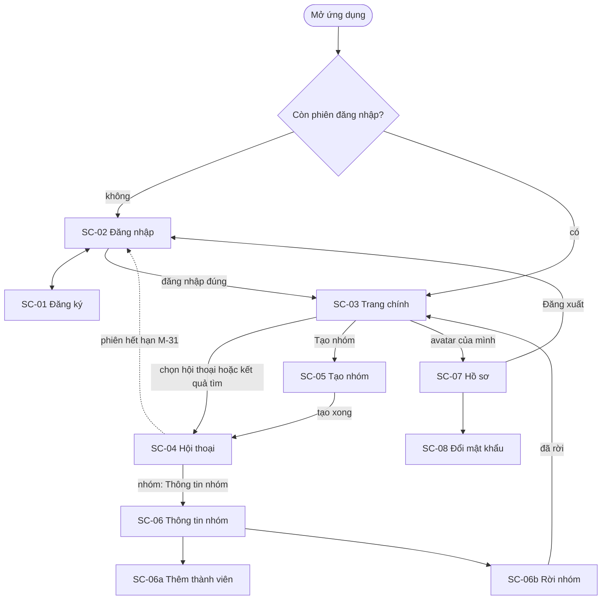
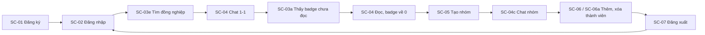

# 10 - Thiết kế trải nghiệm và giao diện (UI/UX)

| Mục | Nội dung |
|---|---|
| Dự án | Ứng dụng chat nội bộ (MVP) – Nhóm: *[chưa xác định]* |
| Tệp | `docs/10-ui-ux.md` |
| Phiên bản | 1.0 – Draft |
| Ngày | 2026-11-14 |
| Người soạn | Nhóm Designer / BA / QA (bản nháp có trợ lý AI hỗ trợ soạn thảo) |
| Trạng thái | Draft – **wireframe chờ duyệt** (mục 13). Bản UI design là bản nháp dựng trên wireframe chưa duyệt |
| Căn cứ | (1) PDF "Xây dựng ứng dụng chat nội bộ (MVP)", ngày 13~14/11/2026 – **nguồn duy nhất của yêu cầu nghiệp vụ**; (2) `01-brd.md` v1.1; (3) `02-srs.md` (bản trên repository ghi v1.0); (4) `03-frs.md` v1.0 – mục 2, 4, 5 (màn hình, trường nhập, thông báo); (5) `04-use-cases.md` v1.1; (6) `05-user-stories.md` v1.0; (7) `09-detailed-design.md` v1.0 – bản nháp **chưa có trên repository** (OQ-27) |
| Tệp đi kèm | `docs/wireframes/wireframe.html` (khung xám, duyệt bố cục) · `docs/ui-design/ui-design.html` (màu sắc, chữ, thành phần theo mục 8) |

**Quy ước ký hiệu**

| Ký hiệu | Ý nghĩa |
|---|---|
| `[PDF]` | Do đề bài quy định. |
| `[QĐ-xx]` / `[GĐ-xx]` / `[GS-xx]` / `[GF-xx]` / `[GT-xx]` | Quyết định / giả định đã ghi ở các tài liệu trước. |
| `[GX-xx]` | Giả định / lựa chọn thiết kế giao diện mới của tài liệu này. Xem mục 14. |
| `[ĐX]` | Đề xuất của nhóm thiết kế, không phải yêu cầu đề bài. |
| `SC-xx` | Mã màn hình trong tài liệu này. **SC-xx trùng số với SCR-xx của `03-frs.md`** (SC-04 = SCR-04). Trạng thái của một màn hình thêm chữ cái: SC-03b, SC-04c… |
| `M-xx` | Câu thông báo, dùng nguyên văn từ `03-frs.md` mục 5. |

> **Không dùng ảnh chụp giả để nghiệm thu.** Wireframe và UI design là **bản vẽ thiết kế**, không phải ảnh sản phẩm đã chạy. Không được đưa ảnh chụp hai file HTML này vào `12-test-reports.md` hay vào bản demo như bằng chứng sản phẩm hoạt động. Bằng chứng nghiệm thu phải là ảnh, video quay **ứng dụng thật** trên môi trường demo.

---

## 1. Nguyên tắc trải nghiệm

| # | Nguyên tắc | Cách kiểm tra | Gắn với |
|---|---|---|---|
| NG-1 | **Bắt đầu chat 1-1 trong tối đa 3 thao tác** sau khi đăng nhập: gõ tên vào ô tìm → chọn người → gõ tin | Đếm số thao tác trên wireframe SC-03e → SC-04 | TK-06, CH-01 `[ĐX]` |
| NG-2 | **Luôn thấy số tin chưa đọc**: trên từng hội thoại, tổng trên đầu trang và trên tiêu đề tab | Badge có mặt ở SC-03 và tiêu đề tab ở mọi trạng thái | TB-01 `[PDF]` |
| NG-3 | **Không mất chữ đang gõ**: lỗi gửi hay mất mạng đều giữ nguyên nội dung và cho "Gửi lại" | Trạng thái SC-04b | CH-02, NFR-13 |
| NG-4 | **Rõ ai nói gì, chuyện gì đã xảy ra**: tin nhóm luôn có tên + avatar người gửi; sự kiện nhóm là dòng tin hệ thống căn giữa | SC-04c | NH-02, NH-04 `[PDF]` |
| NG-5 | **Dùng được bằng bàn phím, trên điện thoại và với chữ tiếng Việt có dấu** | Mục 10, 11 | NFR-08, NFR-10, NFR-12 `[PDF §2, §4]` |

## 2. Persona

> Hai persona dưới đây là **hình mẫu giả định** để nhóm thiết kế có chung hình dung. Không phải người dùng thật, không dựa trên khảo sát hay số liệu nào.

| | Persona 1 – "Nhân viên văn phòng" | Persona 2 – "Người điều phối nhóm" |
|---|---|---|
| Vai trò trong ứng dụng | Người dùng, thành viên nhóm | Trưởng nhóm chat (`[PDF NH-01]`) |
| Thiết bị | Máy tính ở chỗ làm; đôi khi mở bằng điện thoại khi đi họp | Máy tính, màn hình rộng |
| Cần gì | Nhắn nhanh cho đồng nghiệp, không bỏ sót tin, gõ tiếng Việt thoải mái | Lập nhóm theo việc, thêm/bớt người, mọi người biết ai vừa vào/ra nhóm |
| Lo ngại | Gửi rồi mà không biết đã tới chưa; mất tin khi mạng chập chờn | Người đã rời nhóm vẫn đọc được trao đổi |
| Màn hình hay dùng | SC-03, SC-04 | SC-05, SC-06, SC-06a, SC-06b |

## 3. Sitemap

### 3.1 Bảng sitemap

| Mã | Tên màn hình | Loại | Vào từ | Đi tới | Ai thấy | FRS |
|---|---|---|---|---|---|---|
| SC-01 | Đăng ký | Trang | SC-02 | SC-02 | Khách | SCR-01 |
| SC-02 | Đăng nhập | Trang (mặc định khi chưa đăng nhập) | Mở ứng dụng, SC-01, SC-07, phiên hết hạn | SC-03, SC-01 | Khách | SCR-02 |
| SC-03 | Trang chính: danh sách hội thoại, ô tìm đồng nghiệp, nút "Tạo nhóm", badge tổng | Trang (cột trái trên máy tính) | SC-02 | SC-04, SC-05, SC-07 | Người dùng | SCR-03 |
| SC-04 | Hội thoại 1-1 / nhóm | Trang (cột giữa trên máy tính) | SC-03 | SC-06 (nhóm) | Thành viên | SCR-04 |
| SC-05 | Tạo nhóm | Hộp thoại | SC-03 | SC-04 | Người dùng | SCR-05 |
| SC-06 | Thông tin nhóm (quản lý nhóm) | Bảng bên phải trên máy tính; trang riêng trên điện thoại | SC-04 | SC-06a, SC-06b | Thành viên; nút sửa/xóa/thêm chỉ trưởng nhóm | SCR-06 |
| SC-06a | Thêm thành viên | Hộp thoại | SC-06 | SC-06 | Trưởng nhóm | SCR-06a |
| SC-06b | Rời nhóm | Hộp thoại | SC-06 | SC-03 | Thành viên / trưởng nhóm | SCR-06b |
| SC-07 | Hồ sơ cá nhân (đổi tên hiển thị, nút "Đổi mật khẩu", "Đăng xuất") | Trang / bảng | Avatar của mình ở SC-03 | SC-08, SC-02 | Người dùng | SCR-07 |
| SC-08 | Đổi mật khẩu | Hộp thoại | SC-07 | SC-07 | Người dùng | SCR-08 |

### 3.2 Sơ đồ

## 4. Hành trình chính: Đăng ký → Đăng nhập → Chat → Nhóm → Đăng xuất

### 4.1 Bảng hành trình

| Bước | Người dùng làm | Màn hình / trạng thái | Hệ thống phản hồi | Mã |
|---|---|---|---|---|
| 1 | Nhập tên đăng nhập, tên hiển thị, mật khẩu hai lần, mã tổ chức; bấm "Đăng ký" | SC-01 | Thành công: sang SC-02, hiện M-40, điền sẵn tên đăng nhập. Lỗi: hiện dưới từng ô (SC-01b) | TK-01, TK-02, UC-01 |
| 2 | Nhập tên đăng nhập, mật khẩu; Enter | SC-02 | Đúng: vào SC-03. Sai: M-09 (SC-02b) | TK-03, UC-02 |
| 3 | Gõ tên đồng nghiệp vào ô "Tìm đồng nghiệp…" | SC-03e | Kết quả sau khoảng 0,3 giây; không có thì M-14 | TK-06, UC-06 |
| 4 | Chọn một người | SC-04 | Mở hội thoại 1-1 (cũ nếu đã có) | CH-01, UC-07 |
| 5 | Gõ tin có dấu, Enter | SC-04a | Tin hiện ngay; người kia nhận realtime | CH-02, UC-08 |
| 6 | Quay lại danh sách, thấy hội thoại khác có badge | SC-03a | Badge từng dòng, tổng trên đầu trang và tiêu đề tab | CH-06, TB-01, UC-10 |
| 7 | Mở hội thoại có badge | SC-04a | Badge về 0 | TB-01, UC-11 |
| 8 | Bấm "Tạo nhóm", đặt tên, chọn ≥ 2 người | SC-05 | Mở nhóm ở SC-04c, có tin hệ thống "đã tạo nhóm" | NH-01, NH-04, UC-12 |
| 9 | Nhắn trong nhóm | SC-04c | Mỗi tin có tên + avatar người gửi | NH-02, UC-08 |
| 10 | Mở "Thông tin nhóm"; thêm rồi xóa một người | SC-06, SC-06a | Tin hệ thống "đã thêm…", "đã xóa…" | NH-03, NH-04, UC-13, UC-14 |
| 11 | Mở hồ sơ, bấm "Đăng xuất" | SC-07 | Về SC-02; phiên bị hủy | TK-03, UC-03 |

### 4.2 Sơ đồ hành trình

## 5. Danh sách màn hình và trạng thái

### 5.1 Màn hình

| Mã | Tên | Mục đích | Thành phần chính | Mã SRS | Use case | User story |
|---|---|---|---|---|---|---|
| SC-01 | Đăng ký | Tạo tài khoản | Ô: tên đăng nhập, tên hiển thị, mật khẩu (có nút hiện/ẩn), nhập lại, mã tổ chức; danh sách kiểm tra mật khẩu; nút "Đăng ký"; liên kết "Đã có tài khoản? Đăng nhập" | TK-01, TK-02 | UC-01 | US-01, US-02 |
| SC-02 | Đăng nhập | Vào ứng dụng | Ô: tên đăng nhập, mật khẩu; nút "Đăng nhập"; liên kết "Chưa có tài khoản? Đăng ký" | TK-03 | UC-02, UC-03 | US-03, US-04 |
| SC-03 | Trang chính | Thấy mọi hội thoại, tìm người, tạo nhóm | Đầu trang (tên ứng dụng, badge tổng, avatar của mình); ô "Tìm đồng nghiệp…"; nút "Tạo nhóm"; danh sách hội thoại (avatar, tên, trích tin cuối, thời gian, badge) | CH-06, TB-01, TK-06, CH-01 | UC-06, UC-07, UC-10 | US-07, US-08, US-13, US-14 |
| SC-04 | Hội thoại | Đọc và gửi tin | Đầu khung (1-1: avatar + tên; nhóm: tên nhóm, số thành viên, nút "Thông tin nhóm"); khung tin (50 tin/lần, tin hệ thống); ô soạn nhiều dòng, bộ đếm ký tự, nút "Gửi" | CH-02, CH-03, NH-02, NH-04, TB-01 | UC-08, UC-09, UC-11 | US-09, US-10, US-11, US-12, US-15, US-17, US-22 |
| SC-05 | Tạo nhóm | Lập nhóm mới | Ô tên nhóm; ô tìm + thẻ người đã chọn (nút ×); "Đã chọn: n người"; nút "Tạo nhóm", "Hủy" | NH-01 | UC-12 | US-16 |
| SC-06 | Thông tin nhóm | Xem và quản lý thành viên | Tên nhóm + nút sửa (trưởng nhóm); danh sách thành viên có nhãn "Trưởng nhóm"; nút "Xóa" (trưởng nhóm); "Thêm thành viên" (trưởng nhóm); "Rời nhóm" | NH-03, NH-04 | UC-13, UC-14, UC-15, UC-16 | US-18…US-21 |
| SC-06a | Thêm thành viên | Thêm người vào nhóm | Ô tìm (đã loại người trong nhóm); ô đánh dấu "Cho xem tin nhắn trước đó" (mặc định không đánh dấu); nút "Thêm", "Hủy" | NH-03 | UC-13 | US-18 |
| SC-06b | Rời nhóm | Rời nhóm, chuyển quyền nếu là trưởng nhóm | Câu xác nhận M-44; (trưởng nhóm) danh sách chọn trưởng nhóm mới; nút "Rời nhóm", "Hủy" | NH-03 | UC-16 | US-21 |
| SC-07 | Hồ sơ | Đổi tên hiển thị, đăng xuất | Avatar chữ cái; tên đăng nhập (chỉ xem); ô tên hiển thị; nút "Lưu", "Đổi mật khẩu", "Đăng xuất" | TK-05, TK-03 | UC-05, UC-03 | US-06, US-04 |
| SC-08 | Đổi mật khẩu | Đổi mật khẩu | Ô: mật khẩu hiện tại, mật khẩu mới (có danh sách kiểm tra), nhập lại; nút "Đổi mật khẩu", "Hủy" | TK-04, TK-02 | UC-04 | US-05 |

**Kiểm tra độ phủ:** 15/15 mã MVP xuất hiện trên ít nhất một màn hình. UC-17 (từ chối người ngoài) không có màn hình riêng; giao diện chỉ hiện M-30 khi bị từ chối (SC-04f).

### 5.2 Trạng thái giao diện

Mỗi trạng thái có một khung trong `wireframe.html`.

| Mã | Màn hình | Trạng thái | Hiển thị | Mã |
|---|---|---|---|---|
| SC-01a | Đăng ký | Đang nhập | Danh sách kiểm tra mật khẩu đổi dấu ✓ theo từng điều kiện | TK-02 |
| SC-01b | Đăng ký | Lỗi | Lỗi đỏ dưới ô tương ứng (M-01…M-08, M-05); ô lỗi có viền đỏ **và** biểu tượng | TK-01, TK-02 |
| SC-02a | Đăng nhập | Bình thường / đang gửi | Nút khóa, hiện biểu tượng chờ (FRS NT-05) | TK-03 |
| SC-02b | Đăng nhập | Lỗi | M-09 phía trên nút; hoặc M-31 khi bị đẩy ra do hết phiên | TK-03 |
| SC-03a | Trang chính | Có hội thoại, có tin chưa đọc | Dòng có tin chưa đọc: tên đậm + badge số; hiện "99+" khi > 99; badge tổng ở đầu trang; tiêu đề tab "(5) Chat nội bộ" | CH-06, TB-01 |
| SC-03b | Trang chính | Rỗng | M-23 kèm mũi tên chỉ tới ô tìm | CH-06 |
| SC-03c | Trang chính | Đang tải | 5 dòng khung xám (skeleton) | CH-06 |
| SC-03d | Trang chính | Lỗi tải | M-24 kèm nút "Thử lại" | CH-06 |
| SC-03e | Trang chính | Đang tìm người | Danh sách kết quả (tối đa 20) thay chỗ danh sách hội thoại; không có kết quả: M-14 | TK-06 |
| SC-04a | Hội thoại 1-1 | Bình thường | Tin của mình bên phải, người kia bên trái; dòng ngày; đang tải tin cũ ở đầu khung; hết lịch sử: M-21 | CH-02, CH-03 |
| SC-04b | Hội thoại | Gửi lỗi / mất kết nối | Thanh vàng M-33 ở đầu khung; tin lỗi có biểu tượng ⚠, M-20 và nút "Gửi lại" | CH-02, NFR-13 |
| SC-04c | Hội thoại nhóm | Bình thường | Tên + avatar cạnh **mỗi** tin người khác (GF-16); tin hệ thống căn giữa, chữ nhỏ, màu xám | NH-02, NH-04 |
| SC-04d | Hội thoại | Tin dài | Bộ đếm "4.812 / 5.000" khi > 4.500; > 5.000: bộ đếm đỏ, M-17, nút "Gửi" khóa | CH-02 |
| SC-04e | Hội thoại | Có tin mới khi đang đọc tin cũ | Nút "Có tin nhắn mới ↓" (GF-15); lỗi tải tin cũ: M-22 + "Thử lại" | CH-03 |
| SC-04f | Hội thoại | Bị từ chối / bị xóa khỏi nhóm | M-30 (không tìm thấy hoặc không có quyền) hoặc M-32 (bị xóa), rồi về SC-03 | NFR-04, NH-03 |
| SC-05a | Tạo nhóm | Chưa đủ người | Nút "Tạo nhóm" khóa; gợi ý M-26 | NH-01 |
| SC-06a-o | Thông tin nhóm | Trưởng nhóm xem | Có nút sửa tên, "Xóa", "Thêm thành viên" | NH-03 |
| SC-06a-m | Thông tin nhóm | Thành viên thường xem | Chỉ thấy danh sách và "Rời nhóm" | NH-03 |
| SC-06b | Rời nhóm | Trưởng nhóm rời | Bắt buộc chọn trưởng nhóm mới; chưa chọn thì nút khóa (M-37); một mình thì M-28 | NH-03 |

Trạng thái chung mọi màn hình: **hết phiên** → thông báo M-31, về SC-02 (TK-03); **lỗi kết nối máy chủ** → M-34 dạng thông báo nổi (toast).

## 6. Wireframe low-fidelity

- Tệp: **`docs/wireframes/wireframe.html`** – một file HTML, không dùng thư viện ngoài, mở trực tiếp bằng trình duyệt.
- Chỉ dùng trắng, đen, xám; khung chữ nhật + nhãn; mỗi màn hình hoặc trạng thái là một khung có tiêu đề SC-xx; chú thích số ①②③ giải thích thành phần.
- Có khung máy tính (≥ 1024 px, 3 cột) và khung điện thoại (390 px, 1 cột).
- Mục đích: **duyệt bố cục và luồng**, chưa duyệt màu. Duyệt theo mục 13.

## 7. Bố cục responsive (web, không phải ứng dụng điện thoại)

PDF yêu cầu web responsive, không yêu cầu ứng dụng điện thoại `[PDF §1, §2]`. Các mốc chiều rộng là lựa chọn thiết kế `[GX-01]`.

| Chiều rộng | Bố cục | Điều hướng |
|---|---|---|
| ≥ 1024 px (máy tính) | **3 cột**: SC-03 danh sách (320 px) · SC-04 hội thoại (phần còn lại) · SC-06 thông tin nhóm (320 px, chỉ hiện khi bấm "Thông tin nhóm") | Bấm hội thoại đổi cột giữa; danh sách luôn thấy |
| 768–1023 px (máy tính bảng, cửa sổ hẹp) | **2 cột**: danh sách (280 px) · hội thoại. SC-06 mở thành bảng trượt phủ lên cột hội thoại | Như trên |
| < 768 px (điện thoại) | **1 cột**: mỗi lúc chỉ một màn hình SC-03 → SC-04 → SC-06 | Nút "← Quay lại" ở đầu SC-04, SC-06; hộp thoại SC-05, SC-06a, SC-06b, SC-08 phủ toàn màn hình |

Quy tắc chung: không có thanh cuộn ngang ở 360 px (NFR-12 đo ở 360 / 768 / 1280 px); vùng bấm tối thiểu 44 × 44 px trên điện thoại `[ĐX]`; ô soạn tin bám đáy màn hình và không bị bàn phím ảo che `[ĐX]`.

## 8. Đặc tả giao diện chi tiết (design token)

Các giá trị dưới đây là **lựa chọn thiết kế** `[GX-02]`. `ui-design.html` phải dùng đúng các giá trị này (khai báo thành biến CSS cùng tên).

### 8.1 Màu sắc

Độ tương phản tính theo công thức WCAG 2.1 trên cặp chữ/nền thực dùng. Yêu cầu AA: chữ thường ≥ 4,5:1; thành phần giao diện và viền ô nhập ≥ 3:1.

| Token | Hex | Dùng cho | Tương phản (cặp kiểm tra) |
|---|---|---|---|
| `--color-primary` | `#1D4ED8` | Nút chính, liên kết, bong bóng tin của mình | Chữ trắng trên nền này 6,70:1 |
| `--color-primary-hover` | `#1E40AF` | Nút chính khi rê chuột / bấm | Chữ trắng 8,72:1 |
| `--color-focus` | `#2563EB` | Viền focus 2 px | So nền trắng 5,17:1 |
| `--color-bg` | `#FFFFFF` | Nền trang, khung chat | – |
| `--color-surface` | `#F3F4F6` | Cột danh sách, bong bóng tin người khác | Chữ chính 16,12:1 |
| `--color-selected` | `#DBEAFE` | Hội thoại đang mở | Chữ chính 14,54:1 |
| `--color-text` | `#111827` | Chữ chính | Trên nền trắng 17,74:1 |
| `--color-text-secondary` | `#4B5563` | Thời gian, trích tin cuối, tin hệ thống | Nền trắng 7,56:1; nền surface 6,87:1 |
| `--color-text-muted` | `#6B7280` | Placeholder, chữ gợi ý; viền ô nhập | Nền trắng 4,83:1 |
| `--color-border` | `#E5E7EB` | Đường kẻ phân cách (trang trí, không mang thông tin) | – |
| `--color-badge` | `#C81E1E` | Nền badge chưa đọc | Chữ trắng 5,74:1 |
| `--color-error` | `#B91C1C` | Chữ lỗi, viền ô lỗi, nút nguy hiểm ("Xóa", "Rời nhóm") | Nền trắng 6,47:1; nền `--color-error-bg` 5,91:1 |
| `--color-error-bg` | `#FEF2F2` | Nền tin gửi lỗi, hộp lỗi | – |
| `--color-success` | `#15803D` | Thông báo thành công, dấu ✓ quy tắc mật khẩu | Nền trắng 5,02:1 |
| `--color-warning-bg` / `--color-warning-text` | `#FEF3C7` / `#92400E` | Thanh "Mất kết nối…" | 6,37:1 |
| `--color-disabled-bg` / `--color-disabled-text` | `#E5E7EB` / `#6B7280` | Nút / ô bị khóa | 3,90:1 – WCAG miễn yêu cầu với thành phần bị vô hiệu hóa; vẫn kèm con trỏ "không được" và thuộc tính `disabled` |
| `--avatar-1`…`--avatar-6` | `#1D4ED8`, `#0F766E`, `#7C3AED`, `#B45309`, `#BE185D`, `#4D7C0F` | Nền avatar chữ cái; chọn theo `id % 6` | Chữ trắng: 6,70 / 5,47 / 5,70 / 5,02 / 6,04 / 4,99:1 |

Không dùng **chỉ màu** để truyền thông tin: hội thoại chưa đọc vừa có badge số vừa in đậm tên; ô lỗi vừa viền đỏ vừa có câu lỗi; tin gửi lỗi có biểu tượng ⚠ và chữ M-20.

### 8.2 Chữ (typography)

| Token | Giá trị | Ghi chú |
|---|---|---|
| `--font-family` | `system-ui, -apple-system, "Segoe UI", Roboto, "Noto Sans", "Helvetica Neue", Arial, sans-serif` | Phông hệ thống, có đủ chữ tiếng Việt trên Windows, macOS, Android, iOS; không tải phông từ Internet `[GX-03]` |
| `--font-size-xs` | 12 px | Thời gian dưới tin, chữ trong badge |
| `--font-size-sm` | 14 px | Trích tin cuối, tin hệ thống, chữ gợi ý, câu lỗi |
| `--font-size-md` | 16 px | Chữ thường, nội dung tin, ô nhập (16 px tránh trình duyệt điện thoại tự phóng to khi bấm vào ô) |
| `--font-size-lg` | 20 px | Tiêu đề khung hội thoại, tên nhóm |
| `--font-size-xl` | 24 px | Tiêu đề trang đăng ký / đăng nhập |
| `--font-weight-regular` / `--font-weight-bold` | 400 / 600 | Tên hội thoại chưa đọc dùng 600 |
| `--line-height` | 1.5 | Đủ chỗ cho dấu chồng của tiếng Việt (ví dụ "Ẩ", "ỗ") không bị cắt |

### 8.3 Khoảng cách, bo góc, kích thước (lưới 8 px)

| Token | Giá trị | Token | Giá trị |
|---|---|---|---|
| `--space-1` | 4 px (nửa bước, chỉ dùng trong thành phần nhỏ) | `--radius-sm` | 4 px (ô nhập, nút) |
| `--space-2` | 8 px | `--radius-md` | 8 px (thẻ, hộp thoại) |
| `--space-3` | 16 px | `--radius-lg` | 16 px (bong bóng tin) |
| `--space-4` | 24 px | `--radius-full` | 999 px (badge, avatar) |
| `--space-5` | 32 px | `--size-avatar` | 40 px (danh sách), 32 px (cạnh tin nhóm) |
| `--space-6` | 48 px | `--size-touch` | 44 px (chiều cao tối thiểu nút, dòng danh sách) |
| `--width-sidebar` | 320 px | `--width-bubble-max` | 70% chiều rộng khung chat |

### 8.4 Thành phần và trạng thái

| Thành phần | Mặc định | Rê chuột (hover) | Focus (bàn phím) | Bị khóa (disabled) | Lỗi / đặc biệt |
|---|---|---|---|---|---|
| Nút chính | Nền `primary`, chữ trắng, bo 4 px, cao 44 px | Nền `primary-hover` | Viền ngoài 2 px `focus`, cách 2 px | Nền/chữ `disabled`; không bấm được | Đang gửi: chữ "Đang xử lý…" + biểu tượng quay, khóa nút |
| Nút phụ | Nền trắng, viền `text-muted`, chữ `text` | Nền `surface` | Như trên | Như trên | – |
| Nút nguy hiểm ("Xóa", "Rời nhóm") | Nền `error`, chữ trắng | Tối hơn 10% | Như trên | Như trên | Luôn có hộp xác nhận (M-43, M-44) |
| Ô nhập | Viền 1 px `text-muted`, nền trắng, cao 44 px, nhãn phía trên | Viền `text` | Viền 2 px `focus` | Nền `disabled-bg` | Viền 2 px `error` + câu lỗi đỏ dưới ô, nối với ô bằng `aria-describedby` |
| Ô đánh dấu | 20 px, nhãn bên phải bấm được | – | Viền focus | – | – |
| Avatar chữ cái | Tròn, nền `avatar-n`, chữ trắng in hoa giữ dấu (GS-11) | – | – | – | Có `aria-hidden`; tên đọc từ chữ cạnh bên |
| Badge chưa đọc | Tròn/viên thuốc, nền `badge`, chữ trắng 12 px, tối thiểu 20 px | – | – | Ẩn khi 0 | > 99 hiện "99+"; có `aria-label="5 tin chưa đọc"` |
| Dòng hội thoại | Cao 72 px: avatar · tên + trích tin · thời gian + badge | Nền `surface` | Viền focus | – | Đang mở: nền `selected`; chưa đọc: tên đậm 600 |
| Bong bóng tin của mình | Nền `primary`, chữ trắng, căn phải | – | – | – | Đang chờ: giữ nguyên màu (không làm mờ, để đủ tương phản), nhãn nghiêng "đang gửi…" thay giờ; **lỗi**: nền `error-bg`, viền `error`, chữ `text`, ⚠ + M-20 + nút "Gửi lại" |
| Bong bóng tin người khác | Nền `surface`, chữ `text`, căn trái; nhóm: tên + avatar 32 px | – | – | – | – |
| Tin hệ thống | Căn giữa, chữ 14 px `text-secondary`, không avatar, kèm giờ | – | – | – | – |
| Ô soạn tin | Nhiều dòng, tự giãn tới ~6 dòng; nút "Gửi" bên phải | – | Viền focus | – | > 4.500: bộ đếm; > 5.000: bộ đếm đỏ, M-17, nút "Gửi" khóa |
| Thanh mất kết nối | Nền/chữ `warning`, chiếm cả chiều ngang đầu khung | – | – | – | M-33; tự ẩn khi nối lại |
| Thông báo nổi (toast) | Góc dưới, tự ẩn sau vài giây; lỗi thì giữ tới khi đóng | – | Nút đóng nhận focus | – | Vùng `aria-live` |
| Hộp thoại | Nền trắng, bo 8 px, lớp phủ mờ phía sau | – | Focus vào ô đầu tiên khi mở; Tab không ra khỏi hộp; Esc đóng | – | Trên điện thoại: phủ toàn màn hình |
| Khung xám đang tải (skeleton) | Khối `surface` có hiệu ứng nhạt dần | – | – | – | Tắt hiệu ứng khi người dùng chọn "giảm chuyển động" |

### 8.5 Tệp UI design

- Tệp: **`docs/ui-design/ui-design.html`** – HTML tĩnh, CSS nội tuyến, chỉ dùng token ở mục 8; dữ liệu mẫu tiếng Việt có dấu là **dữ liệu giả lập**.
- Thể hiện: badge từng hội thoại và tổng trên đầu trang (và mẫu tiêu đề tab); tin hệ thống trong nhóm; avatar chữ cái; tên người gửi trong nhóm; tin gửi lỗi với "Gửi lại"; thanh mất kết nối; trạng thái hover/focus/disabled/lỗi của nút và ô nhập; khung điện thoại 390 px cho trang chính.
- Có dòng chữ "MẪU THIẾT KẾ – không phải ảnh sản phẩm đang chạy" ở đầu trang.

## 9. Hỗ trợ tiếng Việt và Unicode

| Nội dung | Cách làm | Nguồn |
|---|---|---|
| Khai báo ngôn ngữ | `<html lang="vi">`; mã hóa UTF-8 | NFR-08, NFR-10 |
| Phông chữ | Phông hệ thống (mục 8.2); `line-height` 1.5 để dấu không bị cắt | `[GX-03]` |
| Gõ tiếng Việt bằng bộ gõ | Khi bộ gõ đang ghép chữ (`event.isComposing` là đúng), phím Enter **không** gửi tin | `[GX-04]` – tránh gửi nhầm chữ đang ghép dở |
| Đếm ký tự | Bộ đếm "n / 5.000" dùng đúng hàm `countChars` của `09` mục 4.1 (đếm sau chuẩn hóa NFC) | `[PDF CH-02]`, `[OQ-24]` |
| Xuống dòng, dòng trống | Hiển thị nguyên văn (`white-space: pre-wrap`); chữ dài không có khoảng trắng tự xuống dòng (`overflow-wrap: anywhere`) | `[PDF CH-02]` |
| Ký tự đặc biệt | Hiện như chữ thường; không chuyển thành định dạng hay liên kết | CH-02 R6, `[GF-14]` |
| Cắt bớt | Trích tin cuối và tên dài cắt bằng CSS `text-overflow: ellipsis` (không cắt giữa chữ có dấu) | `[GS-25]` |
| Avatar | Chữ cái đầu của **từ cuối** tên hiển thị, in hoa, giữ dấu: "Nguyễn Văn Ẩn" → "Ẩ" | `[GS-11]` |
| Số và ngày | Số có dấu chấm ngăn nghìn ("5.000"); thời gian "14:05", "Hôm qua", "dd/mm/yyyy" | `[GS-26]` |

## 10. Trợ năng (accessibility)

| Nội dung | Yêu cầu thiết kế | Mức |
|---|---|---|
| Tương phản | Mọi cặp chữ/nền ở mục 8.1 ≥ 4,5:1; viền ô nhập, viền focus ≥ 3:1 | WCAG 2.1 AA `[ĐX]` |
| Bàn phím | Mọi thao tác làm được bằng Tab / Shift+Tab / Enter / Space / Esc. Thứ tự Tab theo thứ tự đọc: đầu trang → ô tìm → "Tạo nhóm" → danh sách → khung tin → ô soạn → "Gửi" | `[ĐX]` |
| Phím tắt chat | Enter gửi, Shift+Enter xuống dòng (máy tính) `[GF-10]`; Esc đóng hộp thoại | FRS-08 |
| Focus | Luôn thấy viền focus (`:focus-visible`, 2 px `--color-focus`); mở hộp thoại thì focus vào ô đầu tiên, đóng thì trả focus về nút đã mở | `[ĐX]` |
| Nhãn | Mỗi ô nhập có `<label>` thật; nút chỉ có biểu tượng có `aria-label` (ví dụ "Gửi tin nhắn", "Hiện mật khẩu") | `[ĐX]` |
| Lỗi | Câu lỗi nối với ô bằng `aria-describedby`; ô lỗi có `aria-invalid="true"`; lỗi chung đặt trong vùng `role="alert"` | `[ĐX]` |
| Tin mới | Khung tin là vùng `role="log"` với `aria-live="polite"`; badge có `aria-label` đọc số chưa đọc | TB-01 |
| Phóng to | Dùng được khi phóng to trình duyệt 200% | `[ĐX]` |
| Chuyển động | Tôn trọng `prefers-reduced-motion` (tắt hiệu ứng skeleton, cuộn mượt) | `[ĐX]` |

## 11. Câu chữ giao diện (microcopy)

Câu thông báo M-xx dùng **nguyên văn** từ `03-frs.md` mục 5; bảng dưới chỉ ghi nơi dùng. Nhãn và placeholder là đề xuất `[ĐX]`.

### 11.1 Nhãn, nút, placeholder

| Màn hình | Thành phần | Chữ |
|---|---|---|
| Chung | Tên ứng dụng / tiêu đề tab | "Chat nội bộ" · có tin chưa đọc: "(5) Chat nội bộ" `[GĐ-15]` |
| SC-01 | Tiêu đề / nút / liên kết | "Tạo tài khoản" · "Đăng ký" · "Đã có tài khoản? Đăng nhập" |
| SC-01 | Nhãn ô | "Tên đăng nhập" · "Tên hiển thị" · "Mật khẩu" · "Nhập lại mật khẩu" · "Mã đăng ký tổ chức" |
| SC-01 | Placeholder / gợi ý | "vd: an.nguyen" · "vd: Nguyễn Văn An" · gợi ý dưới tên đăng nhập: "3–30 ký tự: a–z, 0–9, dấu chấm, gạch dưới" |
| SC-01, SC-08 | Danh sách kiểm tra mật khẩu | "Ít nhất 8 ký tự" · "Có chữ cái" · "Có chữ số" |
| SC-01, SC-02, SC-08 | Nút hiện/ẩn mật khẩu | `aria-label`: "Hiện mật khẩu" / "Ẩn mật khẩu" |
| SC-02 | Tiêu đề / nút / liên kết | "Đăng nhập" · "Đăng nhập" · "Chưa có tài khoản? Đăng ký" |
| SC-03 | Ô tìm / nút | "Tìm đồng nghiệp…" · "Tạo nhóm" |
| SC-03 | Trích tin | Nhóm: "Tên người gửi: nội dung"; tin của mình: "Bạn: nội dung"; tin hệ thống: chữ nghiêng `[GS-25]` |
| SC-03 | Thời gian | "14:05" · "Hôm qua" · "12/11/2026" `[GS-26]` |
| SC-04 | Ô soạn / nút | "Nhập tin nhắn…" · "Gửi" |
| SC-04 | Đầu khung nhóm | "Phòng Kế hoạch · 4 thành viên" · nút "Thông tin nhóm" |
| SC-04 | Nút cuộn | "Có tin nhắn mới ↓" `[GF-15]` |
| SC-04 | Nhóm ngày | "Hôm nay" · "Hôm qua" · "Thứ Năm, 12/11/2026" `[ĐX]` |
| SC-05 | Tiêu đề / nhãn / nút | "Tạo nhóm" · "Tên nhóm" · "Thêm thành viên" · "Đã chọn: 2 người" · "Tạo nhóm" · "Hủy" |
| SC-06 | Tiêu đề / nhãn / nút | "Thông tin nhóm" · "Thành viên (4)" · nhãn "Trưởng nhóm" · "Thêm thành viên" · "Xóa" · "Rời nhóm" |
| SC-06a | Nhãn / nút | "Cho xem tin nhắn trước đó" · "Thêm" · "Hủy" |
| SC-06b | Tiêu đề / nhãn / nút | "Rời nhóm" · (trưởng nhóm) "Chọn trưởng nhóm mới" · "Rời nhóm" · "Hủy" |
| SC-07 | Nhãn / nút | "Tên đăng nhập" · "Tên hiển thị" · "Lưu" · "Đổi mật khẩu" · "Đăng xuất" |
| SC-08 | Nhãn / nút | "Mật khẩu hiện tại" · "Mật khẩu mới" · "Nhập lại mật khẩu mới" · "Đổi mật khẩu" · "Hủy" |

### 11.2 Thông báo theo màn hình

| Màn hình | Thông báo dùng |
|---|---|
| SC-01 | M-01, M-02, M-03, M-04, M-05, M-06, M-07, M-08, M-34; thành công M-40 (hiện ở SC-02) |
| SC-02 | M-09, M-31, M-34, M-35, M-40 |
| SC-03 | M-14, M-15, M-16, M-23, M-24, M-30, M-34 |
| SC-04 | M-17, M-20, M-21, M-22, M-30, M-31, M-32, M-33, M-34; câu tin trống của `09` (`MESSAGE_EMPTY`, chờ OQ-38) – thực tế nút "Gửi" đã khóa nên ít gặp |
| SC-05 | M-25, M-26, M-27, M-34 |
| SC-06, SC-06a, SC-06b | M-25, M-28, M-29, M-36, M-37, M-43, M-44; câu mới chờ duyệt ở `09` (`TARGET_NOT_MEMBER`, `CANNOT_REMOVE_SELF`) – OQ-38 |
| SC-07 | M-03, M-42 |
| SC-08 | M-04, M-06, M-07, M-08, M-10, M-11, M-41 |

## 12. Truy vết màn hình → mã SRS → use case → user story

| Mã SRS | Màn hình / trạng thái | Use case | User story |
|---|---|---|---|
| TK-01 | SC-01, SC-01b | UC-01 | US-01 |
| TK-02 | SC-01a, SC-01b, SC-08 | UC-01, UC-04 | US-02 |
| TK-03 | SC-02, SC-02b, SC-07 (Đăng xuất), trạng thái hết phiên | UC-02, UC-03 | US-03, US-04 |
| TK-04 | SC-08 | UC-04 | US-05 |
| TK-05 | SC-07 | UC-05 | US-06 |
| TK-06 | SC-03e, SC-05, SC-06a | UC-06 | US-07 |
| CH-01 | SC-03e → SC-04 | UC-07 | US-08 |
| CH-02 | SC-04a, SC-04b, SC-04d | UC-08 | US-09, US-10 |
| CH-03 | SC-04a, SC-04e | UC-09 | US-11, US-12 |
| CH-06 | SC-03a…SC-03d | UC-10 | US-13 |
| NH-01 | SC-05, SC-05a | UC-12 | US-16 |
| NH-02 | SC-04c | UC-08 | US-17 |
| NH-03 | SC-06, SC-06a, SC-06b, SC-04f | UC-13…UC-16 | US-18…US-21 |
| NH-04 | SC-04c (tin hệ thống) | UC-12…UC-16 | US-22 |
| TB-01 | SC-03a (badge, tiêu đề tab), SC-04a (về 0) | UC-10, UC-11 | US-14, US-15 |
| NFR-04 | SC-04f | UC-17 | US-23 |
| NFR-12 | Khung điện thoại ở cả hai file HTML | – | US-26 |
| NFR-13 (khuyến khích) | SC-04b | UC-08 | US-27 |

**Ngoài MVP – không có trên giao diện** `[QĐ-01]`: nhãn "đã gửi / đã nhận / đã xem" (CH-04), chấm online (CH-05), "đã xem bởi n người" (NH-05), thông báo bật lên của trình duyệt (TB-03), bộ chọn emoji, reaction, đính kèm, trả lời trích dẫn, "đang nhập…" (TN-01…TN-07), sửa/thu hồi tin (TN-10…TN-14), quên mật khẩu (TK-07…11), màn hình quản trị (QT-01, QT-02). Người dùng vẫn gõ được emoji bằng bàn phím hệ điều hành.

## 13. Duyệt wireframe trước khi viết mã

PDF không yêu cầu bước duyệt này; đây là quy trình nhóm đề xuất `[ĐX]`. **Chưa được duyệt thì không bắt đầu viết mã giao diện.**

Cách duyệt:

1. Mở `docs/wireframes/wireframe.html` bằng Chrome, Edge, Firefox hoặc Safari.
2. Với từng khung SC-xx: đối chiếu với bảng mục 5 và với FRS mục 4 (đủ trường, đủ nút, đúng chữ).
3. Đi hết hành trình mục 4.1 trên wireframe: có màn hình nào thiếu, có bước nào phải đoán không?
4. Ghi ý kiến vào bảng dưới; sửa xong thì đổi trạng thái tài liệu.

| Người duyệt | Vai trò | Ngày | Kết quả (Duyệt / Duyệt có sửa / Chưa duyệt) | Ý kiến |
|---|---|---|---|---|
| | Product Owner | | Chưa duyệt | |
| | Đại diện người học / người dùng | | Chưa duyệt | |
| | QA | | Chưa duyệt | |

## 14. ASSUMPTIONS – Giả định của tài liệu này

| Mã | Giả định | Áp dụng | Câu hỏi |
|---|---|---|---|
| GX-01 | Mốc responsive: ≥ 1024 px 3 cột; 768–1023 px 2 cột; < 768 px 1 cột | Mục 7 | OQ-40 |
| GX-02 | Bảng màu, cỡ chữ, khoảng cách ở mục 8 là lựa chọn của nhóm; không dùng logo hay hình ảnh thương hiệu nào | Mục 8 | – |
| GX-03 | Dùng phông hệ thống, không tải phông (ví dụ Inter) từ Internet | Mục 8.2 | OQ-41 |
| GX-04 | Enter không gửi tin khi bộ gõ tiếng Việt đang ghép chữ | Mục 9 | – |
| GX-05 | Trên máy tính, SC-06 Thông tin nhóm là cột thứ ba bên phải; trên điện thoại là màn hình riêng | Mục 3, 7 | OQ-40 |
| GX-06 | Màu avatar chọn theo mã người dùng (`id % 6`), cố định cho mỗi người | Mục 8.1 | – |
| GX-07 | Tin của chính mình trong nhóm không hiện tên người gửi | SC-04c | – |
| GX-08 | Dữ liệu mẫu trong wireframe và UI design (tên người, tin nhắn) là dữ liệu giả lập | Mục 6, 8.5 | – |

## 15. OPEN QUESTIONS – Câu hỏi mở

| Mã | Câu hỏi | Giả định tạm | Ảnh hưởng | Người phụ trách |
|---|---|---|---|---|
| OQ-39 | Ai duyệt wireframe (mục 13), hạn duyệt khi nào? UI design hiện dựng trên wireframe chưa duyệt | Bảng mục 13 để trống | Thời điểm bắt đầu viết mã giao diện | DungNQ |
| OQ-40 | Trên máy tính, "Thông tin nhóm" là cột thứ ba (như hiện tại) hay hộp thoại? Mốc 768 / 1024 px được chấp nhận không? | GX-01, GX-05 | Bố cục SC-06 | DungNQ |
| OQ-41 | Có cần phông chữ riêng (ví dụ Inter, đóng gói cùng ứng dụng) hay dùng phông hệ thống? | GX-03 | Hình thức chữ giữa các máy | DungNQ |
| OQ-38 | (Kế thừa từ `09`) Duyệt câu thông báo mới chưa có trong FRS | Câu `[ĐX]` của `09` | Mục 11.2 | DungNQ |
| OQ-37 | (Kế thừa từ `09`) Phiên hết hạn cứng 8 giờ; giao diện chỉ báo M-31 khi đã hết, không cảnh báo trước | GT-11 | Trạng thái hết phiên | DungNQ |
